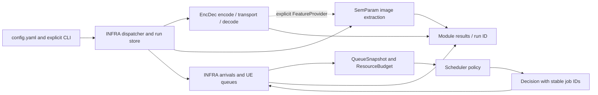

# Project map

## Read this first

This rebuild replaces stage-based implementation ownership. Existing stage imports remain aliases for compatibility. Source is Python 3.12, local Git and the existing GitHub remote; large assets stay in configured shared storage. New work is not remotely reproducible until its commit is pushed.

| Module | Inputs → outputs | Important files | Boundary / acceptance |
|---|---|---|---|
| EncDec | RGB tensor/image → encoded representation → reconstructed image; benchmark rows | `runtime.py`, `catalog.py`, `Evaluation/kodak_benchmark.py`, `Models/`, `Codebooks/`, `training.py` | Owns codecs and communication VQ; Kodak keeps 24 images, schema and append dedup |
| SemParam | image or explicit feature provider + task/context → provenanced ParameterValue bundle | `runtime.py`, `pipeline.py`, `Codebooks/pipeline.py`, `clip_backbone.py`, `evaluation/coverage.py` | Image path loads no codec; missing values remain unavailable |
| Scheduler | immutable QueueSnapshot + ResourceBudget → Decision | `policies.py`, `fixtures.py`, `evaluation/report.py` | No neural imports; deterministic selection; no queue mutation |
| INFRA | root config + jobs/modules → simulation traces + run artifacts | `configuration.py`, `contracts.py`, `simulation.py`, `runs.py`, `cli.py`, `workers.py` | Owns arrivals, clock, deadlines, queues, transport and persistence |

Each module owns its README, config defaults, environment requirements, tests, evaluation and active notebooks. Modules have maintainers by responsibility, not hardcoded personal names. Coordinate changes to INFRA contracts with consumers and add integration tests.

## Control and data flow

The current synthetic INFRA fixture exercises scheduling contracts. Real images are not automatically assigned emergency priorities. Full wireless system integration and classifier/class-priority calibration remain future work.

## Key contracts and units

`INFRA/contracts.py`: frozen Job, QueueSnapshot, ResourceBudget and Decision. A job contains stable job/image/UE IDs, arrival time (ms), resource demand, class and optional deadline. Budget explicitly chooses complex channel uses or digital bits. One selected job completes at slot end. No partial transmission. Overlarge jobs remain pending/expire. Jobs whose deadlines are at/before current time expire; completion exactly on the deadline succeeds.

`INFRA/Artifacts/`: retained tensor/semantic contracts. `INFRA/features.py`: injected feature provider. SemParam values keep availability, evidence source, version and provenance. Semantic codebooks remain separate from EncDec communication codebooks.

`EncDec/Evaluation/kodak_benchmark.py`: BenchmarkCodec encode/decode/complexity, EncodedSample(state, payload_bits, channel_uses, metadata). Payload bits and channel uses may be absent. Float tensor storage is a diagnostic, never radio traffic. CSV v1 columns/dedup are retained; new outcomes JSON supplies errors and stage timings. Legacy decode timing includes transport; explicit per-stage times are recorded for EncDecCodec.

## Extend the system

1. Codec: implement BenchmarkCodec or adapt EncDecInterface with EncDecCodec; declare catalog capabilities, preprocessing, checkpoint identity and environment. Add a round-trip test. Use `INFRA/workers.py` with a pinned external factory for incompatible environments.
2. Extractor: return ParameterValue records through the existing bundle contract; use an injected embedding/feature provider; test unavailable evidence and knowledge query-before-record.
3. Policy: expose `name`, `reset()`, `decide(snapshot,budget)`; return Decision; register the name and test empty/tie/budget/arrival/deadline/replay cases. Policies own only their internal state.
4. Simulation/transport: implement under INFRA, preserving resource units and timing boundaries. Do not put simulation queue mutations in a policy.

## Validation and limits

See `docs/VALIDATION_REPORT.md` for measured checks and model availability, `docs/REBUILD_GUIDE.md` for reproducible commands, `docs/MIGRATION_MAP.md` for source moves, and `docs/NOTEBOOK_MIGRATION.md` for preserved notebooks.

RL, AIDER labeling, classifier training, NS-3/system-level wireless, TPU/XLA and a finalized semantic priority rule are not implemented by this rebuild. Existing explicit unavailable placeholders are retained. Training portability is implemented; full training/convergence on T4/P100/A100/dual GPU is not asserted from CPU tests.
