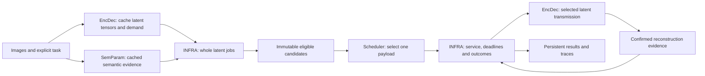

# Semantic-aware image latent scheduler

A four-component research system that chooses **which complete image latent payload to transmit next**. The main path schedules latents, not UEs. Static batches are the current focus; explicit job arrivals use the same lifecycle engine. Older UE experiments remain separate references.

## Start here

```powershell
python -m pip install -e ".[scheduler,test,notebook]"
python -m INFRA.latent.cli --batch Scheduler/config/static_latent_demo.json
python -m pytest -q -p no:cacheprovider
```

Python 3.12 is the declared environment. The static demo is an explicitly synthetic functional fixture: no dataset, checkpoint, CLIP download or GPU is required. After installation, `latent-scheduler` is equivalent to `python -m INFRA.latent.cli`. Old flat script commands remain compatible.

## Four owners

| Component | Responsibility | Main packages |
|---|---|---|
| **INFRA** | Contracts, arrivals, time, deadlines, transport orchestration, logs and results | `latent/`, `scheduling/`, `data/`, `learning/`, `Channels/`, `Transport/` |
| **EncDec** | Models, communication codebooks, reconstruction and codec benchmarks | `Models/`, `Codebooks/`, `Baselines/`, `Evaluation/`, `integration/`, `Research/` |
| **SemParam** | Image/task evidence, semantic codebooks, receiver knowledge and serialization | `features/`, `history/`, `headers/`, `KnowledgeBases/`, `Codebooks/` |
| **Scheduler** | Selection policies over immutable candidates | `latent/`, `baselines/`, `semantic/` |

Scheduler never imports a codec or neural framework. INFRA owns lifecycle mutation. Image-only extraction needs no codec checkpoint. Communication and semantic codebooks have separate owners.

## Whole-latent flow



The static comparison includes FIFO, SJF, EDF, priority FIFO, priority EDF and semantic selection. Priority policies first gate on the highest eligible explicit/predicted class. Semantic selection combines task relevance, confirmed receiver novelty, importance, urgency and service cost. Missing evidence remains visible as unavailable. This is a declared heuristic, not a novelty or performance claim.

## Repository layout

```text
INFRA/latent/          contracts, lifecycle, metrics, experiment and CLI
INFRA/scheduling/      earlier slotted and five-UE simulation
INFRA/data/            manifests, feature caches and dataset bundles
INFRA/learning/        earlier classifier and DQN training
EncDec/                codecs, communication codebooks and integration
SemParam/features/     image/task extraction and cached predictions
SemParam/history/      confirmed delivery knowledge
SemParam/headers/      semantic serialization
Scheduler/latent/      whole-latent policies
Scheduler/baselines/   earlier fixture baselines
Scheduler/semantic/    earlier semantic/DQN policy interface
scripts/               utilities grouped by purpose
src/, semcom_benchmark/ compatibility imports
Notebooks/, Archived/  historical and teammate reference material
data/, models/         shared datasets and assets
references/, external/ pinned checkpoint/upstream source
results/               persistent run artifacts and historical evidence
docs/                  indexed architecture and research records
```

Old flat module paths are aliases to the same canonical module/class objects, not duplicate implementations. Edit the packages above. Downloaded runtime copies, Kaggle staging and scratch/browser outputs are ignored by Git. Assets, results and teammate notebooks remain at their original paths.

## Experiments

The main portable guide is `Scheduler/notebooks/04_static_latent_scheduler.ipynb`. It imports canonical modules and persists results outside disposable cloud checkouts. Substantive training and GPU experiments use Kaggle CLI with exact source/configuration provenance and logs.

Adapt an existing saved classifier/feature workload without retraining:

```powershell
python -m INFRA.latent.cli --cached-run downloaded/train-final-cli/outputs/20260929T021341Z-d3338ef4
```

New scheduler outputs live in `results/Scheduler/<run-id>`: configuration, source digest, commit/dirty state, input hash, environment, decisions, outcomes and metrics. Tensor storage bytes, digital bits and complex channel uses are different units.

The original module dispatcher remains available:

```powershell
python E2EMain.py --module INFRA --action validate
python E2EMain.py --module EncDec --action validate
python E2EMain.py --module SemParam --action validate
```

See [REBUILD_GUIDE.md](docs/REBUILD_GUIDE.md) for codec environments and older configuration. Model inference needs configured assets and is not validated by installing the package.

## Evidence limits and navigation

Ranking, deadline success, resource demand, waits and task usefulness are evaluated separately. Synthetic traces validate mechanics. Cached predictions do not establish calibration; PSNR/SSIM do not establish downstream task accuracy. Missing evidence never receives a fabricated score. Existing RL was not retrained by layout cleanup.

The teammate's `Notebooks/04_LADI_v2_End_to_End_Semantic_Channel_Scheduling.ipynb` is a JPEG/chunk reference, separate from learned latent scheduling.

Read [PROJECT_MAP.md](PROJECT_MAP.md), [the static methodology](docs/STATIC_LATENT_SCHEDULER.md), [the cleanup record](docs/CODEBASE_CLEANUP.md) and [the documentation index](docs/README.md).
