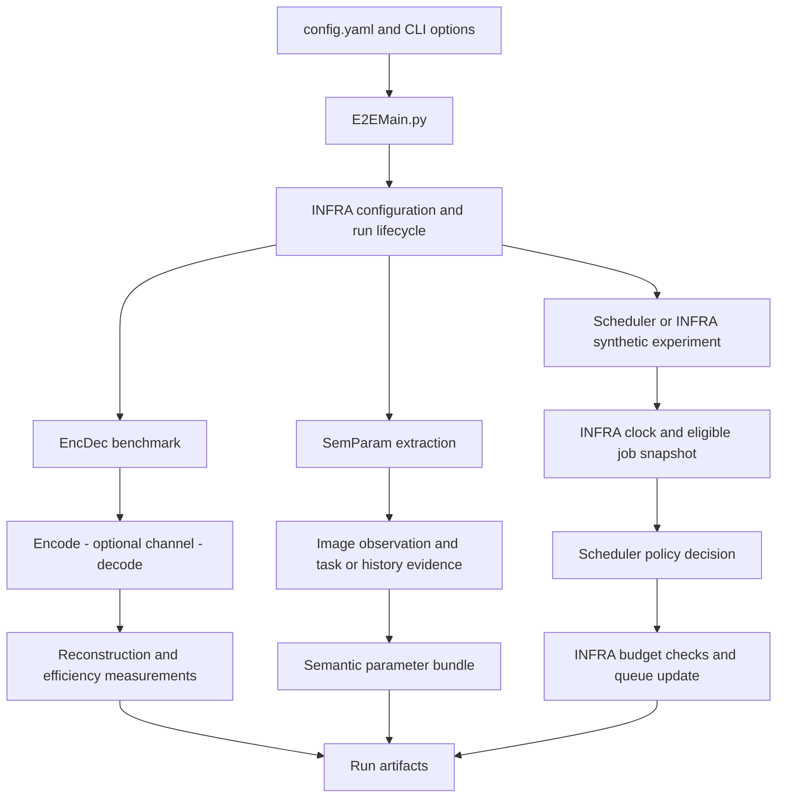

# Semantic Aware AI Scheduler

A modular research system for studying **how images are represented, what information they carry, and which transmission jobs should receive limited communication resources first**.

The repository has three research modules—**EncDec**, **SemParam**, and **Scheduler**—connected through **INFRA**. Each module can be developed and evaluated independently. Root [`config.yaml`](config.yaml) selects the experiment; [`E2EMain.py`](E2EMain.py) runs it and saves traceable artifacts.

**Current implementation:** codec benchmarks, image-based semantic extraction, semantic codebook methods, and deterministic scheduler baselines are available. The modular INFRA demonstration currently runs a **synthetic scheduling simulation**. It does not yet perform the complete image → inferred priority → multi-UE wireless transmission workflow. AIDER labeling, classifier training, the final faculty-approved priority rubric, and RL scheduling remain deferred.

## Contents

- [1. Project objective and data](#1-project-objective-and-data)
- [2. Architecture and ownership](#2-architecture-and-ownership)
- [3. Repository map](#3-repository-map)
- [4. Installation and first run](#4-installation-and-first-run)
- [5. Configuration and commands](#5-configuration-and-commands)
- [6. Experiment execution flow](#6-experiment-execution-flow)
- [7. EncDec](#7-encdec)
- [8. SemParam](#8-semparam)
- [9. Scheduler](#9-scheduler)
- [10. INFRA](#10-infra)
- [11. Evaluation and graphs](#11-evaluation-and-graphs)
- [12. Results and reproducibility](#12-results-and-reproducibility)
- [13. Notebooks and training](#13-notebooks-and-training)
- [14. External model environments](#14-external-model-environments)
- [15. Extending the system](#15-extending-the-system)
- [16. Tests and validation status](#16-tests-and-validation-status)
- [17. Troubleshooting](#17-troubleshooting)
- [18. Reading order and collaboration](#18-reading-order-and-collaboration)

## 1. Project objective and data

An image can be expensive to transmit while contributing little new information. Another image can be smaller, more relevant to a task, or close to its deadline. This project separates three questions:

1. **Representation:** how accurately and efficiently can a codec transmit and reconstruct an image?
2. **Evidence:** what can we estimate about its relevance, novelty, freshness, and task context?
3. **Allocation:** given explicit jobs, priorities, deadlines, and resource limits, which jobs should be served?

This separation allows codec research without changing scheduling logic, semantic extraction without requiring a codec checkpoint, and policy tests without a dataset or classifier.

The eventual composed system will connect these stages through INFRA. A semantic parameter bundle is not automatically a priority class: the mapping requires an explicit, evaluated task policy. Likewise, a codec payload is not automatically a radio resource demand: that requires a defined transport model. These mappings remain explicit integration work.

| Purpose | Current input | What it establishes |
|---|---|---|
| Codec benchmarks | Kodak-24 under `data/Kodak24` | Reconstruction quality and resource measurements on 24 images |
| Semantic demonstration | Images listed in `SemParam/config/extraction.yaml`, rooted at `Test/images` by default | Extraction behavior and evidence provenance |
| Scheduler evaluation | Six explicit jobs in `Scheduler/fixtures.py` | Policy ordering, deadlines, and budget enforcement |
| Semantic codebook demonstration | Configured training images and saved demo artifacts | Codebook engineering behavior; not generalization accuracy |

AIDER is the selected candidate for later disaster-image experiments. It is not currently required, labeled, or used by the synthetic scheduler. Kodak results do not establish disaster classification performance.

## 2. Architecture and ownership

| Component | Owns | Receives | Produces |
|---|---|---|---|
| **EncDec** | Codec adapters, communication codebooks, training, RAW/JPEG baselines, Kodak evaluation | Images, checkpoints, operating point, configured channel | Encoded representation, reconstruction, quality/resource/timing measurements |
| **SemParam** | Extraction, semantic codebooks, knowledge/context methods, extraction evaluation | Images and metadata; injected codec features when required | Semantic parameter bundles with availability and provenance |
| **Scheduler** | Policy logic, policy state, decisions, policy evaluation | Immutable queue snapshot and resource budget | Selected job IDs and resource usage |
| **INFRA** | Contracts, configuration, transport, clock, queues, orchestration, persistence | Configuration and module outputs | Validated execution, lifecycle updates and run artifacts |

The current executable paths are:



Dependencies are deliberate:

- Importing Scheduler does not load PyTorch, CLIP, or a codec.
- Image-based SemParam extraction does not load SwinJSCC.
- Methods that need codec features receive the [`FeatureProvider`](INFRA/features.py) interface instead of implicitly loading a checkpoint.
- A policy chooses jobs; INFRA owns arrivals, expiry, completion, and queue mutation.
- Shared contracts describe exchanged data without containing model implementations.

## 3. Repository map

```text
SemanticSchedulerEnd2End/
├── config.yaml                 # Global experiment selection and paths
├── E2EMain.py                  # Modular CLI, plus legacy dispatch
├── AGENTS.md                   # Contributor/agent boundaries
├── PROJECT_MAP.md              # Concise architecture map
├── EncDec/
│   ├── Models/                 # SwinJSCC and DeepJSCC adapters
│   ├── Research/               # Teammate DeepJSCC/NTSCC benchmark methods
│   ├── Codebooks/              # Communication VQ, indices and packets
│   ├── Baselines/              # Codec baselines
│   ├── Evaluation/             # Kodak contract, CSVs, reports and plots
│   ├── runtime.py              # Codec construction and action dispatch
│   ├── training.py             # Reusable Swin training entry point
│   └── config/, environment/, notebooks/, tests/, README.md
├── SemParam/
│   ├── Codebooks/              # Semantic codebook methods
│   ├── KnowledgeBases/         # History/context lookup
│   ├── pipeline.py             # Observation → knowledge → extractors
│   ├── extractors.py           # Independent parameter estimators
│   ├── runtime.py              # Image-only extraction entry point
│   ├── training.py             # Semantic codebook training
│   └── config/, environment/, notebooks/, tests/, evaluation/, README.md
├── Scheduler/
│   ├── policies.py             # Four deterministic baselines
│   ├── fixtures.py             # Explicit synthetic jobs and labels
│   └── config/, environment/, notebooks/, tests/, evaluation/, README.md
├── INFRA/
│   ├── contracts.py            # Job, QueueSnapshot, ResourceBudget, Decision
│   ├── configuration.py        # Merge, path resolution and validation
│   ├── simulation.py           # Slotted job lifecycle
│   ├── runs.py                 # Run IDs, provenance and persistence
│   ├── cli.py                  # Lazy module dispatch
│   ├── features.py             # Feature-provider boundary
│   ├── workers.py              # Isolated external-model execution
│   ├── Channels/, Transport/   # Channels and digital PHY
│   ├── Artifacts/, Interfaces/, Registries/
│   ├── experiments/            # Retained combined semantic showcase
│   └── config/, environment/, notebooks/, tests/, README.md
├── data/                       # Shared datasets; configurable elsewhere
├── models/                     # Shared saved assets; configurable elsewhere
├── results/                    # Historical and new module/run outputs
├── external/                   # Pinned upstream implementations
├── references/                 # Teammate DeepJSCC/NTSCC source snapshots
├── semcom_benchmark/           # Historical notebook import compatibility
├── docs/                       # Migration, operation and validation records
├── scripts/                    # Setup, reporting and architecture utilities
├── Test/tests/                 # Preserved regression tests
├── src/                        # Temporary legacy import compatibility
└── Notebooks/                  # Preserved historical experiments
```

Canonical implementation lives in the four root modules. `src/` forwards old imports such as `EncDecPipeline`, `TransformerPipeline`, and `CodebookParam`; `semcom_benchmark/` forwards the teammate's benchmark imports to `EncDec/Research/`. Edit the canonical module, not a wrapper. See the [migration map](docs/MIGRATION_MAP.md), [team consolidation inventory](ORGANIZATION.md), and [historical team guide](docs/HISTORICAL_STAGE_GUIDE.md).

## 4. Installation and first run

Run commands **from the repository root**. The project declares **Python 3.12**. Editable installation lets notebooks and the CLI use the same source files.

### Scheduler-only environment

No dataset, trained assets, or neural framework is needed:

```powershell
py -3.12 -m venv .venv
.\.venv\Scripts\Activate.ps1
python -m pip install -e ".[scheduler,test]"
python E2EMain.py --module INFRA --action demo
```

The CLI prints the run directory. Open `result.json`, `jobs.json`, `traces.json`, and `policy_comparison.png` there. The graph compares four policies on the same explicit fixture.

Without graphs, install `-e .` and run `--module Scheduler --action validate`. The `scheduler` extra supplies plotting dependencies. The `test` extra alone does not supply all dependencies for the full cross-module suite.

### Model and benchmarking environment

The saved Swin manifest requires compatible Python/PyTorch versions. This CPU example uses its expected versions:

```powershell
py -3.12 -m venv .venv-models
.\.venv-models\Scripts\python.exe -m pip install torch==2.10.0 torchvision==0.25.0 --index-url https://download.pytorch.org/whl/cpu
.\.venv-models\Scripts\python.exe -m pip install -e ".[encdec,semparam,scheduler,metrics,benchmark,test,notebook]"
.\.venv-models\Scripts\Activate.ps1
python E2EMain.py --module EncDec --action availability
```

On Linux, use `python3.12 -m venv ...` and `source .venv-models/bin/activate`. CUDA training needs compatible CUDA-enabled wheels; the example above installs CPU wheels. Notebook setup does not silently replace a hosted runtime's GPU wheel.

Availability checks inspect assets/configuration; they are **not inference tests**. Neural checkpoints and teammate repositories are not installed by `pip install -e .`.

| Experiment | Additional assets |
|---|---|
| Scheduler/INFRA demo | None |
| RAW/JPEG benchmark | `data/Kodak24/kodim01.png` through `kodim24.png` |
| Swin inference | Kodak; `stage1_manifest.json` and full/encoder/decoder checkpoints under `models/SwinJSCC`; compatible patched source |
| CLIP extraction | Configured images and CLIP cache, or explicit download-enabled configuration |
| Semantic codebook methods | Compatible semantic codebook and injected codec feature provider |
| DeepJSCC/NTSCC | Configured external source revision, checkpoints and environment |

For a fresh Swin source setup, `python scripts/bootstrap_swinjscc.py` prepares the pinned upstream source. It does not supply trained checkpoints. Keep source/checkpoint guards enabled.

## 5. Configuration and commands

Later configuration layers override earlier ones:

```text
<Module>/config/defaults.yaml
    → selected root profiles entry
    → root settings
    → explicitly supplied CLI options
```

Mappings merge recursively. Module selection determines which defaults load, and every run saves the resolved configuration.

**Root values override profiles.** The current root `device: auto` therefore overrides `device: cpu` in the `cpu` profile. Use `--device cpu` to enforce CPU execution. Also specify the desired `--action`: the current root action is `validate`.

| Field | Purpose |
|---|---|
| `module`, `action`, `implementation` | Module, operation, and selected codec/policy |
| `profile`, `profiles` | Named overlays; the selected profile must exist |
| `device`, `seed` | Requested backend and reproducibility seed |
| `paths` | Results, images, Kodak, models, source, and training directories |
| `benchmark` | JPEG quality, Swin rate/SNR, repetitions, optional LPIPS |
| `scheduler` | Slot length, horizon, budget, maximum jobs per slot |
| `transport` | Supported channel and resource accounting unit |
| `semantic` | Overrides for module-owned semantic settings and cache behavior |
| `dependencies` | External revisions, checkpoints, interpreters and factories |
| `training` | Swin epochs, batch size, crop size and patience |

Paths inside `paths`, and supported dependency paths, resolve relative to the **selected YAML file's directory**, with environment-variable and home expansion. `--output` resolves relative to the calling shell and sets the results base; output still goes under `<base>/<module>/<run-id>`.

SemParam expands its settings file into `semantic.resolved_settings`. Image manifests and tasks live in [`SemParam/config/extraction.yaml`](SemParam/config/extraction.yaml). Legacy settings retain their loader semantics; inspect resolved values when moving training datasets.

### Example configuration

Save as `scheduler-demo.yaml` in the repository root:

```yaml
module: Scheduler
action: evaluate
implementation: priority_edf
profile: default
profiles:
  default: {}
seed: 42
device: cpu
paths:
  results: results
transport:
  name: awgn
  resource_unit: complex_channel_uses
scheduler:
  slot_ms: 10
  horizon_ms: 200
  resource_units: 100
  max_jobs_per_slot: 1
```

```powershell
python E2EMain.py --config scheduler-demo.yaml
```

This runs the built-in fixture. `awgn` does not execute a channel in the scheduler simulation; it is relevant to codec transport experiments. Resource demands here are assigned synthetic inputs.

### Actions and commands

| Module | Action | Behavior |
|---|---|---|
| EncDec | `validate`, `availability` | Capabilities and asset presence; no inference |
| EncDec | `smoke` | First Kodak image through the selected codec |
| EncDec | `benchmark` | Full Kodak-24 evaluation |
| EncDec | `train` | Swin training from configured directories |
| SemParam | `validate` | Semantic configuration/catalog setup; no image inference |
| SemParam | `extract` | CLIP extraction over the configured manifest |
| SemParam | `train` | Semantic codebook training; requires `semantic_codebook` implementation |
| Scheduler, INFRA | `validate` | Synthetic simulation and traces, without plotting |
| Scheduler, INFRA | `demo`, `evaluate` | Same synthetic experiment with comparison plot |

```powershell
python E2EMain.py --help
python E2EMain.py --module EncDec --action benchmark --implementation jpeg
python E2EMain.py --module EncDec --action benchmark --implementation raw
python E2EMain.py --module EncDec --action smoke --implementation swinjscc --device cpu
python E2EMain.py --module SemParam --action extract
python E2EMain.py --module Scheduler --action evaluate --implementation all
python E2EMain.py --module INFRA --action demo --output ./experiment-results
```

Modular flags are `--config`, `--module`, `--action`, `--implementation`, `--profile`, `--device`, `--seed`, and `--output`. Advanced settings use YAML; there are no modular `--snr` or `--model-dir` flags. Keep historical stage flags with their legacy entry points.

## 6. Experiment execution flow

1. [`E2EMain.py`](E2EMain.py) selects modular dispatch, forwarding recognized historical actions/configs to `INFRA.legacy_cli`.
2. [`configuration.py`](INFRA/configuration.py) merges configuration, resolves paths, and rejects unsupported/invalid settings.
3. [`runs.py`](INFRA/runs.py) creates a unique UTC timestamp/UUID directory, saves configuration/provenance, and records `running` status.
4. [`cli.py`](INFRA/cli.py) lazily imports and executes the selected module. Scheduler execution never initializes neural models.
5. The module writes detailed artifacts and returns a summary; INFRA writes `result.json` and final status.
6. Execution exceptions record `failed`. Per-image benchmark failures record `completed_with_failures` and exit code 2. Configuration errors occur before a run directory is created.

Model actions seed Python, NumPy and PyTorch through runtime helpers. Deterministic scheduling decisions do not imply identical host timings or bitwise model reproducibility across hardware.

## 7. EncDec

EncDec answers: **what representation is transmitted, what reconstruction is produced, and what does it cost?** Start with [`runtime.py`](EncDec/runtime.py) and [`kodak_benchmark.py`](EncDec/Evaluation/kodak_benchmark.py).

### Codec paths

| Implementation | Behavior |
|---|---|
| `raw` | Lossless RGB8 bytes and exact digital payload size |
| `jpeg` | JPEG compression, default quality 20, payload size and reconstruction |
| `swinjscc` | Learned latent → configured channel → learned reconstruction; active complex channel uses |
| `deepjscc` | Configured external adapter/checkpoint, or isolated worker for dependency conflicts |
| `ntscc` | Retained benchmark integration through a configured external worker |
| `external_worker` | Factory-based extension supplying compatible benchmark codecs |

RAW/JPEG measure codec reconstruction without implicit modulation, channel coding, noise, or retransmissions. Native Swin encodes normalized RGB tensors, applies the channel to its latent, and decodes the received representation. Its current path requires image dimensions divisible by 128.

The catalog declares preprocessing, representation and environment requirements. Swin loading additionally checks checkpoint hashes, patched source identity and manifest runtime requirements. A filename alone is insufficient model provenance.

### Shared benchmark contract

`BenchmarkCodec` exposes `name`, `version`, `device`, `operating_point`, and:

- `encode(tensor, image, image_id)` → `EncodedSample` containing codec state, available resource counts and metadata.
- `decode(sample)` → reconstructed image tensor.
- `complexity()` → available model complexity information.

Adapters preserve model-specific behavior behind this contract. Unknown measurements stay unavailable; an adapter must not invent a bitrate for an analog latent.

The Kodak runner validates all 24 expected files, records image hashes, warms up the codec, times encode/decode, measures quality, saves per-image outcomes, appends CSV rows, and generates a report/plot. Even `smoke` validates the full dataset before taking the first image. Native dimensions are retained; an adapter may not silently resize the benchmark set.

Quality computation is outside the codec timing region. Defaults are JPEG quality 20, Swin rate 96 at 10 dB, one timing repetition, and LPIPS disabled. Override them in `benchmark`.

### Communication versus semantic codebooks

| Type | Owner | Purpose |
|---|---|---|
| Communication codebook | EncDec | Quantize a codec representation into indices for digital transport/reconstruction |
| Semantic codebook | SemParam | Map a feature descriptor to stored semantic estimates/statistics |

Communication VQ maps latent vectors to nearest representatives; indices, packet metadata, masks, coding and modulation need separate accounting. A semantic codebook does not replace the decoder. An index count is not automatically the number of radio channel uses.

## 8. SemParam

SemParam answers: **what evidence can an image and its context provide for a downstream decision?** It produces estimates with provenance, not an automatically validated emergency label.

### Image-only extraction

[`TransformerParameterPipeline`](SemParam/pipeline.py) follows this flow:

1. Read a configured image and capture/task/deadline context.
2. Build an observation using CLIP image embeddings, cached text embeddings, image hash, concept scores and metadata.
3. Query knowledge/history **before** inserting the current observation, avoiding comparison with itself as prior history.
4. Run independent parameter extractors and return a `SemanticParameterBundle`.
5. Record the observation for subsequent history-dependent extraction.

The default backbone is `openai/clip-vit-base-patch32`, with cached-only loading. Set root `semantic.local_files_only: false` when first-time download is intended. This path does not require Swin.

The CLI processes `demo.images` in manifest order. Changing `paths.images` changes the root but does not enumerate a directory automatically. Order affects novelty; the current CLI creates a fresh knowledge store per run.

### Parameter meanings and formulas

Definitions live in [`extractors.py`](SemParam/extractors.py). In this table, `clip(x, 0, 1)` bounds a scalar; it does not refer to the CLIP model.

| Parameter | Estimator | Interpretation/limits |
|---|---|---|
| `AoI_seconds` | `now - captured_at`, in seconds | Missing/future capture timestamps produce unavailable evidence |
| `freshness` | `exp(-AoI_seconds / tau)` | Requires valid capture time; decays with age |
| `novelty` | `clip(1 - max_history_cosine, 0, 1)`; 1 for empty history | Novel relative to stored observations |
| `relevance` | `clip((image_task_cosine + 1) / 2, 0, 1)` | Task-text similarity, not a calibrated probability |
| `reliability` | Maximum configured zero-shot concept probability | Semantic confidence proxy, not radio reliability or proven correctness |
| `urgency` | `clip(1 - seconds_remaining / urgency_horizon, 0, 1)` | Deadline pressure; unavailable without explicit deadline context |
| `task_importance` | Bounded sum of matched concept probabilities × task-policy weights | Depends on configured concepts and policy |

`ParameterValue` stores value, raw evidence, availability, method, source, version, units, producer level and provenance. Missing evidence retains a reason. **Unavailable is not zero**: zero may be a valid score.

Bundles link image/observation/task identity and knowledge evidence. Image-only CLI IDs use `image-` plus the first 16 characters of the image content hash. This does not assign a UE or priority class.

### Feature-based semantic codebooks

[`INFRA/features.py`](INFRA/features.py) defines the boundary:

```text
FeatureProvider.capture(image, **options)
    → FeatureCapture(representation, optional latent)
    → SemParam descriptor/codebook lookup
    → semantic estimates plus context-derived parameters
```

The Swin provider exposes a pre-modulation representation. Training can use CLIP-derived content targets; inference can use a saved codebook and injected features without loading CLIP. Feature/task-profile compatibility still matters. The saved semantic artifact is demo-only and does not demonstrate unseen disaster-image accuracy.

Versioned semantic-header and packet utilities are retained. Producing a bundle does not automatically transmit its header or charge that overhead to codec payload measurements. The historical combined showcase lives in [`INFRA/experiments`](INFRA/experiments).

### Evaluation

The image CLI reports availability/coverage and per-image extraction time, not ground-truth accuracy. The first image can include lazy model initialization, so distinguish cold and warm timings. Demo temporal scores use configured timestamps and `reference_now`, not silently changing wall-clock time.

## 9. Scheduler

Scheduler answers: **which eligible jobs fit this budget, and which should be selected first?** It consumes explicit fields rather than raw images or model names.

### Contracts and IDs

[`INFRA/contracts.py`](INFRA/contracts.py) defines:

| Record | Main fields | Meaning |
|---|---|---|
| `Job` | Job/image/UE IDs, arrival, demand, class, optional deadline | One scheduling request |
| `QueueSnapshot` | `now_ms`, immutable job tuple | State visible to a policy; eligible-arrival filtering |
| `ResourceBudget` | `units`, explicit `unit`, `max_jobs` | Limits for one slot |
| `Decision` | Policy, time, job IDs, used units, unit, reason | Auditable policy output |

`image_id` identifies content, `ue_id` identifies the user equipment/source, and `job_id` identifies a scheduling request. An image or UE may have multiple jobs, but job IDs within a simulation must be unique. Smaller `priority_class` means higher priority: 0 precedes 1.

### Policies

| CLI name | Ordering | Ties/state |
|---|---|---|
| `fifo` | Earliest arrival among fitting jobs | Lexical job ID |
| `round_robin` | Rotate through UEs with fitting eligible jobs | Lexical UE cycle; oldest arrival/ID inside UE |
| `fixed_priority` | Lowest class number first | Arrival, then job ID within class |
| `priority_edf` | Class first, earliest deadline within class | Missing deadline last, then arrival and job ID |

`priority_edf` is **not global EDF** across classes. Round robin remembers the last served UE and resets at the beginning of each simulation.

All policies skip jobs exceeding the remaining budget. FIFO can therefore bypass an oversized head job; it is FIFO among fitting jobs. Jobs are neither split nor preempted. A demand larger than the entire per-slot budget cannot complete under this service model.

### Assigned synthetic fixture

These labels/demands are explicit in [`fixtures.py`](Scheduler/fixtures.py), not inferred from images.

| Job ID | Image ID | UE ID | Class | Arrival ms | Deadline ms | Demand |
|---|---|---|---:|---:|---:|---:|
| job-0001 | synthetic-image-001 | ue-001 | 2 | 0 | 100 | 60 |
| job-0002 | synthetic-image-002 | ue-002 | 0 | 0 | 30 | 60 |
| job-0003 | synthetic-image-003 | ue-001 | 0 | 0 | 20 | 40 |
| job-0004 | synthetic-image-004 | ue-003 | 1 | 10 | 60 | 60 |
| job-0005 | synthetic-image-005 | ue-002 | 0 | 20 | 40 | 40 |
| job-0006 | synthetic-image-006 | ue-003 | 2 | 30 | 120 | 100 |

With 10 ms slots, a 200 ms horizon, 100 units per slot, and at most one job per slot:

| Policy | Selected job suffixes | Completed | Deadlines met | Mean wait of completed jobs |
|---|---|---:|---:|---:|
| FIFO | 0001, 0002, 0004, 0005, 0006 | 5/6 | 5/6 | 8 ms |
| Round robin | 0001, 0002, 0004, 0005, 0006 | 5/6 | 5/6 | 8 ms |
| Fixed priority | 0002, 0003, 0005, 0004, 0001, 0006 | 6/6 | 6/6 | 15 ms |
| Class priority + EDF | 0003, 0002, 0005, 0004, 0001, 0006 | 6/6 | 6/6 | 15 ms |

At time 0, FIFO selects job-0001, fixed priority selects job-0002, and priority+EDF selects job-0003 for its earlier deadline within class 0. FIFO/RR let job-0003 expire at time 20. Fixed priority completes it exactly at 20 ms, which counts as on time.

This explains behavior, not general policy superiority. FIFO's lower mean wait excludes the job it did not complete; compare completion and deadlines alongside latency.

### Custom workload through the Python API

The CLI currently uses the built-in fixture. For custom jobs:

```python
from INFRA.contracts import Job, ResourceBudget
from INFRA.simulation import simulate
from Scheduler.policies import create_policy

jobs = [
    Job("job-a", "image-a", "ue-01", 0, 60, 1, 40),
    Job("job-b", "image-b", "ue-02", 0, 40, 0, 20),
]
budget = ResourceBudget(units=100, unit="complex_channel_uses", max_jobs=1)
result = simulate(
    jobs,
    create_policy("priority_edf"),
    budget,
    slot_ms=10,
    horizon_ms=50,
)
assert result["decisions"][0]["job_ids"] == ("job-b",)
print(result["metrics"])
```

The direct API returns results in memory. Use the INFRA run layer for persistence/provenance. Real classes and resource demands require explicit derivation rather than copying synthetic values.

## 10. INFRA

[`simulation.py`](INFRA/simulation.py) owns queue state and the simulation clock. Each full slot:

1. Expires arrived jobs with deadlines at or before slot start.
2. Builds a snapshot; selectable jobs must have arrived and not expired.
3. Calls the policy and measures host `decide()` runtime.
4. Rejects duplicate/ineligible selections, incorrect accounting, mismatched time/units, or budget violations.
5. Completes selected jobs at **slot end**, records wait/deadline outcomes, and removes them from pending state.
6. Advances time until all jobs resolve or no full slot fits inside the horizon.

Completion exactly at a deadline succeeds. A job can be eligible at slot start but finish late; it remains completed with a failed deadline outcome. Waiting time is selection time minus arrival, while completion latency also includes service time.

Budget resets each slot without carry-over. All selected jobs finish at the slot boundary regardless of individual demand. At the horizon, remaining jobs become expired, pending, or not yet arrived; no service is invented beyond the horizon.

### Transport and composition boundary

INFRA contains AWGN and perfect-CSI Rayleigh paths and retained digital packet/coding/modulation utilities. Modular configuration supports `awgn` and `rayleigh_perfect_csi`; Rician is deferred. Optional digital PHY dependencies need separate runtime validation.

These implementations are available for composition, but the scheduler simulator does not execute them. It does not derive packet errors, reconstruction quality, retransmissions, interference, or UE-specific link adaptation from a scalar budget. Large-scale traffic generation and complete wireless composition remain later INFRA work.

## 11. Evaluation and graphs

### Resource accounting

| Quantity | Meaning | Invalid shortcut |
|---|---|---|
| Latent storage bytes | Memory occupied by a representation | Calling tensor storage the transmitted bitrate |
| Digital bits | Payload/packet bits at a stated boundary | Equating JPEG bits to channel uses without a PHY mapping |
| Complex channel uses | Complex symbols/resources used by a communication path | Treating them as bytes or assuming universal bits per symbol |

State whether headers, masks, coding overhead and side information are included. Synthetic demand is assigned input, not measured image payload.

### Quality and timing

- PSNR uses dB; SSIM is dimensionless. LPIPS is optional and disabled by default.
- RAW is lossless: PSNR is positive infinity and SSIM is 1. Reports preserve that distinction instead of substituting a large finite score.
- Failed reconstruction has unavailable quality and an explicit failure record. Missing measurements must not be plotted as zero.
- Detailed outcomes separate encoding, channel and decoding where measured. Legacy CSV `decode_time_ms` can include transport; read its timing note.
- Codec timing excludes semantic extraction and scheduling. Initial semantic extraction may include model loading. Neither is measured end-to-end network latency.
- Match hardware, image set, model identity, operating point and timing repetitions when comparing measurements.

### Scheduler metrics

`result.json` summarizes completions, expiry/pending counts, deadlines, wait, policy runtime and per-UE completions. `traces.json` retains decisions and individual job outcomes.

`mean_wait_ms` averages **completed jobs only**, including late completions. `deadline_met_fraction` divides on-time completions by all deadline-bearing jobs arriving strictly before the horizon. Pending jobs remain in that denominator even when their deadlines lie beyond the horizon. Interpret this as the fraction served on time by the observation horizon, not a censored deadline-failure estimate. No deadline-bearing jobs means an unavailable fraction.

`mean_scheduling_time_ms` measures host time around `decide()`, including idle-slot decisions. It is neither the configured slot duration nor a deterministic value across runs.

### CSVs and plots

Kodak CSV v1 columns and append behavior are retained. Duplicate protection uses `(run_id, method, operating_point, image_id)` with locked, atomic appends. A new run ID intentionally represents another measurement. Modular runs write their own CSV and do not automatically append to or replace historical `results/kodak24_benchmark.csv`.

Reports group compatible run/model/version/operating-point/device records and require matching image sets for comparisons. Do not pool unrelated checkpoints/devices/operating points into one average. Graphs show units and sample counts. Error bars, where available, are **across-image sample standard deviation**, not confidence intervals from independent training runs. A single-image smoke gives no across-image uncertainty.

## 12. Results and reproducibility

```text
results/<module>/<UTC-timestamp>-<unique-suffix>/
├── config.resolved.yaml       # Effective configuration
├── provenance.json           # Commit, dirty state, source digest, environment
├── status.json               # running/completed/completed_with_failures/failed
├── result.json               # Successful action's summary
└── action-specific artifacts
```

An early failed action may have status without `result.json`. Check status before using a run in a report.

| Action | Additional artifacts |
|---|---|
| Codec benchmark/smoke | `benchmark.csv`, `dataset_manifest.json`, `outcomes.json`, `reconstruction.png` |
| Scheduler/INFRA | `jobs.json`, `traces.json`; `policy_comparison.png` for demo/evaluate |
| Semantic extraction | Image identities, paths, bundles, times and coverage within `result.json` |
| Training | Checkpoints, history/summaries and exported artifacts in the run destination |
| External worker | Request, worker logs/results and environment provenance |

Provenance captures Git commit/dirty state, a digest of canonical Python source, Python executable/version, platform and important package versions. HEAD alone cannot describe an uncommitted working tree. Dataset hashes and codec identities provide further evidence; share complete run directories.

Exact reruns require source revision, checkpoint/source manifests, dataset identity, configuration, environment, seeds and compatible hardware settings. A folder timestamp is insufficient.

## 13. Notebooks and training

Active guides import reusable source; model/training logic does not live only in notebook cells.

The fetched team commit also preserves `Notebooks/DeepJSCC_NTSCC_Final_Repaired.ipynb` and `Notebooks/Stage1A/01_stage1a_complete_kaggle.ipynb` as research references. Their imports remain supported, but the numbered notebooks below are the active modular entry points.

| Notebook | Purpose |
|---|---|
| [EncDec validation](EncDec/notebooks/01_validate_and_demo.ipynb) | Codec/module setup |
| [Kodak benchmark](EncDec/notebooks/02_kodak_benchmark.ipynb) | Codec evaluation |
| [Portable Swin training](EncDec/notebooks/03_portable_training.ipynb) | Configure reusable training |
| [SemParam validation](SemParam/notebooks/01_validate_and_demo.ipynb) | Semantic setup/contracts |
| [Image extraction](SemParam/notebooks/02_image_extraction.ipynb) | Image-only extraction |
| [Semantic codebook training](SemParam/notebooks/03_codebook_training.ipynb) | Teacher/features and artifact training |
| [Scheduler demo](Scheduler/notebooks/01_validate_and_demo.ipynb) | Policy traces/comparison |
| [INFRA demo](INFRA/notebooks/01_validate_and_demo.ipynb) | Configuration and synthetic composition |

### Local, Colab and Kaggle

Setup exposes `CLEAN_SYNC`, `PROJECT_GIT_URL`, `PROJECT_REF`, `LOCAL_PROJECT`, and `RESULTS_DIR`:

- `CLEAN_SYNC = False` uses an existing local checkout.
- `CLEAN_SYNC = True` clones into a **new disposable checkout** at the requested revision without deleting the development repository.
- Use an exact published commit for `PROJECT_REF`. `main` can move; remote sync cannot fetch uncommitted changes.
- `INSTALL_DEPENDENCIES` and `RUN_TRAINING` are explicit switches, disabled by default in the relevant guides.
- Results remain outside disposable source. Set `SEMANTIC_RESULTS_DIR` explicitly, or use the local sibling directory, mounted Colab Drive, or Kaggle working-output defaults. Save a Kaggle notebook version to retain outputs.

The loop is **edit locally → test → review/commit/push → sync specified revision → run → persist → compare**. Never keep the only checkpoint copy inside a disposable checkout.

### Swin training

Configure existing `paths.train`, `paths.validation`, compatible `paths.upstream_swin`, and the `training` block:

```powershell
python E2EMain.py --module EncDec --action train --implementation swinjscc
```

The reusable path performs base then SNR/rate-adaptive training, saves optimization history/checkpoints, and exports artifacts. Default one-epoch phases demonstrate execution, not convergence. Crops must be multiples of 128. New modular CLI runs create new run directories; do not assume automatic resume.

CPU/CUDA paths and multi-GPU training support are implemented. Dual-GPU execution and T4/P100/A100 performance need hardware validation. TPU/XLA is explicitly unsupported; hardware detection does not make CUDA model code TPU-compatible.

### Semantic codebook training

Configure [`codebook_training.yaml`](SemParam/config/codebook_training.yaml), data, task profile and feature source:

```powershell
python E2EMain.py --module SemParam --action train --implementation semantic_codebook
```

Evaluate against data independent of the training/calibration corpus before claiming generalization. A codebook trained on Kodak-derived images cannot establish unbiased performance on those same images.

## 14. External model environments

The teammate's consolidation commit `1e44baa` supplies checkpoint-compatible DeepJSCC/NTSCC source snapshots in `references/`, a calibration cache and CIFAR-trained model files in `models/`, and four benchmark methods now owned by `EncDec/Research/`. `semcom_benchmark/` retains the old notebook import path. The two production `.pth` checkpoints used in the repaired Kodak comparison remain **outside** this Git repository. This checkout does not currently contain those production files, so real DeepJSCC/NTSCC inference has not been validated here.

The newly tracked `.pt` and `.pkl` assets use Git LFS. After cloning, install Git LFS and hydrate the files before attempting to load them:

```powershell
git lfs install
git lfs pull
```

`models/MANIFEST.sha256` records the expected asset hashes. A small text file beginning with `version https://git-lfs.github.com/spec/v1` is an unhydrated pointer, not a model. The ADJSCC checkpoint is preserved, but no compatible ADJSCC adapter is implemented.

Direct DeepJSCC loading uses `dependencies.deepjscc` with `source_root`, `revision`, and `checkpoint`. Source must match a clean pinned Git revision. Use a subprocess worker for incompatible dependencies.

For the teammate's native DeepJSCC or NTSCC method, configure the worker under that implementation name. It validates and loads only the selected model. The example uses paths relative to the selected root YAML; replace the production checkpoint and exact revision:

```yaml
dependencies:
  ntscc:
    python: .venv-models/Scripts/python.exe
    source_root: .
    revision: EXACT_MERGED_GIT_COMMIT
    factory: EncDec.Evaluation.repaired_notebook_models:build_team_benchmark_codecs
    ntscc_checkpoint: ../NTSCC_JSAC22/checkpoints/ntscc_hyperprior_quality_1_psnr.pth
```

Run with `python E2EMain.py --module EncDec --action smoke --implementation ntscc --device cpu`. For DeepJSCC, use `dependencies.deepjscc`, `deep_checkpoint`, and `--implementation deepjscc`. The full four-method research comparison, including both codebook methods, uses `implementation: external_worker` with the same factory plus **both** production checkpoints, CIFAR-10 training data, and the hydrated NTSCC calibration cache. Codebook transport also needs its optional digital PHY dependencies. The repaired comparison excludes Kodak records from NTSCC codebook fitting; do not train a codebook on its benchmark images.

Example fragment; replace placeholders with real dependencies:

```yaml
implementation: external_worker
dependencies:
  external_worker:
    python: /absolute/path/to/worker-environment/python
    source_root: /absolute/path/to/pinned/model-repository
    revision: EXACT_GIT_COMMIT
    checkpoint: /absolute/path/to/model-checkpoint.pt
    factory: your_package.benchmark_factory:build_codecs
```

The factory receives resolved config and returns a sequence of `BenchmarkCodec` instances, optionally paired with method provenance. INFRA verifies source identity, launches the selected interpreter, and retains logs, outcomes and environment information. See [team merge details](docs/MAIN_MERGE_1E44BAA.md) for exact asset boundaries.

[`repaired_notebook_models.py`](EncDec/Evaluation/repaired_notebook_models.py) retains teammate wrappers and calibration-exclusion logic. It is an integration starting point, not an automatically available checkpoint. Each model needs a compatible preprocessing contract and real smoke test.

## 15. Extending the system

| Addition | Owner/location | Required checks |
|---|---|---|
| New codec | EncDec adapter/benchmark contract, catalog/runtime or worker | Identity, preprocessing, shape, real smoke, units and failures |
| Semantic estimator | SemParam extractor, settings/catalog and pipeline | Missing evidence, provenance, controlled cases, explicit feature dependencies |
| Semantic codebook | SemParam/Codebooks and training/evaluation | Feature/task compatibility, corpus identity, held-out evaluation |
| Scheduling policy | Scheduler implementation and policy selection | Ties, empty queues, arrivals, deadlines, budgets, state reset |
| Channel/traffic/composition | INFRA | Contracts, queue ownership, accounting, reproducible traces |
| Experiment guide | Owning module's notebooks | Fresh setup, source imports, dependencies, persistent artifacts |

Add defaults and validation alongside implementations. Update module documentation/tests; architecture changes also require `PROJECT_MAP.md` and graph refresh. Keep compatibility wrappers thin rather than maintaining two copies of the same logic.

## 16. Tests and validation status

Run focused checks before affected regressions:

```powershell
python -m pytest Scheduler/tests INFRA/tests -q
python -m pytest EncDec/tests -q
python -m pytest SemParam/tests -q
python -m pytest -q
```

Full-suite execution needs the full declared model/test dependencies. Include saved Swin tests in the compatible environment with:

```powershell
$env:STAGE1_MODEL_DIR = "models/SwinJSCC"
.\.venv-models\Scripts\python.exe -m pytest -q
```

[`VALIDATION_REPORT.md`](docs/VALIDATION_REPORT.md) records the rebuild evidence below. It is a snapshot, not a promise about every future checkout.

| Area | Recorded validation | Boundary |
|---|---|---|
| Regression/integration | 58 passed, 1 skipped; later plotting check 3 passed | Skip requires two CUDA GPUs |
| RAW/JPEG | All 24 Kodak images, zero failures | JPEG excludes digital PHY |
| Swin | Saved-model regressions and one Kodak smoke at 10 dB, rate 96 | Not full Swin Kodak evaluation |
| CLIP | Four real demo images without Swin | No labeled accuracy evaluation |
| Saved codebooks | Real communication/semantic artifact smoke checks | Semantic artifact remains demo-only |
| Scheduler | Synthetic replay and edge-case tests | No general superiority or disaster-response validity claim |
| Eight active notebooks | Structural checks and local cells executed, training disabled | Hosted sync/full training not validated |
| Worker protocol | Actual subprocess with pinned test factory | DeepJSCC/NTSCC assets need real validation |

The migration preservation audit matched 80 original asset hashes. Existing datasets, checkpoints and results were retained. Stage names may remain in manifests/version strings and compatibility APIs without defining current ownership.

Open work includes AIDER labeling, classifier training, faculty-approved semantic-to-priority mapping, RL policies, complete image-to-UE wireless composition, large-scale simulation, full training/accelerator validation, and optional digital PHY runtime validation. A software rebuild does not establish model accuracy or research novelty.

## 17. Troubleshooting

| Symptom | Check |
|---|---|
| Swin load fails | Manifest runtime versions, checkpoint hashes and patched source; retain guards |
| Availability passes, inference fails | Availability checks assets; run `smoke` in the real environment |
| Smoke needs all Kodak images | Full dataset is validated before selecting one |
| CLIP cache missing | Supply cache or explicitly set `semantic.local_files_only: false` |
| New images ignored | Update `demo.images` as well as `paths.images` |
| CPU profile resolves to auto | Root overrides profiles; use `--device cpu` |
| Relative paths unexpected | YAML paths use its directory; `--output` uses shell cwd |
| Urgency/freshness unavailable | Supply valid deadline/capture context; values are not guessed |
| Job never selected | Arrival, expiry, demand/budget, remaining full slots and max jobs |
| No scheduler plot | Use demo/evaluate; validate only writes traces |
| CUDA/TPU fails | Check available CUDA; TPU/XLA is unsupported |
| DeepJSCC/NTSCC unavailable | Supply real assets, clean pinned source and worker environment |
| Remote notebook has stale code | Publish commit, set `PROJECT_REF`, enable fresh sync |
| Plot comparison rejects rows | Match images, identity, operating points and devices |

## 18. Reading order and collaboration

Read the project map, follow `E2EMain.py` into `INFRA/cli.py`, then inspect one module's runtime. For scheduling follow **contracts → fixtures → policy → simulation → traces**. For extraction follow **settings → observation → knowledge → extractors → bundle**. For benchmarking follow **adapter → encoded sample → channel/decoder → measurements → CSV/report**.

| Document | Purpose |
|---|---|
| [PROJECT_MAP.md](PROJECT_MAP.md) | Ownership/interfaces and implementation status |
| [AGENTS.md](AGENTS.md) | Contributor/agent boundaries |
| [EncDec README](EncDec/README.md) | Codec entry points |
| [SemParam README](SemParam/README.md) | Extraction entry points |
| [Scheduler README](Scheduler/README.md) | Policy entry points |
| [INFRA README](INFRA/README.md) | Runtime/shared infrastructure |
| [Run guide](docs/REBUILD_GUIDE.md) | Operational commands and environments |
| [Migration map](docs/MIGRATION_MAP.md) | Old locations and new owners |
| [Notebook migration](docs/NOTEBOOK_MIGRATION.md) | Active versus historical guides |
| [Historical guide](docs/HISTORICAL_STAGE_GUIDE.md) | Retained team experiments/setup |
| [Validation report](docs/VALIDATION_REPORT.md) | Evidence, availability and limitations |

Graphify's generated view is `graphify-out/graph.html`, with source revision/digest in `graphify-out/source_revision.json`. After implementation/architecture changes, refresh it in an environment with Graphify installed:

```powershell
python scripts/refresh_graph.py --semantic docs/architecture_semantics.json
```

Before editing, identify the owner and read its defaults/tests. Preserve teammate changes, assets and historical outputs. Record what was measured, what failed, and what remains unvalidated so the next contributor can reproduce the system without relying on conversation history.
