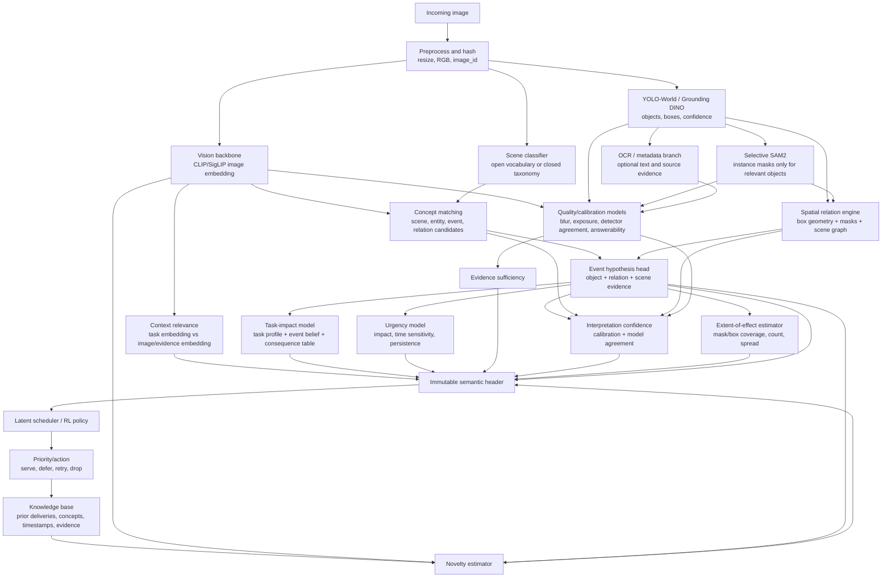

# Semantic evidence extraction pipeline

This diagram separates the small CLIP demonstration from the production pipeline. The
demo uses CLIP prompt matching and simple rules. The production design uses the same
header contract, but replaces the prompt-only parts with detector, segmentation,
relation, calibration, and knowledge-base components.



## Header sent to the scheduler

The image content is not sent as a long list of labels. The extractor first keeps
the rich intermediate evidence internally, then emits fixed-size numeric fields:

```text
scene_id, scene_score
entity_count, entity_summary_vector, entity_evidence_score
event_id, event_belief
relation_count, relation_summary_vector, relation_evidence_score
context_relevance
novelty
task_impact
urgency
evidence_sufficiency
interpretation_confidence
extent_of_effect              # unavailable in the first RL milestone
```

`entity_1` and `relation_1` in the demonstration are only the top-ranked display
labels. They are not the final representation. In production, all detected entities
are retained in a bounded top-k table and compressed into fixed-size summary values
for the scheduler. The scheduler therefore receives numbers, while the audit record
retains the complete detections and provenance.

## Meaning of provenance fields

`impact_source`, `urgency_source`, and `sufficiency_source` identify how a value was
produced. Examples are `demo_rule`, `task_policy`, `trained_head`, `calibrated_model`,
or `unavailable`. They are metadata for auditability, not extra importance signals.

The demo uses `demo_rule` for impact and `demo_task_policy` for urgency. Those values
are deliberately transparent rules, not claims that CLIP has learned real-world
consequence or time sensitivity. A trained or calibrated version must replace them
before reporting scheduler performance.

`sufficiency_proxy` is an image-quality heuristic based on sharpness and exposure.
It answers “is there enough usable visual evidence for the extractor?” It does not
answer “is the image important?” and it is not a probability until calibrated. The
real version combines image quality, detector confidence, segmentation coverage,
cross-model agreement, and answerability calibration.

## Parameter calculation map

| Parameter | Value produced | Main evidence | Scheduler interpretation |
|---|---|---|---|
| Scene | taxonomy id plus confidence | scene model / CLIP or SigLIP | what broad situation is shown |
| Entities | bounded object set and summary score | YOLO-World or Grounding DINO; SAM2 masks | what is present and how strongly detected |
| Event | event id plus calibrated belief | scene + objects + relations | what may be happening |
| Spatial relations | relation summary and confidence | boxes, masks, scene graph | how entities interact |
| Context relevance | cosine or calibrated match score | task embedding versus image/evidence embedding | how well this image serves the current task |
| Novelty | distance from delivered-history evidence | knowledge base plus embeddings | whether this adds new information |
| Task impact | bounded consequence score | task profile, event belief, consequence table | expected value if delivered |
| Urgency | bounded time-sensitive score | impact, event persistence, deadlines | how quickly it should be served |
| Evidence sufficiency | calibrated probability/score | quality and model agreement | whether delivery is likely to support a decision |
| Interpretation confidence | calibrated confidence | agreement and calibration | how much the scheduler should trust the header |
| Extent of effect | affected-area/count/spread value | masks, boxes, scene geometry | how widely the event matters; deferred initially |

The first RL milestone uses only `novelty`, `context_relevance`, `task_impact`,
`urgency`, and `evidence_sufficiency`. Scene, entities, events, and relations are
upstream evidence used to derive those values; they are not necessarily separate
policy inputs. Extent is explicitly unavailable in that milestone.

