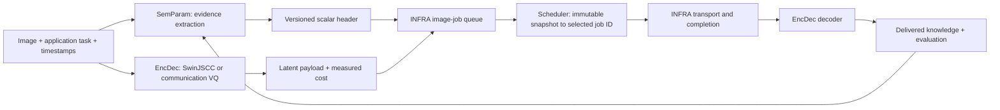

# Semantic-aware image-latent scheduler: final development plan

Design decision, 2026-09-28. This is an implementation plan, not a claim that the complete pipeline or trained policy exists. It uses the supplied presentation and the user's *Suggested parameters for image* note as design inputs. Their older UE, O-RAN, RB, progressive-layer, and weighted-SPI proposals do not set the present scope. This plan supersedes the disaster-specific extraction proposal where it conflicts with the later requirement for general images and single-valued header fields.

## 1. The question the system must answer

Given several **whole image latents** ready to send, which one should be served next for a declared task? The answer may change with the task and with what has already been delivered. A photo of the Eiffel Tower, an ordinary portrait, and a burning house have no universal ordering. For a landmark-identification task the tower may be valuable; for emergency assessment the apparent fire is stronger evidence. A still photo cannot establish whether a person is conscious, whether a vehicle is moving toward anyone, or whether a fire is current without corroborating evidence.

The application supplies a versioned task definition and optional capture time, deadline, and source/event identifiers. The image extractor supplies **separate numeric scalar fields** about visible content and evidential quality. The scheduler sees those fields, the waiting queue, and service constraints. It never sees the image or latent tensor. A priority estimator may predict one of the four requested classes (Critical, Emergency, Moderate, Normal), but the estimated class is visibly distinct from measured image evidence and human labels. There is no hand-written weighted semantic-priority index.

The selected SwinJSCC or SwinJSCC-codebook representation is transmitted and decoded; successful delivery updates the receiver-side knowledge state. The research claim to test is **better ordering and earlier useful delivery**, not that queue reordering itself compresses data. Codec and codebook savings are evaluated separately.

Scope now: image-level, nonpreemptive jobs, one complete latent or codebook payload per image; no device/UE scheduling requests, O-RAN decisions, RB allocation, or guessed progressive latent layers. The decoder is on the receiving side in the conceptual flow. Mixed general imagery and explicit task context are required. The four-class demonstration remains a notebook deliverable with real curated image thumbnails and manually reviewed labels.

## 2. What the literature contributes, and what it does not

| Evidence | Design consequence | Limit |
|---|---|---|
| [SwinJSCC](https://arxiv.org/abs/2308.09361) supports image reconstruction under varying channel conditions/rates. | Reuse the existing encoder/decoder and measure real latent demand and reconstruction. | Rate adaptation is not proof that arbitrary latent subsets are independently decodable or semantically ordered. |
| [Transmit What You Need](https://arxiv.org/abs/2412.13646) shows objects, relations, and richer scene representations serve different visual tasks. | Extract scene, event, object, and spatial evidence before reducing it to compact header scalars. | It does not establish a generic priority class or validate our header. |
| [CLIP](https://arxiv.org/abs/2103.00020) aligns images and task text. [YOLO-World](https://arxiv.org/abs/2401.17270) and [Grounding DINO](https://arxiv.org/abs/2303.05499) localize text-described objects. | Reuse one image-text backbone for task/scene/event similarities; benchmark one small detector for object and relation evidence. | Similarity and detector scores are not calibrated factual confidence or urgency. |
| [Visual Genome](https://arxiv.org/abs/1602.07332) motivates explicit object relationships. [DINOv2](https://arxiv.org/abs/2304.07193) provides reusable visual descriptors. | Keep rich detections and nearest-neighbor evidence in an audit artifact, then expose bounded scalar summaries. | Image-plane overlap is not proof of causal interaction; descriptor distance is not importance. |
| [CrisisMMD](https://arxiv.org/abs/1805.00713), [LADI v2](https://openaccess.thecvf.com/content/CVPR2025W/EarthVision/papers/Scheele_LADI_v2_Multi-label_Dataset_and_Classifiers_for_Low-Altitude_Disaster_Imagery_CVPRW_2025_paper.pdf), and [EmergencyNet/AIDER](https://arxiv.org/abs/2104.14006) offer informative/event/damage evidence. [Radiology triage](https://pmc.ncbi.nlm.nih.gov/articles/PMC6438359/) uses four urgency classes. | Use public image evidence labels where license permits; write a separate task-conditioned human priority rubric. | Disaster and medical classes are domain labels, not universal image priority ground truth. |
| [Smart chest X-ray worklist prioritization](https://arxiv.org/abs/2001.08625) shows priority can reduce average delay yet worsen extreme waits. | Compare FIFO, class priority, EDF, class round robin, and a maximum-wait safeguard; report tails and false-negative effects. | A radiology workflow does not directly validate our visual model. |
| [Significance-Driven Semantic Communication](https://arxiv.org/abs/2608.28441), a 2026 preprint, frames per-sample significance through downstream task loss and schedules accordingly. [Conditional Visual Evidence Utility](https://arxiv.org/abs/2608.28316), another preprint, demonstrates state-dependent evidence order in controlled search. | Evaluate priority against explicit task outcomes and update novelty after delivery. Static scene rarity alone cannot define utility. | Neither supplies our general-image labels, scalar schema, or a demonstrated SwinJSCC pipeline. |
| [QuizRank](https://arxiv.org/abs/2509.15059) evaluates images by whether they help answer a specific question. [Visual Jev](https://arxiv.org/abs/2609.25845) reuses one VLM visual prefix for many fixed-choice questions. | Task-question probes are an optional later comparator for value/importance; batch questions if a VLM is justified. | The 4B-scale VLM approach is unnecessary for the first efficient extractor, and neither paper is an image-latent scheduler. |
| [Calibration of modern neural networks](https://arxiv.org/abs/1706.04599) separates score from calibrated probability. | Reserve “confidence” for held-out-calibrated heads; retain raw similarity/score type elsewhere. | Calibration can fail under a new domain and must be rechecked. |

The papers support **components and evaluation logic**, not a published, validated universal scalar importance header. Our novelty, if demonstrated, would be an empirically tested composition of task-conditioned evidence, delivery-aware history, and whole-latent scheduling. It must not be asserted merely from this plan or synthetic simulation.

## 3. Fixed system boundary and data flow

- **EncDec** owns codec inference, communication codebook indices, reconstruction, checkpoint/rate identity, and honest bit/channel-use measurement. Existing checkpoints and pinned source snapshots stay intact.
- **SemParam** owns image-only evidence extraction, the lightweight task/delivered-history knowledge store, calibrated prediction heads, and header serialization. The default image extractor must run without a codec checkpoint. A codec-dependent retention estimator obtains features through `INFRA.features.FeatureProvider`.
- **Scheduler** owns pure policies over immutable, bounded queue observations and budgets. It must not import EncDec, image models, or neural frameworks for ordinary policy execution. A trained policy is loaded through a narrow inference adapter if needed; queue mutation stays in INFRA.
- **INFRA** owns image-job contracts, arrivals, service time, deadlines, drops, transport calls, queue state, knowledge-update events, experiment configuration, and run artifacts. Preserve current UE-shaped contracts/tests as compatibility surfaces; introduce the image-job path separately.

The **header is a logical sidecar paired by immutable `job_id` and `payload_id`** in this prototype. Its encoded byte length is measured. An analog SwinJSCC symbol stream and a digital TLV header have different physical accounting; do not claim an over-air framing standard or add their numbers as if they shared units. A codebook payload is digital and must include actual framing/entropy-coding overhead when claiming bits. Float tensor storage is never counted as radio traffic.

## 4. The scalar contract

One header field contains **one numeric value**. Categorical IDs are integer scalars; they are one-hot encoded or embedded by a learned predictor, never interpreted as ordered magnitudes. The canonical local `ParameterValue` also carries availability, unit, score type, extractor/model version, and provenance. Serialized v2 header has a schema/vocabulary revision, fixed field IDs, a presence bitmap, bounded numeric encodings, and a checksum. It must round-trip and keep v1 decoding working. Missing is *unavailable*, not zero. Sensitive or unsupported inferences are not silently promoted to facts.

The schema starts with roughly 20–30 scalar slots; its exact byte size and top-object count are selected after measuring real output distributions. The following is the **field register to implement and validate**, not permission to fabricate every field on every image:

| Field or scalar family | Meaning and source | Availability / interpretation |
|---|---|---|
| `task_id`, `task_version`, `capture_time_ms`, `deadline_ms` | Application/manifest context. `deadline_ms` is optional. | No task means no task relevance or task consequence estimate. A filename never supplies a class. Current age/slack is computed from timestamps at each decision, not frozen into the image header. |
| `scene_id`, `scene_match_score` | Top scene among a versioned generic prompt taxonomy from the existing CLIP backbone; examples indoor, road, landmark, residential. | Score is prompt similarity, not confidence. `unknown` is valid. |
| `event_id`, `event_match_score` | Top visible event/condition, e.g. apparent fire/smoke, collision scene, gathering, ordinary scene, from a validated prompt/head. | “Possible visible fire” is not verified emergency status or current timing. Multi-label evidence stays in the local artifact. |
| `activity_id`, `activity_match_score` | Visible still-image action/pose category when a supported model identifies it. | Unavailable for movement direction, speed, patient consciousness, intent, or other temporal/medical claims from one still. |
| `object_count`, `person_count`, `object_1_id`…`object_K_id`, `object_1_score`…`object_K_score` | Detector count and top-K distinct detected categories, with documented selection/tie rule. | K is measured then fixed in schema; `object_truncated_count` exposes omissions. A zero count means no supported detection, not proof of absence. |
| `relation_subject_id`, `relation_id`, `relation_object_id`, `relation_score` | One best-supported 2-D relation triple (for example person beside vehicle), selected from detector geometry or a trained relation model. | Geometry only justifies overlap/left-of/inside, not “injured,” “trapped,” or “caused by.” Unknown triple is unavailable. |
| `task_similarity`, `task_object_match_count` | Image-to-task cosine similarity and detector matches to declared task concepts. | K-means is not the relevance estimator; clusters may help retrieval only after validation. Similarity is not value of information. |
| `delivered_duplicate_score`, `delivered_fact_novelty`, `confirmation_gain` | Exact/near-duplicate similarity and task-fact change relative to **successfully delivered** history; clearer corroboration may add value. | Empty history is unavailable. Fact novelty requires a matched event/location with validated facts; no false “new fact” from viewpoint change. |
| `temporal_change_score` | Difference from a known earlier view of the same event/place. | Unavailable without trustworthy image grouping/time. Do not infer cross-device scarcity in this image-only scope. |
| `blur_score`, `exposure_bad_fraction` | Deterministic evidence-quality measurements. | Low image quality should lower certainty, not automatically lower priority. |
| `event_probability`, `priority_class_probability`, `out_of_domain_score` | Calibrated supervised heads and OOD detector after held-out validation. | A CLIP prompt softmax is **not** accepted here. Record class probabilities separately from the chosen class; if not calibrated, mark unavailable. |
| `estimated_impact`, `estimated_urgency`, `predicted_priority_class` | Separate task-conditioned supervised targets, rather than an SPI. Impact = potential consequence under declared task; urgency = cost of waiting; class = final ordinal label prediction. | Require an annotation rubric and independent labels. No deadline or currentness claim can be invented from pixels. Manual class for baseline is a distinct provenance value. |
| `payload_cost`, `header_bytes`, `codec_mode_id`, `rate_id` | Measured payload demand and selected codec mode. `payload_cost` has an explicit unit tag: complex channel uses **or** digital bits. | Do not rank arbitrary mixed units as one number. Header bytes are reported separately; simulation service duration follows a declared conversion/service model. |
| `estimated_task_retention` | Optional predicted probability that the downstream task remains answerable after decode at a specified codec/rate/channel condition. | Only after paired original/reconstructed training and validation. Unavailable in the initial extraction path; PSNR or raw Swin features do not provide it by themselves. |

The object slots and relation triple satisfy the single-value requirement: each slot is a scalar, while related slots share stable IDs and a schema. A full caption, embedding, object list, or scene graph remains **local audit evidence**, never an unbounded “semantic content” header. A short human-readable description can be generated for explanation, but is not a scheduling parameter.

## 5. Extraction method, in runtime order

1. **Validate context and image.** Decode/preprocess once, hash the image, attach the supplied task/version/time, and record unsupported metadata as unavailable. Use one versioned task specification containing goal text, concept prompts, rubric, and decision endpoint. The application supplies this; scene classification cannot guess the user's goal.
2. **Reuse one visual-language pass.** Start from the repository's existing CLIP backend for scene/event candidate similarity and image-to-task similarity. Freeze the prompt set and backbone version per experiment. CLIP's image vector stays local for matching and audit.
3. **Detect objects once.** Benchmark a small YOLO-World configuration against the existing proposed Grounding DINO reference on a labeled mixed-image slice. Select one runtime detector by measured recall of task-relevant objects, latency, memory, and download/checkpoint reliability. Keep boxes and raw scores local; derive counts, top-K IDs, and defensible geometry. Do not run SAM, depth, a second VLM, and graph inference by default.
4. **Query lightweight knowledge.** Use a small local in-memory/SQLite index for the prototype, with task specifications separate from delivered observations. Query matching delivered images/facts before writing the candidate. Pending, failed, dropped, and delivered states remain distinct. For generic unrelated photographs, only exact/near-duplicate retrieval may be available; event-level fact change is unavailable without reliable event identity.
5. **Measure quality and calibrated uncertainty.** Compute blur/exposure deterministically. Fit calibration only for supervised outputs with held-out labels and report calibration error. Missing/out-of-domain evidence remains visible; do not drop a possible critical image just because one model is uncertain.
6. **Serialize and pair with the encoded payload.** Create the scalar v2 TLV (or equivalent bounded binary) header, round-trip it, measure bytes, and bind it to the latent job. Update delivered history only after actual successful decode/acceptance.

Image-first extraction is the reference because the image is available before encoding in this offline prototype. A **latent-only student extractor** is a separate, measured experiment: freeze the codec, obtain paired original-image evidence and Swin latent features through the provider interface, train small heads, and compare field errors, class decisions, latency, and final queue outcomes at each codec mode/rate/SNR. Original-image teacher outputs are pseudo-labels, not human truth. Do not deploy the student simply because it produces numbers.

## 6. Dataset and supervision that make “important” meaningful

There is no validated universal four-class priority label for arbitrary images in the reviewed sources. Build a versioned **task-image annotation table**. Each row has image source/license/hash, task text and ID, independent evidence labels where available, human priority class, impact/urgency judgment, rationale, annotator ID, disagreement, and split group. At least two annotators review ambiguous priority cases; disagreement is preserved rather than forced into a false certainty. Decide a simple written rubric before test labels are seen.

The prototype mixes ordinary photos, landmarks, people, roads, accidents, hazards, and other scenes. It includes deliberately **same-image/different-task** pairs. For example, an Eiffel Tower image changes relevance when the goal changes from emergency assessment to landmark identification; the visible scene and detector results do not. A portrait does not become “Critical” merely because it contains a face. An apparent house fire can be high-consequence for an emergency task, while current urgency still depends on trustworthy time/context.

The presentation notebook uses **24 curated images, six manually assigned examples in each class**, including real disaster/traffic scenes plus generic controls. Show every image, source, task, label, and rationale for review. These labels are supplied directly to baseline policies. Public datasets may supply object/event evidence labels, but their categories are not silently converted into our priority classes. Check source terms before downloading or redistributing assets.

The learned models need a separate larger annotation effort and source/event/near-duplicate grouped train/validation/test splits. Do not call 24 demonstration images a classifier training set. Size the collection after a pilot learning curve and error analysis; record class imbalance and domain coverage instead of promising generality from an arbitrary sample count. Annotators must be blind to extractor predictions where practical. Priority labels must never be recovered from filenames, source folders, or future receiver state.

## 7. Scheduling: baseline, learned predictor, then RL experiment

**Ground-truth and predicted priority are separate experiments.** First, the notebook feeds human classes directly to FIFO, strict class priority, EDF, class round robin, and strict priority with a maximum-wait safeguard. It plots the *actual* before-arrival and after-service thumbnail arrangements for **every algorithm**, service ranks, delay, throughput, class fairness, deadlines, and distinct overflow/expiry drops. The same arrival/service trace and seed are reused for each policy. Static equal-cost/all-arrive-together ordering verifies class behavior; streaming, overload, and unequal-service traces reveal trade-offs. Oracle/manual priority is an upper-bound diagnostic, not a model result.

Then train a small **task-conditioned ordinal priority head** (MLP or gradient-boosted tabular model; choose by held-out accuracy/calibration/runtime) on the separate scalar fields. Feed its *predicted* class to the same queue policies, including a false-negative safety analysis and abstention/uncertain bucket. Evaluate macro-F1, ordinal error, confusion matrix, expected calibration error, task-switch consistency, and throughput/delay consequences. An explicit deadline is queue metadata; it is not learned from pixels. Compare feature-family ablations to test whether objects, scene/event, task similarity, history, and quality each change decisions usefully.

Finally implement a **masked DQN policy as a research comparator**, not as a presumed upgrade. Its observation is a bounded set of eligible job scalar fields plus current age/slack, service cost, and queue summary; its action is exactly one eligible whole-latent job ID or idle where permitted. Padding/actions must be masked, ties deterministic, and no future arrivals or manual test labels may enter the observation. Use a small shared per-job network, replay buffer, target network, fixed seeds, and source modules rather than notebook-only training. Fix the decision objective *before* tuning: maximize timely delivery by the human class ordering, then enforce/report a maximum-wait guard for lower classes. A standard scalar DQN needs numeric trade-offs; derive them from a declared application rubric or elicited pairwise trade-offs and record them, rather than pretending the model invents what matters. If such trade-offs cannot be justified, use strict class ordering as the actual policy and report DQN as unresolved instead of quietly adding arbitrary feature weights. DQN must beat matched predicted-class baselines on held-out workloads and costs to become the selected policy. It cannot outperform an oracle on an objective that simply rewards following oracle classes.

The environment should model nonpreemptive **variable service duration** from a measured payload cost and declared service rate; the current INFRA slot simulator completes any admitted selected job at the slot boundary and cannot express this honestly. Add a separate image-job simulator, preserving legacy behavior and tests. Its event order is completion, waiting-job expiry, arrival/admission, then decision. A job finishing exactly at its deadline succeeds; overflow, expiry, late completion, transport failure, and horizon censoring are distinct. The policy receives immutable snapshots; INFRA alone changes queue/clock/job state.

Evaluation compares identical offered jobs, order, seeds, load, cost mode, channel setting, and deadlines. Report per-class waiting/completion delay (median, p95, max), timely completion fraction, critical false-negative delay, image throughput, deadline miss/drop reason, class fairness, policy latency, extractor latency, and header overhead. Use confidence intervals over independent traces or image groups, clearly identifying the replication unit. Never infer real radio throughput from a synthetic service constant.

## 8. Codec integration and receiver-side usefulness

Run real checkpoint inference on selected images for **native SwinJSCC** and the repository's **communication-codebook** route as two named modes. Verify preprocessing, latent shape, codec/rate/SNR configuration, payload identity, round trip, and one matched image-by-image reconstruction test before using them in scheduling. Preserve model/checkpoint provenance. Codebook K=256 means an index can be represented in eight raw bits, but total transmitted cost also depends on number of indices, framing, coding, and protection; report measured or explicitly calculated quantities accordingly.

On successful decode, run the declared downstream question/classification on the reconstructed image and compare with the original and independent ground truth. Save PSNR/SSIM only where a reconstruction exists; report task retention and failure separately. The receiver knowledge store records **only accepted deliveries**. This makes a repeated image less valuable after a clear delivery, while allowing a replacement after a failed one. Do not interpret transmission or compression measurements as evidence that the scheduling policy understands semantics.

## 9. Work packages and acceptance gates

| Package / owner | Concrete output | Acceptance before dependency proceeds |
|---|---|
| A. Dataset and task rubric (SemParam + user review) | Versioned mixed-image manifest, task specs, 24-image notebook labels, larger annotation protocol. | Source/rights documented; classes and disagreements visible; same-image/task-switch examples checked. |
| B. Scheduler baseline (INFRA + Scheduler) | Image-job contract, variable-service event simulator, five deterministic baselines, standalone notebook and actual-order plots. | Hand-calculated tiny schedules, arrival/deadline/drop edge cases, restart-and-run-all CPU notebook, all results persisted. |
| C. Scalar extractor (SemParam) | Versioned v2 field registry/header, CLIP + selected detector, quality features, KB query/update rules, provenance. | Header round-trip/byte count; field-level labeled tests; missingness, no-history, no-leakage, task-switch, and delivery-only knowledge tests. |
| D. Predictive priority (SemParam + Scheduler) | Calibrated ordinal class/impact/urgency heads; predicted-class policy run. | Grouped held-out results and class-to-queue error analysis outperform trivial task-only/scene-only controls before claims. |
| E. Real latent integration (EncDec + INFRA) | Paired SwinJSCC and codebook payload paths, receiver decode, measured cost/quality/task retention. | Actual checkpoint inference, payload/header identity, unit correctness, transport failures, matched before/after evidence. |
| F. RL comparison (Scheduler) | Masked DQN, declared reward/rubric, replayable train/eval notebook, ablations. | No future/test-label access; stable seeded training; held-out workload gains over matched baselines without unacceptable critical misses/starvation. |
| G. Final combined report (INFRA) | One command/notebook reproduces task → evidence → scalar header → queue → selected latent → decode → knowledge update → metrics. | Clean-environment run, committed source and pinned assets, saved traces/plots/config/commit/dirty state/source digest and limitations. |

Own core logic in canonical source modules; notebooks import it. Local Git is the source of truth and the existing remote is the sync target. A standalone Local/Colab/Kaggle experiment notebook must offer a guarded clean reset of **only its disposable clone**, check out an explicit commit, detect CPU/GPU backend, and write run-ID artifacts to a configured persistent location outside that clone. Do not imply TPU or multi-GPU compatibility without a separately supported path. Run owning-module tests first, then integration regressions. Architecture changes update `PROJECT_MAP.md` and migration notes; refresh Graphify and record the exact source digest. Preserve archived baseline work and teammates' uncommitted work.

## 10. Stop/go decisions and honest limits

The first substantial design review is **the field contract and annotation rubric**: without these, a model can learn a visually plausible but wrong priority. The next is **actual runtime and field accuracy** on mixed images; if the detector adds little, remove it from runtime. The next is **predicted-priority scheduling versus manual-priority upper bound**; this separates visual inference errors from scheduling errors. Only then is an RL gain meaningful. The final gate is full checkpoint-based latent delivery with receiver-side task retention.

No current paper or repository result proves that the proposed scalar set is sufficient for all tasks. No current feature detects consciousness, verified harm, or future consequence from an arbitrary still. The knowledge base can estimate redundancy only from scoped, actually delivered evidence. Image-level SwinJSCC scheduling does not implement progressive token/layer selection. These are clear research extensions if the measured whole-image system works.
