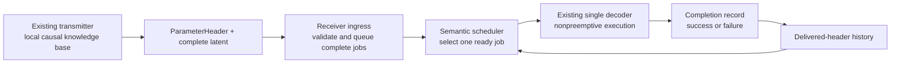
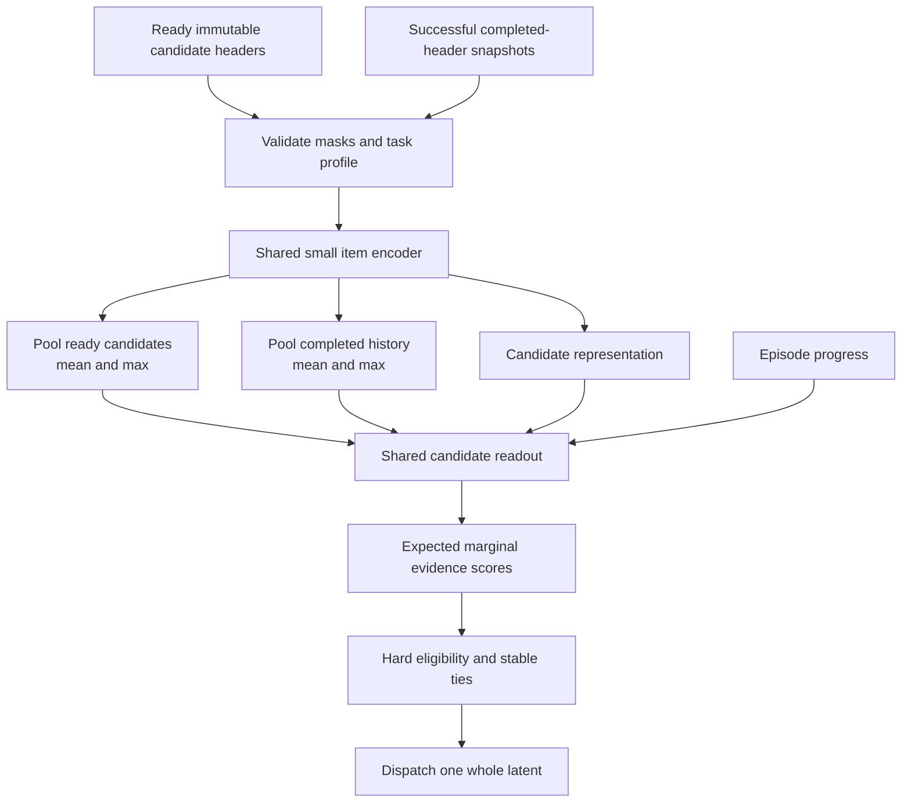
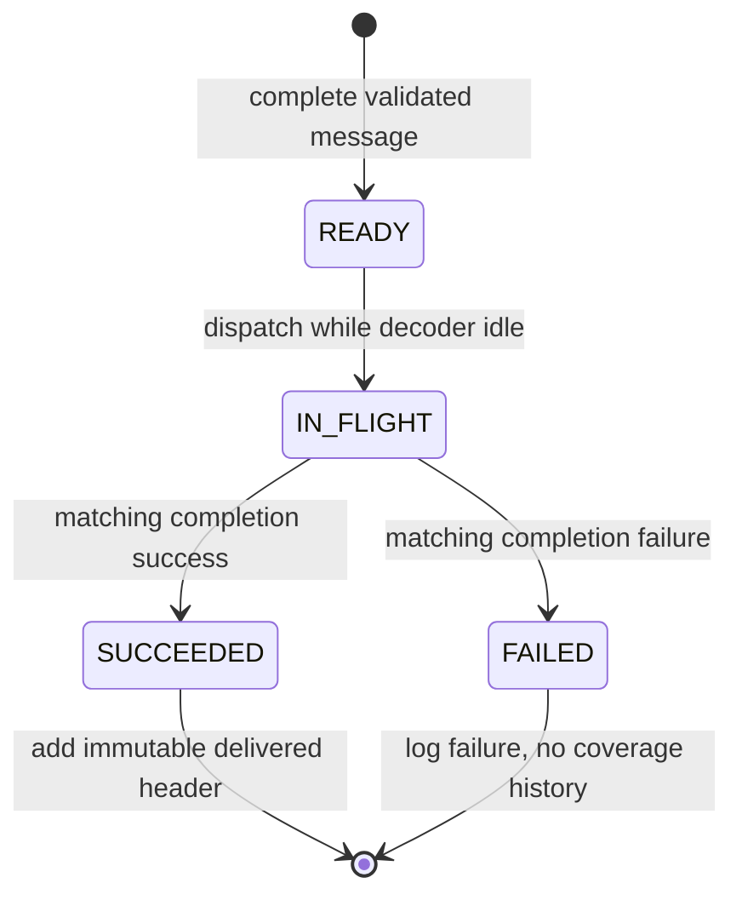

# Master execution plan: semantic ordering of received image latents

> Historical research/design context copied before implementation. The user's
> subsequently approved build plan and current execution record are authoritative
> in [BUILD_STATUS.md](BUILD_STATUS.md). In particular: no new human reviewers,
> building presence/damage as known tasks, published-label/controlled-overlap
> truth, and separately held-out structural-flooding scheduler transfer.

**Date:** 24 October 2026.
**Status:** revised after the 24 October critical review. The proposed runtime architecture remains unimplemented; an additive CPU diagnostic and parameter-selection pilot is recorded separately.
**Historical scope:** this copied research plan superseded [06_REVISED_APPROACH_AND_RL_PLAN.md](../../../SemanticSchedulerEnd2End/docs/decoder_scheduler_redesign/06_REVISED_APPROACH_AND_RL_PLAN.md) before the subsequent user-approved build plan. The current implementation record is BUILD_STATUS.md. Earlier protocols and results retain their historical meaning.

## 1. The decision

Build one completion-aware receiver pipeline. Its proposed policy predicts the **expected additional important task evidence** supplied by each ready latent, conditional on the headers of already completed jobs. Start with transparent overlap summaries and a small contextual tabular predictor. Compare a learned set-context model only after that baseline. Add a compact descriptor, attention or reinforcement learning when a specific experiment establishes why it is needed.

This applies the useful mechanisms from recent semantic scheduling research without combining incompatible radio, token-selection, retrieval and decoder objectives into one system.

The first implementation increment is small: an explicit completion lifecycle, a reproducible contextual benchmark, and a lightweight supervised contextual scorer using the existing header. In parallel, review a small cross-domain correspondence cohort before claiming real semantic novelty. The principal research uncertainty is whether the available headers identify semantic overlap well enough. A larger policy cannot repair information that the header has discarded.

**Review-driven correction:** the present original-image-ID benchmark has one weighted unit per job. With equal service costs and known units/weights, distinct-unit greedy is exactly optimal for A_K. It cannot demonstrate a need for RL planning. Also, FIFO/RR lose badly on the saved primary A10 metric; their lower repeat fraction is not overall semantic superiority. See the [critical review and measured evidence](../../../SemanticSchedulerParameterAudit/docs/scheduler_review/REVIEW_AND_DECISIONS.md), [research sources](../../../SemanticSchedulerParameterAudit/docs/scheduler_review/RESEARCH_EVIDENCE.md), and [pilot validation](../../../SemanticSchedulerParameterAudit/docs/scheduler_review/VALIDATION.md).

### What we want to show

1. When semantic parameters help order important image evidence, and when they fail.
2. Whether conditioning on delivered history improves distinct-evidence coverage over a strong importance-only policy.
3. Whether extra semantic information earns its header and extraction cost.
4. Whether sequential optimization adds value beyond good marginal-gain prediction and inexpensive planning.
5. Whether the conclusions survive independently annotated images, different views, unseen groups, and actual decoder outcomes.

These are testable questions. A journal contribution would be supported by the resulting mechanisms, comparisons and evidence; neither a PPO implementation nor a combination of recent components guarantees novelty or acceptance. Generality initially means one policy works across declared tasks and unseen source/site groups. Unseen-task transfer is a separate, stricter claim.

## 2. Preserve the actual project

### 2.1 Fixed system boundary



- The payload is already received. One complete image latent is one atomic job.
- One decoder processes one job at a time, without preemption. The system serves an eligible job whenever idle.
- There are no radio resource grants, retransmissions, patch requests, token pruning or encoder changes in this study.
- The objective is useful evidence early. Throughput, fairness and radio efficiency are not substitute objectives.
- No policy sees pixels, latent contents, evaluator fact IDs, priority labels or future arrivals under the existing information contract.
- Transmitter-side novelty and its knowledge base remain. Compute novelty before inserting the current observation into the sender's history.
- A receiver scheduling gain cannot establish image compression or reduced channel usage: the bytes have already arrived.

### 2.2 Baseline identity and existing ownership

The audited source is teammate branch `new-scheduler`, commit `2f16785a16dd9c58ce12c98b502087cc212b279b`, in the isolated sibling checkout `SemanticSchedulerParameterAudit`. The original `SemanticSchedulerEnd2End` checkout has unrelated local modifications. Do not merge, reset, overwrite or train from an unspecified mixture of these checkouts.

| Component | Existing responsibility | Preserve / proposed change |
|---|---|---|
| `SemParam/decoder_parameters.py` | Eight parameters, masks, task profiles, causal transmitter history | Preserve definitions and provenance; validate constructs before selecting a feature profile |
| V3 parameter header | 32-byte serialized header with CRC and identification metadata | Preserve for the primary experiment |
| `Scheduler/decoder_scheduler.py` | Header-only policies and the current independent 16-input MLP | Preserve frozen baselines; add a separate contextual policy |
| `INFRA/decoder_queue.py` | Validate complete messages, create ready snapshots, dispatch and remove a selected job | Preserve ingress; establish explicit caller-owned completion integration |
| `INFRA/learning/decoder_v3_study.py` | Existing study and training machinery | Preserve historical results; reuse compatible utilities without changing their meaning |
| `INFRA/learning/decoder_parameter_audit.py` in isolated checkout | Completed diagnostic probes | Preserve measured evidence; do not rerun unchanged experiments as apparent progress |

The queue currently removes a job at dispatch and returns it to the caller. It does not itself track decoder completion. This is an integration contract to make explicit, not proof that the queue is broken. A contextual policy needs to distinguish ready, in-flight, successful and failed jobs.

### 2.3 What the completed audit actually established

Source: [measured findings](../../../SemanticSchedulerParameterAudit/docs/parameter_audit/FINDINGS.md), [protocol](../../../SemanticSchedulerParameterAudit/docs/parameter_audit/PROTOCOL.md), and [final run validation](../../../SemanticSchedulerParameterAudit/results/parameter_audit/20261024T010201_real_final/post_run_validation.json).

- 1,934 original cached records; A=445 fitting, B=178 calibration, C=267 development diagnostics. Test records were excluded before label/model use.
- Nine focused tests passed; the final audit ran on CPU in 29 seconds. These checks validate the diagnostic's tested scope, not the new plan.
- C is development-exposed. It is not a new publication holdout.
- Labels in this audit use native standalone utility and controlled observation copies. They do not establish real-world correspondence across viewpoints.

| Development A10 | Building damage | Road damage | Structural flooding |
|---|---:|---:|---:|
| Direct importance I | 0.6817 | 0.7245 | 0.7735 |
| Ridge using all eight fields | 0.6764 | 0.8200 | 0.7865 |
| Small histogram boosting using all eight | 0.6743 | 0.7237 | 0.7838 |
| Header-signature deferral | 0.7621 | 0.7585 | 0.8249 |

Additional fields helped some probes/tasks and did not help others. Signature deferral exploits identical deterministic headers in the copy-based benchmark; it is a required shortcut control, not a demonstrated recognizer of the same disaster from a different angle.

Sender N versus receiver-new observations had AUC 0.5151 / 0.4965 / 0.5218 in the controlled completed-prefix diagnostic. This warns against treating sender novelty as receiver novelty. It does not show that the sender KB is useless. Freshness was unavailable throughout this cache; road Q lacked calibration support. Replacing a ranker with RL does not resolve these limitations.

### 2.4 Subsequent review pilot: exhaustive small-model subset search

The [review pilot](../../../SemanticSchedulerParameterAudit/docs/scheduler_review/VALIDATION.md) ran 255 field subsets × 3 Ridge regularization values × 3 A-only group folds × 3 tasks = 6,885 inner fits, then nine final refits. It completed in 80.084 CPU seconds. Component tests passed 58 with three LightGBM-dependent skips; six additional pilot tests passed. This is cached-feature development evidence, not fresh vision/codec validation or final nested evaluation.

| Exposed-C A10 | Building | Road | Flooding |
|---|---:|---:|---:|
| FIFO | 0.3058 | 0.1657 | 0.1590 |
| RR | 0.3081 | 0.2153 | 0.2100 |
| Direct I | 0.7034 | 0.7197 | 0.7856 |
| A-fold-selected subset | 0.7037 | 0.6120 | 0.7950 |

The selected subsets were R/I, S/I/C and R/I/P/C/N, but fold choices varied and all paired selected-minus-I intervals spanned zero. Do not adopt these as universal best parameters. Direct I remains the practical reference. The exact singleton oracle matched its analytical optimum. This evidence strengthens the requirement to validate semantic targets/relations before escalating architecture or tuning.

## 3. How the recent approaches enter our system

The following is an adaptation map, not a replication claim or a measured ranking of papers. Dates identify the inspected versions or publication. Several recent works are preprints.

| Research approach and source | Mechanism worth transferring | Concrete use here | Boundary / adoption gate |
|---|---|---|---|
| **GOSC**, September 2026 preprint, [Resource-Efficient Semantic Communication for Heterogeneous Agentic Teams](https://arxiv.org/html/2609.39477v1) | Message value depends on task and already shared knowledge; resource decisions use estimated value | Predict marginal task evidence relative to delivered history | No radio pricing, rate control or shared-KB broadcasts; their guarantees do not transfer automatically |
| **DELTA**, 2026 journal version, [Goal-Oriented Medium Access With Distributed Belief Processing](https://www.research.unipd.it/retrieve/bd3d2509-7171-4b37-82db-5fc8c770de9f/Goal-Oriented_Medium_Access_With_Distributed_Belief_Processing.pdf) | Maintain a causal belief using observed communication outcomes | Maintain explicit delivered-history state; update only on completion | No collision protocol, MAC feedback redesign or AoII claim without changing-state truth |
| **RAMSemCom**, May 2025 preprint, [Wireless Agentic AI with Retrieval-Augmented Multimodal Semantic Perception](https://arxiv.org/html/2505.23275v1) | Task-conditioned sequential decisions use retrieval history and learned action value | A later masked PPO policy chooses among complete ready jobs using the same context as supervised learning | Its iterative patch retrieval and extra transmissions are outside this project |
| **ATS-ToDMA**, July 2026 preprint, [Adaptive Token Selection and Token-Domain Multiple Access](https://arxiv.org/html/2607.03520v1) | Attention models relations among candidates; deployment enforces hard constraints | Optional tiny set-attention scorer; hard eligibility masks in every policy | No token scheduling or semantic-interference model; attention must beat pooling |
| **CDFL / SGAM**, April 2026, [Resource-Adaptive Semantic Transmission and Client Scheduling for OFDM-Based V2X Communications](https://www.mdpi.com/1424-8220/26/9/2615) | Representative selection through facility-location structure | A transparent descriptor-coverage comparator | Descriptor representativeness is not independently verified fact coverage; no FL or token-budget machinery |
| **SSMW**, February 2026, [Semantic Security-Aware Multi-User Resource Allocation: A Novel Meaning-First Scheduling](https://www.sciencedirect.com/science/article/pii/S1874490725003313) | Separate causal queue state, constraints and objective | Keep queue legality outside learned semantic preference | Full Lyapunov/secrecy/resource allocation is deferred; inspected access was limited to abstract/introduction/indexed material |
| **Semantic Scheduling for LLM Inference**, June 2025 preprint, [paper](https://arxiv.org/html/2506.12204v1) | Separate semantic priority estimation from execution machinery | Keep the scorer independent of queue lifecycle and decoder execution | No KV cache, batching or preemption; VLM use is optional offline assistance |

Supporting foundations are [Deep Sets](https://papers.nips.cc/paper/2017/file/f22e4747da1aa27e363d86d40ff442fe-Paper.pdf), [Set Transformer](https://proceedings.mlr.press/v97/lee19d.html), [MMR](https://aclanthology.org/X98-1025/), and [PPO](https://arxiv.org/pdf/1707.06347). The proposed implementation uses their mechanisms selectively. It does not claim to reproduce each paper's full system or published gains.

**Decision:** integrate task-conditioned value, completion history and hard constraints in the common pipeline. Evaluate redundancy penalties, representative coverage, attention and PPO as competing policy variants. Do not stack all variants into one uninterpretable model.

## 4. Reformulate the learning target

### 4.1 Importance and marginal value are different

Suppose a queue contains three images:

- A: severe damage to building X.
- B: another view that confirms exactly the same known damage to X.
- C: moderate damage to a previously unreported building Y.

A and B can both have high standalone importance. After A completes, C can add more useful evidence than B. B may nevertheless add a new fact if it reveals an otherwise hidden collapse. Image similarity alone cannot settle this distinction.

The receiver must estimate **additional evidence**, not merely repeat the sender's standalone importance or novelty score.

### 4.2 Evaluator truth

For a fixed task episode, define:

- `F_i`: independently reviewed source-image facts supported by image i.
- `w_f >= 0`: a task-specific fact weight, fixed before policy comparisons.
- `W = sum(w_f)` over the union of facts offered by all source images in the episode.
- `D`: jobs successfully completed so far.

In the ideal-decoder study, assume successful processing exposes the source facts:

\[
C(D)=\frac{\sum_{f\in\cup_{j\in D}F_j}w_f}{W},\qquad
g_i^*(D)=C(D\cup\{i\})-C(D).
\]

`g_i*` is the normalized extra evidence supplied by candidate i. Fact IDs and W are evaluator/training-target data. They are never policy inputs.

The model estimates:

\[
\hat g_i=\mathbb E[g_i^*(D)\mid O],
\]

where O contains only permitted headers, ready candidates and completed-header history. Select the largest predicted gain, with stable FIFO tie-breaking.

This is expected gain under limited information. It is not a claim that a 32-byte header reveals exact physical facts.

### 4.3 Primary scheduling objective

For the first K=10 decode opportunities:

\[
A_K=\frac1K\sum_{k=1}^{K}C_k.
\]

`C_k` is cumulative distinct weighted coverage after opportunity k. A failed attempt consumes its opportunity and adds zero evidence. Require at least K ready jobs in the main static benchmark. If a diagnostic deliberately has fewer, declare its separate denominator convention.

Example: with K=3 and coverage 0.4, 0.6, 0.9, A3=(0.4+0.6+0.9)/3=0.6333. This rewards evidence arriving earlier, not only final coverage.

If W=0, normalized coverage is undefined. Report these episodes and their proportion separately. Do not silently turn them into successful zero-error or perfect-coverage cases.

### 4.4 What completion history means

In a static batch, all headers are visible initially. Completing a job does not reveal new semantic content to an H0/H1 policy. It changes which already-observed representations are counted as delivered. Call this a **delivered-coverage estimate**, not new knowledge discovery.

Actual semantic feedback from decoded pixels would be a different information contract. It is a deferred extension, not hidden inside the proposed history feature.

## 5. Parameter policy: retain the contract, validate its meaning

Do not discard the finalized parameters or force all eight to contribute positively. Keep the wire fields and masks while testing task-specific feature use and producer validity.

| Field | Supported meaning | Validation / correction needed | Scheduler treatment |
|---|---|---|---|
| R | Relevance to the fixed declared task | Independent relevant/irrelevant and hard-negative labels; inspect compressed dynamic range | Candidate utility input; no universal threshold |
| S | Scarcity under the sender's specified causal reference population | Define what is counted, window, smoothing, empty KB and sample support | A potentially useful sender-context prior, not global rarity truth |
| Q | Confidence/reliability of a named semantic claim | Calibrate claim correctness on supported groups; retain unavailable state when calibration fails | Learn interactions; high confidence in absence is not high urgency |
| I | Standalone task importance | Independently reviewed severity/evidence rubric; strong direct-I baseline | Primary utility signal; it does not account for already delivered overlap |
| F | Age/freshness with trustworthy timestamp semantics | Need real capture time and synchronized reference; default tau=30 s makes serialized F zero after about 187 s | Mask missing values; choose a task-justified time scale and test temporal use separately |
| P | Visually occupied area/prominence under the existing extractor | Compare with reviewed object area and task relevance | Do not interpret as physical distance or threat proximity |
| C | Count/entropy-based scene complexity proxy | Check relation to reviewed useful information and extraction failure | Busy scenes need not be important; learn or exclude through validation |
| N | Novelty relative to the sender's causal KB | New asset, same asset/new view, changed condition, empty history and cross-sender overlap | Preserve KB; do not relabel it as receiver novelty |

For KB tests, freeze observation order, compare-before-insert behavior, window and embedding revision. Keep sender histories separate. Test the same image with different legitimate histories: its N/S may change, while evaluator source facts remain fixed. Do not reset the KB opportunistically to improve scores.

The empty KB deliberately yields N=1; this is cold start, not evidence of a new disaster. Test that distinction. The existing header's KB version could support a cold-start indicator in a separately versioned candidate-input contract, without another transmitted field. It is not currently one of the 16 scorer inputs and must not be added silently. Receiver freshness can be recomputed from the existing capture timestamp when trusted UTC is available, so the 187-second finding concerns the encoded F value and default scale, not an assertion that every receiver path always outputs exact zero.

Fit producer calibration and feature preprocessing on allowed training/calibration groups only. Compare I, full fields, a prespecified reduced profile and masks-only controls. Field ablations measure incremental predictive value under a particular task; they do not establish a universal causal meaning.

## 6. Two information tracks

### 6.1 H0: primary, unchanged 32-byte header

Inputs are the eight quantized values, eight validity bits and permitted queue bookkeeping. The policy receives ready-header context and up to 32 successful completion-header snapshots from the current episode/profile. Empty pools have explicit handling. Token/source identifiers are used for routing, lifecycle and deterministic ties, not as learned semantic features.

Successful history means decoder execution succeeded. It does not certify that every semantic fact survived reconstruction. Under ideal decoding this is an explicit assumption; actual codec evaluation measures the difference.

**First gate:** can H0 predict marginal evidence and distinguish important overlap beyond static I and signature matching? If it cannot, document the observable ambiguity. Do not respond by automatically increasing model size.

Make this gate empirical: report held-out standalone-utility and marginal-gain prediction against I, then inspect equal/near-equal permitted header pairs with independently different fact targets. Report how often high-weight new evidence and already-covered evidence are indistinguishable to H0, including the completed-header context. Exact observed collisions demonstrate particular ambiguities; near collisions and finite-sample prediction failures do not prove an information-theoretic impossibility. Any fact-aware or signature-group oracle remains an evaluator diagnostic, not an achievable runtime bound established by this dataset.

### 6.2 H1: optional compact semantic descriptor

This is a proposed separate experiment requiring explicit adoption of a new experimental header profile before implementation. It changes metadata, not the compression encoder. H0 remains the primary compatibility reference.

Use the existing frozen 512-dimensional CLIP representation if its exact model/preprocessing provenance and reuse are verified. Fit a 32-dimensional PCA projection on training groups only, without whitening. Normalize the projected vector; quantize with a serialized scale to signed int8. Test whether it preserves useful semantic-neighbor distinctions. Cosine similarity is a feature, not proof of identical evidence.

Proposed serialized layout:

| Portion | Bytes | Meaning |
|---|---:|---|
| Existing V3 core | 32 | Unchanged existing header and its CRC |
| Extension prefix | 8 | Type u8, version u8, representation profile u16, scale float16, dimension u8, flags u8 |
| Descriptor | 32 | 32 signed int8 coordinates |
| Extension CRC | 4 | CRC32 over core + prefix + descriptor |
| **Total** | **76** | **44 extra bytes versus H0** |

The enclosing ingress must explicitly identify header length/profile. The old 32-byte parser remains unchanged. Reject unknown profiles, incorrect dimensions/lengths/CRC and invalid scale. A zero or nonfinite projection is unavailable, not a valid all-zero semantic descriptor. Round using the serialized scale and clamp to [-127,127]; dequantize using that same scale. Representation profiles pin model revision, preprocessing, PCA mean/matrix, quantization and checksum.

No labels, source-image identity, evaluator asset identifiers or split identifiers enter the descriptor. IDs in transport metadata remain excluded from learned semantic features.

Measure descriptor utility against three same-information competitors: pointwise descriptor utility, explicit descriptor redundancy penalties and contextual descriptor scoring. An H1 model beating an H0 model demonstrates an information-plus-method change, not an isolated algorithm improvement.

### 6.3 Deferred H2: decoded semantic feedback

An independently validated lightweight extractor could later inspect a completed reconstruction and update receiver fact beliefs. That introduces new runtime information and compute. It requires a separate interface, failure analysis and same-information baselines. It is not necessary for the first complete study.

## 7. The proposed architecture



### 7.1 First contextual baseline, then the set-context model

First compare calibrated standalone utility with an explicit redundancy penalty and a small contextual linear/tree predictor. Candidate context consists of permitted header distances to completed items, maximum calibrated overlap, a signature-match flag and history/progress counts. These are predicted relationships, not evaluator fact identities. Compare this model with and without those context features. It directly tests whether useful context exists before requiring a learned pooling representation.

The following Deep Sets design is a stronger candidate, not a predetermined winner:

Start with a Deep Sets-style model, not a transformer:

1. H0 item input: 8 normalized values + 8 masks = 16 dimensions.
2. Shared encoder: `16 -> 32 -> 32`, ReLU between layers.
3. Ready-set summary: mean and max, 64 dimensions.
4. Completed-set summary: mean and max, 64 dimensions.
5. Candidate representation: 32 dimensions.
6. Two progress features: remaining-count fraction and completed-attempt fraction under the fixed static-episode convention.
7. Readout: `162 -> 32 -> 1`; output logit l, gain estimate sigmoid(l).

This has **6,849 trainable parameters**, including biases. H1 uses 49 input dimensions (16 scalar/mask +32 descriptor +1 descriptor-validity), producing **7,905 parameters** with the same summaries/readout. These are design arithmetic, not measured memory or FLOPs.

Use training-only medians/scales where preprocessing is needed; retain masks. Define empty summary outputs explicitly and use progress to distinguish empty completion history. Pooling is permutation-invariant; stable queue order only breaks actual score ties. A permutation of candidates must not change their associated scores.

Runtime inference is exported NumPy arithmetic; policy modules do not import PyTorch, decoder models or VLMs. Training remains in INFRA. Export a versioned artifact containing weights, preprocessing, information profile, task profile, source/data revisions and checksums.

### 7.2 Completion lifecycle



Keep one authoritative service owner. If the existing caller already owns decoder state, extend that caller with the contract rather than create a second state machine.

- At most one in-flight job; dispatch while busy produces no new selection.
- Completion must match the in-flight token/session; reject duplicate or foreign completions.
- Record dispatch/completion monotonic times and terminal outcome. Wall-clock capture time remains separate.
- Commit the header-at-dispatch snapshot to delivered history only after successful completion.
- A failed execution consumes time/opportunity, adds no delivered semantic history, and has no automatic retry.
- Header N/S are immutable. The receiver never overwrites them to represent its own coverage.
- History is bounded to 32 in the initial static benchmark and reset per episode/profile; study larger histories separately.
- No valid candidate: return explicit no-selection. Malformed ingress is rejected; invalid/nonfinite model output falls back to the frozen direct-I policy and is counted.

Completion tracking, training truth and semantic inference are different responsibilities. An opaque payload and token may cross the service boundary without exposing either to the semantic scorer.

## 8. Policies to implement and compare

All policies use the same workload, legal candidate set, decoder outcomes and resource budget within their information track.

| Tier | Policy | Question answered |
|---|---|---|
| Required references | FIFO, round robin, seeded random, direct I | Is semantic ordering useful; does learning beat the strongest practical simple reference? |
| Required diagnostic | Existing header-signature deferral | Are improvements explained by exact-copy construction? |
| Required learned static | Linear probe, small tree, pointwise MLP; preserve the frozen previous best as historical comparator | Does nonlinear standalone utility suffice? |
| First learned contextual method | Small linear/tree gain scorer with explicit delivered-header relation summaries | Does usable context improve ordering without a learned set representation? |
| Stronger contextual candidate | Supervised set-context marginal-gain scorer | Do learned summaries improve on the contextual tabular baseline? |
| Transparent contextual alternative | Calibrated MMR-style utility/overlap penalty | Can an explicit redundancy rule explain the same improvement? |
| H1 conditional alternative | Weighted facility-location greedy | Does representative descriptor coverage suffice? |
| Conditional model variant | Tiny Set Transformer with comparable compute | Are pair-specific relations missed by mean/max pooling? |
| Conditional planner | Two-step lookahead over predicted gains | Is inexpensive planning sufficient? |
| Final gated extension | Masked PPO, initialized from the supervised scorer | Does learned sequence optimization add value under the same observation contract? |

SJF and EDF are not main semantic competitors. Add SJF only in a measured unequal-service diagnostic; add EDF only if genuine application deadlines exist. Fairness quotas and throughput rewards would change the objective and are excluded from the primary result.

### 8.1 Explicit redundancy baseline

Estimate standalone utility u_i and directional overlap q(i,h), the fraction of candidate i's useful evidence already covered by completed job h. A simple score is:

\[
s_i=\hat u_i\left(1-\max_{h\in D}\hat q(i,h)\right).
\]

With no completed jobs, the penalty is zero. Estimate overlap using permitted headers/descriptors; train/calibrate against reviewed overlap pairs from training groups. Unknown correspondence is not a negative pair. For a candidate with zero useful evidence, the fractional overlap target is undefined; handle its utility separately.

The maximum pairwise overlap misses coverage accumulated jointly across several jobs. Summing overlaps can double-count shared facts. These are reasons to compare this baseline with the contextual model, not reasons to omit it. MMR-style diversification originates in [MMR](https://aclanthology.org/X98-1025/); our evidence-weighted calibration is an adaptation.

### 8.2 Descriptor representative coverage

For a fixed initial offered set R and selected set S:

\[
F_{desc}(S)=\sum_{u\in R}a_u\max_{j\in S}k(z_u,z_j),
\]

where a_u is a nonnegative task-utility estimate and k is a fixed nonnegative calibrated similarity kernel. Greedily choose the largest increase. Keep R fixed during a static episode; changing it to only the remaining queue changes the objective mid-run.

Dense duplicate clusters can dominate this surrogate. Report whether it fails on many views of one asset and similar-looking different assets. Do not call descriptor coverage semantic fact coverage. Task-aspect diversification is a later option only if aspect predictions have independent labels and runtime availability; an asset-level fact is not the same as a broad class such as “building.”

## 9. Loss functions and RL gate

### 9.1 Primary supervised loss

Train predicted marginal gain against g_i* using mean squared error. Its conditional optimum is the conditional mean, matching the expected-gain interpretation. A robust Huber alternative can be a later diagnostic if annotation errors dominate; its optimum is not generally the same conditional expectation.

\[
L=\frac1E\sum_e\frac1{|T_e|}\sum_{t\in T_e}
\frac1{|Q_{et}|}\sum_{i\in Q_{et}}
(\hat g_i-g_i^*)^2 .
\]

Equalize episode, decision and candidate contributions so large queues/history enumerations do not dominate accidentally. Repeatedly sampled copies of one original image must not become independent training evidence; preserve source grouping and control occurrence weights.

Generate training histories using a declared mixture of direct-I, random and current-model rollouts **within training groups**. Start with equal proportions; log the actual mixture. Refresh current-model histories only inside training. This addresses training histories that otherwise differ from deployment decisions.

For ranking diagnostics, include the existing coverage-swap pairwise approach as a comparator with its original definition, not a silently reinterpreted target. Consider a pairwise auxiliary loss only after a measured regression-versus-ordering failure. No composite loss is required initially.

Measure marginal-gain error, calibration by predicted-gain bin, positive-gain recall, overlap discrimination and A10. Low regression error dominated by zero-gain candidates is not sufficient. Do not reward model uncertainty as urgency.

### 9.2 Why RL is conditional

If good marginal-gain estimates plus greedy selection nearly match the best feasible sequence, PPO adds cost with little available benefit. Conversely, a large privileged gap may reflect missing header information, not a need for planning.

For the current singleton original-ID benchmark, exact distinct-unit greedy is already optimal: repeats add no value, and sorting first occurrences by descending weight maximizes every prefix. Use it as an exact oracle for that narrow setting. Its planning gap is zero by construction. In a future multi-fact benchmark, union coverage with fixed nonnegative weights is monotone submodular; exact marginal greedy has a classical per-prefix guarantee, also giving a summed A_K bound. This does not guarantee the accuracy of learned gains. The [original theorem](https://thibaut.horel.org/submodularity/papers/nemhauser1978.pdf) and the [review deduction](../../../SemanticSchedulerParameterAudit/docs/scheduler_review/RESEARCH_EVIDENCE.md) state the assumptions.

Measure separately:

1. **Utility estimation gap:** static predicted importance versus true standalone utility.
2. **Context gap:** static utility versus true marginal-gain greedy.
3. **Planning gap:** true marginal-gain greedy versus exact best sequence on small queues.
4. **Information gap:** permitted-header models versus privileged fact-aware references.

For N<=12, compute an evaluator-only subset dynamic program:

\[
V(S)=\max_{i\notin S}\left[\frac{C(S\cup\{i\})}{K}+V(S\cup\{i\})\right],
\]

with V=0 when |S|=K. This is an exact reference for the stated ideal static objective, not a runtime policy. Larger-queue greedy references are not labeled exact upper bounds.

Small counterexample, K=2 and ten equally weighted facts: A covers a1,a2,a3,b1,b2,b3; B covers a1..a5; C covers b1..b5. Greedy chooses A then B: A2=(0.6+0.8)/2=0.70. B then C gives (0.5+1.0)/2=0.75. Sequence planning can matter. Exact duplicate copies alone do not establish this kind of planning headroom.

Before PPO, test two-step lookahead using the learned model. With L remaining opportunities, a truncated score is `L*g(i,H) + (L-1)*max_j g(j,H+i)`. This omits later gains and is a heuristic. Hypothetical delivered-header updates are permitted; hypothetical revealed fact IDs are not.

### 9.3 PPO definition if the gates pass

- Observation: identical H0 or H1 headers/context used by the supervised comparator.
- Action: one legal candidate. Mask padding, absent and in-flight entries.
- Actor: the same candidate logits as the supervised model, initialized from its weights.
- Critic: pooled queue/history plus progress, `130 -> 32 -> 1`; 4,225 additional head parameters, optionally sharing the item encoder.
- Reward at opportunity k: `r_k = C_k / K`, gamma=1, terminal at K.
- Equivalent alternative: reward each incremental gain by `(K-k+1)/K`. Do not mix these equivalent formulations in one run.

Unweighted incremental coverage rewards sum to final coverage. They do **not** optimize early coverage A_K. This distinction must be tested numerically.

Use standard clipped PPO, a value loss and entropy regularization. Start with the reference implementation's conventional clip 0.2 and a documented small learning rate; tuning is development-only and subordinate to the reward/observation checks. Preserve candidate identity and the legal mask when recomputing old/new action probabilities. Do not compare probabilities at different candidate indices after queue mutation.

No fairness, deadline, novelty or throughput bonus is added to the main reward. Evaluator truth supplies training rewards only; W and fact IDs never enter observations. Exclude W=0 episodes from normalized reward training under a recorded rule, while reporting their prevalence and policy behavior separately.

PPO is retained only if it improves over supervised contextual greedy and cheap lookahead on the same information, generalizes beyond training compositions and stays within the compute/latency budget. Do not launch a DQN/PPO/actor-critic tournament. Revisit another RL method only after diagnosing a specific PPO limitation.

## 10. Dataset and independent semantic truth

### 10.1 Keep the application coherent

The first integration task remains **building-damage evidence review**. To test a reusable scheduler, independently annotate a second declared task—**road-obstruction/flood-access evidence**—on the same cross-domain cohort. Begin the second-task experiment after the first pipeline works. Broad image diversity alone does not establish task generalization.

The existing LADI-derived cache is a valuable reference/control. A targeted new cohort is needed for true same-asset/new-view/changed-condition evaluation. [MEDIC](https://crisisnlp.qcri.org/medic/) contains 71,198 images and combines sources including CrisisMMD, AIDR and DMD. Its native annotations cover disaster, informativeness, humanitarian and severity categories; its event field can identify an event **or a data source**. Those fields do not establish physical asset or fact correspondence. [CrisisMMD](https://crisisnlp.qcri.org/crisismmd) overlaps MEDIC and cannot automatically serve as an independent holdout.

Start with a curated development allocation of approximately 300–500 images, subject to usable provenance and permissions. A concrete candidate is 360 images: 120 LADI, 120 MEDIC and 120 [RescueNet](https://arxiv.org/html/2202.12361v4), substituting [FloodNet](https://arxiv.org/pdf/2012.02951) when flood access is central. RescueNet and FloodNet add UAV scene/pixel labels but each covers one hurricane; neither guarantees cross-view asset tracks. [xBD/xView2](https://github.com/DIUx-xView/xView2_baseline) is a later satellite stress test only if that domain is part of the claim. xBD and xView2 are not independent sources.

This is an annotation work allocation, not a statistical power guarantee. First review 20 image/pair candidates to measure annotation time, provenance and correspondence yield. Seek a verified 60–100-image correspondence panel within the development allocation only if actual matches can be established. If the required groups cannot be verified, report the gap and obtain an appropriate cohort instead of inventing identities. No new dataset download or annotation is established by the review pilot.

### 10.2 Annotation schema

Each image record should contain:

```text
image_record_id             evaluator bookkeeping only
source_dataset / revision / original_source
event_group / site_group / duplicate_group / confidence
task_profile / reviewed relevance
supported_facts[]           event, asset, condition, condition episode
fact_weights               fixed task rubric reference
correspondence_status       verified / ambiguous / unavailable
capture_time / evidence     optional, never fabricated
annotator_ids / adjudication / exclusions
```

Two annotators independently review critical fact correspondence and importance; adjudicate disagreement. Where resource limits permit only partial double review, disclose its scope and prioritize high-weight facts and ambiguous pairs. Unknown same-asset status remains unknown. A semantic label such as “collapsed building” does not identify which building.

Prevent hierarchical double counting: do not credit a generic parent fact and every child description as independent evidence for the same observation unless the rubric explicitly justifies distinct information. A new view of the same asset can add a new supported condition; a changed physical condition belongs to a separately identified condition episode. Mere corroboration earns no extra credit in the initial coverage objective. If corroboration is useful to the application, define and validate a separate evidence-confidence objective later.

### 10.3 Required workload regimes

| Regime | Why it matters |
|---|---|
| Source-preserving random queues | Main sampled-cohort distribution; deployment traffic representativeness remains unverified |
| Exact copies | Regression/shortcut control; separate from actual semantic redundancy |
| Same asset and same condition, different view | Tests true overlap beyond exact header identity |
| Same asset, newly visible or changed condition | Tests harmful over-suppression of useful new evidence |
| Similar appearance, different asset/site | Tests false semantic duplicate decisions |
| High-importance repeated reports mixed with moderate distinct reports | Tests the intended utility/coverage trade-off |
| Noninformative and hard-negative images | Tests confident absence and false urgency |
| Causal sender-KB differences and cross-sender overlap | Tests sender-versus-recipient novelty mismatch |

Stratified challenges are supporting analyses, not a replacement for the natural cohort. Record how queues were sampled and their group dependence.

### 10.4 Producer validity before cross-dataset claims

The existing task profiles and extractor are tied to LADI labels and image conditions. Aerial-to-social-image transfer is not automatically valid. Independently assess R/I/Q/P/C outputs on the new cohort. If needed, fit a small producer head or calibration on allowed training/calibration groups and give it a new version/profile. This remains metadata extraction, not a redesigned communication encoder.

Do not silently map new labels into old profile IDs. Do not use the same extractor's predictions as both semantic parameters and correctness truth.

### 10.5 Split discipline

Group near duplicates, related views, sites and event provenance before splitting or constructing pairs/queues. Reserve fitting, calibration, development and final evaluation roles. Keep connected correspondence groups in one role. A declared event-held-out claim requires actual independent events, not a source directory called an event.

Do this across dataset names: Harvey and Michael occur in several public collections. A held-out dataset can contain a seen event. Recover available upstream LADI location/mission/time provenance before making event claims; the current extracted manifest has null event and capture fields.

Old C and historical test results are development-exposed for the next design. New queue seeds from those same images do not create an independent final test. Freeze the new final groups and protocol before model selection. Report uncertainty at the highest defensible independent unit; a small event count limits cross-event claims.

### 10.6 Generalization ladder

G1 is unseen site/group performance under a known task/domain. G2 is transfer to another image-source domain under the same reviewed task. G3 is one policy reused across multiple declared tasks on unseen groups. G4 is an unseen task with compatible runtime conditioning and no target-task selection. Target G1–G3 first; claim G4 only after a separate held-out-task experiment.

For G3 compare a pooled task-conditioned policy, a pooled scorer without explicit task ID, and validation-selected task specialists. Keep data and tuning allowances comparable. Task-conditioned producer fields already contain task information; the second model is not necessarily task-agnostic. Profile IDs are a legitimate possible input under a declared revised contract; they are not part of the present 16 numeric scorer features.

### 10.7 VLM role

A Qwen-like VLM may propose task rubrics, candidate facts or annotation explanations offline. Human review owns final correspondence and critical labels. Keep model/version/prompts and abstentions. It must not be the sole producer, teacher and judge of its own semantic definition. Previous abstaining/unsuccessful VLM attempts are evidence, not a reason to make the whole pipeline depend on another VLM run.

Runtime task conditioning initially means a declared versioned task profile per episode. Open-ended runtime task text is a separate experiment requiring task-held-out evaluation and a new interface.

## 11. Evaluation design and acceptance rules

### 11.1 Main comparison

Start with static batches: 32 complete ready jobs, four logical transmitters, one fixed task profile, one decoder, K=10. Source assignment must not leak importance. All policies receive identical serialized input headers and evaluator outcome realizations. Compare within H0 and within H1 first.

Primary endpoint: paired A10 difference against the strongest validation-selected eligible same-information baseline, including direct I. Freeze that comparator before final evaluation. Show the full curve C1..C10 and individual task/regime results, not only a favorable macro average.

| Measurement | Role / interpretation |
|---|---|
| A10 | Primary early distinct weighted evidence |
| Coverage@10 and high-weight fact recall | End-prefix coverage and critical-evidence guardrail |
| Weighted redundant selections / false deferrals | Whether diversity removes useless repeats or useful evidence |
| nDCG / rank agreement | Supporting standalone-priority diagnostics; insufficient alone for overlap |
| Gain calibration, positive-gain recall, overlap discrimination | Diagnose estimation rather than only final ordering |
| No-useful-evidence prevalence | Avoid hiding undefined normalized cases |
| Header bytes, extractor cost and policy latency | Practical cost, reported separately from semantic benefit |
| Failure, fallback, unsupported-claim rates | Reliability and semantic validity |

Do not use unweighted duplicate fraction to announce that FIFO/RR “win.” A policy can have fewer repeats because it selects mostly irrelevant images. Compare useful distinct evidence under a fixed opportunity budget.

### 11.2 Uncertainty and effect size

Use paired resampling of independent groups, retaining within-group queue dependence. Repetitions and overlapping queue samples are not independent disasters. For existing audit pools, use pool-level paired analysis; for new data, respect site/event hierarchy and disclose limited group counts.

For a development screening threshold, start with +0.02 absolute A10 as a practically interesting effect against the strongest same-information baseline. This is a proposed engineering threshold, not an established scientific constant. Revisit its practical meaning before locking the final protocol; never change it after seeing final test outcomes.

Use confidence intervals plus effect sizes. Start learned-policy stability checks with three training seeds as a bounded pilot; expand only if uncertainty changes the decision. A fixed number of seeds does not establish statistical power. Freeze model families/tuning budgets before final evaluation and identify exploratory comparisons.

Retain a method only if the benefit is meaningful, not driven solely by exact copies or one exposed pool, and does not conceal a severe critical-evidence failure. Report negative and mixed results. No requirement says all eight parameters or all recent approaches must win.

Report defined/undefined episode and independent-group counts for **each** metric. In particular, high-weight recall can be undefined when A10 is defined. Do not compare conditional averages as if they used identical support.

### 11.3 Feature and hyperparameter search protocol

Feature selection is part of model training. For the new cohort use grouped outer evaluation and grouped inner selection of the entire procedure. Fit imputation/scaling, Q calibration, trainable producers, descriptor projection, overlap estimator, subset and hyperparameters inside the appropriate inner training/calibration roles. A fixed pretrained component retains its source-training exposure. Do not select using outer results and then report those same results as unbiased evidence for the chosen subset. See [selection-bias evidence](https://jmlr.org/papers/volume11/cawley10a/cawley10a.pdf).

With eight bundled fields/masks, there are 255 nonempty subsets. Start the cheap linear screen with Ridge alpha {0.1,1,10}. Then test I/full and a small inner-selected shortlist with a small tree grid (leaves 3/7/15; L2 0/1/10; fixed round budget). Limit neural configurations; do not multiply every subset by every model and producer setting. Report fold selections, near-best alternatives, effect uncertainty and shared extraction cost. Numerical ties prefer fewer fields and stronger regularization.

The additive review pilot executes the 255-subset linear screen using three A-only group folds and a separately fixed B calibration, then evaluates selected/I/all configurations on exposed C. It is development evidence, not the full nested final study. Preserve N and the transmitter KB in the system; allowing a no-N scorer ablation does not remove them. A mandatory-N deployment search would use the 128 N-containing subsets.

Gold fact weights, evaluation metrics and favorable dataset mixtures are not hyperparameters to tune for a scheduler win. Their meanings are fixed independently. Parameter inclusion requires construct support, adequate availability/calibration, incremental scheduling value, group/domain stability and a defensible extraction cost.

### 11.4 Required ablations

1. I versus full fields versus reduced profile versus masks-only.
2. No history versus delivered history; shuffled history as a diagnostic, not a valid production policy.
3. Exact copies versus reviewed cross-view overlap.
4. H0 versus H1, and pointwise versus contextual within each track.
5. Sender N/S with legitimate different KB histories; receiver-history benefit separately.
6. Pooling versus attention only if attention is adopted.
7. Supervised versus PPO using the same actor/information and comparable tuning allowance.
8. Ideal decoder versus fixed actual reconstruction outcomes.

Prioritize these in stages rather than running a Cartesian product of every model, field subset, task and workload.

### 11.5 Real decoder evaluation

After the semantic ordering benchmark works, replay fixed complete latents through the existing decoder. Fix model, latent, noise realization where relevant, hardware/backend and common outcome records across policies.

For each image, independently review recovered supported facts G_i. Credit `G_i intersect F_i`; a failed decode supplies an empty set. Keep W based on **offered source facts**, so poor reconstruction cannot improve normalized coverage by shrinking the denominator. Unsupported hallucinated facts receive no credit and contribute to a separate false-claim/precision guardrail.

Successful code execution is not semantic success. Under H0/H1, the policy still sees only execution status and headers; reconstruction fact labels remain evaluator-only.

Measure decoder service time and policy overhead with declared hardware, batch size, warmup, synchronization and timing scope. Do not label abstract simulator ticks as milliseconds. If latent shapes/service costs vary, compare equal decoding opportunities first and a separate measured equal-time experiment second.

### 11.6 Temporal extension

Only after static success, add causal arrivals and real or explicitly simulated timestamps. A suitable fixed-horizon metric is `A_T = (1/T) integral_0^T C(t) dt`, including real service and scheduling overhead. All policies use the same arrival trace and measurement convention.

Temporal obsolescence requires condition episodes and observation times. Age of incorrect information requires changing-state ground truth. Neither is established by adding F or waiting time to a reward. Keep temporal conclusions separate from the initial static A10 claim.

## 12. Implementation contracts for the next increment

The following are proposed file responsibilities, not files already implemented by this plan. Inspect existing callers before choosing exact insertion points.

| Location | Responsibility |
|---|---|
| Existing INFRA decoder caller, or `INFRA/decoder_service.py` only if no owner exists | Single in-flight lifecycle and completion contract |
| `Scheduler/contextual_decoder_scheduler.py` | Immutable context input, NumPy set scorer, selection, fallback |
| `INFRA/learning/decoder_context_study.py` | Episode construction, evaluator-only fact coverage, paired policy replay, provenance |
| `INFRA/learning/decoder_context_training.py` | Training-history generation, supervised fit/export; later optional PPO |
| `INFRA/tests/test_decoder_service.py` | Busy, duplicate completion, failure and exact-once history behavior |
| `Scheduler/tests/test_contextual_decoder_scheduler.py` | Inference, masks, permutation and deterministic selection |
| `INFRA/tests/test_decoder_context_study.py` | Independent coverage/reward/DP references and leakage controls |
| `SemParam/decoder_descriptor_header.py` | H1 serialization only after adopting that experiment |

Proposed interfaces:

```text
DecisionContext:
  candidates: immutable ready-header snapshots with opaque routing tokens
  delivered: bounded successful header-at-dispatch snapshots
  attempt_count, initial_candidate_count, task_profile, observation_profile

select(context) -> token | no_selection
  exactly one legal token; deterministic tie behavior
  no payload inspection, no evaluator metadata, no mutable queue ownership

complete(token, status, monotonic_finish_time) -> completion record
  matching in-flight job exactly once
  success appends its dispatch header; failure appends no semantic history

model artifact:
  schema version, task/observation profile, preprocessing, weights
  source revision, training/calibration group hashes, export checksum
```

Independent acceptance checks for this increment:

- Busy dispatch cannot start a second job; foreign/duplicate completion fails clearly.
- Failed decode does not suppress a later job as delivered evidence.
- Header validity masks distinguish missing from a real zero.
- FIFO/RR/random baseline behavior must remain independent of semantic availability. The existing universal all-semantics-missing FIFO fallback currently changes RR behavior; correct this narrowly and regression-test it before missingness comparisons.
- Candidate permutation preserves token-associated scores and legal selection.
- Empty history, one candidate and bounded-history rollover behave as specified.
- Model/profile mismatch and nonfinite output follow the documented rejection/fallback path.
- A hand-computed overlap fixture gives the correct coverage and marginal gain.
- Exhaustive tiny permutations match the subset-DP optimum.
- Reward sums equal A_K, including a failed opportunity; unweighted incremental reward is shown to differ.
- Poisoning evaluator IDs/labels cannot change runtime observations or exported predictions.
- Fresh-process replay from exported NumPy weights matches training-model scores within declared numerical tolerance.

These are meaningful correctness checks. Passing them does not establish real-image effectiveness.

## 13. Phased execution, budgets and stopping rules

| Phase | Work and deliverable | Acceptance / stop decision |
|---|---|---|
| **0 — Completed evidence** | Preserve baseline, audit, hashes and previous failures | Already completed; no new performance claim |
| **0a — Critical review pilot** | Parameter subset grid, shuffled/reversed controls, exact-oracle check and component regression tests | See linked review/validation; limited to cached native utility and controlled repeats |
| **1 — First vertical slice** | Completion contract + H0 context replay + independent numerical fixtures; no new dataset/model dependency | Lifecycle, objective and leakage checks pass; small exported inference demonstrable |
| **2 — Independent data and producer check** | Curated development cohort, reviewed correspondence, group manifest, producer validation | Enough verified useful overlap and hard negatives; otherwise stop model escalation and fix data |
| **3 — H0 supervised study** | Static baselines, contextual gain scorer, calibration and ambiguity analysis | Beat strongest same-information reference meaningfully or establish H0 limitation |
| **4 — Optional information study** | Adopt H1 explicitly, validate projection/quantization, compare same-information alternatives | Extra information earns byte/extraction cost; otherwise retain H0 |
| **5 — Conditional stronger methods** | H1 facility comparison where adopted; attention only after pooling failure; lookahead/PPO only after planning gate | Keep only mechanisms supported by isolated comparisons |
| **6 — Real decoder and locked evaluation** | Fixed codec replay, recovered-fact review, latency, final held-out groups, reproducible report | Claims match tested task, information and data scope |

The route is not six mandatory training campaigns. Phase 1 and annotation planning can proceed in parallel; models requiring independent labels wait for Phase 2. Failure at an information or data gate is a useful result and changes the next action.

### Resource boundaries

- First increment: existing project environment, CPU, existing cached headers and synthetic fact fixtures. No new service or GPU requirement.
- Check the actual interpreter/dependencies and record the source snapshot before execution; the isolated checkout currently contains uncommitted audit code, so a commit ID alone is insufficient provenance.
- Supervised pilot: one small configuration per family, then bounded development tuning only if diagnostics justify it. Record fit/inference times rather than predicting laptop speed.
- PPO, if approved after its scientific gate: begin with at most 100,000 action decisions and a preflight timing estimate. Extend toward 500,000 only if validation and compute evidence justify it within the agreed budget. These are proposed caps, not launched jobs or promises of convergence.
- Annotation is a principal cost. Record measured minutes per image/pair after a 20-image pilot; plan the rest from observed workload. Do not promise a journal-quality dataset in an arbitrary six-hour session.
- Avoid a full MEDIC download or large extractor retraining before checking whether a small accessible cohort can answer the correspondence question.
- GPU/Kaggle work is a later resource decision. If adopted, use the project's run artifact map, fresh-kernel preflight, cell logs and persisted checkpoints; do not create another notebook platform for this planning task.

A reasonable scheduling target is the first runnable vertical slice in the next implementation block, followed by a small annotated development pilot. A full end-to-end study will likely require multiple engineering/annotation blocks; calendar estimates should be revised after those two measured pilots.

### Execution ownership

Main Sol owns implementation, scientific interpretation, integration and the canonical plan. Use a bounded Medium assessment at the first complete lifecycle/training/export milestone. Luna High executes the agreed tests, repeatable runs and artifact bookkeeping. Sol High advice is used for a specific unresolved design question rather than supervising every edit. Future delegation does not replace measured validation or authorize an unapproved experiment.

## 14. Run artifacts and research outputs

Use one run root such as `results/decoder_context/<run-id>/` with:

```text
manifest.json                  source snapshot, hashes, environment, hardware
config.json                    task, observation, policy, seeds, limits
data/group_manifest.json       provenance and split identity, no silent regrouping
data/annotation_rubric.md       versioned facts/weights/correspondence rules
logs/                          stage start/end/status, stdout, errors
models/                        exported weights and preprocessing, checksums
metrics/per_episode.csv        paired policy outcomes and undefined cases
metrics/per_group.csv          independent-unit summaries
metrics/comparisons.json       effect sizes, intervals, selection status
figures/                       coverage, errors, ablations, cost plots
validation.json                tests actually executed and their scope
REPORT.md                      measured results, failures and limitations
```

Do not overwrite historical run directories. Preserve partial failures and rejected variants. Separate prediction data from evaluator truth in files and APIs. Final replay should require a manifest and explicit paths, not hidden notebook state.

Planned publication evidence:

1. Receiver architecture and precise information boundary.
2. Parameter construct/availability results, including negative findings.
3. Coverage curves versus strong same-information references.
4. Exact-copy versus true cross-view versus changed-condition performance.
5. Information-byte versus semantic-benefit trade-off for H1, if adopted.
6. Supervised/greedy/planning comparison with exact small-queue headroom.
7. Actual codec semantic preservation, failure and latency measurements.

A defensible possible contribution is **completion-aware, limited-header prediction of marginal semantic evidence with an independent correspondence benchmark and a measured information/planning decomposition**. This is a proposed positioning, not a verified novelty claim. Before submission, compare it with the closest inspected work and additional directly matching papers found through citations.

## 15. Decision record and immediate next actions

| Decision | Current disposition | Revisit trigger |
|---|---|---|
| Decoder ordering, not radio allocation | Fixed | Explicit change of project objective |
| Transmitter KB and N/S | Preserve causal implementation and sender meaning | Independent producer validation identifies a concrete flaw |
| Existing eight-field V3 header | Primary H0 compatibility baseline | Separately adopted H1 experiment |
| First learning comparison | Explicit-overlap and contextual tabular gain models, then Deep Sets | Useful context verified but simple relation features insufficient |
| Strong simple comparison | Direct I plus learned static and signature controls | Validation selects a stronger same-information reference |
| RL | Gated extension | Observable context and nontrivial planning headroom survive simpler planning |
| New data | Targeted correspondence cohort | Accessible data cannot verify sites/views/conditions |
| Final test | Fresh grouped holdout after pilot protocol freeze | Insufficient independent groups: narrow claim instead of relabeling exposed data |

**Immediate implementation handoff:** preserve the review pilot and source snapshot; trace the existing decoder caller; implement its single-owner completion contract; add H0 contextual replay with explicit overlap features and independent numerical tests; then export one small supervised scorer on a clearly labeled development fixture. This establishes integration and objective correctness. It does not claim semantic learning from synthetic fixtures.

**Immediate research handoff:** write the building-damage fact rubric and review 20 candidate images/pairs for real correspondence and producer validity. Measure annotation time and ambiguity. Use that evidence to decide whether the proposed 300–500-image development cohort is feasible.

**What is deliberately not decided yet:** H1 adoption, the final independent cohort size, a validated task-specific field subset, actual hardware decoding cost, and whether PPO earns implementation. Each has a concrete gate above. Keeping these conditional prevents another round of complex implementation before the missing evidence is available.

## 16. Delivery verification for this document

The initial planning delivery edited this Markdown plan and a supersession pointer in document 06. The subsequent critical review adds a separate diagnostic pilot, tests and evidence reports in the isolated audit checkout. Production modules, historical audit results, cached features, deployed weights and header parsing remain unchanged. Document checks and pilot tests are reported separately; neither establishes the unimplemented contextual runtime architecture.

**Checks executed for this delivery:** four relative links resolved; three Mermaid source blocks had balanced fences; model parameter counts and 76-byte header arithmetic matched the specified layouts; the three-image example's subset DP matched exhaustive sequence enumeration; the reward identity matched A_K, including a failed opportunity. Diagrams were checked as source, not rendered. No new scheduler training or runtime test suite was run for this documentation-only change.
