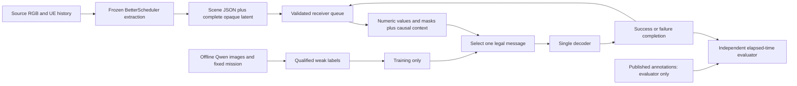

# Scene suite implementation record

Updated 26 October 2026. This is the canonical implementation record for the
approved BetterScheduler learning/RL suite. It supersedes proposals only where
the implemented behavior and evidence below explicitly say so.

**Current completed checkpoint:** corrective increment `20261026m` is implemented
and validated; measured results and remaining evidence limits are below.

### Current SPI decision (26 October; later user steering)

The user adds predicted **Semantic Priority Index** classes Critical, High,
Medium, Normal and requests a literature-backed scheduling/evaluation basis.
The consolidated decision is `SPI_SCHEDULING_DECISION.md`. It refines the
previous severe-building-only next-step proposal below.

The chosen policy is nonpreemptive SPI-first selection, FIFO as the strong
within-class baseline, and receiver-added semantic evidence as the learned
within-class comparison. Primary outcomes are capped completion delay and
exposure/misses conditioned on **independent reference priority**, with all
classes reported. Tau is an evaluation budget, not an invented image deadline.
No single mean over all classes or self-assigned priority score establishes
success. Gold-SPI and predicted-SPI arms separate producer and policy errors.

Official TREC-IS supplies post-priority labels and an image archive. Low->Normal
is an explicit alias. Four-class image-only urgency and actual image/post joins
are not yet verified. TREC-IS post-priority proxy and xBD severe-image-fact truth
remain separate scopes; do not substitute either label for the other.

Additive code now defines SPI selection and independent per-class metrics in
`Scheduler/spi_policy.py` and `INFRA/spi_evaluation.py`, plus numerical reference
tests and a bounded pinned TREC annotation preflight. This is a standalone
contract/reference core; BetterScheduler's serialized SPI schema and actual
image SPI producer are not yet integrated or trained. Next gate is media/label
fit plus upstream schema freeze, before additional model runs. Existing models,
old pilot boundaries and the user's codec pause are preserved.

SPI reference checkpoint completed: **56 focused tests passed**; official pinned
TREC-IS preliminary annotation preflight retrieved and hashed 858,433 bytes with
6,876 post labels (Critical 281, High 1,087, Medium 1,262, Low 4,246). No images,
teacher inference, model training or final pilot were run. Numeric deadline and
image-priority fields are absent in that inspected record schema. Raw labels,
source hash and checks are preserved under
`results/scene_suite/spi_reference_20261026/`. See the decision document for
scope, test timing-receipt limitation and image/label-fit gate.

### Next decision: severe-damage discovery reference (26 October)

The unresolved evaluation problem is now the next work item, ahead of additional
algorithm training. The chosen mission is **expose previously unreported
major-damage/destroyed building facts within the first ten completed decoder
attempts**. This is a severe-building-damage discovery study, not a claim to
infer life-safety urgency from structural severity.

Use xBD published post-event object polygons, source-qualified object identities
and native damage classes. Major damage and destroyed are one reference target
set, with unit weight per distinct annotated building. Unclassified remains
unknown. Existing LADI runs remain implementation/regression evidence because
their binary image labels cannot establish this new target. The existing xBD
adapter is available, but real xBD assets have not been verified locally.

**Primary endpoint:** severe-fact recall after ten completed decoder attempts,
using a fixed offered-fact denominator and counting each fact once. Failures
consume an opportunity and expose no fact. Report the full recall-versus-attempt
curve, misses, workload conditions and paired group uncertainty. Timing and J
remain supporting quantities. No image-specific deadline is invented.

**Training reference:** at each causal current queue snapshot, label every
candidate by its number of new target facts relative to successful receiver
history. Train the existing scalar pairwise ranker on strict gain differences;
allow all best ties and exclude all-equal decisions from preference loss. These
are immediate-gain targets, not a proof of optimal global planning. If RL is
later justified, use incremental severe-fact coverage as reward, gamma one,
termination after ten completed attempts, so reward sum equals the endpoint.

**Correspondence boundary:** start with controlled overlapping views/crops of
annotated parent tiles, retaining existing 95%-polygon-in-view credit. Annotations
and identities live only in INFRA's evaluator. Actor inputs remain BetterScheduler
parameters and successful-header context. Report controlled correspondence;
do not assert matching across unrelated natural camera views.

**Next executable increment:** (1) verify access to a small source/annotation
sample and source terms before downloads; (2) implement the annotation-ledger
reference/choice targets with hand-computed cases; (3) construct mixed, congested
episodes with repeats plus new severe, minor and undamaged observations; (4)
check whether existing permitted parameters distinguish severe-gain choices;
(5) only then retrain linear and RankNet baselines and compare to FIFO, RR,
random, current damage-only and repeat rules on identical information/queues.
Group before cropping and reserve new final groups before tuning. Where event
identities exist, group/hold out by event. A data-access or insufficient-group
failure is recorded explicitly; it does not authorize substituting VLM truth.

The key acceptance result is improved independent severe-fact recall at ten
attempts over the strongest same-information baseline, together with shared-state
gain regret and repeat suppression. No guaranteed effect size or superiority is
assumed. If headers cannot predict the target on grouped development data, the
failure is an information/producer limitation to report to BetterScheduler,
not a reason to keep adding RL architectures.

The mission priority rule is an explicit research/application choice. Published
annotations establish severe damage and controlled repetition; they do not prove
that structural damage category equals rescue urgency. Human risk and response
deadlines remain outside this claim until supported by separate references.

**Earlier baseline evidence:** CPU run `20261026l` completed eight learning arms
and seven references; three teacher arms were intentionally blocked because no
qualified teacher bundle was supplied. All 80 saved artifact hashes were
verified. Its validation-only audit and the next corrective increment are
recorded at `results/scene_suite/audit_20261026l/RESULTS_REVIEW.md`. Earlier
"not started" entries below are dated development history, not current status.
No locked pilot evaluation was run.

### Corrective increment m (authorized 26 October)

The prior audit is the baseline; originals and source hashes are preserved in
`results/scene_suite/corrections_20261026m/baseline_manifest.json`.

1. Fix pair sampling and use explicitly recorded random/predicted-damage
   demonstration histories. Use fresh deterministic training streams for RL,
   with a bounded cache; validation traces remain fixed.
2. Version training preprocessing: fit distance scales and remove constant
   model-input columns on training groups only. Preserve raw Scene JSON and
   historical v1 model inference.
3. Add the same-information receiver-history repeat baseline, completion-budget
   evidence coverage, capped exposure delay, source-exposure strata and shared
   nontrivial-snapshot choice regret. Keep J and independent labels.
4. Add Q/PPO diagnostics and an annotation-only bounded-Q option. Compare with
   unbounded Q under the same corrected protocol; bounds alone do not establish
   better selections. Preserve teacher gates and permit extra validation query
   candidates within the existing call budget.
5. Run meaningful lifecycle/export/resume/metric regression checks, a Medium
   assessment, then a bounded CPU development comparison. Record actual
   configuration, source, costs, failures and results. No final pilot, GPU,
   Qwen inference, new image downloads or codec work in this increment.

Acceptance: unchanged legacy inference; unbiased/permutation-consistent pair
supervision; causal collection; finite, masked portable inference; bounded Q
and aligned targets; numerically correct metrics including failed/missed
evidence; reproducible new development results. Source exposure and missing
urgency/cross-view truth remain reported limitations, not silently fixed labels.

V1 portable inference remains supported. V1 optimizer checkpoints are incompatible
with the new training preprocessing/protocol and must use their preserved source
snapshot; they are not silently resumed under v2. Patience-stopped v2 checkpoints
remain stopped on an unchanged resume. The first v2 development probe uses eight
epochs and 2,048 RL decisions; it checks feasibility, not convergence or the full
patience window. An unbounded-Q control uses the same v2 protocol and budget.

Corrective checkpoint: **47 focused tests passed** in 28.28 seconds. A frozen
real-data validation preflight loaded the current evidence, completed FIFO and
repeat-guard dispatches, serialized the expanded metrics without NaN, and
confirmed one identical shared-state probe hash across all 16 tested policies.
Evidence: `results/scene_suite/corrections_20261026m/checkpoint_checks_final/`.
Medium's assessment identified and the main thread corrected reference-policy
state carried across probes, patience bypass on resume, and undefined-cell
macro NaN. These are covered by the new regressions. No assertion was weakened.

One additional development hypothesis is predefined after the first CPU stage:
use exact successful-history repeat detection as a final selection constraint
around the trained RankNet scorer. Scores must be computed on the original
full queue context before choosing among nonmatching candidates. This uses no
new input or training labels at runtime. Test the raw/hybrid pair on the same
32 validation traces and audit cross-image signature collisions. This is a
controlled-copy hypothesis, not a claim that exact header signatures recognize
physical buildings across viewpoints. It does not change the ongoing Q control.

Increment m execution is complete: five corrected learners and eight references
completed their bounded CPU stage, followed by the matched unbounded-Q control.
All declared run artifact hashes passed (348 and 320 respectively); both runs
used identical frozen source/data manifests. At the short 2,048-decision budget,
bounded/unbounded DDQN reached J=.709254/.673303. These are one-seed development
results, not convergence evidence.

The exploratory RankNet repeat-filter probe reached J=.724329 versus .717204
without the filter, and useful distinct observations at completion ten rose
from 5.53125 to 5.6875. It observed zero exact signature collisions across the
48 validation images; natural cross-view behavior is not validated. The optional
filter is integrated into `ScenePolicy`; `receiver_policy.json` binds its model
and registry. Final focused checks: **48 passed**. Production/wrapper choices
match on all 1,428 reconstructed shared probes (936 nontrivial). A production
rollout parity run stopped at its 180-second cap after 30/32 traces, so no full
production rollout-J parity is claimed. The complete exploratory wrapper result
is preserved. Old/current v1 readers match exactly on one real history-bearing
context for RankNet and LambdaMART; the full legacy replay exceeded its earlier
60-second cap and remains unverified.

Detailed measured results, checks and limits:
`results/scene_suite/corrections_20261026m/CORRECTION_REPORT.md`.
The user's deadline-classifier idea is under a separate literature/utility
decision recorded in `SEMANTIC_UTILITY_FOUNDATIONS.md`; no invented deadline
labels or new primary evaluation target were introduced into these runs.

## Scope and boundary

**Latest user boundary:** encoder/decoder integration is paused pending the
user's digital-payload codec. All new scheduler experiments use opaque payload
references. Historical codec checks below remain development evidence only;
they do not authorize further codec work.

The receiver selects one complete message from the ready queue whenever its
single decoder is free. Decoding is nonpreemptive. Arrivals during service are
eligible at the following decision. There is no grant, retransmission, WAIT
action, encoder redesign or new codebook.

BetterScheduler owns extraction and the causal transmitter knowledge base.
The input is `semantic_scene_evidence_v2` for `building_damage`. Scene JSON is
an interchange format with measured byte length, **not** the historical
32-byte header. Historical header callers remain supported.



Images, embeddings, payload contents, annotation facts, source identifiers as
features and future arrivals are excluded from learned actor inputs. Routing
identities remain available to the controller. The registry is fixed before
evaluation; unknown predicates are counted rather than assigned meanings.

## Source and environment identity

- Initial source manifest: `results/scene_suite/20261026T021105Z/baseline_manifest.json`.
- Baseline commit: `8947b399c6d0c178fe4cf870aa8a4700a960cf35`, with preserved pre-existing dirty work.
- Every notebook package adds its complete per-file source hashes, upstream
  allowlist hashes, archive hash and observed runtime. The mutable working tree
  is not interchangeable with an earlier frozen package.
- Local learner checks use `../SemanticSchedulerEnd2End/.venv/Scripts/python.exe`.
- Strict actual codec checks use `../SemanticSchedulerEnd2End/.venv-models/Scripts/python.exe`.
- Additional dependency specification: `environment/requirements-scene-suite.txt`.
  LightGBM 4.6.0 was installed only in the project learner environment;
  jsonschema was installed only in the codec environment when absent.

## Implemented components

| Component | Responsibility |
|---|---|
| `INFRA/scene_queue.py` | Strict schema/producer validation, frozen numeric registry, complete-message queue |
| `INFRA/decoder_service.py` | Existing controller with injected queue/context builder; one completion owner |
| `Scheduler/scene_policy.py` | NumPy linear/MLP/tree inference, references, deterministic tie handling, logged FIFO fallback |
| `INFRA/scene_environment.py` | Dynamic arrivals, causal decisions, independent fact coverage, immutable transitions |
| `INFRA/learning/scene_corpus.py` | Frozen upstream imports, grouped roles, per-offered-observation transmitter KB replay |
| `INFRA/learning/scene_learners.py` | Supervised choice/ranking/classification, PPO, Double DQN and replay variants |
| `INFRA/learning/scene_teacher.py` | Strict teacher parsing, preference reward fitting, bounded image backend |
| `INFRA/learning/scene_teacher_run.py` | Controls, raw response ledger, image/prefix/replay queries, cumulative call accounting |
| `INFRA/learning/scene_feedback.py` | Cohort/request provenance checks and separate teacher-dependent learners |
| `INFRA/learning/scene_prepare.py` | Bounded official data access and pinned producer extraction |
| `INFRA/learning/scene_study.py` | Shared training, validation, checkpointing, optional locked pilot evaluation |
| `INFRA/scene_codec_driver.py` | Actual common received-payload replay through the v2 controller |
| `scripts/build_scene_suite_notebooks.py` | Frozen Kaggle preparation/labeling and training stages |

The default registry currently has 99 numeric fields. The shared contextual
input has `7*d+5 = 698` entries: candidate values/masks/cold-start, masked queue
and successful-history summaries, comparable-history distance and temporal/
progress summaries. Available false, available zero, unavailable and cold
start remain distinct. Static data do not acquire invented trusted timestamps
or locations.

## Learners and supervision

All eleven arms have executable training paths:

| Arm | Mechanism and target |
|---|---|
| Linear choice | Shared linear scorer; best immediate-gain choice cross-entropy with supported ties |
| MLP choice | 64/32 ReLU scorer; identical choice targets |
| RankNet | Shared MLP; strict annotation-derived pairwise preferences |
| LambdaMART | LightGBM grouped ranking, integer grades, explicitly linear label gain |
| Priority classifier | Contextual useful-new-observation classification; training-only class balancing |
| Masked PPO | Variable legal candidate set, pooled critic, annotation reward |
| Masked Double DQN | Candidate-conditioned Q values, uniform replay, legal next actions |
| Double DQN + TD-PER | TD-priority replay with actual-probability importance correction |
| RL-VLM-F-inspired | Frozen learned prefix-preference reward plus Double DQN |
| VLM-guided replay | Annotation reward; teacher affects sampling only, with uniform support |
| VisionPrefer-inspired | Aspect-derived teacher pairs train the same small RankNet scorer |

FIFO, round robin, seeded random, context alignment, appearance novelty and
concept novelty are untrained references. Teacher adaptations are **not**
literal reproductions of their original papers.

The primary fact is a distinct positively annotated source observation;
exact copies share its identity. This does not identify physical buildings
across natural camera views. For a fixed offered trace,

\[
J=\frac1T\int_0^T\frac{U(t)}Wdt,
\qquad r_k=\frac{\Delta U_k}{W}\frac{\max(T-t_k,0)}T.
\]

With discount 1 the annotation reward sum equals the independent integrated
coverage. Failed, repeated and late completions gain no evidence. Normalized
metrics are undefined when offered useful weight is zero.

Replay correction uses the actual mixture probabilities and a global replay
normalization constant. Checkpoints preserve current model/optimizer pairs,
best-validation artifacts, random states, progress, action histories and
replay. DQN additionally pins its exploration schedule and feedback version.
Exact numerical recovery was checked on fixed-budget fixtures; changed
feedback is a separate controlled update, not silently accepted resume.

## Teacher safeguards and limits

The worker uses the pinned Qwen3.5-9B NF4 backend in a separate Transformers
environment on Kaggle GPU1. The deployed scheduler never waits for Qwen.
No actual Qwen run has been performed for this suite yet.

- One-image, two-image and largest-input technical checks precede controls.
- The 32-control budget is divided into 16 image/aspect-order controls,
  eight equal-endpoint temporal/redundancy controls and eight replay-convention
  controls. These small sets are engineering gates, not statistical proof of
  broad teacher reliability.
- Aspect, prefix and replay labels require their respective gate. An
  image-choice pass cannot promote the other tasks.
- Replay-category controls test the declared heuristic convention; they do
  not establish which experiences truly improve learning.
- Raw valid/invalid responses, input hashes, prompt context, model/runtime
  identity and costs are preserved. Invalid output does not become a label.
- Feedback must match the current cohort hash and exact pinned request,
  including context, images and role. Full transition fingerprints prevent
  ratings from attaching to another decision history.
- Actual replay matches are counted. Neutral-only fallback is reported as
  partial rather than teacher-informed learning.
- Round continuation retains cumulative calls, skips completed requests and
  can reuse matching prior responses. The total call ceiling remains 216.

## Execution evidence and current gates

| Evidence | Actual outcome |
|---|---|
| Lifecycle, observation and numerical fixtures | Passed focused checks; latest aggregate validation is recorded with the final validation artifact |
| Learner fixtures | All eleven paths exercised; direction/export/resume checks, including exact uninterrupted/recovered equivalence for supervised, PPO and DQN fixtures |
| Teacher pipeline fixture | Scripted backend verifies independent gates, cohort/request rejection, cumulative budget and pending replay resume; **no VLM-quality claim** |
| Actual one-image codec command | 57.58 seconds CPU; FIFO and random checkpoint inference, same received payload/reconstruction |
| Actual five-image codec command | 283.25 seconds CPU; ten successful decodes, five per policy, matching payload and reconstructed-image hashes |
| GPU consumption by this suite | Zero so far |

Codec timings above are whole-command wall times, including load, encoding
and both policy replays; they are not per-image decode latency. Per-decode
measurements are in the traces. Checkpoint SHA256 is
`8e9d53d875e807177ba767209e605b680a91b7aae4046a6cb0bdffe1e5f4a7ef`.
Evidence: `results/scene_suite/codec/20261026_one/` and
`results/scene_suite/codec/20261026_five/verification.json`.
These images are development compatibility data. Reconstructed semantic
preservation and learned-policy actual-codec comparisons remain unmeasured.

Kaggle execution history is maintained in the existing upstream
`../SemanticSchedulerParameterAudit/BetterScheduler/KAGGLE_RUNS.md`:

1. `20261026b` failed before any cells because notebook kernel metadata was
   absent. The builder now sets and validates a Python kernelspec.
2. `20261026c` executed preparation and preserved 202 valid source images:
   80 absent, 80 intact, 42 affected. Its strict cohort gate correctly failed.
   The official test split has only 1,049 rows and approximately 44 positives;
   80 positives cannot be obtained from that split.
3. The user explicitly approved expanding to official training images while
   disclosing frozen-vision-model training exposure. The revised preparation
   targets roughly 40 test plus 40 train images in each stratum, keeps
   duplicate/parent groups intact and retains 144/48/48 scheduler roles.
4. `20261026e` hit HTTP 502 before downloading any rows. Its recovery ZIP and
   checksums were retrieved and verified.
5. `20261026f` adds bounded transient-request retries. It was **not submitted**
   because the official train-rows endpoint returned HTTP 500 twice during
   preflight. Its response identifies a deterministic server scan limit:
   613,920,909 bytes exceeds 300,000,000. Retrying cannot correct that limit.
   The 100-row preview works but contains only 17 damaged-building positives.
6. `INFRA/learning/scene_arrow_source.py` now provides an explicit one-shard,
   revision-pinned Arrow reader/downloader with a 650 MB default cap. Official
   shard HEAD checks returned 200 at approximately 581 MB. Synthetic Arrow
   parsing and label/byte preservation pass; no shard has been downloaded or
   joined into the real cohort yet. Raw shard bytes must count toward the
   approved cumulative 2 GB cap, including earlier source downloads.

Latest local validation: **34 focused tests passed in 43.22 seconds** across
scene, learning, teacher-pipeline and legacy service paths. Subsequently the
teacher/source pipeline passed **7 tests**, including the added Arrow fixture.
Compile checks and `git diff --check` passed. These tests do not certify real
Qwen labels or real-data scheduler quality.

The Luna operational delegate reached its usage limit during the alternate
source investigation. No further Kaggle or GPU job was launched. Next work is
to validate and integrate one official Arrow shard, audit historical exposure
and near duplicates, then resume the approved cohort/extraction sequence.

### Resumed execution: 26 October

The approved restart obtained official training shard 20 at revision
`5f2dbfe8c466d32edafd1bab847ec5252309acdb`: 580,542,952 bytes,
SHA256 `be25cd27b9d83bfd4a6d352c3d924791b7e3d948aab8f8e15ff2e3198f5dc2c0`.
It has 201 unique valid annotated images (79 absent, 79 intact, 43 affected),
with no exact matches to the existing official-test collection.

`INFRA/learning/scene_assemble.py` assembled
`results/scene_suite/cohort_20261026g/`: **240 images**, 40 official-test and
40 official-train per class, with **144 training / 48 validation / 48 reserved
pilot-evaluation groups**. The assembly checked 211 historical exposed IDs
and 272 accessible historical image fingerprints, then enforced SHA/dHash
deduplication within the new cohort. No sampled candidate was rejected under
those recorded rules. This is an automated duplicate audit, not independent
natural-view correspondence verification.

Data receipt and images are preserved locally. A private Kaggle input and
frozen extraction package `extract_20261026h` are being prepared. Its source
archive SHA is `3e2fcaad571fa5172b6243d4846213e31b89c0b0ef0d317ee13e12e7b9ef775e`.
Extraction is capped at 2,700 seconds assigned wall time, conservatively
1.5 aggregate GPU-hours with two assigned T4s, and includes one/ten-image
preflights. Teacher inference and real-data learners have not started at this
checkpoint. See the existing Kaggle run map for actual launch status.

No real-data learner comparison, teacher quality measurement, locked pilot
evaluation or final superiority result exists yet. No final evaluation has
been opened to compensate for data-access failures.

## Reproduction and next execution

From the Build root, using the recorded learner environment:

```powershell
..\SemanticSchedulerEnd2End\.venv\Scripts\python.exe -m pytest INFRA/tests/test_scene_suite.py INFRA/tests/test_scene_learning.py INFRA/tests/test_scene_teacher_pipeline.py INFRA/tests/test_decoder_service.py -q
```

Build a private CPU preparation package with the approved expanded pool:

```powershell
..\SemanticSchedulerEnd2End\.venv\Scripts\python.exe scripts/build_scene_suite_notebooks.py --output staging/scene_suite/NEW_RUN --tag NEW_RUN --stage data --source-splits test train --seconds 1800
```

Do not submit until metadata/row access and frozen-package preflights pass.
After a valid cohort, build `extract`, then CPU `train`, then gated `teacher`
stages with their exact upstream notebook sources. Extract one/ten images
before the full cohort; reserve GPU1 teacher inference for qualified inputs.
The aggregate GPU ceiling remains six hours, including both assigned devices
and setup/idle time. Training defaults remain one seed and feasibility-scale
budgets; they do not establish convergence or journal superiority.

`scene_study` preserves checkpoints incrementally and accepts `--resume-from`.
DQN split runs must declare the same `--schedule-steps` from the first block.
Use `--open-pilot` only after policies, labels, splits and selection procedures
are frozen. Subsequent real-data execution and final comparative reporting
remain gated on valid source access, teacher quality and the approved compute
budget.

Latest restart validation: 35 focused checks passed in 41.83 seconds. The
end-to-end copied-evidence fixture also completed six references and linear,
PPO and DQN training/export/checkpoint/evaluation, with all three teacher arms
correctly blocked. Its results are in
`results/scene_suite/orchestrator_fixture_20261026/` and must not be treated
as real-data scheduler performance.

Historical exclusion inputs are now preserved, including the actual 211-ID
set and 272 path/hash/dHash/std records:
`results/scene_suite/ops/20261026g/historical_exclusion_inputs.json`, SHA256
`25f2610f5fdef21d36a0f8070fcb9685204eaf951f0133f9486ad8570749a66c`.
This supplements the immutable cohort receipt. The private upload preserves
the same image hashes and changes only image-path layout to match Kaggle
input packaging; its own records hash must therefore be tracked separately.

The downstream CPU training package `train_20261026j` is frozen at source
archive SHA256
`244e256172bf0c56925e006af49717c42db0ecfc100f6c657401fd4a2ed422ef`.
It remains gated on successful, validated 240-image extraction. It does not
open pilot evaluation or perform encoder/decoder inference.
It adds a direct positive-class building-damage-probability reference, using
the same predicted claim score available to the learned actors. Package i was
prepared but remains unsubmitted and is superseded by j.

Private cohort upload is in progress under operational ownership at
`results/scene_suite/ops/20261026g/`. Source size is approximately 380 MB;
the upload contains 240 images and provenance/record files. The first CLI
attempt failed locally because a relative Windows path broke its upload
metadata path; the diagnosed absolute-path retry is progressing. No GPU
extraction or real-data learner has started at this update. Do not infer a
completed upload or model run from this preparation record.

### Active extraction checkpoint

The private cohort input `satyapaladugu/scene-suite-cohort-20261026g` is now
ready (v1). All 244 remote files reconcile to 240 images and four record/
provenance files; the downloaded records hash matches the staged input.
The upload CLI reported a JSON decoding error after file transfer, so remote
status, inventory and downloaded bytes were verified before proceeding.

Extraction **k version 1 is RUNNING** at
https://www.kaggle.com/code/satyapaladugu/scene-suite-extract-20261026k .
It was submitted once with requested `NvidiaTeslaT4`, server timeout 2,700 s,
and worker SIGALRM 2,640 s. Actual hardware and consumed GPU time remain
pending runtime evidence. Its archive hash is
`91dcd9ccfb3fe150066d5f698f2535b79f9e780d6f07a500645beab663775bb5`;
all 194 source-manifest entries were individually verified.

The matching CPU training package is now **train_20261026l**, archive hash
`e2fa30c2ceea02b6d6b5f2ccc4ce5ca1b6b3ec14294eb83b615ede0d96224aed`,
with extraction k as input. Earlier unsubmitted h/i/j packages remain
preserved but are superseded. CPU training stays gated on finite, unique,
provenance-valid evidence for all 240 images. Encoder/decoder work stays
paused and the reserved pilot evaluation remains unopened.

### Extraction quality gate passed

Extraction k completed successfully on two observed Tesla T4s. Stage elapsed
time was 141.5239 seconds (extraction-function elapsed 96.9474 seconds).
Actual runtime: Python 3.13.15, torch 2.11.0+cu128, NumPy 2.1.3.
The recovered ZIP contains 240 unique evidence records exactly matching the
240 source images. All 254 listed artifact checksums passed. Real training
and validation evidence each built a valid causal 48-message scene episode
with eight initial candidates and 99 numeric fields. Pilot evaluation was
not executed. Evidence: `results/scene_suite/ops/20261026k/main_quality_gate.json`.

CPU training l is authorized following this passed gate. It has not yet
produced performance results at this checkpoint. The operational owner
records submission/status in the existing Kaggle run map. GPU billing is
accounted from observed allocation/quota separately from extraction time;
141.5 seconds is not a complete billing measurement.
