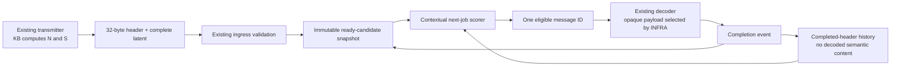

# Revised approach: receiver-side semantic scheduling, with a gated RL study

**Date:** 24 October 2026. **Status:** research recommendation and next-increment plan; not an implemented improvement.

**Decision:** preserve the completed prototype. Use importance-only as the practical reference. Investigate conditional marginal utility using a small contextual scorer; compare supervised training against masked PPO on the same scorer and information. First establish that the permitted headers contain enough information and that the workload actually rewards sequential decisions.

**24 October follow-up completed:** the user authorized an empirical parameter audit, implemented by Sol Light and tested by Luna in the isolated sibling `SemanticSchedulerParameterAudit` checkout. [Measured findings](../../../SemanticSchedulerParameterAudit/docs/parameter_audit/FINDINGS.md) and the [protocol](../../../SemanticSchedulerParameterAudit/docs/parameter_audit/PROTOCOL.md) record nine passing focused tests and a 29-second final CPU audit. Extra-field value was mixed across tasks; sender N weakly predicted receiver-new observations under controlled repeats; F was unavailable. Prioritize independent parameter/semantic-correspondence validation before the contextual/RL gates. The eight-field wire contract and deployed extractor remain unchanged.

**Superseded for forward execution:** use [07_MASTER_EXECUTION_PLAN.md](07_MASTER_EXECUTION_PLAN.md), which incorporates the completed audit and recent semantic-scheduling mechanisms. This document and documents 01–05 remain historical methodological records; their recorded experiments are not retroactively changed. No runtime source, trained model, header schema, encoder, or published result is changed by these planning documents.

## 1. What we want to achieve

Given fully received `[ParameterHeader][Complete latent]` messages from multiple sources, choose which complete latent the existing single decoder processes next. A good order exposes important, supported, distinct task evidence early.

The contribution we should test is **whether compact semantic headers can support useful context-dependent decoder ordering, and when sequential learning improves on strong simpler policies**. Applying PPO by itself is not a research contribution. Journal suitability depends on the evidence, closest prior work, and experimental validity; it cannot be guaranteed in advance.

### Fixed boundaries

- One atomic image latent per job, one nonpreemptive decoder, work-conserving service.
- No radio grants, transmission scheduling, partial-latent selection, retransmissions, encoder redesign, or new compression objective.
- Keep the eight agreed fields: R relevance, S scarcity, Q reliability, I importance, F freshness, P image-area prominence, C scene complexity, N transmitter knowledge-base novelty, plus availability masks.
- Keep novelty computation at the transmitter, before committing the current observation to its local KB. N and S remain frozen header values at the receiver.
- The scheduler sees headers and legitimate queue metadata, not image pixels, latent contents, evaluator labels, semantic fact IDs, or future arrivals.
- A scheduling result here cannot demonstrate reduced transmitted bits: these payloads have already arrived. Compression and reconstruction quality belong to the separate encoder/decoder study.

## 2. Evidence behind the revision

### 2.1 Verified implementation baseline

On 24 October, `git ls-remote` confirmed branch `new-scheduler` at **2f16785a16dd9c58ce12c98b502087cc212b279b**. Source and small saved reports were inspected through an isolated, shallow, no-checkout clone. The existing local working tree was not switched, reset, or merged.

Pinned evidence:

- [Branch entry point](https://github.com/saltypal/SemanticSchedulerEnd2End/blob/2f16785a16dd9c58ce12c98b502087cc212b279b/SCHEDULER_START_HERE.md).
- [Research report](https://github.com/saltypal/SemanticSchedulerEnd2End/blob/2f16785a16dd9c58ce12c98b502087cc212b279b/docs/disaster_decoder_v3/RESEARCH_REPORT.md).
- [Runtime policies](https://github.com/saltypal/SemanticSchedulerEnd2End/blob/2f16785a16dd9c58ce12c98b502087cc212b279b/Scheduler/decoder_scheduler.py).
- [Episode construction and training](https://github.com/saltypal/SemanticSchedulerEnd2End/blob/2f16785a16dd9c58ce12c98b502087cc212b279b/INFRA/learning/decoder_v3_study.py).
- [Saved macro results](https://github.com/saltypal/SemanticSchedulerEnd2End/blob/2f16785a16dd9c58ce12c98b502087cc212b279b/results/disaster_decoder_v3/20261023_stageC_v2/analysis/macro_comparison.csv).
- [Saved privileged diagnostics](https://github.com/saltypal/SemanticSchedulerEnd2End/blob/2f16785a16dd9c58ce12c98b502087cc212b279b/results/disaster_decoder_v3/20261023_stageC_v2/analysis/oracle_diagnostics.json) and [their implementation](https://github.com/saltypal/SemanticSchedulerEnd2End/blob/2f16785a16dd9c58ce12c98b502087cc212b279b/INFRA/learning/decoder_v3_analysis.py).

These are inspected saved results, not experiments rerun in this replanning session. Large LFS caches, checkpoints, all tests, and every historical execution path were not independently audited here.

| Saved equal-task macro A10 | Value |
|---|---:|
| FIFO | 0.2503 |
| Importance-only | **0.6622** |
| Fixed importance/novelty formula | 0.6613 |
| Coverage-gradient trees | 0.6471 |
| Coverage-trained neural ranker / CAHR | 0.6417 |
| Ordinary neural RankNet | 0.6244 |

This supports retaining importance-only as a strong reference. It does not justify choosing the old held-out winner as a new deployment selection: that test has already been examined. Existing C-selected models remain identifiable historical selections.

### 2.2 A more informative diagnostic

| Task | Privileged true-item-utility order | Privileged greedy distinct-coverage order | Difference |
|---|---:|---:|---:|
| Building damage | 0.972260 | 0.977796 | 0.005536 |
| Road damage | 0.997433 | 0.997433 | 0.000000 |
| Structural flooding | 0.954924 | 0.961690 | 0.006766 |
| Equal-task mean | 0.974873 | 0.978973 | **0.004101** |

Both columns use evaluator truth. The first sorts true per-message utility, including repeated observations; the second avoids previously covered units. In this particular workload, knowing true item utility already accomplishes most of what the distinct-coverage heuristic achieves. The comparison does not isolate all causes, prove an information-theoretic bound, or establish how RL would perform on another workload. It does argue against making RL the first expensive intervention.

The controlled benchmark assigns one original image ID to each evidence unit. Exact injected copies share that ID. It does not yet establish which different photographs show the same damaged building or condition.

### 2.3 Confirmed limitations and decisions

| Finding | Classification and implication |
|---|---|
| Learned scores are computed independently for each 16-feature row. | Confirmed design limitation: removing one candidate does not change another's score unless its supplied features change. Coverage-sensitive training alone does not create runtime context. |
| Eight scalars omit explicit asset/fact correspondence. | Information limitation: different latent relationships can produce the same policy observation. |
| Exact copies reuse deterministic R/Q/I/P/C evidence. | Benchmark shortcut risk: equality of quantized semantic fields can reveal some injected copies. Measure collisions and compare a simple equality-based baseline. Its accuracy has not been measured here. |
| Importance-only already uses a pretrained native-label predictor. | Strong baseline, not an unfair baseline. A small newly trained ranker must add value beyond that existing signal. |
| F is unavailable naturally; road Q fails the declared calibration gate. | Evidence gap: eight-field support does not establish eight useful measured features. Preserve masks. |
| Current streaming uses equal abstract service ticks and finite traces. | Valid simulator scope, not actual decoder timing or a sustained-load stability claim. |
| Qwen originally abstained on all 32 reviewed proposals; small repair diagnostic still missed a positive. | Do not make usable training/evaluation labels depend on a presumed VLM success. |
| Existing local legacy DQN uses ResourceBudgetSemantic, fixed action slots, and another environment. | It is not a drop-in V3 policy. Do not silently reuse its reward, resource decisions, or observation contract. Local modifications were only read. |

## 3. Research question and falsifiable hypotheses

**Primary question:** under the fixed 32-byte header, can context improve expected early semantic evidence beyond strong itemwise priority?

1. **H1 — utility estimation:** supervised training on independent reviewed utility may improve ranking over current predicted I. If it does not, retain I; do not hide that outcome behind a weaker FIFO comparison.
2. **H2 — contextual information:** remaining-queue and previously completed-header summaries may improve expected marginal utility over the same model without context. This requires observable statistical clues; it is not guaranteed.
3. **H3 — sequential optimization:** PPO may improve early coverage over the same contextual architecture trained to predict immediate marginal utility. A gain over a smaller itemwise network would not isolate an RL benefit.
4. **H4 — knowledge-base usefulness:** transmitter N/S may help under defined local histories. Test absent, empty, stale, within-source, and cross-source histories. Low sender novelty must not be treated as proof the receiver already knows a fact.

Failure of H2/H3 is a useful result. A narrower, validated compact-priority scheduler is preferable to an unsupported claim of semantic understanding.

## 4. High-level system

Training/evaluation separately accesses reviewed fact truth to calculate targets and rewards. That evaluator channel never becomes a policy observation.

**Proposed change:** remember a bounded sequence of completed message headers and rescore the current queue at each decoder completion. This is scheduler execution history, not a receiver semantic KB or a new calculation of novelty. The first trial uses only previously selected/completed headers, completion count, and the current queue. Semantic decode feedback is a separately scoped future interface, not silently assumed here.

## 5. Low-level next-increment design

### 5.1 Observations and state ownership

Keep existing candidates and ingress validation. Add a versioned `PolicyContext` supplied by INFRA:

| Input | Initial contract |
|---|---|
| Ready candidates | Existing complete, eligible, same-profile `SchedulerCandidate` records |
| Candidate vector | Eight A-fitted-imputed values followed by eight availability bits; header quantization preserved |
| Completed history | Up to 32 completed candidate header vectors, in completion order; no images, facts or evaluator outputs |
| Episode progress | Completed count and declared static cutoff K; counts are runtime bookkeeping |
| Reset boundary | New episode/task/source-session policy as declared; never carry history across train/test episodes |
| Metadata | Arrival/source/sequence retained for eligibility, FIFO/RR, stable ties and diagnostics; opaque IDs are not learned semantic features |

Initial experiment: static N=32, K=10, four logical sources, same frozen headers and equal opportunities as the old protocol. The policy is called again after each completion; it does not issue one permanent order for the entire batch.

For later streaming, use bounded header history and current queue counts/time, never future arrivals or end-of-trace truth. Static progress features must be redesigned explicitly before claiming online generalization.

### 5.2 Small contextual architecture

Start with a DeepSets-style shared encoder and pooling, rather than a large transformer or GNN. Set-based parameter sharing is supported by [Deep Sets, NeurIPS 2017](https://papers.nips.cc/paper/2017/file/f22e4747da1aa27e363d86d40ff442fe-Paper.pdf). Our exact architecture below is a proposed engineering choice, not that paper's semantic scheduler.

1. Encode each candidate: `16 -> 32 -> 32`, ReLU after each layer.
2. Mean-pool and max-pool remaining candidate embeddings: `32 + 32 = 64` dimensions.
3. Apply the same encoder and pooling to completed headers: another 64 dimensions. Empty history gives zeros; progress identifies the empty state.
4. For candidate i concatenate its 32-vector, remaining-pool 64-vector, completed-pool 64-vector, and two progress/count values: **162 dimensions**.
5. Shared readout `162 -> 32 -> 1` produces a marginal-utility score or policy logit.

The scorer has **6,849 trainable parameters**, including biases, under precisely these dense-layer shapes. PPO adds a separate small critic. This is an architectural parameter count, not measured runtime, memory, or FLOPs. Per-decision encoding/pooling/readout scales linearly with candidate/history counts at fixed layer widths. Full sequential ordering requires repeated decisions.

Pooling makes arbitrary candidate array order irrelevant except documented ties; each candidate still receives its own score. Mean/max pooling can discard useful relationships. Add pairwise attention only if its controlled comparison resolves a demonstrated failure, not because transformers are available.

### 5.3 Training alternatives using the same observations

**First: supervised expected marginal gain.** Let F_i be independently reviewed facts in candidate i, H the previously completed indices, and W the total offered distinct fact weight. At a training decision, the evaluator computes:

\[
g_i^*=\frac{\sum_{f\in F_i\setminus\cup_{j\in H}F_j}w_f}{W}.
\]

Fit the contextual scorer with Huber loss against g_i*. Average candidate losses within a decision, decisions within an episode, then episodes, so long queues do not silently dominate. Start with Huber transition 0.1 for normalized targets; treat it as a development choice, not an established optimum. Use only training-episode histories generated by a recorded mixture of I ordering, random ordering and current-policy rollouts. Validation histories are generated independently by the policy being evaluated.

Gold facts define the label, not the policy's input. Identical observable states can have different labels; the fitted score then estimates conditional expected utility. Immediate-gain supervision is a useful greedy approximation, not a guarantee of the globally best order.

**Then, conditionally: masked PPO.** Use the same candidate encoder/context/readout. The actor samples one ready candidate from a masked categorical distribution during simulation training, and uses deterministic argmax for reported evaluation. Initialize from the supervised encoder/scorer and record how score-to-logit scaling is initialized; compare training from scratch only if warm-start dependence matters.

The critic sees the same permitted context, not gold fact identities. Training rewards may use independent evaluator truth. This distinction allows offline simulation learning without giving the deployed scheduler privileged semantic knowledge.

### 5.4 Runtime invariants

- No incomplete, future, already-dispatched, or incompatible-profile action.
- Empty queue returns no decision; simulator advances to the next real arrival. No learned waiting action initially.
- Single nonpreemptive service: next selection occurs only when the decoder is free.
- INFRA owns queue mutation and completion history. Scheduler consumes snapshots.
- Missing features retain validity masks. All-semantics-unavailable fallback is FIFO.
- Nonfinite/model-incompatible output triggers a logged deterministic fallback, with its rate reported.
- Reset state between independent episodes. An episode cutoff is not a resumed online stream.
- Runtime inference preserves the existing NumPy/no-neural-framework scheduler boundary; training belongs under INFRA.
- Never silently truncate a larger queue to 32 slots. Static training N=32 does not establish performance at arbitrary sizes.

## 6. Why RL might help, and why it might not

RL can learn how choosing one job changes the value of subsequent choices. For example, decoding one view may make another view redundant. But the actor must have observable clues about that relationship; a training reward cannot supply missing facts at deployment.

### Numerical example

A and B reveal the same fact X (weight 10). C reveals Y (weight 9), D reveals Z (weight 1). W=20, K=3.

| Order | Coverage at first three completions | A3 |
|---|---|---:|
| A, B, C | 0.50, 0.50, 0.95 | 0.6500 |
| A, C, D | 0.50, 0.95, 1.00 | 0.8167 |

A contextual policy could learn to defer B **if its allowed observation predicts that B repeats A**. That condition matters more than the choice between PPO and DQN.

### Information-aliasing check

After completing A, suppose B and C have identical eight-field values/masks and otherwise noninformative metadata. In world 1, B repeats A and C adds a fact; in world 2, the hidden relationships are swapped. Randomize positions and IDs, preserving the entire observable history. A policy sees the same observation in both worlds, so cannot always make the correct opposite choices. Under a balanced construction, its success on that next choice is at most 50% in expectation.

This applies to supervised models, attention, recurrence and RL. It does not mean all real headers are uninformative: they can contain useful correlations. It does mean we cannot promise general cross-source duplicate identification from scalar novelty.

With disjoint facts, fixed additive utilities and equal service, descending true utility is optimal for early coverage: exchanging an earlier smaller gain with a later larger gain increases the prefix sum. In that regime RL adds no optimality benefit. Do not manufacture deadlines, variable costs, or extra constraints simply to make an RL result look better.

## 7. RL algorithm selection and reward

### 7.1 Choice

| Candidate | Recommendation |
|---|---|
| Masked PPO with shared candidate scorer | First RL candidate, conditional on the gates below. Convenient for categorical variable-candidate decisions and direct rollout training. Not proven best. |
| Shared-scorer masked Double DQN | Credible alternative if experience cost or PPO instability becomes material. Variable candidate sets do not require PPO. Replay/targets add another correctness burden. |
| Contextual bandit | Appropriate if only immediate observed payoff matters. Does not automatically optimize a sequence-dependent coverage objective. |
| SAC/DDPG | No current continuous control action justifies their usual formulations. Radio allocation papers using them solve a different problem. |
| Multi-agent RL | Four senders do not imply four scheduler agents. Here one receiver controls one decoder. |
| Large GNN/transformer/recurrent agent | Deferred until a specific dependency or history-loss failure warrants it. Header history remains partially informative even with more capacity. |

### 7.2 Reward exactly aligned to A10

Let C_k be normalized distinct-fact coverage after completion k. Keep:

\[
A_K=\frac{1}{K}\sum_{k=1}^{K} C_k.
\]

Use a finite K-step training episode with **gamma=1** and:

\[
\boxed{r_k=C_k/K.}
\]

Then total reward is exactly A_K. Equivalent weighted marginal rewards are:

\[
r'_k=\frac{K-k+1}{K}(C_k-C_{k-1}),\quad C_0=0.
\]

Both express early coverage. Rewarding only unweighted new coverage with gamma=1 telescopes to C_K and loses the preference for earlier coverage. Arbitrary discounting also changes the declared objective.

No reward is a weighted sum of the eight predicted fields. No throughput, fairness, deadline or lossless bonus is added to this semantic-coverage experiment. W and fact correspondences belong to the evaluator only. W=0 is logged as an undefined normalized-coverage episode; report its prevalence separately and use zero training reward under an explicit zero-utility rule, never call it perfect coverage.

### 7.3 PPO loss and implementation controls

Using advantage estimate Ahat_t and likelihood ratio rho_t:

\[
L=-E[\min(\rho_t\hat A_t,\operatorname{clip}(\rho_t,1-\epsilon,1+\epsilon)\hat A_t)]
+c_v E[(V-G_t)^2]-c_e E[\mathcal H(\pi)].
\]

Use the [original PPO clipped objective](https://arxiv.org/pdf/1707.06347); this loss is established methodology. Initial engineering defaults may use epsilon .2, Adam 3e-4 and gradient norm .5, but must be recorded and judged on development data. Entropy/value coefficients and rollout size need a bounded pilot; these defaults are not evidence of optimal tuning.

Feature-availability masks and legal-action masks are different. Save each rollout's candidate mapping, history snapshot and legal mask, and apply the same legal distribution when evaluating old/new action log-probabilities. See [Huang and Ontañón, invalid action masking](https://arxiv.org/pdf/2006.14171). Terminals must not bootstrap; artificial time limits need explicitly correct handling. A candidate-slot index alone is not a durable action identity.

For the initial short K-step episodes, Monte Carlo returns avoid unnecessary discount/GAE ambiguity. Normalize advantages without changing the recorded reward or headline metric. Online training or exploration on real users is outside this proposal.

### 7.4 Streaming extension

After static validation, use actual recorded arrivals and a declared common horizon T. Define:

\[
A_T^{time}=\frac{1}{T}\int_0^T C(t)\,dt.
\]

Coverage changes when useful evidence becomes available at completion. Integrate event intervals exactly, including empty periods and the final interval. A reward is the corresponding coverage-area increment divided by T; do not substitute per-message throughput. Future facts may define an offline normalization constant but never enter actor observations. Keep normalized and unnormalized weighted coverage-time measures distinguishable.

Equal service is the clean initial control. Later real service times must come from the actual codec/backend, recorded under comparable conditions. Do not convert abstract ticks into milliseconds. A long-run arrival-rate study needs a separately justified objective and training formulation; the initial finite-trace replay is not that study.

## 8. Benchmark redesign

### 8.1 Keep two evidence tiers separate

**Tier A — reproducible controlled observation benchmark:** retain the existing LADI-based queue generator and reports for regression, ablations and debugging. Repeated originals represent repeated observations, not verified physical-fact correspondence. Old test results are historical/development evidence once used for replanning.

**Tier B — independently reviewed semantic benchmark:** collect a small development pilot, approximately 100–200 images as a work estimate, with defensible site/asset/time provenance and same-fact/different-fact relationships. Include different views, similar-looking different sites, changed conditions, small relevant targets, and benign clutter. Freeze fact granularity, task weights and assessability rules before final labeling.

Two reviewers independently label facts/correspondence and utility; resolve disagreements and retain them. Qwen can propose matches or assist review, but its output is not independent ground truth. Start with the existing damage-review task. Additional tasks are extension evidence, not a way to select favorable results.

Pilot size is not a journal sample-size claim. Determine the final number of independent event/site groups from pilot variability, a declared useful effect, annotation feasibility and confidence-interval precision. If trustworthy correspondence data cannot be obtained, narrow the claim to controlled observation prioritization rather than relabeling unknown relationships as facts.

### 8.2 Split and leakage controls

- Original image, crop/augmentation, exact/near-duplicate family and verified site/event groups stay together.
- Fit normalizers, imputation, calibration, prompts and policy hyperparameters on their declared development roles only.
- Use old A/C/cache for immediate diagnostics; do not repeatedly evaluate new variants on the old inspected test.
- A new final evaluation needs untouched image/event groups not previously used to choose policies or representations. New queue seeds from the same exposed test images are not a fresh holdout.
- Preserve causal transmitter histories. No self-comparison, future observations, receiver truth, or evaluator identity enters N/S.
- All policies receive identical header bytes, arrivals, completion outcomes and compute assumptions.

### 8.3 Minimal useful comparison

1. FIFO, plus seeded random as a sanity check.
2. Importance-only I.
3. Existing C-selected static policy, with its historical selection identified; add current RankNet/coverage scorer as static references.
4. **Identical-header-signature deferral:** group on available, quantized R/Q/I/P/C plus profile/masks; prefer an unserved signature before repeating it, ordered by I. Never drop a message. Mask-poor/empty signatures disable the heuristic. Measure distinct-image collisions and false deferrals; this is a controlled-copy diagnostic, not a semantic identity claim.
5. Contextual supervised marginal-gain scorer.
6. Same-architecture masked PPO, only after feasibility gates.
7. Evaluator-only true-utility, greedy fact-aware and tiny exact-order references, all clearly privileged.

Keep the full 13-method historical table available. The next increment need not retrain every previous weak baseline or run an RL tournament. Where the benchmark offers full feedback on every candidate, use it for supervised learning rather than artificially pretending labels are bandit feedback.

### 8.4 Metrics and uncertainty

Primary static endpoint remains A10. Report coverage@10, high-weight unique-fact recall, repeated-fact fraction, undefined cases and assessed-data coverage. nDCG is secondary because it can reward repeated important items.

For streaming, report coverage-time area, time to first supported high-weight fact, unserved useful weight at the fixed horizon, and wait-time tails/source service as diagnostics. Throughput is not the headline. All jobs still decode if the trace is allowed to drain.

Measure decision latency median/p95/p99 at specified queue sizes, hardware and backend, excluding evaluator calculations. Report training wall time, interactions, examples and extraction cost separately. More useful evidence per decode opportunity does not by itself show end-to-end UE savings.

Pair policy comparisons on the same workloads. Aggregate repeated queue draws within independent site/event groups before resampling; existing disjoint source-image pools are not independent disaster events. Use paired intervals and effect sizes; choose resampling appropriate to the group count. Report task/regime results and a declared task macro separately.

Train at least three initializations in the pilot to detect gross instability; expand only if observed variance makes the conclusion uncertain. This is a practical start, not a universal seed requirement. Select methods on validation; lock the final holdout once. A proposed practical threshold is **+0.02 absolute A10** over the strongest same-information comparator, with a paired interval supporting an improvement; stakeholders may revise that threshold before evaluation. It is a project usefulness criterion, not a theorem or promised result.

### 8.5 Required ablations

- Same scorer without queue pool; without completed-header pool; with both.
- Same contextual model trained supervised versus PPO; match feature access and report parameter/compute budgets.
- Remove N; remove S; remove N+S, with retraining and preserved masks.
- Within-source versus cross-source repeats; exact copies versus different views.
- Native available-field subsets versus genuinely measured added fields. Synthetic timestamps stay a separate experiment.
- Clean headers versus declared quantization/missingness stress; never score missingness as certainty.
- Policy with no history in no-backlog conditions: all valid work-conserving policies should reduce to arrival service order.

## 9. Literature that changes this decision

Bounded primary-source search, checked 24 October 2026. This is not an exhaustive survey or a proof of novelty. No inspected paper validates this exact eight-scalar-header/opaque-latent/single-decoder task as a solved PPO application.

| Source | Inspected mechanism and boundary | What to use here |
|---|---|---|
| [Deep Sets — 2017](https://papers.nips.cc/paper/2017/file/f22e4747da1aa27e363d86d40ff442fe-Paper.pdf) | Set-based invariant/equivariant representations. | Shared candidate encoding and pooling; no semantic performance guarantee. |
| [PPO — 2017](https://arxiv.org/pdf/1707.06347) | Policy-gradient training with clipped probability ratios. Original tasks are locomotion/Atari. | Candidate training method, not a scheduling superiority result. |
| [Decima — SIGCOMM 2019](https://people.csail.mit.edu/malte/pub/papers/2019-sigcomm-decima.pdf) | RL scheduler combines job/DAG and global context, with scalable candidate decisions. Cluster resources/dependencies differ from this problem. | Contextual shared scoring; do not import executor allocation or its completion-time gains. |
| [Learning to Dispatch — NeurIPS 2020](https://papers.neurips.cc/paper/2020/file/11958dfee29b6709f48a9ba0387a2431-Paper.pdf) | Size-agnostic graph-based dispatch policy, pooled state and PPO for multi-machine job-shop makespan. | Useful variable-candidate actor reference; our jobs have no demonstrated DAG or machine-allocation problem. |
| [Invalid Action Masking — preprint 2020, FLAIRS 2022](https://arxiv.org/pdf/2006.14171) | Analysis and experiments on legal action distributions. | Mask legal jobs consistently during sampling and updates. |
| [Semantic-aware Transmission Scheduling — 2023](https://arxiv.org/html/2305.13706v2) | Remote estimation/AoI scheduling; derives partial Q-function monotonicity and adapts DDPG. | Learn from its physically justified structure. It does not justify monotonicity of all eight image parameters or a decoder policy. |
| [RAMSemCom — preprint 2025](https://arxiv.org/html/2505.23275v1) | DRL selects retrieval/patch allocations with channel, similarity and history inputs in a shared-bandwidth multi-vehicle task. Inspected §§III–IV. | Supports task-conditioned history-aware decisions. PPO/DQN findings there cannot be transferred to fixed received latents. |
| [GOSC — September 2026 preprint](https://arxiv.org/html/2609.39477v1) | Message/rate selection uses value and broadcast common knowledge. Inspected §§III–V, including valuation ablations. | Distinguish sender/private and shared knowledge. More valuation sophistication is not automatically useful; radio actions remain out of scope. |
| [Online Submodular Set Cover, Ranking, and Repeated Active Learning — NeurIPS 2011](https://proceedings.neurips.cc/paper/2011/hash/8757150decbd89b0f5442ca3db4d0e0e-Abstract.html) | Foundational connection between coverage, ordering and online learning. | Establishes adjacent prior work. Its cover-time formulation is not identical to our normalized A10 objective. |

For a value-based alternative, [Double DQN, AAAI 2016](https://arxiv.org/pdf/1509.06461) separates online action selection from target-network evaluation. A shared Q(s,i) can handle candidate sets; mask the online argmax and handle terminals correctly. We have not benchmarked that alternative here.

## 10. Concrete next steps and stop rules

Times below are engineering work estimates conditional on usable cached artifacts, not measured completion guarantees. Annotation and independent review are the main unknowns. No GPU launch or paid dependency is required for the first stage.

| Stage | Build/check | Deliverable and stop rule |
|---|---|---|
| **0. Preserve and reproduce** | Isolated branch worktree at the pinned commit; verify required LFS objects and environment before executing. Reproduce one cached terminal order and saved metrics under the existing protocol. | Revision/data manifest and explicit reproducible/missing-artifact status. Do not re-extract all features or rerun all models first. Roughly 1–2 hours if artifacts are accessible. |
| **1. Diagnose value and information** | Per-stratum utility-oracle/coverage gaps; header-signature collision/deferral baseline; identical-observation counterexample; audit classifier utility errors on development images. | A small diagnostic table showing whether utility estimation, redundancy observability or sequential planning is the current bottleneck. Stop new model work if the label/data issue dominates. Roughly half to one engineering day. |
| **2. Establish semantic labels** | Review a development pilot with actual correspondence; define unseen final groups and task rubric. Keep controlled copies separately. | Auditable fact/weight/correspondence manifest, disagreement and missingness report. Do not promise physical-fact evaluation without it. Calendar time depends on data access/reviewers. |
| **3. Small contextual vertical slice** | Candidate/context interface, NumPy inference, supervised marginal targets, simulator completion-history update, same-info ablations. | Working end-to-end header selection with no codec changes. It must beat or clarify why it cannot beat I/static/signature controls on validation. Roughly 1–2 engineering days after labels/contracts exist. |
| **4. RL feasibility pilot** | Tiny exact-order cases, reward identity, legal-action checks; then supervised warm-start + masked PPO with frozen data. | Validation learning curves against the identical supervised architecture, interactions/time and seed variation. Start with a modest recorded interaction budget, e.g. 100k decisions; extend only with positive validation evidence, up to a separately recorded cap. No automatic sweep. |
| **5. Real decoder replay** | Existing decoder consumes chosen payload refs; cache reconstructions and measure actual service on one fixed backend. Independently assess facts visible in reconstructed outputs. | Actual bytes/shapes, decode success and completion times, source-versus-reconstructed fact utility. Until then say header/observation scheduling, not measured semantic recovery. |
| **6. Frozen final evaluation** | Select pipeline/hyperparameters on validation, freeze, then evaluate untouched event/site groups once. | Paired group effects, failure cases, timing/cost, all claim boundaries and negative results. Final evidence can favor I or supervised context. |

**RL go/no-go:** proceed only when (a) actions measurably change later semantic opportunity, (b) that difference is at least partly predictable from permitted observations on development data, and (c) a valid simulator/independent evaluation exists. Reject or defer PPO if it cannot outperform the same contextual supervised model at useful cost. If richer semantic identity is indispensable, record that as a separate proposed header/interface change requiring a new decision; do not smuggle embeddings or gold IDs into the eight-field study.

## 11. Implementation ownership and acceptance checks for the next approved increment

| Existing owner | Proposed responsibility |
|---|---|
| SemParam | Preserve extraction, calibration, causal TX KB and V3 serialization. Produce no new scheduler-only embedding silently. |
| Scheduler | Contextual inference/export loader and immutable decision contract; no training framework or queue mutation. |
| INFRA | Completion-header history, simulator, supervised/PPO training, fact-label evaluator and artifact provenance. |
| EncDec | Existing fixed decoder adapter only in the later replay gate. |

Before accepting the contextual/RL increment, check: header round-trip; unavailable semantics fallback; permutation-equivalent scores; no action outside eligible jobs; empty/singleton queues; completion-only history updates; reset isolation; terminal masking; reward sum equals A10; independent tiny exact orders; and exported NumPy versus training-framework score/order agreement. Broader tests are warranted only by changed integration paths.

Computational notebooks must record actual interpreter/dependencies, source revision, hardware, data/split and run configuration; expose progress and preserve executed outputs/logs/checkpoints. Use the existing run/artifact map. A PPO resume needs optimizer, counters, RNG, rollout/environment boundary and compatible data/source identity, not weights alone.

## 12. Current decision record and unresolved questions

| Decision | Reason / revisit trigger |
|---|---|
| Keep teammate implementation and all historical evidence. | It is a usable baseline, not zero progress. No measured consistent learned advantage yet. |
| Keep I as the immediate strong practical reference. | Saved aggregate evidence supports it; it is not established optimal on unseen real facts. |
| Diagnose before training PPO. | Saved oracle gaps and copy construction suggest formulation/utility information may dominate. |
| Compare same-context supervised versus PPO. | Separates observation/architecture changes from sequential-training benefits. |
| Preserve eight fields and sender novelty. | User-selected contract; receiver semantic feedback is not currently an allowed input. |
| Do not claim all fields useful. | Missingness and exploratory ablations do not support that conclusion. |
| Do not reuse old exposed test for new final claims. | Replanning has used its results. |

Unresolved: access to untouched real correspondence groups; annotator agreement; whether permitted header context predicts new utility; whether different-view redundancy creates meaningful sequential headroom; actual decoder cost and preservation of task facts; practical effect threshold and final study power. Resolve these with the smallest checks above before expanding architecture or compute.

**Validation of this document's numerical example:** a local standard-library calculation enumerated all 24 orders of the four-item example and checked equality of the two A3 reward formulations to 1e-12. It reproduced A3=0.65 and 0.8166667 for the shown orders and the saved oracle macro difference 0.004100565. No model training, scheduler test suite, real codec execution, or performance experiment was run during this replanning.
