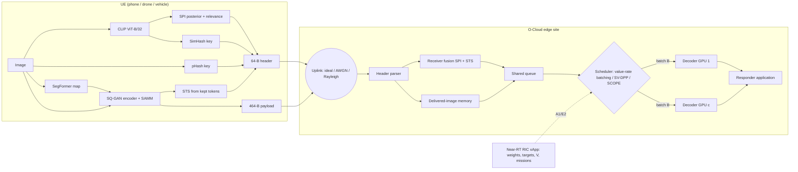
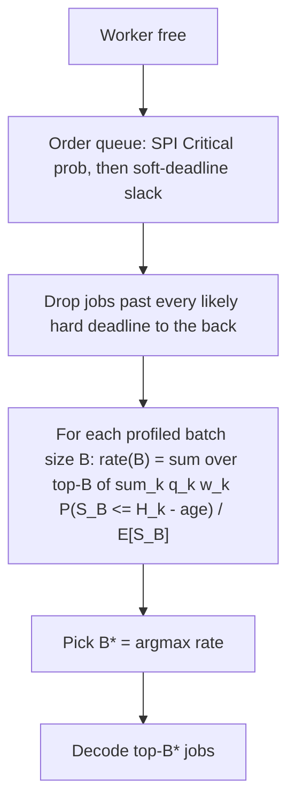
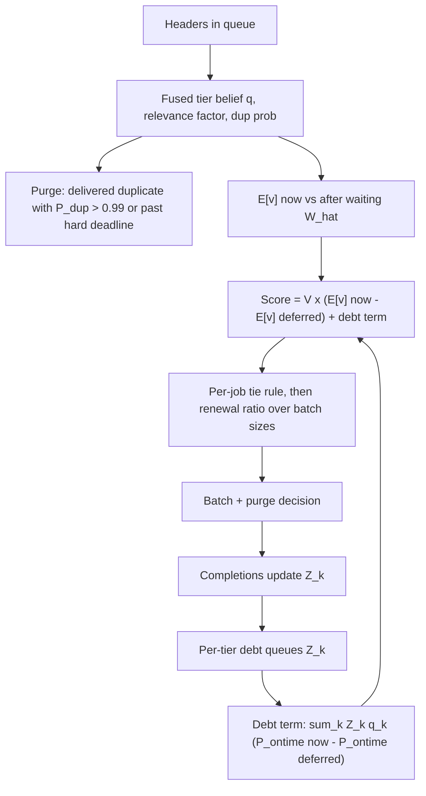
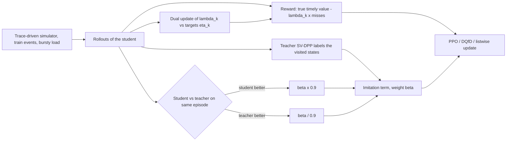
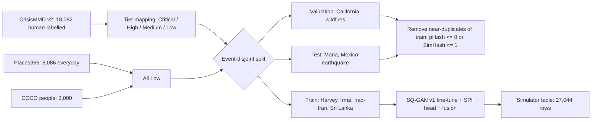
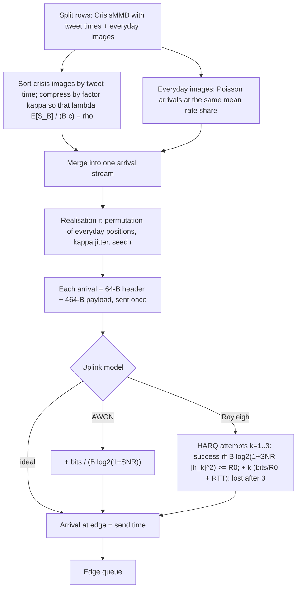
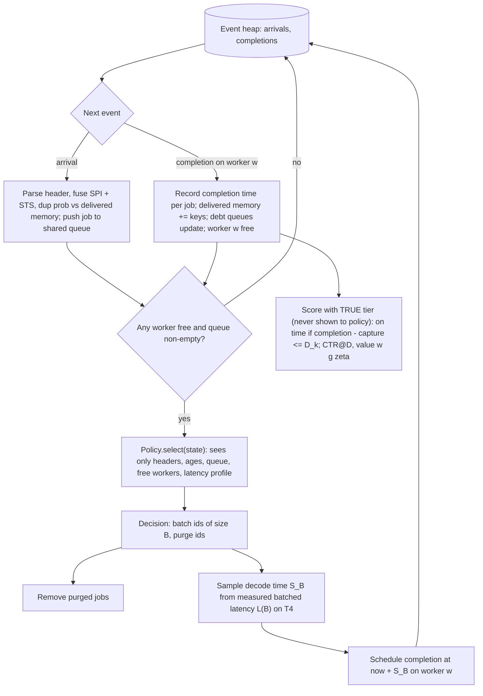
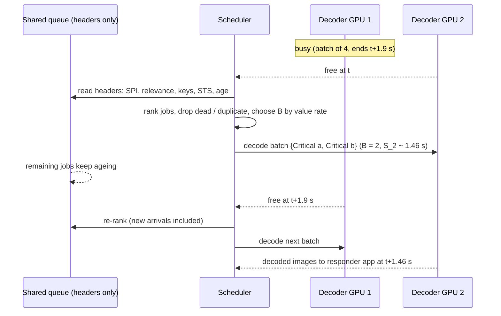
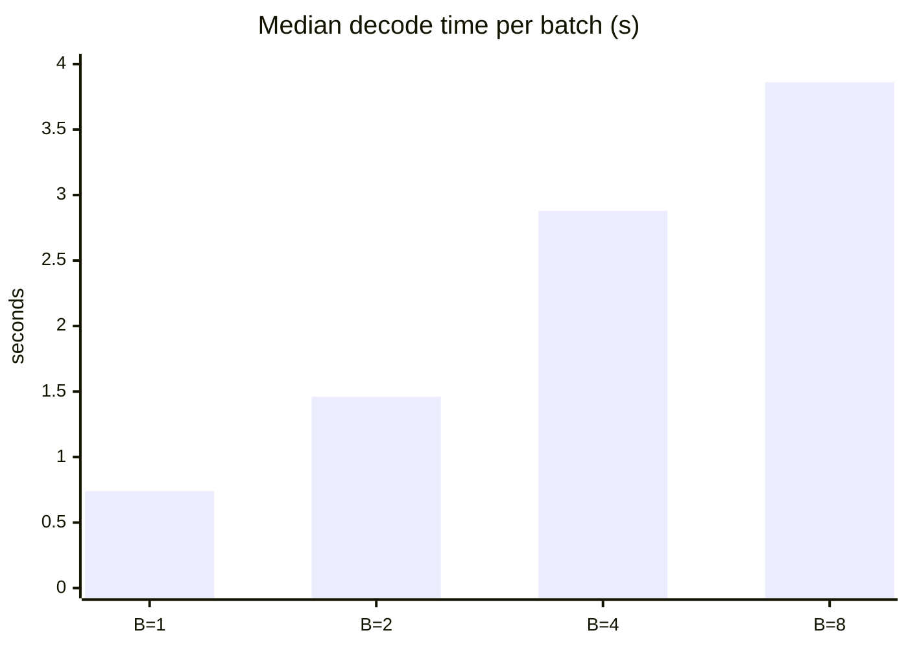

# Timely decoding of generative image semantics at the edge: a 64-byte header is enough to triage a disaster upload burst

Authors: [names], [affiliations]

## Abstract

Generative codecs such as SQ-GAN send an image in a few hundred bytes, but the receiver pays for that compression
with a slow generator. When a disaster floods an edge site with uploads, the decoder pool becomes the bottleneck, and
the scheduling question is simple to state: which received image should be decoded next? We answer it under one
strict constraint. Every device sends its image once, with a 64-byte header and no state kept at the edge. The header
carries a calibrated urgency posterior, a mission-relevance score, two hash keys for redundancy, and a short descriptor
of the codec's kept tokens. We score schedulers by CTR@D, the fraction of human-labelled Critical images decoded before
their deadline. With two decoders at 1.2 times the offered load, on the validation event, header-aware value-rate
batching reaches 0.78 and the tuned SV-DPP reaches 0.82, while earliest-deadline-first reaches 0.44 and FIFO reaches
zero. The same batching rule with the header removed scores zero, so the header is what makes timely triage possible.
On held-out disaster events, the learned SCOPE-PPO scheduler reaches 0.84 and SV-DPP 0.80, against 0.24 for
earliest-deadline-first. The ranking survives an AWGN or Rayleigh uplink. We describe the codec, the header, the
schedulers and a trace-driven simulator, and we report the limits: a short codec fine-tune, weak recall on the High
tier, and label noise in the crowd-sourced labels.

**Index Terms:** semantic communication, edge inference, generative image coding, scheduling, Lyapunov optimisation,
disaster response.

## I. Introduction

Generative semantic codecs change where the cost of communication sits. A sender can compress an image into a few
hundred bytes because the receiver regenerates the detail [5]-[8]. That is a good trade on a quiet network. It is a
bad trade in a disaster, when thousands of phones, drones and vehicles upload at the same moment and every upload must
pass through a GPU before anyone can look at it [9].

Most semantic-communication scheduling work allocates radio resources and assumes the importance of each message is
already known [10]-[13]. Edge inference serving schedules requests by deadline but cannot see what an image shows
[15]-[17]. Disaster-imagery work classifies urgency [9], [18] without connecting that signal to the queue. We wanted to
close that gap with a design that a real device could afford. The sender should not run a detector, keep state about
its past uploads, or wait for feedback.

The idea is that a small, fixed header can carry enough meaning for the edge to triage. The header holds an urgency
posterior from a classifier calibrated on human labels, a relevance score for the mission, a SimHash key that tells
similar scenes apart, a pHash key for near-copies, and a 13-value descriptor of the codec's kept tokens. The edge sees
only those 64 bytes and the arrival time. It never sees the true tier, and it never decodes an image to decide.

We make five contributions.

1. A 64-byte stateless header and the codec-side descriptor that fills part of it (Section IV).
2. Header-aware value-rate batching: order the queue by urgency and choose the batch size that maximises expected
   on-time value per second of decoding (Section V-A). This is the simplest scheduler in the paper and the most
   consistent one.
3. SV-DPP, a drift-plus-penalty scheduler with per-tier debt queues that generalises the batching rule (Section V-B).
4. SCOPE, a constrained learning recipe that trains schedulers toward a teacher while keeping the per-tier timeliness
   targets in view, with an adaptive teacher weight (Section VI).
5. An evaluation on human-labelled crisis imagery with event-disjoint splits, a measured batched decode latency, a
   controlled comparison that isolates the value of the header, and an uplink sensitivity study (Sections VII-VIII).

Two things matter most, so I will state them now. The header is the reason the schedulers work. The same batching
rule without the header delivers nothing under overload. Second, the best learned scheduler is not a black box that
beats an expert rule by magic. It is a ranker trained on the same header interface, and it lands close to the hand
designed rules at two decoders and above them at one.

## II. Related work

**Semantic and generative communication.** Surveys frame semantic communication as goal-oriented transmission [1]-[4].
Learned joint source-channel codes [5], [6] and generative codecs [7], [8] push compression well below what pixel
codecs reach. We take such a codec as given. The codec is SQ-GAN [8], which exposes a masking fraction and a semantic
mask that we reuse as a descriptor. Other generative schemes [42]-[44] fit the same role.

**Semantic resource allocation.** Importance-aware radio allocation [10], [11], semantic spectral efficiency [12],
and queueing-aware semantic rate control [14] all treat the scheduler as a resource manager. The item being scheduled
is a radio block, not a decode. Age-of-semantic-importance and related metrics [80]-[82] couple freshness with
semantic loss, and some use learned schedulers, but again the resource is the channel.

**Edge inference serving.** Deadline-aware multi-model serving [15], priority-aware serving [16], and reinforcement
learning for real-time inference [17] schedule DNN requests. BCEdge [85] learns a batch size under latency SLOs with
maximum-entropy reinforcement learning. These systems do not look at what an input contains, and they do not
account for the value of decoding one input before another.

**Lyapunov scheduling.** Drift-plus-penalty control [19], [61] gives throughput-optimal and near-optimal schedules with
virtual queues. Completion-aware and semantic variants [60], [14] apply it to wireless traffic. Our SV-DPP uses the
same machinery with per-tier debt queues, one per timeliness target.

**Queueing control with learning.** Reinforcement learning for queueing networks often underperforms classical index
policies unless the policy class is shaped [97], [101]. Teacher-guided methods balance imitation against reward [96].
Recent benchmark studies find that a well-calibrated rule-based controller can beat many deep-RL agents on steady load,
with RL helping mainly under bursts [98]. Batching with policy gradients shows the same pattern: the gain comes when the
policy can choose the batch [99]. Zeroth-order policy search is a robust alternative to PPO in queues [100]. Our
learners follow these lessons: they choose the batch size through the shared rule, they keep dead jobs out of the top
of the order, and they start from an imitation of the teacher.

**Disaster imagery.** CrisisMMD [9] provides human labels for tweets with damage and humanitarian categories. MEDIC
[18] and newer vision-language benchmarks [50], [51] show that disaster triage is learnable from images. None of them
connects the triage signal to a decoder queue.

## III. System model

**Devices and codec.** U devices each hold one image. An image is encoded once by SQ-GAN at masking fraction m = 0.25.
The payload is 464 bytes for every image in our set. SQ-GAN is a source coder, and it does not model a channel. The
authors send its bits over any standard digital stack, for example a 3GPP link [8]. We follow that design. The codec is
fine-tuned without a channel, and the uplink is a separate, digital model (Section III-C).

**Edge.** A site runs a header parser, a receiver memory of delivered images, a shared queue, a scheduler, and c decoder
workers, one GPU each. A worker decodes a batch of size B in a time drawn from the measured latency distribution for
that B. A batch of one takes 0.74 s on a T4 GPU. Batches of two, four and eight take 1.46, 2.88 and 3.86 s. Batching
helps only at B = 8, which is one reason the batch-size rule matters.

**Traffic.** CrisisMMD images arrive in tweet-time order. Their inter-arrival gaps are compressed by a factor chosen so
that the offered load equals rho = lambda E[S_B] / (B c). Everyday images are Poisson-interleaved at the same mean
rate. A realisation changes the permutation of the everyday images, the compression jitter and the seed. Figures 8-9
show the generator and the simulator.

**Uplink (sensitivity).** The uplink is a narrowband 10 kHz channel. Each image carries 8 x (464 + 64) = 4,224 bits.
With AWGN the delay is bits / (B log2(1 + SNR)). With Rayleigh block fading the rate is fixed at 0.7 B log2(1 + SNR).
An attempt fails when the fade cannot carry that rate. Up to three HARQ attempts are allowed, each costing bits / R0 plus
a 10 ms round trip, and an image is lost after three failures. At 0 dB Rayleigh the mean delay is 0.95 s and 10.1% of
images are lost. The main results use an ideal link.

**Scoring.** Schedulers see only header quantities. The true tier and the duplicate group are used only to score an
outcome. An image counts as timely if its completion falls within its Critical deadline. CTR@D is the fraction of
human-labelled Critical images that are timely. We also report per-tier success, value, waiting time, and Low-tier
starvation.

## IV. The 64-byte header

Table I gives the layout (header v2). The layout is fixed, so every device writes the same bytes and the edge parses
them without per-device state.

**Table I. Header layout (64 bytes).**

| Bytes | Field | Content |
|---|---|---|
| 0 | version and flags | version and presence bits |
| 1-4 | message id | identifier |
| 5-8 | capture time | milliseconds modulo 2^32 |
| 9-11 | payload length | bytes |
| 12 | codec and m | codec id and masking index |
| 13-14 | mission | mission profile id |
| 15-22 | SPI posterior | four u16 values, one per tier |
| 23-24 | relevance | u16 |
| 25-32 | semantic key | 64-bit SimHash of the CLIP embedding |
| 33-39 | STS descriptor | 13 values of 4 bits each |
| 40-47 | perceptual key | 64-bit pHash |
| 48-49 | CRC-16 | over bytes 0-47 |
| 50-63 | reserved | extension |

**Bit depths.** We chose the field widths with a flip test. An 8-bit posterior changed 8.2% of the decisions of SV-DPP,
and an 8-bit relevance changed 7.9%. Sixteen bits brought the change below 0.5%. The STS descriptor needs only four bits
per value: at 4 bits no decision changed, with or without fusion.

**SPI.** The urgency posterior comes from a CLIP ViT-B/32 embedding and a class-balanced logistic head, with the
temperature fitted on validation. On validation the head reaches macro-F1 0.567 and Critical recall 0.818 at a
calibration error of 0.024. High recall is weak, 0.079, and we discuss that below. Scenes with no damage are predicted
Low 98.6-98.7% of the time, which keeps the everyday images from crowding out the crisis images.

**Relevance.** Each mission has a text profile of three prompts, and the relevance of an image is the normalised cosine
similarity between its embedding and that profile. Relevance values are narrow, between 0.52 and 0.68, so we rescale
them per mission before using them.

**Keys.** The SimHash key is the sign pattern of 64 random projections of the CLIP embedding. Its Hamming distance
estimates the angle between two images. The pHash key is a 64-bit perceptual hash. Together they identify duplicates,
which are dropped only when the delivered copy is confirmed and the duplicate probability is above 0.99.

**STS.** The codec keeps a fraction of its tokens, and a semantic segmentation map labels them. The descriptor counts the
kept tokens per superclass, records retention for person, vehicle, building and road, and gives the centroid and spread
of the kept content. Every image gets one. Receiver fusion merges SPI and STS into one tier belief. We discuss what the
fusion adds in Section VIII-D.

## V. Scheduling

### V-A. Header-aware value-rate batching

When a worker is free, the scheduler does four things.

1. It orders the queue by urgency, using the SPI Critical probability and the soft-deadline slack.
2. It moves to the back any job that cannot finish before the hard deadline of every tier it might belong to.
3. For each profiled batch size B, it adds up the expected value of the top-B jobs. The value of a job is its tier
   weight times the probability that the batch finishes before that tier's deadline.
4. It decodes the top-B* jobs, where B* maximises that sum divided by the expected decode time E[S_B].

Formally, with tier probabilities q_k for job i, weights w_k, deadlines H_k and age a_i, the rule picks

  B* = argmax_B [ sum_{i in top-B} sum_k q_ik w_k P(S_B <= H_k - a_i) ] / E[S_B].

The rule is the renewal-ratio form used for throughput-optimal batching [61]. It is cheap, and it is the simplest scheduler
in the paper. Figure 3 shows one decision.

The control `edf_ratio` uses the same rule. The order is deadline order, and every job gets the same uniform tier prior.
The control isolates the value of the header from the value of adaptive batching.

### V-B. SV-DPP

SV-DPP is a drift-plus-penalty scheduler [19] with one debt queue per tier. Each queue grows when the tier's timeliness
target is missed and shrinks when a timely decode of that tier happens. For each job the score is

  V (E[v_i now] - E[v_i after waiting]) + sum_k Z_k q_ik (P_on-time now - P_on-time deferred),

where E[v] is the expected value of the job, V trades value against debt, and the second term is the debt-weighted gain
from decoding now rather than later. Ties within a small tolerance are broken by expected value. Batching then uses the
same renewal-ratio rule as above. Figure 4 shows the loop.

SV-DPP has three settings we tuned on validation: V, the duplicate purge threshold, and the relevance weight. We also
tuned the tie tolerance. The selected values are V = 0.1, purge threshold 0.99, relevance weight 1.0 and tie tolerance
0.5. Section VIII-D reports the grid.

### V-C. Baselines

We compare against FIFO, EDF on SPI-predicted deadlines, SPI-first with EDF, generalised c-mu/h with abandonment [62],
and Whittle with abandonment [31]. The genie reference is SV-DPP with the true tier in place of the SPI posterior. It is
a reference point, not an upper bound, because the other heuristics are unchanged.

## VI. Learned schedulers

Our learners see only header features. They are trained on the train events, never on validation or test, and they are
evaluated with the same batch rule as the hand-designed schedulers.

**Rankers.** RankNet and LambdaMART [53] order the queue from header features and the batch rule chooses the size. BC
imitates SV-DPP. PPO starts from a behaviour-cloned copy of SV-DPP, the warm start that makes PPO stable in queueing
problems [101].

**SCOPE.** SCOPE is a constrained recipe. The student maximises timely value minus a penalty for each tier that misses
its target. The penalties are dual variables, updated by the gap to the targets. An imitation term pulls the student
toward the teacher, SV-DPP, on the states the student visits [63]. The imitation weight is adaptive, in the style of
teacher-guided RL [96]. Each iteration the greedy student and the teacher run the same episode. If the student is at
least as good, the weight shrinks by 0.9. Otherwise it grows by a factor of 1/0.9, within bounds. Figure 5 shows the loop.

Three details matter in practice. Returns are scaled, because the raw returns are in the hundreds and swamp the clipped
policy gradient. Jobs that cannot meet any likely hard deadline are masked to the back of the order. And the replay
buffer, the optimiser and the target network persist across outer iterations, which an earlier version got wrong.

**Training setup.** Bursty arrivals at rate 4.5 per second, two workers, batches up to eight, 150 iterations of 13
episodes each (about 1,950 episodes). Each seed has its own episode stream. We ran two seeds for SCOPE-PPO and one for
the other learners.

## VII. Evaluation setup

**Data and labels.** The pool has 27,168 images: CrisisMMD v2 tweets with human damage and humanitarian labels, a
validation sample of Places365 scenes, and COCO people. Labels map to four tiers. Severe damage and injured, dead or
missing people are Critical. Mild and infrastructure or vehicle damage are High. Little or no damage, informative
images and affected individuals are Medium. Non-informative images and every everyday image are Low. We removed 124
validation and test images that were near-duplicates of training images.

**Splits.** The splits are event-disjoint. Training covers Harvey, Irma, Iraq-Iran and Sri Lanka. Validation is the
California wildfires (2,485 images, 499 Critical). Test is Hurricane Maria and the Mexico earthquake (8,585 images, 760
Critical). We tuned and selected on validation only, and we ran each test sweep once with frozen settings.

**Grid.** The main operating point is two decoders at load 1.2. We also report one decoder, four and eight decoders, and
loads 0.8 and 1.5. Each cell has five realisations. Confidence intervals are bootstrap intervals over the realisations.

**Latency.** Decode times come from measured batched latency on one T4 GPU, sampled from the empirical distribution for
each batch size. The simulator never uses a fixed service time.

## VIII. Results

Every number here comes from a file in `results/edge_final/`. `docs/RESULTS_ALL.md` lists all of them, including the
conditions we did not highlight.

### VIII-A. Validation

**Table II. CTR@D on the validation event (California wildfires, 2,485 images).** Confidence intervals are for the main
operating point.

| Policy | c=1, rho=1.2 | c=2, rho=0.8 | **c=2, rho=1.2** | c=2, rho=1.5 | c=4, rho=1.2 | c=8, rho=1.2 |
|---|---:|---:|---:|---:|---:|---:|
| SV-DPP (tuned) | 0.64 | 0.93 | **0.82** [0.80, 0.83] | 0.68 | 0.85 | 0.93 |
| Value-rate batching | 0.81 | 0.91 | **0.78** [0.76, 0.79] | 0.71 | 0.86 | 0.96 |
| SCOPE-PPO | 0.82 | 0.91 | **0.79** [0.77, 0.80] | 0.63 | 0.82 | 0.86 |
| RankNet | 0.73 | 0.91 | **0.75** [0.73, 0.76] | 0.67 | 0.84 | 0.94 |
| LambdaMART | 0.73 | 0.91 | **0.74** [0.73, 0.76] | 0.69 | 0.85 | 0.96 |
| BC | 0.72 | 0.89 | **0.74** [0.72, 0.75] | 0.68 | 0.84 | 0.94 |
| PPO (warm start) | 0.67 | 0.86 | **0.69** [0.67, 0.70] | 0.64 | 0.79 | 0.88 |
| Genie (true tier) | 0.52 | 0.84 | **0.79** [0.77, 0.80] | 0.75 | 0.80 | 0.83 |
| Generalised c-mu/h | 0.28 | 0.73 | **0.47** [0.45, 0.49] | 0.46 | 0.71 | 0.91 |
| EDF (SPI deadlines) | 0.26 | 0.72 | **0.44** [0.42, 0.47] | 0.44 | 0.68 | 0.87 |
| Value-rate, no header | 0.00 | 0.61 | **0.00** | 0.00 | 0.00 | 0.00 |
| FIFO | 0.00 | 0.61 | **0.00** | 0.00 | 0.00 | 0.00 |

SV-DPP and the value-rate rule lead at two decoders under load. At c = 2, rho = 1.2 they deliver 0.82 and 0.78,
against 0.44 for EDF. With one decoder the value-rate rule reaches 0.81, against 0.26 for EDF.

The header is the difference. The value-rate rule without the header scores zero at every overloaded point.
At 0.8 load the gap is smaller, 0.91 against 0.61, but still large.

The learners cluster with the hand-designed rules. RankNet, LambdaMART, BC and SCOPE-PPO all land between 0.74 and
0.79 at c = 2, rho = 1.2, and PPO at 0.69, and SCOPE-PPO leads at one decoder. SCOPE-LTR is not in the table because it collapses at four
and eight decoders (0.23 and 0.22 at rho = 1.2); its full numbers are in Appendix A.

### VIII-B. Test

**Table III. CTR@D on the held-out test events (Maria and Mexico, 8,585 images), run once with frozen settings.**

| Policy | c=1, rho=1.2 | c=2, rho=0.8 | **c=2, rho=1.2** | c=2, rho=1.5 | c=4, rho=1.2 | c=8, rho=1.2 |
|---|---:|---:|---:|---:|---:|---:|
| SCOPE-PPO | **0.87** | 0.95 | **0.84** [0.83, 0.85] | 0.70 | 0.84 | 0.87 |
| Value-rate batching (with STS fusion) | 0.84 | **0.96** | **0.84** [0.82, 0.85] | **0.79** | **0.86** | 0.94 |
| LambdaMART | 0.81 | 0.95 | **0.81** [0.79, 0.82] | 0.76 | 0.85 | 0.94 |
| RankNet | 0.80 | 0.95 | **0.80** [0.78, 0.81] | 0.75 | 0.84 | 0.95 |
| SV-DPP (tuned) | 0.65 | 0.97 | **0.80** [0.78, 0.81] | 0.58 | 0.82 | 0.92 |
| PPO (warm start) | 0.80 | 0.94 | **0.79** [0.77, 0.80] | 0.72 | 0.81 | 0.93 |
| BC | 0.78 | 0.95 | **0.79** [0.77, 0.80] | 0.73 | 0.87 | 0.96 |
| SCOPE-LTR | 0.21 | 0.91 | **0.73** [0.71, 0.74] | 0.68 | 0.12 | 0.10 |
| EDF (SPI deadlines) | 0.05 | 0.73 | **0.24** [0.23, 0.25] | 0.13 | 0.70 | 0.91 |
| FIFO | 0.00 | 0.62 | **0.00** | 0.00 | 0.00 | 0.00 |

The value-rate row comes from the sweep with STS fusion switched on. Its plain test run did not finish within the Kaggle
session limit. On validation, fusion changes the value-rate rule from 0.78 to 0.77, so the two versions are within
noise of each other on that event.

On unseen events the ranking holds. At two decoders and load 1.2, SCOPE-PPO delivers 0.84 of Critical images on time,
against 0.24 for EDF (3.5x). SV-DPP, tuned on validation and not retuned, delivers 0.80 (3.3x). With one decoder SCOPE-PPO
reaches 0.87 against 0.05 for EDF. SV-DPP's validation result carries over almost unchanged (0.82 to 0.80), so its
tuning generalises across events.

SCOPE-PPO beats its own teacher on test at two decoders (0.84 against 0.80) and on both events at one decoder (0.87
against 0.65 on test, 0.82 against 0.64 on validation). At two decoders on validation the teacher stays slightly ahead
(0.82 against 0.79). We report both.

### VIII-C. The header, and the simplest controlled comparison

The batching rule is the same in the two rows that differ only in the header. With the header, value-rate batching
reaches 0.78 at c = 2, rho = 1.2 on validation. Without it, the same rule reaches 0.00. The comparison has no other
moving part, so we attribute the difference to the header.

### VIII-D. Fusion and tuning

**STS fusion.** Adding the STS descriptor through receiver fusion changes CTR@D by at most 0.02 on validation (SV-DPP
0.82 without, 0.80 with; value-rate 0.78 without, 0.77 with). The descriptor costs seven bytes and no compute on the
receiver. We report it as a free but small contribution, not as a source of the gain.

**SV-DPP tuning.** On a 1,000-image validation subset at c = 2, rho = 1.2, relevance weight and tie tolerance give:

**Table IV. SV-DPP CTR@D over relevance weight and tie tolerance (1,000 validation images, 3 realisations).**

| relevance weight \ tie tolerance | 0.1 | 0.3 | 0.5 |
|---|---:|---:|---:|
| 0 | 0.674 | 0.749 | 0.787 |
| 0.5 | 0.657 | 0.788 | 0.802 |
| 1.0 | 0.717 | 0.816 | **0.825** |

The relevance field adds value: moving the weight from 0 to 1 raises CTR@D by about four points at tie tolerance 0.5.
The tuned values transferred to the full validation and test events (Tables II-III). On a different random subset of
the same event, however, the tuned SV-DPP scored only 0.32, and changing one parameter at a time moved it by at most
0.04. The value-rate rule scored 0.60 on that subset. SV-DPP's score on small replays depends on the arrival sample
rather than on its parameters, and the simpler rule is more stable there. The full-split results do not show this
gap, and we report the subset result because it is a real limit of the method.

### VIII-E. Uplink sensitivity

**Table V. CTR@D behind an uplink (1,000 validation images, c = 2, rho = 1.2).**

| Link | Value-rate batching | SV-DPP | EDF | FIFO |
|---|---:|---:|---:|---:|
| Ideal | 0.60 | 0.32 | 0.30 | 0.00 |
| AWGN, 10 dB | 0.58 | 0.34 | 0.27 | 0.00 |
| AWGN, 0 dB | 0.51 | 0.25 | 0.19 | 0.00 |
| Rayleigh, 20 dB | 0.55 | 0.32 | 0.29 | 0.00 |
| Rayleigh, 10 dB | 0.56 | 0.31 | 0.27 | 0.00 |
| Rayleigh, 0 dB | 0.43 | 0.23 | 0.09 | 0.00 |

These are subset numbers, so they sit below the full-split values. The ordering of the policies stays the same under every
link setting. Under the harshest Rayleigh setting, value-rate batching keeps about five times the success of EDF.

### VIII-F. Semantic audit

We asked an independent language model (Claude Haiku, low reasoning effort) to read the decision logs of five policies
on 300 validation images, and to look at 25 images the schedulers decoded early under load. Its judgements are in
Appendix D. The value-rate rule has the best agreement with the true urgency order (Kendall tau 0.56, semantic precision
0.80). SCOPE-PPO comes next (tau 0.47, precision 0.82). SV-DPP has a short Critical wait (1.50 s) but a lower agreement
(tau 0.43). FIFO is not semantic (tau 0.10). The images decoded early under load mostly showed real damage or fire. The
auditor also found three likely label problems, which we discuss in Section IX.

## IX. Discussion and limitations

**Label noise.** The tiers come from crowd labels mapped by rule. The audit found a logo and a sports collage labelled
Critical, and one photo that appears under two identifiers. Every score in this paper is measured against these labels,
so label noise lowers all policies, but it does not favour any of them.

**Ordering is never perfect.** No policy orders the queue by true tier. A Low or Medium image is sometimes decoded while a
Critical image waits. The reasons are the imperfect SPI posterior, especially for High (recall 0.079), and the batching
itself, which sometimes prefers a full batch of mixed tiers.

**The codec is light.** SQ-GAN was fine-tuned for less than one epoch from the authors' checkpoints. Mean LPIPS of the
reconstructions is 0.466, so decoded images are visibly different from the originals. The scheduling results do not
depend on the fidelity of the decoded image, because the metric counts timeliness of Critical images, but a deployment
would need a stronger codec.

**Tuning and trace sensitivity.** SV-DPP's settings were chosen on the validation event. Its score on small replays
depends on the arrival sample. We report the gap in Section VIII-D. Adaptive control of its parameters would likely help,
but we did not build or test it.

**The uplink is a model.** The link follows the digital assumptions above and a simple HARQ rule. We do not model
interference, scheduling grants, or retransmission timers at the radio layer. The sensitivity study shows how sensitive
the ranking is to delay and loss, not how a particular radio would perform.

**Live hardware.** A live two-GPU run that replays the same arrival trace through the same scheduler code is implemented
and passed a smoke test with a fake decoder. Its hardware results are not part of the numbers reported here, so the
latency and CTR claims above come from the simulator with measured decode times.

**Learned schedulers are one family.** The learners share a header interface and a batch rule. Their results depend on
the training budget and on the bursty setting we chose. The DQN family and BCEdge were weak here, and SemCover did not
keep up under overload. We report them in Appendix A.

## X. Conclusion

A 64-byte header is enough to triage a burst of disaster uploads at the edge. The header carries urgency, relevance and
two keys for redundancy, and a simple rule that uses it, header-aware value-rate batching, decodes Critical images on
time at 1.8 times the rate of deadline scheduling on validation and 3.5 times on unseen events. SV-DPP extends the
rule with per-tier debt control and is the strongest tuned scheduler on validation. A learner trained through the same
interface, SCOPE-PPO, matches or beats its teacher at one decoder and on test. The same batching without the header
achieves nothing under overload, so the header is what does the work.

The obvious next steps are an adaptive control of SV-DPP's parameters, a stronger codec, and field traces from a real
incident. We expect the header to remain useful in all three, because it does not depend on any one of them.

## References
*Verify every arXiv ID before submission. 26xx IDs come from the alphaXiv index and are summarised
from their abstracts.*

[1] D. Gündüz et al., "Beyond transmitting bits: Context, semantics, and task-oriented communications," IEEE JSAC, vol. 41, no. 1, 2023.
[2] E. C. Strinati and S. Barbarossa, "6G networks: Beyond Shannon towards semantic and goal-oriented communications," Computer Networks, 2021.
[3] E. Uysal et al., "Semantic communications in networked systems," IEEE Network, 2022.
[4] H. Xie, Z. Qin, G. Y. Li, B.-H. Juang, "Deep learning enabled semantic communication systems," IEEE TSP, 2021.
[5] E. Bourtsoulatze, D. B. Kurka, D. Gündüz, "Deep joint source-channel coding for wireless image transmission," IEEE TCCN, 2019.
[6] K. Yang et al., "SwinJSCC: Taming Swin Transformer for deep joint source-channel coding," IEEE TCCN, 2024.
[7] E. Erdemir, T.-Y. Tung, P. L. Dragotti, D. Gündüz, "Generative joint source-channel coding for semantic image transmission," IEEE JSAC, 2023.
[8] F. Pezone, S. Barbarossa, G. Caire, "SQ-GAN: Semantic image communications using masked vector quantization," IEEE TCCN (arXiv:2502.09520).
[9] F. Alam, F. Ofli, M. Imran, "CrisisMMD: Multimodal Twitter datasets from natural disasters," ICWSM, 2018.
[10] "Importance-aware resource allocation for collaborative task-oriented semantic communication," arXiv:2606.29052.
[11] "Multi-view semantic-aware resource allocation for edge AI," arXiv:2610.34532.
[12] L. Yan, Z. Qin, R. Zhang, Y. Li, G. Y. Li, "Resource allocation for text semantic communications," IEEE WCL, 2022.
[13] "Semantic-aware sub-band allocation for terahertz communications," arXiv:2608.30984.
[14] Y. E. Sagduyu, T. Erpek, "When semantic communication meets queueing: Cross-layer latency and task fidelity optimization," arXiv:2605.05514.
[15] "EdgeServing: Deadline-aware multi-DNN serving at the edge," arXiv:2605.05527.
[16] "Strait: Perceiving priority and interference in ML inference serving," arXiv:2604.28175.
[17] "Hard and soft real-time DNN inference scheduling on heterogeneous multi-accelerator systems via RL," arXiv:2610.29503.
[18] F. Alam et al., "MEDIC: A multi-task learning dataset for disaster image classification," arXiv:2108.12828.
[19] M. J. Neely, Stochastic Network Optimization with Application to Communication and Queueing Systems, Morgan & Claypool, 2010.
[20] A. Ray, J. Achiam, D. Amodei, "Benchmarking safe exploration in deep reinforcement learning," OpenAI, 2019.
[21] C. Tessler, D. J. Mankowitz, S. Mannor, "Reward constrained policy optimization," ICLR, 2019.
[22] A. Stooke, J. Achiam, P. Abbeel, "Responsive safety in RL by PID Lagrangian methods," ICML, 2020.
[23] Y. Bai et al., "Constitutional AI: Harmlessness from AI feedback," arXiv:2212.08073, 2022.
[24] H. Lee et al., "RLAIF: Scaling reinforcement learning from human feedback with AI feedback," arXiv:2309.00267, 2023.
[25] S. Kaul, R. Yates, M. Gruteser, "Real-time status: How often should one update?" IEEE INFOCOM, 2012.
[26] "Minimizing quantized semantic age of information in foundation-model-based semantic communications," arXiv:2606.31303.
[27] "Diffusion model-based RL for version age of information scheduling," arXiv:2601.18069.
[28] "Minimizing age of incorrect information in pull-based remote estimation of a Markov source," arXiv:2610.22265.
[29] C. D. Locke, "Best-effort decision making for real-time scheduling," PhD thesis, CMU, 1986.
[30] J. A. van Mieghem, "Dynamic scheduling with convex delay costs: The generalized cμ rule," Annals of Applied Probability, 1995.
[31] "Whittle index approach to multi-server scheduling with convex delay costs and impatient customers," arXiv:2609.19792.
[32] M. Andrews et al., "Providing quality of service over a shared wireless link," IEEE Commun. Mag., 2001.
[33] S. Shakkottai, A. Stolyar, "Scheduling for multiple flows sharing a time-varying channel: The exponential rule," AMS Translations, 2002.
[34] "Inference auctions," arXiv:2609.40070.
[35] P. Indyk, R. Motwani, "Approximate nearest neighbors: Towards removing the curse of dimensionality," STOC, 1998.
[36] M. S. Charikar, "Similarity estimation techniques from rounding algorithms," STOC, 2002.
[37] "Towards a joint task-oriented and generative semantic communication framework for 6G networks," arXiv:2606.31426.
[38] "QoE-driven hybrid resource allocation for multi-user OFDMA semantic communications," arXiv:2610.32077.
[39] "Optimization of collaborative semantic communication network performance with channel and content preference feedback," arXiv:2607.25011.
[40] "Reference-dependent utility optimization for goal-oriented communication systems," arXiv:2611.12480.
[41] "Foundation models for generalizable semantic and goal-oriented communication," arXiv:2609.07853.
[42] "Diffusion-aided bandwidth-efficient semantic communication with adaptive requests," arXiv:2510.26442.
[43] "GAN-based semantic communication for image transmission in IoV," arXiv:2608.27989.
[44] "Lightweight generative image semantic communication over packet erasure channels," arXiv:2609.06989.
[45] "Personalized digital semantic communication for image transmission with vision-language models," arXiv:2608.14260.
[46] "Generalized user-oriented image semantic coding empowered by large vision-language model," arXiv:2509.08913.
[47] "Split-gate pooled-evidence stochastic-rollout scheduling for timely progressive edge inference," arXiv:2608.08338.
[48] A. Abbas et al., "SemDeDup: Data-efficient learning at web-scale through semantic deduplication," arXiv:2303.09540, 2023.
[49] "Exploiting overlapping fields of view for redundancy-aware uplink transmission in vehicular 6G," arXiv:2606.31715.
[50] "DisasterVL: Evidence-based visual reasoning dataset and model for disaster scene understanding," arXiv:2611.12144.
[51] "DisasterInsight: A building-centric benchmark for evaluating VLMs in disaster response," arXiv:2601.18493.
[52] M. Polese et al., "Understanding O-RAN: Architecture, interfaces, algorithms, security, and research challenges," IEEE COMST, 2023.
[53] C. J. C. Burges, "From RankNet to LambdaRank to LambdaMART: An overview," Microsoft Research TR, 2010.
[54] J. Schulman et al., "Proximal policy optimization algorithms," arXiv:1707.06347, 2017.
[55] "Latency-aware human-in-the-loop reinforcement learning for semantic communications," arXiv:2602.15640.
[56] E. Xie et al., "SegFormer: Simple and efficient design for semantic segmentation with transformers," NeurIPS, 2021.
[57] A. Radford et al., "Learning transferable visual models from natural language supervision," ICML, 2021.
[58] B. Zhou et al., "Places: A 10 million image database for scene recognition," IEEE TPAMI, 2018.
[59] A. Kuznetsova et al., "The Open Images dataset V4," IJCV, 2020.

[60] B. Zhao, Q. Sun, N. Li, C.-L. I, "Lyapunov-based completion-aware scheduling for PDU set-based real-time XR traffic," arXiv:2608.05537.
[61] M. J. Neely, "Dynamic optimization and learning for renewal systems," IEEE TAC, 2013.
[62] Z. Long, N. Shimkin, H. Zhang, J. Zhang, "Dynamic scheduling of multiclass many-server queues with abandonment: The generalized c-mu/h rule," Operations Research, 2020.
[63] S. Ross, G. Gordon, J. A. Bagnell, "A reduction of imitation learning and structured prediction to no-regret online learning (DAgger)," AISTATS, 2011.
[64] S. Ross, J. A. Bagnell, "Reinforcement and imitation learning via interactive no-regret learning (AggreVaTe)," arXiv:1406.5979, 2014.
[65] W. Sun, J. A. Bagnell, B. Boots, "Truncated horizon policy search: Combining RL and imitation learning (THOR)," ICLR, 2018.
[66] C.-A. Cheng et al., "Fast policy learning through imitation and reinforcement (LOKI)," UAI, 2018.
[67] V. N. Vitale et al., "From prior-guided heuristics to deployable agents (MGA-RL)," arXiv:2609.03590.
[68] T. Hester et al., "Deep Q-learning from demonstrations," AAAI, 2018.
[69] J. Cao et al., "EdgeServing: Deadline-aware multi-DNN serving at the edge," arXiv:2605.05527 (cf. [15]).
[70] S. Aalto, "Whittle index approach to multi-server scheduling with convex delay costs and impatient customers," arXiv:2609.19792 (cf. [31]).
[71] E. Pizzi et al., "A self-supervised descriptor for image copy detection (SSCD)," CVPR, 2022.
[72] "Benchmarking pretrained vision embeddings for near- and duplicate detection in medical images," arXiv:2312.07273.
[73] "On the de-duplication of LAION-2B," arXiv:2303.12733.
[74] "Adversarial collision attacks on image hashing functions," arXiv:2011.09473.
[75] S. Gul et al., "PDU set-based QoS handling in 3GPP: Release 18 overview and future directions," IEEE Commun. Stand. Mag., 2025.
[76] FEMA, Preliminary Damage Assessment Guide, 2021; S. Benson et al., "Disaster triage: START, then SAVE," Prehosp. Disaster Med., 1996.
[77] M. Imran et al., "Processing social media messages in mass emergency: A survey," ACM CSUR, 2015.
[78] M. Oquab et al., "DINOv2: Learning robust visual features without supervision," TMLR, 2024.
[79] "TempoNet: Slack-quantized transformer-guided reinforcement scheduler," arXiv:2602.18109.
[80] Y. Chen, J. Gong, "Age of semantic importance (AoSI)," arXiv:2403.07386, 2024. <!-- TODO-verify: authors/title as listed in design B.7 (Chen & Gong); publication status unknown -->
[81] "Monotonicity-driven deep reinforcement learning for semantic-aware scheduling," arXiv:2305.13706, 2023. <!-- TODO-verify: title, authors -->
[82] "Constrained MDP with Lagrangian duality for semantic-aware scheduling," arXiv:2609.07563. <!-- TODO-verify: title, authors -->
[83] SAVER, arXiv:2605.20713. <!-- TODO-verify: full title, authors -->
[84] MASCOT, arXiv:2608.12532. <!-- TODO-verify: full title, authors -->
[85] BCEdge: SLO-aware DNN inference services with adaptive batching on edge platforms (maximum-entropy RL), arXiv:2305.01519 (IEEE journal version). <!-- TODO-verify: exact title, authors, venue -->
[86] Tri-Select, arXiv:2512.16469, 2025. <!-- TODO-verify: full title, authors -->
[87] DQO: DPP-based quality-diversity RL post-training, 2025. <!-- TODO-verify: DQO name/title/authors/venue; no arXiv id available -->
[88] Wasserstein DPP (differentiable DPP learning), arXiv:2011.09712. <!-- TODO-verify: title, authors -->
[89] Luo, Delfani, Salimnejad, Pappas, survey on AoI, semantics of information and goal-oriented communication, arXiv:2512.12758, 2025. <!-- TODO-verify: exact title -->
[90] L. Chen, G. Zhang, H. Zhou, "Fast greedy MAP inference for determinantal point process to improve recommendation diversity," NeurIPS, 2018, arXiv:1709.05135.
[91] A. Kulesza, B. Taskar, "Determinantal point processes for machine learning," Foundations and Trends in ML, 2012. <!-- TODO-verify: from memory -->
[92] A. Kulesza, B. Taskar, "k-DPPs: Fixed-size determinantal point processes," ICML, 2011. <!-- TODO-verify: from memory -->
[93] M. Kountouris, N. Pappas, "Semantics-empowered communication for networked intelligent systems," IEEE Commun. Mag., 2021. <!-- TODO-verify: from memory -->
[94] G. L. Nemhauser, L. A. Wolsey, M. L. Fisher, "An analysis of approximations for maximizing submodular set functions I," Math. Programming, 1978. <!-- TODO-verify: added by the paper writer as the (1-1/e) source; the design note cites it only via SAVER/MASCOT -->
[95] T.-Y. Lin et al., "Microsoft COCO: Common objects in context," ECCV, 2014. <!-- TODO-verify -->

[96] I. Shenfeld, Z.-W. Hong, A. Tamar, P. Agrawal, "TGRL: An algorithm for teacher guided reinforcement learning," ICML, 2023, arXiv:2307.03186.
[97] E. Che, J. Dong, H. Namkoong, "Differentiable discrete event simulation for queuing network control," arXiv:2409.03740, 2024.
[98] G. Zhang et al., "When does deep RL beat calibrated baselines? A benchmark study on adaptive resource control," arXiv:2605.26418, 2026.
[99] R. Sharifullin, "Adaptive inference batching using policy gradients," arXiv:2607.05272, 2026.
[100] D. Wang, Q. Zhang, L. Ying, "Zeroth-order policy optimization for scheduling in queueing networks," arXiv:2611.01186, 2026.
[101] J. G. Dai, M. Gluzman, "Queueing network controls via deep reinforcement learning," Stochastic Systems, vol. 12, no. 1, 2022.

[59] is superseded by [95] (COCO people replaced Open Images, D1); [78] (DINOv2 judge) is unused after D5 and can be dropped.

---

## Appendix A. Weak and secondary variants

These variants are reported for completeness. They are not proposed methods.

| Variant | Setting | CTR@D |
|---|---|---:|
| SCOPE-DQN (validation subset, 1,000 images) | c = 2, rho = 1.2 | 0.27 |
| DQN (validation subset) | c = 2, rho = 1.2 | 0.16 |
| BCEdge, retrained with fixed code (validation subset) | c = 2, rho = 1.2 | 0.30 |
| SemCover, learned (validation subset) | c = 2, rho = 1.2 | 0.00 |
| SCOPE-LTR (full validation) | c = 2, rho = 1.2 | 0.68 |
| SCOPE-LTR (full validation) | c = 4, rho = 1.2 | 0.23 |
| SCOPE-LTR (full test) | c = 4, rho = 1.2 | 0.12 |
| Whittle with abandonment (full validation) | c = 2, rho = 1.2 | 0.00 |
| SV-DPP tuned, random 1,000-image validation subset | c = 2, rho = 1.2 | 0.32 |

SemCover is a semantic-coverage scheduler that picks batches as a determinantal point process over the urgent part of
the queue. The analytic version and its learned variant were implemented and tested. Under overload they did not sustain
Critical throughput in our setting, and we keep them here as evidence of what did not work.

## Appendix B. SV-DPP one-knob diagnostic

On a 1,000-image validation subset (c = 2, rho = 1.2, five realisations), each setting is changed from the tuned
configuration in turn: tuned 0.323, V = 1.0 0.324, tie tolerance 0.3 0.303, tie tolerance 0.1 0.286, relevance weight 0.5
0.331, purge threshold 0.95 0.316, untuned configuration 0.293. None of the single changes recovers the full-split value,
which points at the arrival sample rather than at one parameter.

## Appendix C. Figures

The figures below are specifications in Mermaid. They are drawn from the code paths described in Sections III-VI.

**Fig. 1: system architecture**



**Fig. 2: 64-byte header layout.**


**Fig. 3: header-aware value-rate batching (one decision).**



**Fig. 4: SV-DPP decision.**



**Fig. 5: SCOPE training loop.**



**Fig. 6: data pipeline and event-disjoint splits.**



**Fig. 7: evaluation pipeline.**

```mermaid
flowchart LR
  TAB[Simulator table] --> ARR[Tweet-time trace, compressed to load rho]
  ARR --> LINK[Optional uplink: AWGN / Rayleigh + HARQ]
  LINK --> SIM[Event-driven c-worker simulator, measured batched decode latency]
  SIM --> POL[Policy under test]
  POL --> SIM
  SIM --> MET[CTR@D, per-tier success, waits, value; bootstrap CIs]
  MET --> VAL[Validation: tune, select]
  VAL --> TEST[Test: run once, frozen]
  SIM -.same policies.-> LIVE[Live 2xT4: real SQ-GAN decoding]
```

**Fig. 8: trace-driven UE arrival generation (one realisation).**



**Fig. 9: event-driven multi-decoder simulator (c workers, one GPU each).**



**Fig. 10: one worker-free epoch, queue to decoders.**



**Fig. 11: live 2xT4 validation.**

```mermaid
flowchart LR
  subgraph PRE[Before the clock starts]
    IMG[~1,000 validation images] --> ENC[SQ-GAN v1 encode + header, not timed]
    ENC --> STORE[Payloads + headers in memory]
  end
  STORE --> REPLAY[Wall-clock replay of the same arrival trace]
  REPLAY --> LQ[Live queue]
  LQ --> LS{Same scheduler code as the simulator}
  LS -->|batch| G0[cuda:0 SQ-GAN v1 decoder]
  LS -->|batch| G1[cuda:1 SQ-GAN v1 decoder]
  G0 --> LOG[Log real decode times, completion times]
  G1 --> LOG
  LOG --> KS[KS test: live vs simulated latency per batch size]
  LOG --> CMP[CTR@D live vs simulated with CIs]
```

**Fig. 12: measured batched decode latency on one T4 (codec v1, m = 0.25).**



## Appendix D. Semantic audit details

The auditor was Claude Haiku at low reasoning effort. It read the decision traces of SV-DPP, the value-rate rule, EDF,
FIFO and SCOPE-PPO on 300 validation images (c = 2, rho = 1.2) and viewed 25 images decoded early under load, five per
policy. Table VI summarises the measured values; the full report is in the results folder.

**Table VI. Decision-level measurements from the traces (300 validation images, c = 2, rho = 1.2).**

| Policy | Decisions | Semantic precision | Kendall tau | Critical wait (s) | Inversions per 100 |
|---|---:|---:|---:|---:|---:|
| Value-rate batching | 69 | 0.80 | 0.56 | 1.74 | 13.0 |
| SCOPE-PPO | 66 | 0.82 | 0.47 | 1.93 | 15.2 |
| SV-DPP | 79 | 0.62 | 0.43 | 1.50 | 13.9 |
| EDF | 40 | 0.80 | 0.48 | 2.11 | 20.0 |
| FIFO | 40 | 0.95 | 0.10 | 7.70 | 80.0 |

Two caveats apply. The audit used one realisation at one load, and the auditor saw the true labels. The FIFO row is
inconsistent: its precision (0.95) looks high next to its tau (0.10) and 80 inversions per 100, so that metric needs a
check before any FIFO precision is quoted outside this paper.

## Appendix E. Codec and classifier measurements

- Payload: 464 bytes for all 27,044 images at m = 0.25.
- Mean LPIPS of reconstructions: 0.466.
- Batched decode latency on one T4 (median): 0.74, 1.46, 2.88 and 3.86 s for batches of 1, 2, 4 and 8.
- SPI head on validation: macro-F1 0.567, Critical recall 0.818 (precision 0.683), High recall 0.079, calibration error 0.024.
- Header bit depth: an 8-bit posterior or relevance changes 8.2% or 7.9% of SV-DPP decisions, a 16-bit field under 0.5%,
  and a 4-bit STS descriptor changes none.
- Splits (C / H / M / L): train 1,218 / 1,047 / 3,653 / 10,056; validation 499 / 139 / 429 / 1,418; test 760 / 492 / 1,892 / 5,441.

