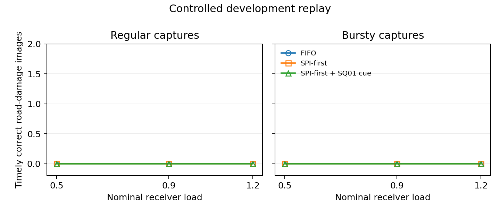

# Frozen road-damage reader follow-up

We need the receiver to recognize visible road damage before queue order can improve how quickly it reports that damage. This follow-up separates failures on the original image, losses from resizing, and losses after SQ-GAN reconstruction.

**Decision.** No-go for deploying the SQ01 cue or opening the protected holdout. The frozen reader failed qualification on originals and reconstructions. The scheduler, SPI model and codec weights stayed frozen.

## Development protocol

The frozen candidate is [MIT Lincoln Laboratory's LADI-v2 large reference classifier](https://huggingface.co/MITLL/LADI-v2-classifier-large-reference) at revision `e7971f2700074d2cfe587c685a73de400b4f809f`. Its weights and the prior SPI comparator stay fixed. The [publisher's validation labels](https://huggingface.co/datasets/MITLL/LADI-v2-dataset) define visible road damage. Negatives contain roads without the road-damage label. These labels do not establish urgency.

The first batch includes 12 positives and 12 negatives. The gate required two-thirds recall and at most two false positives at a threshold of 0.5. Images come from the publisher's original URLs. The acquisition checks source row IDs, raw SHA-256 hashes, and 32-by-32 RGB thumbnail mean absolute difference against the earlier pilot and across selected images. This is a near-duplicate screen and does not prove scene independence.

The initial source gate failed. It produced 4/12 true positives and 1/12 false positives. The aspect-preserving 512-by-256 input produced the same counts. The average precision was 0.836 on originals and 0.833 on the resized content.

For a separate retry, the first batch serves as calibration. The threshold is the next representable float above the third-highest negative score. The second batch excludes the first batch's source folders and both earlier sets of image identities. It retained nine eligible positives and 12 negatives after screening, so the same recall criterion requires six true positives. The two-false-positive cap is unchanged. The second batch was unscored when this rule and the reduced quota were set.

The locked retry threshold was 0.0019101367797702553. The source test recovered 3/9 positives with 3/12 false positives and an average precision of 0.591. Resizing recovered 3/9 with 1/12 false positives at the same threshold. The source test failed both criteria, so the retry stopped before codec inference.

The native pilot pairs original and reconstructed inputs by source hash, applies consistent EXIF orientation, keeps the SQ-GAN 25% image retention setting and times sender preparation, decoding, and reading separately. The cue is a one-byte quantization of the fraction of teacher-labeled road pixels covered by retained image tokens. The replay uses synthetic capture and complete-message arrival times with measured per-image costs.

## Native codec and matched replay

All 24 paired SQ-GAN jobs decoded successfully at 464 payload bytes per image. The original and resized reader scores reproduced when computed again in the native pilot. At the fixed 0.5 threshold, the reconstructions gave 0/12 true positives and 1/12 false positives. Average precision dropped to 0.498. In an exploratory calculation on the calibration batch itself, the source-derived lower threshold gave 10 true positives and two false positives on originals, compared with six true positives and six false positives on reconstructions. The latter exceeds the false-report cap.

Median local CPU time was 16.92 s for sender preparation including SPI, 43.37 s for decoding and 3.93 s for reading. The cue was available on 21/24 images, cost one experimental header byte and added a median 3.01 ms of sender work. SPI computation added a median 1.41 s. The timings reflect this machine and run. Each policy sees the same measured sender and receiver workloads, including cue computation. The byte cost is accounted separately and the replay assumes ideal delivery.

All policies produced zero timely correct road-damage reports and one false report per scenario. The p95 observed waits below are seconds on the replay clock. This wait includes arrived jobs that remain queued through the observation horizon.

| Nominal load | Captures | FIFO | SPI-first | SPI-first + cue |
| ---: | --- | ---: | ---: | ---: |
| 0.5 | Regular | 0.0 | 0.0 | 0.0 |
| 0.5 | Bursty | 87.7 | 111.7 | 111.7 |
| 0.9 | Regular | 0.0 | 0.0 | 0.0 |
| 0.9 | Bursty | 129.8 | 191.3 | 197.7 |
| 1.2 | Regular | 158.7 | 292.6 | 474.6 |
| 1.2 | Bursty | 237.9 | 364.2 | 570.3 |

The named-event cue diagnostic could not fit a model because the outcome had one class. Independent Critical references were unavailable. The FIFO tail result applies to this workload and the replay yields no comparison of Critical service.

The single-cycle traces drained all 24 jobs by the observation horizon. The 96-offer stress control repeats the same measurements four times. At nominal load 1.2, both burst modes left one job in service at the horizon under each policy. FIFO and SPI-first each left nine jobs unstarted. The cue variant left eight unstarted. These are workload repetitions with 24 unique images.



## Five-stage outcome

1. **Native pilot complete.** All measured payloads, timings and receiver outcomes are recorded for the first batch.
2. **Simulator checks complete.** Arrival, payload and deadline fields match across policies. This replay and the preceding 24-image replay each reproduced byte-for-byte from cached timings. The stress control exercised unfinished service and queue backlog. Decode-failure handling is covered by focused tests.
3. **Cue feasibility measured.** The extraction and overhead checks passed. Predictive benefit beyond SPI remains unqualified.
4. **Policy replay complete.** FIFO had the shortest p95 observed wait in every scenario that queued work. Timely correct evidence was zero across policies. Critical service remains unmeasured because the cohort has no independent Critical references.
5. **Holdout decision recorded.** A final evaluation still requires a reader that qualifies on fresh originals and paired reconstructions, plus a separate multi-event cohort with independent task and Critical labels. A receiver-arrival log would be needed to validate field timing.

The next experiment should qualify the reader and the codec jointly against the road-damage task before choosing a new policy. Test a region-focused reader on independent, labeled source views. If it passes on originals and fails after reconstruction, measure task accuracy over a rate curve and an equal-byte control before choosing a new codec setting. The current result establishes a development failure for this reader and rate.

## Reproduction

Use the publisher's `v2/ladi_v2a_labels_val_resized.csv` and the previous 24-image local manifest with its referenced images. The frozen model must be available locally at the revision above. Use the same pinned SQ-GAN bundle and source root as in the [earlier pilot](native_sqgan_pilot.md).

```powershell
python -m Evaluation.scheduler_fresh_reader_cohort $validationCsv $priorManifest $first
python -m Evaluation.scheduler_frozen_reader_screen "$first/manifest.json" $reader "$first/source_screen.json"
python -m Evaluation.scheduler_codec_pilot --manifest "$first/manifest.json" --reader $reader --bundle $bundle --source-root $sourceRoot --exif-transpose --output "$first/paired.json"
python -m Evaluation.scheduler_codec_spi "$first/paired.json" "$first/manifest.json" $clip "$first/paired_spi.json"
python -m Evaluation.scheduler_codec_study "$first/paired_spi.json" "$first/replay.json"
python -m Evaluation.scheduler_codec_study "$first/paired_spi.json" "$first/stress.json" --cycles 4
python -m Evaluation.scheduler_fresh_reader_cohort $validationCsv $priorManifest $retry --exclude-prefixes-from "$first/manifest.json" --positive-count 9
python -m Evaluation.scheduler_frozen_reader_screen "$retry/manifest.json" $reader "$retry/source_screen.json" --calibration-screen "$first/source_screen.json"
```

The [run manifest](strong_reader_receipts/run_manifest.json) indexes the preserved receipts by SHA-256. Replaying a cached receipt is deterministic. Re-encoding measures new hardware timings.
