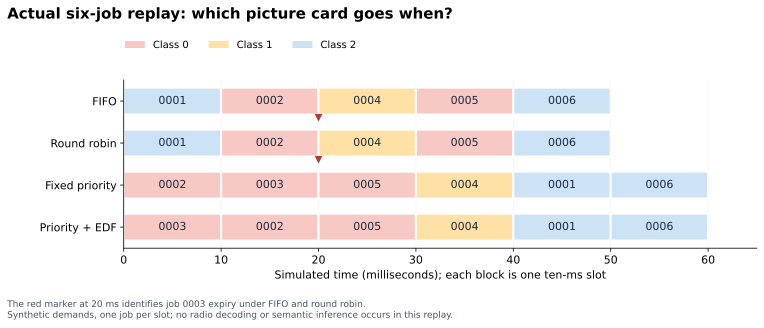
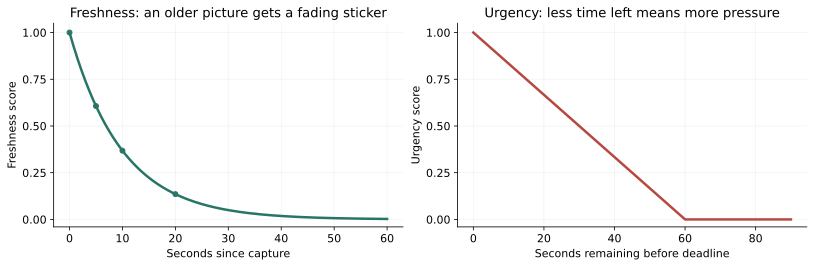

# 1. Start here: what this report promises

Imagine that three children each have a camera. They take pictures and want to send them to a helper. One picture shows a flower. Another shows smoke. Another might show somebody who needs help. The road to the helper is narrow. Only a few pictures can travel at a time.

Somebody must decide which picture goes next. That somebody is the **scheduler**.

Our goal is to build a scheduler that understands why a picture matters and how soon somebody needs it. The goal is more specific than sending many pictures quickly: the receiver should learn the right important thing while there is still time to act.

This report begins with that little story, then explains the real implementation, every scheduling algorithm we have discussed, the semantic measurements, communication methods, knowledge bases, experiments, literature, and remaining work. Technical terms are introduced with ordinary examples. Formulas are explained with numbers. You can read the story explanations first and return to the technical details later.

There is one rule throughout: **a plan is different from working code, and working code is different from a proven research result**.

## 1.1 The four labels used throughout

| Label | What it means |
|---|---|
| **EXISTS** | We inspected implementation in the current repository. It may still need dependencies, data or model files before it runs. |
| **CHECKED NOW** | We actually ran the stated check while preparing this report. The claim applies only to that check. |
| **RECORDED EARLIER** | An earlier conversation or repository validation report records the result. It was not necessarily repeated here. |
| **PROPOSED** | We discussed or specified it. It has not been implemented and validated as part of this conversation. |

The word “we” describes the project and our investigation. It does not mean this assistant originally wrote all the inherited code. The four policies, model adapters, extraction pipelines and test infrastructure were already in the selected repository. Our work in this conversation prepared a development workflow, inspected it, tested focused paths, researched related methods, and wrote specifications. We have not implemented a new semantic scheduling policy during this conversation.

## 1.2 The current state in one picture

**EXISTS:** a small, deterministic scheduling demonstration; image semantic extraction code; codec adapters; codebook methods; channel models; run logging; tests.

**CHECKED NOW:** the focused Scheduler/INFRA test command passed 23 cases and skipped one PyTorch-dependent case. Two additional semantic import-isolation tests passed. The six-job demonstration completed. Constructed semantic-header and VQ-packet examples round-tripped correctly.

**STILL FAILING HERE:** two external-worker tests fail because the worker reaches PyTorch-dependent seeding without PyTorch. Configuration also resolves the virtual-environment Python symlink to its underlying interpreter. These are separate setup/worker concerns; neither prevents the model-free scheduler demonstration.

**PROPOSED:** a real-image static semantic/urgency policy; a feedback-driven dynamic knowledge policy; active requests; representation selection; the new evaluation benchmark; deployment hardening.

Source reviewed: `saltypal/SemanticSchedulerEnd2End`, commit `edad7d07c44fd3006e4359b8c32b6dbe143818d7`. The source tree remained unchanged while preparing the report. Runtime dependencies and generated report outputs are separate from tracked application changes.

# 2. The little rescue story

Picture a small rescue station. Three cameras are our messengers. The station is the receiver. A narrow bridge is the communication link. Picture cards are waiting to cross.

A card has several questions written on its envelope:

- Who sent it?
- Which picture is inside?
- When did it arrive?
- How much bridge space does it need?
- How important is it?
- When does it become too late to help?

The scheduler reads the envelopes and chooses cards. A separate worker moves the chosen cards and advances the clock. Separating those jobs helps us understand mistakes: was the choice poor, or did delivery fail?

Today, the scheduler's little demonstration has six made-up envelopes. Their importance is written by a person. It does not open a fire picture and discover the importance itself.

We also have a separate picture-understanding tool. It produces measurements such as relevance, freshness and novelty. The next major engineering task is to connect those measurements to real scheduling envelopes using an explicit task policy.

## 2.1 What each part does

| Project part | Rescue-station explanation | Actual responsibility |
|---|---|---|
| **EncDec** | Packs a picture and opens it at the other end | Image encoding, decoding, communication codebooks and reconstruction evaluation |
| **SemParam** | Writes evidence about what the picture might mean | Semantic observations, parameters, semantic codebooks and local knowledge |
| **Scheduler** | Chooses which waiting envelope goes next | Policy decisions from immutable queue snapshots and budgets |
| **INFRA** | Keeps the clock, runs the bridge and writes the notebook | Contracts, configuration, arrivals, queues, transport, orchestration and results |

The Scheduler is intentionally lightweight. It should consume facts and estimates through a typed interface; it should not secretly load a neural network or modify everybody's queue. INFRA owns queue and clock changes.

## 2.2 Where the complete future loop goes

```text
Source takes picture
    -> semantic evidence is produced
    -> a task policy assigns operational meaning and urgency
    -> INFRA creates an eligible job with a measured cost
    -> Scheduler chooses a job and, later, a representation
    -> EncDec and transport deliver the selected information
    -> receiver reconstructs/interprets it
    -> receipt and usefulness feedback return
    -> receiver knowledge changes
    -> later scheduling decisions use that changed knowledge
```

The current root command dispatches Scheduler/INFRA to the synthetic fixture, EncDec to codec actions, and SemParam to extraction actions. Selecting `module: INFRA` does not automatically execute every arrow in this future loop.

# 3. The words we need before we start

An **observation** is something a source saw at a particular time. An **image** is the picture content. An **event** is the thing happening in the world, such as one particular building fire. Several images can show the same event.

A **job** is a request to do work. The same image can have more than one job, for example a first attempt and a later explicitly managed action. Each job needs its own identity.

A **UE**, or user equipment, is a source device: a camera, phone or drone. “Three UEs” means three sources, not three pictures.

A **queue** is a waiting line. A **policy** is the rule for choosing from it. A **budget** is how much work we are allowed to choose at one decision. A **slot** is one small step of simulated time.

An **arrival** is when a job becomes available to the scheduler. A **capture time** is when the camera took the image. These can differ because extraction or upload takes time.

A **deadline** is the latest useful completion time. **Urgency** concerns how little safe time remains. **Criticality** concerns how serious the consequences are. A very serious job can have a generous deadline; a routine job can have a tight deadline. They are different dimensions.

A **representation** is the form we send: a full image, compressed image, thumbnail, crop, short alert, or learned features. A **codec** is an encoder and decoder together. A **checkpoint** stores learned model parameters.

A **baseline** is a comparison method. An **ablation** removes one ingredient to discover whether it helped. An **oracle** is an explicitly labeled experiment with information the ordinary deployed system would not know perfectly.

**Provenance** is the evidence trail: which source, model, configuration and code produced a result. **Calibration** asks whether a numerical confidence agrees with real correctness rates. If predictions called “90% certain” are correct only half the time, confidence needs work.

A **false positive** raises an alarm for an event that is absent. A **false negative** misses an event that exists. In emergency work, their costs can differ greatly.

# 4. What we have actually done in this conversation

## 4.1 Prepared a useful development path

We read the onboarding instructions, project guidance, map, README, configuration and dependency declarations. We selected the documented Scheduler/INFRA first-run workflow because it needs no disaster dataset or trained neural checkpoint.

We used Python 3.12 and the repository's frozen `uv.lock`, installing the `scheduler` and `test` extras. The initial installation had 17 packages including plotting and test dependencies. A frozen installation uses the saved dependency choices rather than silently rewriting them.

We ran focused tests and the demonstration. We checked the generated completion status, six job records, four policy results/traces and a readable comparison image. We fixed writable plotting/cache locations through runtime environment variables, without changing tracked source or lockfiles.

The earlier onboarding saved an `install_script` and `start_skill` configuration draft. A draft records repeatable instructions; it does not execute them or prove publication. This conversation contains no confirmation that the user published the prepared environment. During this report, the minimal environment was recreated because its `.venv` was absent in the current instance.

## 4.2 Investigated the limits

We found the missing integration between semantic extraction and the scheduler; synthetic resource demands; the single-slot completion abstraction; absent receiver task evaluation; and the difference between local observation memory and delivered receiver knowledge.

We also investigated two broader worker failures. A worker is a separate Python process for models with incompatible dependencies. Its current failure happens before meaningful model execution: seeding imports PyTorch, which is absent. Resolving a configured interpreter with `Path.resolve()` also follows a virtual-environment symlink to the underlying Python. We documented these issues rather than changing application code during onboarding.

## 4.3 Designed future work and researched references

We proposed an interpretable static semantic/urgency policy, followed by a dynamic policy using causal receiver knowledge. We designed a project benchmark called **Timely Semantic Event Delivery v1**. This is our proposed protocol name, not an established community benchmark or collected dataset.

We identified the LLM semantic scheduling paper and closer communication references. We inspected accessible author repositories and selected implementation files. Full arXiv/publisher PDF downloads were blocked in those research turns, so we did not verify all paper proofs or numerical results.

Three earlier documents remain supporting specifications: `semantic_scheduler_research_roadmap.md`, `llm_semantic_scheduling_methodology.md`, and `related_work_and_scheduler_upgrades.md` under `/workspace/plans`.

# 5. The job envelope: every current field

**EXISTS.** `INFRA/contracts.py` defines a frozen `Job`. Frozen means its normal fields cannot be reassigned after construction. Think of a laminated envelope: the policy reads it; it does not rewrite the contents.

| Field | Plain explanation | Current rule |
|---|---|---|
| `job_id` | This exact request's name | Nonempty string; unique within a queue snapshot |
| `image_id` | Which picture this request concerns | Nonempty string |
| `ue_id` | Which source sent it | Nonempty string |
| `arrival_ms` | When it joins the line | Finite, nonnegative number |
| `resource_units` | Its declared resource cost | Positive integer |
| `priority_class` | Its importance class | Nonnegative integer; smaller means higher priority; default 2 |
| `deadline_ms` | Latest on-time completion | Optional; finite/nonnegative and not earlier than arrival |

The four demo policies use classes 0, 1 and 2, but the contract does not limit all possible jobs to exactly three classes. It also does not say class 0 means a particular medical or disaster category. An operational mapping still needs explicit definition.

Current jobs contain no semantic bundle, event identity, calibrated confidence, remaining work, ACK state or knowledge version. Those are proposed integration fields or associated immutable records. Adding an event ID requires a genuine event-association rule; an image hash alone cannot identify an evolving fire.

## 5.1 The budget envelope

`ResourceBudget` has `units`, `unit` and `max_jobs`. Units and maximum job count may be zero. The unit must be `digital_bits` or `complex_channel_uses`.

A budget of 100 units and one job allows one job costing at most 100 units. It does not allow two jobs costing 40 units each, because the maximum job count is one. With a maximum of two jobs, those two might fit.

The budget itself does not convert bits into radio symbols, seconds or energy. A transport model must supply that conversion. The synthetic fixture's numbers are declared demands, not measured payloads.

## 5.2 Snapshot and decision

A `QueueSnapshot` contains a time and a tuple of jobs. A tuple is a fixed ordered collection. The snapshot rejects duplicate job IDs.

A job is eligible when `arrival_ms <= now_ms` and its deadline is absent or strictly greater than now. A job with deadline exactly equal to now cannot begin a new positive-length slot.

A `Decision` records the policy name, current time, selected IDs, used units, unit name and a short reason. INFRA checks the returned choice against the actual eligible jobs and budget. A policy cannot legally select the same job twice or claim it spent fewer units than the selected jobs require.

# 6. How one current decision is made

**EXISTS.** The shared `BaselinePolicy.decide()` procedure works as follows:

1. Ask the snapshot for eligible jobs.
2. Start with an empty selected list and zero spent units.
3. Find jobs that fit the remaining budget.
4. If none fit, stop.
5. Choose the best fitting job using the selected policy.
6. Remove it from the temporary candidate list, add its ID to the choice and add its demand to spending.
7. Repeat until no more jobs fit or the maximum selected job count is reached.
8. Return a decision. INFRA later applies it.

There is a subtle point: **the policy ranks fitting jobs**. Even FIFO can bypass an earlier oversized job. Imagine cards costing 100, 6, 5 and 4 units, with a ten-unit budget and room for three jobs. The current FIFO chooses the six-unit and four-unit cards. It cannot fit the 100-unit card, and the five-unit card no longer fits after choosing six.

No job is partially sent by this procedure. A 101-unit job never fits a repeated 100-unit slot, even if the horizon is long. The future design needs smaller representations or explicit multi-slot service.

The loop scans candidates repeatedly. With n jobs and a cap of m selected jobs, its straightforward selection work is roughly O(mn); selecting many jobs can approach quadratic work. These small baseline scans are different from a heap-based system with logarithmic insertion/removal. We have not measured production-scale queue capacity.

# 7. The four implemented scheduling algorithms

## 7.1 FIFO: first in, first out

**EXISTS.** Imagine a lunch line: the child who joined first is served first.

The current key is `(arrival_ms, job_id)`. Compare arrival first. If arrivals tie, compare the job ID text. The chosen job is the fitting one with the smallest key.

If A arrives at time 0 and B at time 5, A goes first. If both arrive at time 0 and their IDs are `job-0001` and `job-0002`, the first ID wins. The zero-padded names make the intended numbering easy to compare lexicographically.

FIFO is easy to understand, but it can serve a routine old picture while an emergency waits. In this implementation it considers no semantic class or deadline while ranking. Eligibility still prevents a job that is already expired from starting.

## 7.2 Round robin: take turns between sources

**EXISTS.** Imagine three children each taking a turn to hand over one card. A child with many cards should not automatically get every turn.

The policy remembers `last_ue`. For fitting jobs it sorts source IDs. It selects the next source after `last_ue`, wrapping to the first source when necessary. Within that source it chooses FIFO. It updates the pointer after every selection, including selections inside a multi-job decision.

If the last source was `ue-002` and the currently fitting sources are `ue-001` and `ue-003`, `ue-003` goes next. If only `ue-001` fits, the pointer wraps to `ue-001`.

Reset clears the pointer at the beginning of a simulation, making separate replays comparable. This provides turns among fitting active sources; it is not a guarantee of equal bytes, equal delay or deadline success. A source with only oversized jobs can still receive no service.

## 7.3 Fixed priority: serve the most important class first

**EXISTS.** Imagine three trays: urgent red cards, important amber cards, and routine blue cards. Empty the higher tray before taking from a lower tray when jobs fit.

The key is `(priority_class, arrival_ms, job_id)`. Class 0 precedes class 1, and class 1 precedes class 2. Within a class, FIFO decides.

The names red, amber and blue are teaching aids. The repository does not automatically assign those meanings to images. Its fixture supplies class integers explicitly.

Fixed priority respects the supplied class but ignores different deadlines inside that class. A constant stream of class-0 work can starve lower classes. The real system needs an explicit overload/fairness policy; moving a truly critical job behind routine traffic merely to improve a fairness number may violate the task goal.

## 7.4 Priority plus EDF: most important class, then earliest deadline

**EXISTS.** EDF means earliest deadline first. Here it operates inside each class.

The key is `(priority_class, deadline_ms, arrival_ms, job_id)`. A missing deadline is treated as infinity for ordering, so it comes after finite deadlines in the same class.

Suppose A has class 1 and deadline 10, while B has class 0 and deadline 50. This policy chooses B. The first comparison is class. It is therefore different from global EDF, which would choose A if both otherwise fit.

Among class-0 jobs B and C with deadlines 50 and 20, C wins. This is why the fixture changes its first selection from job 0002 under fixed priority to job 0003 under priority plus EDF.

This method uses a deadline, but it does not estimate remaining service time. The current simulator gives every selected job one whole slot regardless of its demand, so adding service-aware urgency requires extending the model as well as the policy.

# 8. Walk through all six demo jobs

**CHECKED NOW.** These are explicit synthetic records. The words “image” and “UE” are identifiers; no real image inference determines these classes or demands.

| Job | Source | Arrival, ms | Class | Deadline, ms | Demand, synthetic units |
|---|---|---:|---:|---:|---:|
| 0001 | ue-001 | 0 | 2 | 100 | 60 |
| 0002 | ue-002 | 0 | 0 | 30 | 60 |
| 0003 | ue-001 | 0 | 0 | 20 | 40 |
| 0004 | ue-003 | 10 | 1 | 60 | 60 |
| 0005 | ue-002 | 20 | 0 | 40 | 40 |
| 0006 | ue-003 | 30 | 2 | 120 | 100 |

The budget is 100 complex-channel-use units per slot, the maximum is one selected job, slots are ten milliseconds, and the horizon is 200 milliseconds. The simulation can finish earlier when no pending jobs remain.



## 8.1 FIFO, one slot at a time

At time 0, jobs 0001, 0002 and 0003 have arrived. FIFO selects 0001 because all three share arrival 0 and 0001 has the smallest ID. It finishes at time 10.

At time 10, job 0004 joins. FIFO selects 0002, which arrived before 0004 and wins the ID tie against 0003. It finishes at 20, before its deadline of 30.

At time 20, job 0003 expires before selection because its deadline is now. Job 0005 arrives. FIFO selects 0004, which arrived at 10. It finishes at 30.

At time 30, job 0006 arrives. FIFO chooses 0005, which arrived at 20. It finishes at 40, exactly its deadline, which counts as on time.

At time 40, FIFO selects 0006. It finishes at 50. There are no jobs left. Five completed; one expired.

## 8.2 Round robin, one slot at a time

At time 0, source `ue-001` is the first fitting source. Its FIFO card is 0001 rather than 0003. Next, at time 10, the pointer selects `ue-002`, so 0002 goes.

At time 20, job 0003 expires. The next source after `ue-002` is `ue-003`, so 0004 goes. At time 30, the pointer wraps and finds `ue-002` with job 0005. At 40, `ue-003` sends 0006.

This particular fixture produces exactly the FIFO job order. That does not mean FIFO and round robin are the same algorithm. A different distribution of source jobs produces different choices.

## 8.3 Fixed priority, one slot at a time

At time 0, class-0 jobs 0002 and 0003 outrank class-2 job 0001. Their arrivals tie, so 0002 wins by ID and finishes at 10.

At time 10, 0003 remains the highest class and finishes at 20, exactly on its deadline.

At time 20, newly arrived class-0 job 0005 wins and finishes at 30. At time 30, class-1 job 0004 beats the remaining class-2 jobs and finishes at 40.

At time 40, class-2 job 0001 precedes class-2 job 0006 by arrival. They finish at 50 and 60. All six complete on time.

## 8.4 Priority plus EDF, one slot at a time

At time 0, both 0002 and 0003 have class 0, but 0003 has deadline 20 rather than 30. It goes first and finishes at 10.

At time 10, 0002 finishes at 20. At time 20, 0005 finishes at 30. At time 30, 0004 finishes at 40. The remaining order is 0001, then 0006, finishing at 50 and 60.

Every deadline is met. The first two jobs exchange positions relative to fixed priority; the rest match.

## 8.5 The exact outcome and the trap in the average

| Policy | Job order | On-time fraction | Mean wait of completed jobs |
|---|---|---:|---:|
| FIFO | 1, 2, 4, 5, 6 | 5/6 = 83.33% | 8 ms |
| Round robin | 1, 2, 4, 5, 6 | 5/6 = 83.33% | 8 ms |
| Fixed priority | 2, 3, 5, 4, 1, 6 | 6/6 = 100% | 15 ms |
| Priority plus EDF | 3, 2, 5, 4, 1, 6 | 6/6 = 100% | 15 ms |

Waiting time here is slot start minus arrival, not arrival-to-completion time. FIFO's completed waits are 0, 10, 10, 10 and 10, totaling 40 across five jobs: 8 ms. Its expired urgent job is excluded from that mean.

Fixed priority's completed waits are 0, 10, 0, 20, 40 and 20, totaling 90 across six jobs: 15 ms. It successfully includes the urgent job FIFO missed.

This is why one average cannot decide whether a scheduler is good. We need missed deadlines and per-criticality task outcomes alongside delay. These six jobs establish program behavior, not a general scientific claim that priority policies always win.

# 9. What the simulator really does

**EXISTS.** INFRA is the clock keeper. Before selecting, it validates the input collection and resets policy state. It keeps a dictionary of pending jobs.

For each complete slot, it expires arrived jobs whose deadline has passed, creates a snapshot, measures the policy's decision runtime, validates the choice, and marks selected jobs completed at the slot end.

It stops early if no pending jobs remain. At the horizon, remaining jobs become expired, pending or not-arrived according to arrival and deadline rules. A partial final slot is not executed. For example, a 25 ms horizon with ten-ms slots includes 0–10 and 10–20, not 20–30.

There are several boundaries to understand:

- **Completed is not necessarily on time.** Eligibility checks deadline against slot start. If a job starts at 10, finishes at 20 and has deadline 15, it can be recorded completed with `deadline_met: false`. No current rule predicts this lateness before serving it.
- **One selected job completes in one slot.** A demand of 40 and a demand of 100 both take ten ms under the default one-job budget if they fit. Demand is a feasibility count, not a measured duration model.
- **No radio success is simulated in this scheduling loop.** Selecting a job does not run AWGN, a CRC, a decoder or a receiver classifier.
- **Future jobs exist in the pending collection.** The current baselines only use `eligible()`. A future online benchmark should hide unreleased jobs from the policy input so a new policy cannot exploit future metadata.
- **Unused capacity remains unused.** With one-job slots, choosing a 40-unit job leaves 60 resource units unavailable to another job that slot.

The current simulation is a useful small contract test. A realistic scheduling study must add measured service, appropriate causal inputs and delivery/task outcomes.

# 10. Configuration, commands and the experiment notebook

**EXISTS.** Configuration is a set of instructions written in YAML. Think of a recipe card. Module defaults are read first, then a selected profile, then root configuration, then explicit command-line overrides. Later layers override earlier ones.

Relative paths in YAML are resolved relative to the selected root YAML file. An explicit `--output` path is resolved from the command's working directory. This distinction prevents “why did my results go there?” confusion.

The root default selects INFRA and validation. Scheduler defaults select all four policies, seed 42, ten-ms slots, 200-ms horizon, budget 100 and maximum one job per slot.

Validation rejects unsupported modules/actions/policies, invalid seed ranges, unsupported accelerator names, bad timing values and invalid budgets. Root configuration rejects unrecognized root keys. This is not a claim that every nested object has an exhaustive schema validator.

Typical scheduler commands from the repository root are:

```bash
UV_CACHE_DIR=/workspace/.uv-cache uv sync --frozen --extra scheduler --extra test
export MPLBACKEND=Agg
export XDG_CACHE_HOME=/workspace/reports/semantic-scheduler/.cache
export MPLCONFIGDIR=/workspace/reports/semantic-scheduler/.cache
.venv/bin/python E2EMain.py --module INFRA --action demo --output /workspace/reports/semantic-scheduler/execution/runs
.venv/bin/python -m pytest Scheduler/tests INFRA/tests/test_modular_runtime.py INFRA/tests/test_transport_selection.py -q
```

For this path, `validate` still runs the synthetic simulation; `demo` and `evaluate` additionally produce the policy comparison plot. They do not train a model or start a deployed service.

A run folder contains `config.resolved.yaml`, `provenance.json`, `status.json`, `result.json`, `jobs.json`, `traces.json`, and for demo/evaluate, `policy_comparison.png`.

The provenance records commit, working-tree status, a digest of canonical Python source, interpreter/platform and selected package versions. A digest is a fingerprint of bytes. The run's source digest covers the canonical Python files, not every dataset/checkpoint/configuration file by itself; those need their own recorded identities where applicable.

Run IDs combine a UTC clock string and random suffix. They identify executions, not independent scientific samples. Repeating an identical six-job fixture under many run IDs does not produce many independent emergency scenarios.

## 10.1 Older stage names, wrappers and notebooks

Older files call codec work Stage 1A, transformer-based semantic work Stage 1B and semantic codebook work Stage 1C. Current ownership is EncDec, SemParam, Scheduler and INFRA. Historical names in manifests and folders do not create additional complete scheduling systems.

The `src/` packages and `semcom_benchmark/` preserve earlier import paths by forwarding to canonical code. They should not become separate copies with different behavior. The class-identity tests check that older imports refer to the same class object where required.

Active notebooks are recipes that import module code. Historical notebooks preserve earlier experiments. A notebook opening successfully does not prove every cell, dependency, training run or external checkpoint is available. Graphify's architecture graph is a map of code relationships, not a learned knowledge base and not evidence of model accuracy; no architecture refresh was needed because this report changed no application architecture.

# 11. How a picture gets semantic measurements

**EXISTS, with model execution requiring its dependencies and weights.** SemParam has an image-only pipeline based on CLIP. It does not require a SwinJSCC checkpoint just to understand an image.

Think of CLIP as a machine that puts pictures and sentences on the same map. Pictures and sentences that appear related tend to point in similar directions on that map. The map position is a list of numbers called an **embedding**. It is an estimate from a learned model, not human understanding or ground truth.

For one image, the current pipeline:

1. Checks that the source file exists.
2. Converts the image to RGB and uses the CLIP processor's expected input preparation.
3. Encodes the image once into a normalized vector.
4. Gets text vectors for configured concept prompts and the task description, reusing cached text vectors when possible.
5. Compares directions using dot products of normalized vectors, equivalent to cosine similarity.
6. Converts concept similarities into scores using a temperature-scaled softmax.
7. Builds an observation with an image hash, observation identity, vectors, scores, timestamp and metadata.
8. Queries local knowledge, extracts parameters, applies allowed externally supplied values, builds the bundle, and then records the observation.

The configured model is `openai/clip-vit-base-patch32`. Text caching avoids re-encoding the same prompt for every picture. The image is still encoded once for every observation, including a repeated image unless a future explicit image cache is introduced.

## 11.1 Cosine similarity without the scary name

Draw two arrows. If they point in the same direction, their similarity is 1. At a right angle it is 0. Opposite directions give -1. We first normalize arrows to unit length so their directions matter rather than their raw sizes.

The code rejects a zero-length vector because it has no meaningful direction. Numerical similarities are useful evidence but do not directly mean “there is an 80% chance of a fire.”

## 11.2 Softmax and temperature

Softmax turns a set of scores into positive numbers that sum to 1. The current rule is approximately `exp(similarity / temperature)` divided by the sum over configured concepts. Subtracting the largest scaled score first keeps the computation numerically stable.

A smaller temperature makes the winning prompt look more dominant. The configured value is 0.07. Changing the prompt list or temperature changes the scores, which is why they belong in experiment provenance.

There is a limitation: smoke, fire, buildings and people can coexist. A normalized competition among prompts is not automatically a calibrated multilabel detector. Even an irrelevant image has a largest score. A robust emergency method needs unknown/negative examples, coexistence handling and independent calibration.

## 11.3 The task is explicit

The demonstration task concerns building fires and smoke for emergency response. Its concept weights are fire 0.95, smoke 0.90, pedestrian 0.85, traffic light 0.80, vehicle 0.75, road 0.70, animal 0.45, building 0.35 and vegetation 0.20.

These are configured demonstration preferences. They are not a clinically or operationally approved consequence model. Another task can legitimately assign different weights. A traffic light can be central to traffic control while a fire response task values other evidence more.

The four configured demo images are `BuildingFire.jpeg`, `BuildingFire2.jpeg`, `Mumbai-Drone-Photo-1.jpeg` and `sunflower.jpeg`. Their names identify files; their names must not be used to assign real semantic ground truth or priority. A filename saying “fire” is not evidence that a learned model recognized fire.

# 12. Every one of the seven semantic parameters

**EXISTS.** The bundle contains independent fields with value, availability, raw evidence, method, source, version, units and provenance. “Unavailable” means we do not know. It is represented by `None`, not the number zero.

## 12.1 Age of Information: how old is this observation?

The present `AoI_seconds` is `now - captured_at`, measured in seconds.

If the picture was taken five seconds ago, its observation age is five. No capture timestamp means unavailable. A timestamp in the future also yields an unavailable value with an explanation.

This is observation age. The receiver's information age asks when the newest useful update actually received was captured. A new picture waiting at the sender does not make the receiver's knowledge fresh. The future benchmark needs both quantities explicitly named.

## 12.2 Freshness: a smoothly shrinking value

The current rule is `freshness = exp(-age / tau)`, with `tau = 10 seconds` in the demo. You can picture a bright sticker gradually fading.

At age 0, freshness is 1. At five seconds, it is about 0.6065. At ten seconds, about 0.3679. At twenty seconds, about 0.1353.

Tau determines how fast the sticker fades; it does not come from the image itself. Missing or future capture time makes freshness unavailable. Because freshness is calculated from age, treating them as completely independent weighted evidence can count the same fact twice.

## 12.3 Novelty: how unlike our local history?

The present rule is `clip(1 - maximum_history_cosine_similarity, 0, 1)`. Clipping limits the number to the range 0–1.

An almost identical direction with similarity 0.98 gives novelty 0.02. Similarity 0.30 gives novelty 0.70. With no history, the implementation assigns novelty 1.0 as a deliberate default.

A new observation is compared before being stored. Otherwise, it would compare to itself and always look old. This correct ordering prevents one simple form of self-contamination.

Novelty here means embedding dissimilarity to locally observed images. A novel flower can still be irrelevant to a rescue task. A familiar-looking fire can still be getting worse. This field is not a complete estimate of new operational information.

## 12.4 Relevance: does the picture match the declared task?

The code compares the image vector with the task text vector, then computes `clip((cosine + 1) / 2, 0, 1)`.

Cosine 0.6 becomes relevance 0.8. Cosine 0 becomes 0.5. This rescaling is mathematical, not calibration: relevance 0.8 does not establish an 80% probability of task usefulness. If the task embedding is absent, relevance is unavailable.

## 12.5 Reliability: what the current field actually measures

The implementation takes the maximum configured concept softmax score. It reports the winning concept and score as evidence.

If fire scores 0.70, smoke 0.20 and other configured concepts together 0.10, the current reliability proxy is 0.70. The label describes semantic confidence from CLIP prompts. It does not measure source honesty, link reliability, correctness of a deadline, or probability that a receiver can interpret the compressed image.

These different ideas should have separate variables in the integrated system. Otherwise a number that looks reassuring could be used for the wrong decision.

## 12.6 Urgency: deadline pressure

The current rule is `clip(1 - seconds_remaining / urgency_horizon, 0, 1)`. The demonstration horizon is sixty seconds.

With thirty seconds left, urgency is 0.5. With twenty left, it is about 0.6667. With ten left, about 0.8333. With one hundred left, the result clips to zero.

No explicit deadline means unavailable. An image does not secretly reveal its response deadline. That deadline must come from operational context or a validated task rule.

After a deadline, this formula clips to 1. That does not make an expired job useful again. Scheduling eligibility and usefulness expiry are separate checks. The future method uses remaining service time to estimate slack, which this extractor currently does not do.

## 12.7 Task importance: combine concept scores with task preferences

For concepts shared between the observation and the task policy, the code sums `concept_score * configured_importance`, then clips the sum into 0–1.

For a teaching example with fire score 0.7, smoke 0.2 and vegetation 0.1, the demo task weights produce `0.7*0.95 + 0.2*0.90 + 0.1*0.20 = 0.865`.

This is a reproducible configured score. It does not supply independent ground-truth severity. Missing policy weights or no overlapping configured concepts yields unavailable evidence.

## 12.8 The four-image timing example

Under the fixed reference time saved in the demo configuration, the fire image is five seconds old with twenty seconds until its deadline; its follow-up is twenty seconds old with ten seconds left. The drone scene is fifty-five seconds old with one hundred seconds left. The sunflower image is 120 seconds old and has no supplied per-image deadline.

Those times are scripted demonstration metadata. They are not measured response windows from a field operation. The first two images therefore have observation-age values 5 and 20, freshness about 0.6065 and 0.1353, and urgency about 0.6667 and 0.8333. The sunflower's urgency remains unavailable unless other explicit task context supplies it.



These arithmetic examples do not claim fresh CLIP inference. Their image-content scores depend on actually running the model, which was not done for this report.

# 13. Bundles, semantic headers and missing values

**EXISTS.** A rich bundle is like a notebook page. It contains numbers and explanations: how they were obtained, model/settings version, original observations and missing-value reasons. An externally supplied parameter must be a proper `ParameterValue`, and unknown enabled-field names are rejected.

`producer_level` distinguishes UE, O-RAN and external producers. This label documents an intended source. It does not establish a working O-RAN integration; that deployment adapter is currently unavailable.

A compact header is like the short label outside an envelope. The current codec uses three magic bytes `SHP`, a version byte, and a field-count byte. Each field has a one-byte ID, one-byte flags and one-byte payload length, followed by its value bytes.

The flags include availability and producer. Age uses four unsigned bytes of milliseconds. Normalized scores use two bytes: multiply by 65,535, round, transmit the integer, then divide by 65,535 when reading. This creates a small quantization step of about 0.00001526.

All seven available fields occupy `5 + 7*3 + 4 + 6*2 = 42 bytes`. That exact constructed example was encoded and decoded during this report. It used teaching values, not trained-model predictions. If one normalized field is unavailable but still represented, its two value bytes disappear while its three-byte field record remains. A missing field and an explicitly unavailable field are distinguishable in the rich representation.

The four-byte age representation has a finite range, around 49.7 days at millisecond resolution. Values outside the range are rejected. Timestamp units must be converted carefully: the semantic bundle uses seconds for age while scheduler fixture time uses milliseconds.

The header is presently a **logical sidecar**. Its existence does not mean its radio airtime is integrated into every benchmark. The future transport must include headers, framing, protection and feedback costs. The compact header also does not carry every rich provenance field, an entire knowledge graph, or proof of sender authenticity.

# 14. What the existing knowledge base knows

**EXISTS.** The current NetworkX knowledge base has two parts: a graph of image/concept associations and a dictionary of normalized image descriptors.

To answer “have we seen something similar?”, it computes similarity to every stored descriptor and returns the nearest observation, maximum similarity and history size. The current similarity query does not perform multi-hop graph reasoning, event tracking or retrieval of a rescue plan. Graph edges record concept evidence; the query still uses descriptor comparison.

With N past descriptors of dimension d, the straightforward query costs approximately O(Nd), and descriptor storage also grows with N times d. There is no built-in persistent distributed receiver-state service here. The vector-store, Redis, global/cross-UE and rich-knowledge-graph classes explicitly raise unavailable errors.

Observation IDs use content hash together with path and a sequence counter. A content hash helps identify identical bytes; the sequence distinguishes observations. Neither alone solves matching several views of one real event across sources, locations and time.

The crucial difference is this: a picture can be stored after local extraction even if it never crosses the communication bridge. Therefore, local history cannot be substituted for what the receiver knows. Our future design keeps those states separate.

# 15. Two codebooks that do different jobs

“Codebook” sounds like one thing, but the project has two different dictionaries. Mixing them would produce incorrect claims about both compression and meaning.

## 15.1 Communication codebook: replace feature vectors with indices

**EXISTS.** Imagine a shared box of 256 colored crayons. Instead of describing a color with many numbers every time, send “crayon 17.” The receiver has the same box and looks up crayon 17.

The actual vectors are learned cluster centers, not colors. The selected implementation is an ordinary K=256 minibatch K-means vector quantizer. It collects real latent tokens, initializes centers deterministically using a fixed seed, assigns tokens to nearby centers, and updates centers using accumulated assignments. Its current training helper uses PyTorch distance calculations and running counts.

At encoding, find each token's nearest center and send its index. At decoding, replace each index by that center and restore the expected latent tensor shape. The result approximates the original features; this is lossy quantization.

For K entries, the required fixed index width is `ceil(log2(K))`. K=256 requires eight bits. The implementation's temporary NumPy index array may use a wider storage dtype; the on-wire fixed-width indices remain eight bits in this selected scheme.

Per-image packets include indices, optional rate mask, 128 metadata bits and 32 CRC bits. Metadata includes a codebook-ID fingerprint, K, active rate, latent dimensions and version. Shared codebook storage and distribution are separate costs.

A constructed example with ten indices, no mask, and K=256 has `10*8 + 128 + 32 = 240 bits`, or thirty bytes. That packet was round-tripped correctly for this report. This checks packing and CRC recovery, not learned reconstruction quality.

A CRC detects many accidental corruptions. It is not a cryptographic identity check, and the identifier fingerprint does not automatically prove identical learned dictionaries. The system must manage matching codebook contents and versions explicitly.

`KMeansVQ` is an alias to the selected minibatch implementation. Product VQ and grouped VQ classes currently fail explicitly as unavailable. Their class names do not establish implemented alternatives.

## 15.2 Semantic codebook: approximate content-derived parameter scores

**EXISTS, demonstration status.** Imagine a teacher who has written short notes for example pictures. We group similar picture features and remember an average note for each group. Later, a new picture gets the note from the closest group.

The teacher is the offline CLIP-based parameter pipeline. The features come from pooled Swin representations. The semantic codebook approximates only three content fields: relevance, reliability and task importance.

Training proceeds in this order:

1. Collect representations, teacher target rows and unique image hashes.
2. Average the representation across token/batch dimensions to obtain one descriptor per supplied image representation.
3. Standardize features so dimensions have a comparable scale.
4. Apply deterministic full-SVD PCA, using at most eight components and respecting sample/feature limits.
5. Run fixed-seed Lloyd K-means with ten initializations; the default group count is four, capped by sample count.
6. Store each group's mean teacher targets with its center, scaling and PCA arrays.

The codebook class requires at least two distinct training image hashes; the demonstration training configuration sets a stronger minimum of ten. The configured corpus has 24 Kodak images and explicitly marks the artifact `demo_only: true`.

At prediction, apply the saved transformations, choose the nearest center by squared distance, and return its three target values. The remaining enabled age/freshness/novelty/urgency fields use their explicit metadata or knowledge rules. Runtime prediction can avoid calling CLIP, but obtaining the Swin representation still has a computation cost and needs a compatible feature provider.

The task-profile ID must match the artifact. A dictionary learned for one task cannot silently be used as another task's policy. Files use `.npz` with auditable arrays and metadata, including training hashes. Teacher imitation is not independent task accuracy; a fast imitation of a mistaken teacher can still be mistaken. Kodak-trained demo prototypes do not establish disaster recognition or held-out emergency performance.

# 16. Encoder and decoder: packing the picture

**EXISTS as multiple adapters and benchmark paths.** An encoder turns a picture into a representation. A decoder reconstructs a picture from the received representation. Encoding and scheduling solve different problems: a good packing method cannot repair a policy that sends the wrong event too late.

## 16.1 RAW and JPEG

RAW RGB24 preserves eight bits for each of red, green and blue at every pixel. An image of width W and height H therefore has `W*H*3*8` source bits. A 100 by 100 RGB image has 240,000 bits, or 30,000 bytes, excluding other transport overhead.

JPEG uses a conventional lossy compression method: broadly, transform image blocks, reduce precision and encode the resulting information efficiently. The repository delegates this codec to Pillow. Its benchmark specifies quality and disables subsampling, optimize and progressive encoding for the recorded operating point. The direct codec accepts qualities 1–100; root configuration restricts the chosen benchmark setting to 1–95.

JPEG's actual output byte length supplies payload bits. Lower quality often reduces size and detail, but the relationship depends on the image. A few crucial smoke pixels might matter more than a large smooth background. That is why the receiver task must be evaluated after compression.

## 16.2 DeepJSCC

JSCC means joint source-channel coding. A learned encoder produces values designed for a noisy communication channel, and a learned decoder reconstructs the image after that channel changes them. A model trained under one distribution or channel condition does not automatically work equally well elsewhere.

The repository has DeepJSCC adapters and teammate research wrappers. Real execution requires the correct source revision, environment and checkpoint. The documented production checkpoint is external. One recorded checkpoint was trained/configured at 200 dB, so a 10 dB test with it must be identified as an unmatched condition rather than a matched-training reproduction.

## 16.3 SwinJSCC

SwinJSCC uses a transformer architecture that processes image information through local attention windows and hierarchical stages. Imagine looking carefully at small neighboring puzzle pieces, then relating larger groups of pieces. The decoder rebuilds detail from the transmitted representation.

The saved architecture configuration has four downsampling stages, window size eight, encoder widths 128/192/256/320, encoder depths 2/2/6/2, and heads 4/6/8/10. Decoder widths reverse those stages, with depths 2/6/2/2 and heads 10/8/6/4. “Depth” counts blocks at that stage; “heads” describes parallel attention views; these values are architectural settings, not independently validated accuracy claims.

The configured rate grid is 32, 64, 96, 128 and 192. The SNR grid is 1, 4, 7, 10 and 13 dB. The selected variant supports SNR/rate adaptation. A rate value is a model operating parameter, not automatically a number of digital bits.

Four spatial halvings imply a factor of sixteen in each dimension. Combining that deepest feature grid with eight-wide windows motivates documented inputs/crops in multiples of 128. The low-level adapter checks divisibility by sixteen, while a full valid window partition can require the stronger multiple-of-128 preparation. Arbitrary cropping can remove important scene evidence; a new task benchmark must specify preprocessing consistently.

The configured channel-bandwidth ratio formula is `rate / (2 * 3 * 2^(2*4))`. At rate 96 this is 0.0625 complex uses per RGB source sample. This formula applies to the stated configuration and counting convention; actual masks and transmitted values must still be accounted for correctly.

The adapter checks the pinned upstream revision and required patch version. A trained manifest must match architecture, runtime and checkpoint hashes. These guards help prevent a plausible-looking run from silently loading incompatible assets. The required Swin source/checkpoint files are not available in the inspected cloud checkout; the recorded one-image smoke belongs to an earlier model-enabled environment.

## 16.4 NTSCC and ADJSCC

NTSCC means nonlinear transform source-channel coding. The project preserves upstream source and research wrappers, including rate-conditioned codebook work. Its external production checkpoint, environment and calibration contracts need real validation for the intended run. A calibration tensor cache is not the neural checkpoint itself.

ADJSCC assets are preserved, but a compatible ADJSCC adapter is not implemented in the current catalog. A file in the models folder is not equivalent to an executable validated method.

## 16.5 Which one should we demonstrate first?

Our recommendation remains JPEG for the first fully integrated scheduling experiment, followed by SwinJSCC as a neural candidate when real assets work. This gives a clear initial payload cost and keeps scheduler attribution understandable.

No codec winner has been established for our emergency scheduling goal. Compare the codecs by correct critical-event information received on time under matched resources, with reconstruction metrics as supporting evidence. First hold the codec fixed across policies; then run the codec-by-policy matrix.

## 16.6 Training, validation and checkpoints

Training is like a student trying to redraw a picture, comparing the drawing with the original, and making small changes to do better next time. A loss is the numerical error. Backpropagation calculates how the model parameters contributed to that error. An optimizer uses those calculations to update parameters.

The existing Swin training path has a base phase and an adaptive SNR/rate phase. The base phase uses 10 dB and its fixed configured rate. Before the adaptive phase, compatible base weights are transferred; the adaptive phase samples operating points from configured SNR/rate grids during training.

`train_phase()` uses MSE reconstruction loss and AdamW with a default learning rate of 0.0001. It clears previous gradients, runs the model, computes error, backpropagates, clips gradients and updates parameters. Where the selected hardware plan supports it, mixed-precision/scaling helpers can reduce computation cost while managing numeric range.

An epoch is a pass through the training loader. Validation uses held-out images without parameter updates and the specified validation operating point. Better validation MSE saves a checkpoint; a patience setting stops after a defined number of non-improving epochs. Validation MSE at one operating point is not a complete channel/rate evaluation.

The lower-level phase trainer supports resume checkpoints containing model/optimizer state and progress. The root modular training command explicitly calls phases with `resume=False` in new run folders; it does not automatically resume an earlier experiment. The best saved checkpoint is restored, histories are written and model artifacts/manifests exported with dataset provenance.

Root defaults have one epoch per phase as an execution demonstration. One epoch is not a convergence claim. The earlier validation report records a tiny test-model CPU optimization/checkpoint cycle, not a complete new Swin training result or verified multi-GPU speedup. Real source, train/validation images, compatible libraries and resources remain prerequisites. TPU is explicitly unsupported.

Semantic codebook training is a different process: it generates offline CLIP teacher targets, captures Swin features, fits the scaling/PCA/clustering lookup, saves it, reloads it and checks its content hash and prediction schema. The driver rejects exact-byte train/test overlap using image hashes. This is useful protection, but near-duplicate images or frames from the same event still require scene/event-aware splits.

No new neural or semantic-codebook training was performed while writing this report.

# 17. What happens on the communication bridge

## 17.1 Bits, bytes, real numbers and complex channel uses

A bit is a 0 or 1. Eight bits make a byte. A learned latent tensor is an array of numbers inside memory. One float32 number usually occupies four bytes in storage. That storage cost does not establish the number of radio bits a scheme transmits.

A complex channel symbol has two real components, conventionally described as in-phase and quadrature. QPSK chooses one of four possibilities and represents two coded bits per symbol. An analog-style JSCC latent and a digital JPEG bitstream need their own explicit mappings into channel uses.

Channel-bandwidth ratio, or CBR, is the chosen number of complex uses divided by `3*height*width` RGB source samples in the project benchmark. Bits per pixel is digital payload bits divided by image pixels. Compression ratio compares source size with an appropriately defined encoded size. Never put quantities with different units into the same ratio without defining the conversion.

## 17.2 AWGN: add controlled random noise

**EXISTS.** AWGN stands for additive white Gaussian noise. Imagine somebody slightly smudging each transmitted mark. The smudges follow a mathematical random-noise model.

The implementation packs real/imaginary halves within each image, normalizes each image's symbol energy, adds noise, reverses normalization and restores the tensor shape. Pairing happens inside each image rather than across a minibatch; crossing image boundaries would mix different people's pictures.

The SNR convention is Es/N0 in dB, with noise variance `10^(-snr_db/10)` for unit-average-energy symbols. At 10 dB, that variance is 0.1. Real and imaginary noise components each receive half that variance.

An active rate mask identifies selected features. Counting active transmitted dimensions is different from storing a dense masked tensor for the decoder. Runtime reference simulations also retain normalization information in memory. A physical protocol must state how any needed scale information, channel estimates and metadata are conveyed or assumed; a tensor simulation is not a complete radio implementation.

## 17.3 Rayleigh fading and unavailable channels

**EXISTS.** The Rayleigh path multiplies symbols by random complex fading, adds noise and equalizes using perfect receiver channel knowledge. Fading can severely amplify noise during equalization. Perfect channel-state information is a controlled assumption, not a statement that a field receiver has perfect estimates.

Rician is an explicit unavailable path. Root configuration currently accepts AWGN and perfect-CSI Rayleigh. The scheduling demonstration does not execute either channel merely because a transport name is present in its configuration.

## 17.4 A conventional digital chain

**EXISTS as an optional reference implementation; not executed here.** The LDPC/QPSK/AWGN chain frames a bit payload, adds integrity information, pads it into information blocks, encodes error-correction blocks, maps to QPSK, adds noise, calculates decoding evidence, runs an LDPC decoder and checks recovered framing/CRC.

Defaults use 1,024 information bits and 2,048 coded bits per block. Nominal code rate is one half. QPSK carries those 2,048 coded bits in 1,024 complex uses. One hundred information bits do not magically occupy fifty complex uses after coding: framing, padding and the selected code matter.

The optional reference requires Sionna 2.0.1 and a compatible PyTorch environment. Its presence does not establish a validated system-level Sionna deployment. Failed CRC recovery is a delivery failure; no invented reconstruction score should be attached to it.

## 17.5 The three different acknowledgements

**PROPOSED integration.** “I selected your card” is scheduling. “I received the envelope intact” is a delivery ACK. “I correctly understood that someone needs help” is task-usefulness feedback. All three can have different timestamps and failure modes.

Channel feedback can describe a received signal or link condition. A packet ACK confirms a protocol condition. Task feedback concerns interpretation. The report uses these names carefully because the future KB should not be updated as though all three were equivalent.

# 18. Static scheduling, explained carefully

**PROPOSED semantic integration.** Static in our roadmap means that the semantic rubric and per-job semantic valuation stay fixed during an experiment. It does not mean that the clock freezes or arrivals stop.

The four implemented policies are fixed-rule baselines with live arrivals. Round robin even carries pointer state. Having state or reacting to arrivals alone does not make a policy knowledge-adaptive.

An offline batch track is a separate case in which all jobs are known at the beginning. It must not be confused with an online policy that only sees arrived information.

## 18.1 The first proposed semantic/urgency rule

Give each job an operational criticality tier, an urgency band based on slack, a fixed predicted task value and stable tie-break information. One candidate key is:

```text
(criticality, urgency_band, -task_value, exact_slack, arrival, job_id)
```

The smallest key wins among feasible candidates. The minus sign lets a larger task value rank earlier when the previous comparisons tie. This is a proposed rule, not current code or a proven optimal solution.

An urgency band groups jobs with similar response pressure, such as “must begin soon” and “has more room.” Bands prevent tiny numerical differences from making semantic value irrelevant. Their thresholds need validation. A strict class-then-slack variant should also be tested.

The user's intended priority is preserved through protected criticality and explicit urgency handling. A global “value divided by bytes” ratio by itself can favor many cheap routine jobs while an important emergency loses its window.

## 18.2 Slack with a small numerical example

The current time is 20 ms. Job A has deadline 50 ms and needs forty more ms of service. Its slack is `50 - 20 - 40 = -10 ms`. It is already infeasible under that estimate.

Job B has deadline 60 ms and needs ten more ms. Its slack is `60 - 20 - 10 = 30 ms`.

Serving A first as a full image may waste scarce time without meeting its goal. A small validated alert might change A's remaining service and make a useful action feasible. We must record that choice explicitly rather than pretending the full image was delivered successfully.

These numbers are teaching scenarios. They are not measured fire-response requirements.

## 18.3 What the static integration still needs

We need a manifest of real observations, operational labels or predictions, a mapping from evidence to criticality, measured encoding/transport demand, defined arrival/capture/deadline times and receiver task outcomes. Initially use independent labels as a clearly marked oracle diagnostic; ordinary predicted-policy runs must not receive evaluator ground truth.

The policy must also define missing-evidence behavior, uncertain possible emergencies, impossible deadlines, large jobs and overload. The first working slice should keep the codec fixed and verify decisions on matched congested scenarios.

# 19. Dynamic scheduling and an active knowledge base

**PROPOSED.** Now imagine the helper has a whiteboard describing each event. The next useful card depends on that board.

If the helper already knows there is a small fire, another identical picture might add little. A new picture showing the fire reaching a crowded room may add a great deal. A picture that looks different because the camera moved may add no new operational fact. The scheduler needs to reason about event evidence, not simply visual difference.

## 19.1 The two memories we must separate

The source memory says what the source observed. The receiver memory says what was successfully received and usable. The edge may hold an estimate of receiver memory while feedback is delayed.

A future event record should contain event identity, task, source/location association where available, severity/state belief, uncertainty, newest useful capture time, receipt/feedback times, unresolved evidence needs, expiry and model/KB versions.

An ACK arriving late must be applied to the correct job and event version. A delayed report about an old small fire must not overwrite newer confirmed evidence of an escalation. Duplicate feedback must be idempotent: processing it twice should not create two independent confirmations.

## 19.2 Marginal value: what changes if this arrives?

Marginal value means the extra benefit of one more observation. A candidate estimate is:

```text
extra_value = expected task utility after useful receipt
              - expected task utility from current receiver knowledge
```

For a teaching example, suppose our declared task utility is 20 before a message and expected to become 35 after useful receipt. Its marginal value is 15. A duplicate that leaves the expected utility at 20 has marginal value zero. These numbers must ultimately come from a defined task model and be checked against independent outcomes.

A richer estimated gain includes timely delivery:

```text
gain = probability of usable receipt by the deadline
       * expected operational harm reduced, conditional on that receipt
```

A message with potential benefit 100 and timely usable-receipt probability 0.6 has estimated gain 60 under that simplified model. A different message with benefit 70 and probability 0.95 has 66.5. Protected criticality and urgency constraints still apply; this arithmetic is not permission to replace all emergency priorities with a single global score.

## 19.3 When to recompute

Recompute affected jobs when time pressure changes, a useful ACK arrives, an event escalates or resolves, another source corroborates evidence, the task changes, or a representation/link estimate changes. Bounded event-driven updates can be cheaper than rerunning every neural calculation for the whole queue each slot.

Knowledge should only use events available at the decision time. A receiver update that arrives later cannot retroactively help an earlier policy decision. This is the **causality** requirement.

## 19.4 Five essential dynamic examples

| Situation | Expected reasoning, subject to the task policy |
|---|---|
| Unchanged image after useful receipt | Lower extra value, while unresolved critical needs remain protected |
| Fire becomes more dangerous | New consequence may restore high value and urgency |
| Independent second source corroborates | May reduce uncertainty and improve the decision |
| First transmission failed | Receiver still needs the evidence; local observation history must not suppress it |
| Event is reliably resolved | Update receiver state and expire/supersede obsolete hazard evidence appropriately |

## 19.5 Active knowledge: ask for what is missing

Passive knowledge records arriving observations. Active information acquisition asks a source for a particular missing piece: a clearer crop, another viewpoint, an updated timestamp or confirmation.

The receiver can push a small request back across the link. That costs time and resources. A useful policy asks when the expected benefit exceeds its acquisition cost and the remaining deadline permits the exchange.

The future system may first push a compact emergency alert, then pull fuller evidence. It may choose a thumbnail or crop rather than a full image. Those representations must be validated for the task: a tiny thumbnail that removes the only visible injured person is not a successful efficiency improvement.

## 19.6 Dynamic does not require reinforcement learning

A transparent rule using delivered event state is already dynamic. We should first understand it and its failures. A learned policy can be compared later if the problem and data justify it. A larger model or a more complex database does not itself establish better decisions.

# 20. Every additional algorithm we discussed

The following methods are **comparison candidates or proposed extensions**, unless explicitly identified as part of related external code. They are not all implemented in our repository. Each answers a different question.

## 20.1 Global EDF

Choose the smallest deadline across all eligible fitting jobs, then stable ties. It does not first separate classes. A routine job with an earlier deadline can outrank a later critical job, depending on the task interpretation.

EDF has well-known results under particular scheduling assumptions. Our multi-resource, uncertain, packetized system must not inherit a universal optimality claim from those different assumptions.

## 20.2 SJF and shortest remaining processing time

Shortest job first chooses the shortest predicted total service. It can reduce average delay in suitable conditions but may postpone long important jobs.

Shortest remaining processing time, also called SRPT/SRTF in common terminology, considers work still needed and may preempt a running job when a shorter one arrives. Preemption means pausing work. A real implementation needs valid pause boundaries and must charge saved-state, discarded work, restart or retransmission cost.

Semantic class plus remaining work sorts class first and estimated service second. This is the directly relevant LLM-inspired baseline. It is different from explicit deadline urgency.

## 20.3 Least laxity, or least slack first

Recompute `deadline - now - remaining_service` and choose the smallest usable slack, subject to the policy's criticality and feasibility rules. A longer job can be more urgent than a shorter one if it needs to begin sooner.

Negative slack means the predicted full action will be late. Define whether to choose an alternative representation, report an infeasible task, or continue because some late evidence retains declared value. Do not quietly turn lateness into success.

## 20.4 Weighted semantic scoring

A weighted sum might combine relevance, importance, freshness, novelty and urgency. For example, `0.6*importance + 0.4*urgency` gives 0.8 when importance is 1 and urgency is 0.5.

This is easy to write and can be useful as a baseline. Its weights encode tradeoffs and its inputs must be meaningful. A large freshness score must not cancel a critical semantic requirement accidentally. Age/freshness can double count evidence, and uncalibrated CLIP scores do not become probabilities through weighting.

## 20.5 Lexicographic priority

Lexicographic means compare the first item, then the second only if needed, like sorting names by family name and then given name. The current fixed-priority and priority-plus-EDF implementations already use this idea.

It makes precedence explicit. Its limitation is that later signals have no influence until earlier comparisons tie or fall within the same defined band. The proposed semantic/urgency rule uses bands to make that tradeoff inspectable.

## 20.6 Aging and starvation prevention

Aging gradually increases the opportunity of long-waiting jobs. A teacher might say, “This child has waited many turns; let us check whether their card can now go.”

It needs an explicit boundary in emergency systems. Routine waiting time should not automatically override a feasible critical rescue action. Define a protected emergency tier, a minimum service objective when feasible, or an overload/admission policy, then measure both critical misses and starvation.

## 20.7 Age-of-Information policies

AoI-based methods value fresh receiver updates. A simple oldest-first policy favors the source whose latest received update is oldest. This can be valuable for changing states.

However, an unchanged scene can remain correctly known even when its last update is old. Repeatedly refreshing that scene can waste bandwidth while another event is misunderstood. Age alone does not measure semantic consequence.

## 20.8 Age of Incorrect Information

AoII-style thinking combines how wrong the receiver is with how long the mismatch has mattered. Imagine the whiteboard still says “safe” while a fire has existed for several seconds. That mismatch is more serious than an equally old but still correct “safe” statement.

Different papers define particular mathematical penalties and source models. For our event benchmark, explicitly define a task-specific mismatch loss and duration rather than claiming one universal AoII formula. Actual world state belongs to the evaluator; a deployed policy estimates mismatch from observations and beliefs.

## 20.9 Max-Weight and Whittle-index approaches

Max-Weight methods rank or allocate resources using a mathematical weight related to backlog, age or expected reduction of a penalty. With appropriate assumptions, this connects each action to an objective such as reducing a queue/age drift.

A Whittle index gives each source a score based on a relaxed multi-source decision problem. The highest suitable indices receive service. Its derivation depends on the source transition model, cost, success process and indexability conditions.

The inspected GOSC comparison code contains weighted-age/Whittle and Max-Weight adaptations. Those are useful leads for stronger comparisons. We have not implemented or proved an index for our real-image, deadline-constrained problem. Do not transplant a formula and call it optimal without checking assumptions.

## 20.10 Proportional fair scheduling

Proportional fairness compares a source's current expected goodput with its past average service. Roughly, a source with a temporarily good opportunity and relatively little previous service becomes attractive.

This is a resource/fairness baseline. It is not itself a guarantee that semantic emergencies are delivered. Use identical transport assumptions when comparing it with semantic policies.

## 20.11 Value of information and decision-aware scheduling

Value-of-information methods ask how an observation changes a receiver's estimate, decision or utility. Decision-aware scheduling goes further than “these images look different”: it estimates whether the next action would improve.

The estimate can be wrong. A model of teammates might not know their private evidence or actual response. Separate oracle knowledge from operational estimates and test errors. A predicted-value-only policy may also idle when it assigns near-zero value to all candidates; a safe work-conserving fallback is worth testing.

## 20.12 Push/pull policies

Push means a source sends because it observed something important. Pull means the receiver asks because its own knowledge needs an update. A combined policy allocates resources between immediate anomaly reports and requested maintenance/confirmation updates.

Push/pull introduces two-way signalling and information acquisition. It cannot be fairly compared with a one-way baseline while making its control messages free.

## 20.13 Greedy selection and knapsack optimization

Suppose several messages and representation choices compete for a fixed budget. Choosing a collection is like packing a lunchbox: there is limited space, different items have different values, and only one representation of a particular message may be allowed. That is a multiple-choice knapsack-style problem under the stated model.

Greedy selection is fast: take a locally attractive next option, perhaps value per cost. It can fail. With budget ten, an item costing six with value twelve can block two five-cost items worth nine each; taking the pair would give eighteen.

Dynamic programming or exhaustive search can find the exact best choice on small finite instances. Exhaustive search tries all feasible combinations and becomes expensive as candidates grow. Use it as a small-case bound, then measure the fast method's gap and decision time.

Evidence can be complementary or redundant, so total value may not equal the sum of individual message values. Two views together can establish an event that neither establishes alone. A simple additive knapsack objective is an approximation when such interactions matter.

## 20.14 POMDP reasoning

A partially observable Markov decision process is a formal way to say: the world changes, we do not see its exact state, we hold a belief, and actions affect future information and outcomes.

Our receiver does not know the full scene at every moment. Sending or requesting evidence changes that belief. This framework can clarify states, actions, observations, costs and timing without requiring an exact full-scale POMDP solver. Its usefulness depends on a justified model.

## 20.15 Reinforcement learning and MAPPO

Reinforcement learning learns actions from rewards and experience. PPO is one family of training methods; MAPPO applies a related approach to multiple agents. The closely related multi-UAV repository includes a MAPPO comparison path. Our Scheduler does not implement a trained RL policy.

A reward must reflect the real objective and constraints. Rewarding packets completed can teach a policy to favor easy routine jobs. Training and test episodes must be separated, training cost reported, and uncertainty/failure handling evaluated. A deterministic baseline can be stronger, simpler or easier to reproduce in some conditions.

## 20.16 Incremental retransmission and refinement

HARQ combines error detection, repeated/additional transmissions and decoding. Semantic/incremental variants motivate sending additional useful evidence rather than mechanically repeating everything.

For images, the next action might be more coded information, a higher-quality crop or an independent viewpoint. These are different implementations with different assumptions. The existence of a text knowledge-based HARQ paper does not make all three available image methods in this repository.

# 21. The benchmark we proposed

**PROPOSED.** Timely Semantic Event Delivery v1 is a test protocol for deciding whether our method improves useful emergency information received in time. A benchmark includes data, rules, allowed policy inputs, workloads, budgets, metrics and evaluation code. A folder of pictures alone is not a complete benchmark.

## 21.1 Three tracks with different purposes

The controlled track supplies clearly labeled oracle semantics and fixed service traces to isolate policy mechanics. The integrated static track uses predicted image semantics, actual encoding costs and receiver task evaluation. The dynamic track uses chronological event sequences, multiple sources, changing event states and delivery/knowledge feedback.

AIDER is a candidate for disaster-category images. Categories do not automatically supply severity, operational deadlines or natural event progression. Kodak supports reconstruction studies, not disaster-response labels. Dynamic work needs actual annotated sequences or transparently defined simulation; invented arrival times must be labeled as scenario assumptions.

## 21.2 What a manifest row should say

An observation row needs stable image identity and hash, event ID, source ID, split, capture time, arrival time, deadline, task, independently annotated event/severity, annotation provenance and uncertainty. Policy predictions belong in separate fields.

An execution row needs semantic output/model version, evidence availability, value/confidence estimate, KB snapshot/version, decision and reason, representation, measured payload/overhead, resource allocation, remaining work, channel trace identity, decode outcome, receiver prediction and feedback time.

Use the same units and clock origin across modules. Two sources with different clock offsets can appear to send future pictures or already-expired jobs. Simulated time and wall-clock computation need clearly distinguished fields.

## 21.3 Labels and leakage

At least two annotators should use an explicit operational rubric; disagreements should be adjudicated and agreement reported. A model teacher's prediction is useful for training a surrogate, but independent task labels are needed to evaluate actual correctness.

Split by event/scene/source and, where appropriate, time. Nearly identical frames of one fire cannot be scattered across training and test sets and counted as unrelated examples. Codebook fitting, calibration, feature/model training and threshold tuning must exclude test events.

A policy sees only available observations and feedback. It must not see the evaluator's true severity, future arrivals, future channel samples or later receiver knowledge unless it is explicitly the oracle track.

## 21.4 What to measure first

The main metric is critical-event recognition before its operational deadline, at a predeclared false-alert operating point. Count unique events. Ten repeated images of one correctly identified fire do not equal ten different fires successfully handled.

Critical-event recall is `correct critical events recognized in time / all relevant critical events`. Missing and failed events remain in the denominator. False-alert rate or a clearly defined false-positive measure must be reported alongside recall so a system cannot win by declaring every image an emergency.

Task quality can include event type, severity, localization or action correctness, depending on the declared task. A generic accuracy percentage must identify what was scored and against which independent labels.

An optional aggregate is `sum(event_weight * on_time_quality) / sum(event_weight)`, with weights and bounded quality scoring fixed before testing. Report per-criticality outcomes too; many routine successes must not hide a missed severe event.

## 21.5 Delays, tails and information errors

Report capture-to-useful-reception delay, queue wait, transmission duration, decoding/inference time and feedback delay separately. The 95th percentile means 95% of measured values are at or below that value under the stated sample convention; p99 focuses further into the slow tail.

For a list of one hundred observations, a single delayed emergency can matter much more than a small change in the average. Report critical misses and drops separately rather than giving an unreceived message an artificially tiny delay.

Receiver information age and incorrectness duration distinguish stale-but-correct knowledge from actively wrong knowledge. Supporting metrics include per-UE/per-class service, starvation, backlog, bytes/channel uses, energy, retries, headers/feedback and CPU/GPU/memory use.

## 21.6 Reconstruction metrics and their limits

MSE averages squared pixel differences. PSNR turns a ratio based on MSE into a logarithmic score. Identical lossless reconstruction can have infinite PSNR; assigning a fake finite number would be incorrect.

SSIM compares structural image properties. LPIPS uses learned perceptual features. Their versions and missing-dependency states must be reported. A failed decode has unavailable image-quality scores, not an invented zero-quality image that obscures delivery failure.

A high PSNR or SSIM does not prove the receiver recognized an emergency. Run the declared receiver task on the delivered reconstruction and compare with independent labels. Also record clean-image receiver performance as a reference ceiling for that receiver model.

## 21.7 Fair comparisons and uncertainty

Policies should share matched exogenous traffic/channel traces, hardware and allowed information. Actions can naturally cause different delivery histories; those are consequences to measure. Saving the realized trace is safer than assuming the same random seed always generates the same events after policies make different calls.

Use independent event/episode units for confidence intervals. Repeated frames and repeated simulated seeds do not replace independent real scenes. A confidence interval describes uncertainty under its sampling assumptions; it is not a promise that every future mission falls inside it.

Run a pilot to estimate variability and choose a meaningful test size/effect threshold. Freeze configurations before confirmatory testing. Report baseline wins, negative findings, and all selected comparisons. Correct for multiple comparisons when claiming significance across many tests.

## 21.8 The required stress cases

Include low load, saturation, bursts, different source counts, heterogeneous payloads, poor/fluctuating channels, tight deadlines, duplicates, escalation, resolution, unknown images, ambiguous semantics, stale timestamps, delayed/lost/out-of-order ACKs, missing knowledge and inference timeout.

Include a critical image larger than one slot, a small alert that can fit, an emergency arriving during routine service, and a sustained stream of urgent work. Record when deadlines are physically infeasible instead of claiming any policy can guarantee the impossible.

## 21.9 Ablations that tell us why a method works

Compare oracle versus predicted semantics; semantic-only versus urgency-only; fixed versus dynamic knowledge; valid versus stale knowledge; with and without ACK gating; fixed versus selected representation; passive versus active requests; and with and without uncertainty handling, expiry or safe fill.

Keep the transport/action space matched when isolating scheduling. A proposed policy with a special low-cost alert should not be credited only for scheduling if all baselines are forbidden from using alerts. Add separate experiments to attribute representation and scheduling gains.

# 22. Related research and what we learned from each work

These summaries come from our earlier targeted search and accessible author code/abstracts or bibliography. They are not a claim that all full papers were read or all reported experiments reproduced. The source links let the reader inspect the original work.

## 22.1 Semantic Scheduling for LLM Inference

Hua et al., 2025, [arXiv:2506.12204](https://arxiv.org/abs/2506.12204). [Author code](https://github.com/Wenyueh/latency_optimization_with_priority_constraints).

Its accessible implementation uses semantic request class and estimated remaining work, with continuous service, stage-aware batching and priority-aware cache management. It compares FCFS, SJF and priority-only approaches. Experiment scripts vary load, prediction errors, prediction overhead and timing settings.

The public simulation generates synthetic priorities/lengths and injected predictor errors. That supports controlled robustness experiments; by itself it is not independent emergency semantic classification evidence. We cannot infer the scope of every unavailable PDF experiment from that simulator alone.

We should borrow the separation of semantic priority, service estimate and predictor cost. We should cite semantic-plus-remaining-work as prior work, add explicit deadline slack, and introduce real receiver-event knowledge as a separately evaluated extension. KV attention cache is computational state; it is different from a whiteboard describing real events.

## 22.2 Decision-aware semantic scheduling for multi-UAV missions

Rezazadeh, Chergui, Liu and Debbah, **Training-Free Decision-Aware Semantic Scheduling for Agentic Multi-UAV Missions**, 2026. [Research code](https://github.com/frezazadeh/agentic-uav-semantic-scheduling). The inspected citation did not establish a publisher/arXiv identifier or verified publication venue.

This is the closest implementation found. It simulates search/rescue, estimates how information changes teammates' decisions, uses shared and private beliefs, and selects message/rate options under uplink constraints. Its variants include freshness, safe use of leftover resources, belief fusion, expiry, and optional multi-slot service.

Its source distinguishes an oracle teammate model from operational estimates. It also contains comparisons with freshness/incorrectness methods, an exact small-case optimizer check, signalling-cost analysis, ablations and held-out confirmatory studies. We inspected these procedures; we did not rerun their gains.

This reference changes the novelty question. Receiver belief plus freshness plus marginal decision value already has closely related implementations. Our project must investigate a clearer contribution around independently labeled real images, operational response deadlines, calibrated uncertainty, representation choices and measured end-to-end costs. Merely naming a knowledge base does not establish novelty.

Its variants also illustrate why adding every possible mechanism is not automatically helpful. Multi-slot handling, fill rules and freshness terms must be tested under the actual workload rather than assumed to improve all settings.

## 22.3 Push/pull digital-twin and anomaly communication

**A Combined Push-Pull Access Framework for Digital Twin Alignment and Anomaly Reporting**, [arXiv:2508.21516](https://arxiv.org/abs/2508.21516). [Author code](https://github.com/signetlabdei/push-pull-anomaly-tracking). The author README reports presentation at IEEE INFOCOM ASoI 2026, which is a workshop.

The distinction is simple: a source pushes an urgent anomaly; a receiver pulls an update to correct its ordinary knowledge. Resource allocation balances both needs.

Our version could push a small fire alert, then request the missing location evidence or clearer image. Evaluate the tradeoff between immediate alerts and routine knowledge maintenance, charging two-way control traffic. A separate journal submission in the same repository had an incomplete preprint link; its acceptance was not verified.

## 22.4 Incorrect information over multi-user fading links

**The Age of Incorrect Information for Multi-User Link Scheduling Over Fading Channels**, J. Li et al. An [author-lab bibliography](https://github.com/the-thinking-reed/5311lab/blob/main/_pages/about.md) lists ICC 2025 and a 2026 IEEE Transactions on Communications version, [publisher record](https://ieeexplore.ieee.org/document/11475769).

This was a bibliographic lead rather than a full algorithm review. It is directly relevant to incorrect receiver information under uncertain links. The inspected multi-UAV source also cites Maatouk et al.'s 2020 foundational AoII paper and implements an adapted AoII-greedy comparator.

Our practical lesson is to measure serious receiver mistakes over time. We should obtain and inspect the full applicable methods before claiming exact reproduction or superiority over them.

## 22.5 Image transmission with feedback

Kurka and Gündüz, **DeepJSCC-f: Deep Joint Source-Channel Coding of Images with Feedback**, IEEE JSAIT, 2020. [Paper](https://arxiv.org/abs/1911.11174), [author code](https://github.com/ipc-lab/deepJSCC-feedback).

This is a reference for feedback-assisted image communication. In our design, separate initial useful evidence from later refinement and measure whether a second action improves the receiver task before expiry. Do not call a channel-feedback method a ready-made semantic event ACK protocol.

## 22.6 Decoder-only side information

Yilmaz, Ozyilkan, Gündüz and Erkip, **Distributed Deep Joint Source-Channel Coding with Decoder-Only Side Information**, ICMLCN 2024. [Paper](https://arxiv.org/abs/2310.04311), [author code/abstract](https://github.com/ipc-lab/deepjscc-wz).

Their system uses correlated information available at the receiver during decoding, with stereo-image datasets in the implementation. That is different from using a KB only to schedule.

We could compare decision-only knowledge against a compatible decoder that also uses correlated observations. Arbitrary stale emergency history is not automatically valid decoder side information. Missing/wrong references, domain mismatch and receiver-state synchronization must be tested.

## 22.7 Adaptive rate control

Yang and Kim, **Deep Joint Source-Channel Coding for Wireless Image Transmission with Adaptive Rate Control**, [arXiv:2110.04456](https://arxiv.org/abs/2110.04456). [Author code](https://github.com/mingyuyng/Dynamic_JSCC). The arXiv version is 2021; the collected implementation index lists ICASSP 2022.

The transferable idea is selecting how much representation to transmit. Our task-specific question is the least costly representation that still supplies correct actionable evidence on time. Rate adaptation alone does not establish semantic emergency scheduling.

## 22.8 Incremental knowledge-based HARQ

Zhou et al., **Adaptive Bit Rate Control in Semantic Communication with Incremental Knowledge-based HARQ**, IEEE Open Journal of the Communications Society, 2022. [Publisher record](https://ieeexplore.ieee.org/document/9827978), [author code](https://github.com/ZJUNICE/Semantic-Communication-IK-HARQ).

The implementation concerns text. It motivates complementary additional information and adaptive transmission. An image adaptation is a proposed new implementation, not an already available project feature. Its author README contains inconsistent arXiv identifiers, so final bibliography metadata should be resolved using the publisher record.

# 23. The additional features we proposed, and their tests

**PROPOSED.** These are engineering/research requirements, not a promise that every mechanism should be turned on simultaneously.

| Feature | Simple reason | Evidence needed before keeping it |
|---|---|---|
| Protected criticality | Important rescue cards need protection | Adversarial matched cases and per-class deadline results |
| Small emergency alert | A short warning can cross quickly | Correct alerts, lower useful-reception delay, false-alarm/overhead measurement |
| Event-aware knowledge | Several pictures can describe one changing fire | Reliable association, escalation/resolution and failed-delivery cases |
| Confidence calibration | “Sure” should mean something measurable | Held-out confidence-versus-correctness evaluation |
| Incorrectness-aware value | Being wrong can matter more than being old | Independent receiver mismatch and harm-duration outcomes |
| Representation choice | A full image is not always necessary | Same feasible options across relevant comparisons; receiver task preservation |
| Active requests | Ask for the important missing piece | Passive-versus-pull comparison including request cost |
| Corroboration handling | Two sources can help each other | Dependence-aware fusion; no duplicate evidence inflation |
| Expiry/supersession | Old queued evidence can become useless | Explicit drop reasons and safe treatment of unresolved critical events |
| Feasible large-job service | Large critical images otherwise never fit | Smaller valid action or costed multi-slot completion |
| Safe work-conserving fill | Do not waste genuinely spare capacity | No delay to protected critical work; test missing/flat utility scores |
| Static fallback | A broken KB should not freeze the service | Controlled KB/inference failures and logged fallback decisions |
| Bounded execution | Thinking too long can miss the deadline | Queue-size scaling and p99 full-path measurements |

These features interact. A longer descriptor can improve valuation but use more radio time. A thumbnail can save time but remove crucial evidence. A corroboration request can improve confidence but arrive too late. The experiment should expose these tradeoffs.

# 24. What would make the work publishable?

A journal-level study needs a precise question, justified novelty, formal information/constraint assumptions, reproducible methods, meaningful data, strong baselines, uncertainty analysis and claims that match the evidence.

Our candidate question is: under scarce multi-source communication, do deadline-protected policies that select observations and representations using calibrated receiver-event uncertainty improve timely critical-event recognition after all signalling and computation costs?

This is a candidate, not an established novel contribution. The close references mean we need a broader literature comparison covering task/decision-aware communication, AoI/AoII, value of information, deadline scheduling, semantic resource allocation and knowledge-assisted decoding.

The formal model should state which sources exist, how events change, what each actor knows when, which actions are feasible, how long each stage takes, and which operational losses matter. State whether costs and channel probabilities are measured, fitted or assumed.

Explain algorithm complexity and use exact small-instance solutions or applicable analysis to assess a fast heuristic. A proof under a simplified model is valuable when its assumptions are explicit; it should not be presented as a guarantee for arbitrary real networks.

The experimental contribution should separate image-model errors, scheduling decisions, representation/codec effects and receiver knowledge. A new name or a large list of modules is not sufficient evidence. A careful deterministic policy can support stronger research than a complicated learning pipeline with unclear attribution.

Release the benchmark schema, split protocol, permissible data manifests, configuration, code identities, model hashes and raw outcome logs needed for reproduction. A reader should be able to identify which claim comes from which run.

# 25. What would make it production-ready?

First choose the deployment boundary. An application scheduler at an edge server chooses which image request to send through a service. A radio MAC/RAN scheduler directly allocates radio resources under network protocols. The current Python job queue is not a deployed radio scheduler.

## 25.1 Define service objectives

Write down the required critical-event recognition rate, false-alert tolerance, useful-reception deadline, p99 decision latency, source count, payload distribution and overload behavior for the actual application. We have not measured or agreed production values for those targets.

“Must always meet every deadline” is physically impossible under unlimited simultaneous emergency demand. The service needs a declared fallback: smaller alerts, resource escalation, admission/drop decisions and visible missed/infeasible outcomes.

## 25.2 Make state survive problems

A durable queue survives restart. Idempotence prevents repeated requests or ACKs from creating duplicate work. Versioned state prevents old feedback from overwriting newer event evidence. Recovery must define what happens to a partly transmitted image.

Backpressure tells sources when queues are overloaded. Admission control decides which new work can be accepted under declared objectives. Neither should hide emergency losses by deleting them from the evaluation denominator.

## 25.3 Make time and identity trustworthy

Clock alignment is required to compare capture, arrival, deadline and feedback times. A source identity and metadata policy prevent any arbitrary sender from monopolizing the queue merely by writing the highest urgency number. Validate payload/header formats, model versions and evidence provenance.

These requirements follow directly from a system whose resource allocation depends on semantic urgency claims. The current header flags and local provenance notebook do not establish a complete authenticated network protocol.

## 25.4 Bound the expensive work

Measure source extraction, model batching, codec time, queueing, KB queries and receiver inference on target hardware. Give each stage a timeout and a documented fallback. A fast pure-Python sort does not prove the entire service is fast.

Control memory growth, event retention, embedding storage and model loading. A local linear history query might work for four images and become too slow for millions. Choose a storage/index backend after measuring retrieval correctness and latency; a fashionable database does not replace a correct event model.

## 25.5 Observe and roll back

Record decisions, reasons, model/KB versions, state staleness, deadlines, resource use, queue growth and failures. Monitor changing scene/model performance and confidence calibration. Roll back model/policy versions when they degrade.

Test staged deployment in shadow mode, where the new policy makes logged recommendations without controlling the real critical service, then progress under a declared release procedure. A canary rollout exposes a limited portion before broader use. Neither is implemented by saving a setup draft.

## 25.6 Exercise failures

Test restart mid-transfer, burst arrivals, packet/ACK loss, duplicate/out-of-order messages, stale receiver state, knowledge-store outage, GPU/inference timeout, invalid metadata and unexpectedly poor links.

NS-3, system-level Sionna and O-RAN deployment adapters currently raise unavailable errors. The digital PHY reference and an image-channel tensor simulation are different from those unavailable system integrations. Actual hardware or a validated system model is required for the corresponding deployment claim.

# 26. Tests and evidence: the complete ledger

## 26.1 Fresh checks for this report

| Check | Outcome | What it establishes |
|---|---|---|
| Focused Scheduler/INFRA command | 23 passed, 1 skipped | Current deterministic policies, configuration/runtime contracts, selected integration behavior |
| SemParam import-isolation file | 2 passed | Image runtime imports without codec/neural loading; codebook module import does not eagerly load Swin models |
| External-worker file | 2 failed | Worker path is not ready in this minimal environment; failure reaches missing PyTorch |
| INFRA demo | Completed | Six synthetic jobs, four results/traces and comparison plot |
| Semantic header example | Round trip passed | Constructed seven-field header encodes/decodes as 42 bytes |
| VQ packet example | Round trip passed | Constructed ten-index packet recovers indices and metadata/CRC at 240 bits |
| Codec availability command | Completed | Catalog reports Swin assets missing and DeepJSCC/NTSCC external dependencies unconfigured; this command does not run inference |

Across those selected pytest commands, the outcomes are 25 passed, 1 skipped and 2 failed. That is not a full repository test-suite count. The protocol checks are separate constructed examples, not extra trained-model tests.

The skipped transport test needs PyTorch. A skipped test supplies no evidence that its tensor/channel behavior passed. The import-isolation tests check dependency boundaries; they do not measure CLIP accuracy.

## 26.2 What individual policy tests cover

The policy file checks empty queues and zero budget for all four policies; deterministic arrival/ID ties; class-before-deadline ordering; round-robin rotation/reset; skipping oversize jobs and batch limits; arrivals/deadlines/horizon; deterministic replay excluding measured runtime; invalid contract values and illegal duplicate selections.

The modular runtime file checks configuration precedence and path resolution; five invalid overrides; no neural dependencies on scheduler import; legacy/canonical class identity; CLI execution from a different directory with traceable artifacts; and two legacy validation dispatches.

These are real useful contracts. They do not cover every production load, every malformed payload, any learned semantic policy, or the complete future image-to-receiver loop.

## 26.3 The worker problem, precisely

The worker test launches an isolated Python process. In the current configuration path, a configured executable is resolved to the underlying interpreter. The worker then calls `seed_models()`, which imports NumPy and PyTorch. Its captured traceback ends with `ModuleNotFoundError: No module named 'torch'`.

This is not a failed emergency recognition result and not a neural codec quality measurement. It is an environment/worker readiness limitation. We preserved the failure and documented it rather than altering application code or inventing a passed result.

## 26.4 Earlier recorded model evidence

The repository validation report records an earlier model-enabled suite with 58 passed and one skipped, then a post-merge environment with 62 passed and one skipped. The skipped model-suite check required two CUDA GPUs. These counts belong to those recorded environments and revisions.

It also records JPEG Q20 over 24 Kodak images with mean PSNR 29.5108 dB and SSIM 0.8320, without a digital PHY; RAW lossless reconstruction; one SwinJSCC Kodak image at AWGN 10 dB/rate 96; four-image CLIP extraction; and saved codebook smoke tests. The semantic codebook remained demonstration-only.

Those earlier results are not newly reproduced here. A one-image Swin smoke is not full-dataset quality, training convergence, disaster recognition or scheduling superiority. File integrity/hydration checks on model assets are not inference tests.

## 26.5 What has not been done

We have not implemented the proposed static semantic policy, dynamic receiver KB, active push/pull requests, selected alert/crop/full-image actions, real multi-UE image delivery evaluation, new labeled event benchmark, trained RL scheduler or production service.

We have not established a codec winner, universal scheduler superiority, journal novelty or real-world response performance. The research references are related work and design inspiration. Their gains do not become our gains because their method is mentioned in a plan.

# 27. A practical sequence from here

## Step 1: write the operational rules

Choose the initial emergency domain, event labels, severity/criticality rubric, response windows and what counts as useful correct receipt. Decide how criticality and urgency interact, how uncertainty is treated and what to do when a deadline is impossible.

Deliver a task-policy specification, manifest schema, annotation guide, metric definitions, information timing and benchmark split rules. The acceptance condition is that two people can apply the rules to the same scenario and understand disagreements.

## Step 2: connect the first static slice

Use real image manifests, semantic evidence, an explicit criticality mapping, measured JPEG costs, valid arrivals/deadlines and receiver task evaluation. Add global EDF, least slack and the cited semantic-plus-remaining-work baseline.

Keep the current fixture as a regression check. Acceptance requires a congested matched case in which changing semantics or urgency changes decisions as intended, with all outcomes and costs recorded.

## Step 3: freeze and test the first benchmark

Run controlled oracle and predicted-semantic tracks separately. Check data splits, labels, calibration, baseline fairness and uncertainty. Identify failure modes before expanding complexity. A pilot estimates variance and measurement costs; it does not establish a final paper claim.

## Step 4: add causal receiver knowledge

Implement event identities, useful-receipt feedback, versioned state, delayed-feedback handling and bounded re-scoring. Test duplicates, escalation, independent corroboration and failed delivery. Measure whether dynamic value improves independent event outcomes over the static policy.

## Step 5: add information-control actions

Introduce a validated compact alert, costed active evidence requests and representation choices. Keep separate ablations so improvements can be attributed. Compare smaller representations with full images under identical allowed action sets where appropriate.

## Step 6: add neural communication comparisons

Restore valid model assets and compatible environments, run real smoke/held-out receiver tests, then compare JPEG, SwinJSCC and additional justified codecs under matched budgets and channel definitions. Do not expand to every available model simply to increase the table size.

## Step 7: complete the research and deployment gates

Freeze code/config/data/model identities, execute held-out confirmatory comparisons and ablations, analyze exact small-case gaps and failure regimes, and write the literature positioning around supported findings. Separately meet the service, capacity, recovery and hardware objectives required for the chosen deployment boundary.

Every step should leave a reviewable artifact and evidence. A scheduler becomes convincing through a chain of understandable, reproducible results.

# 28. Questions a reader is likely to ask

**Does the current scheduler look at pictures?** No. Its root demo receives six explicit job records. SemParam's image extraction is a separate path.

**Does class 0 automatically mean a fire?** No. The contract defines numerical precedence, not an image-to-emergency classifier or approved category mapping.

**Is the current local knowledge base dynamic?** Its observation history changes, so novelty can change. A scheduler that adapts to delivered receiver-event knowledge is still proposed.

**Why can an urgent picture be missed?** The policy may choose another job; evidence may be wrong; the payload may not fit; the channel or processing may fail; or total demand may make the deadline infeasible. The current toy loop tests only a subset of these causes.

**Can the scheduler use an LLM to decide everything?** It could be investigated, but model cost, errors, reproducibility and safe fallback would need evaluation. The current design deliberately keeps neural inference outside the core policy interface.

**Why not immediately use reinforcement learning?** We need a correct objective, causal state and strong baseline before learning a policy. Otherwise the learner may efficiently optimize the wrong thing.

**Is a knowledge graph required?** No. An inspectable event store can be enough initially. Correct state, event association and feedback matter before database type.

**Does high image quality prove useful communication?** No. The receiver may misunderstand a beautiful image or understand a small alert well enough to act. Evaluate the declared task after delivery.

**Can we promise to be best?** We can define an operating envelope and demonstrate improvements against strong methods with uncertainty and complete costs. Different workloads can favor different approaches.

**Have we changed the scheduler's source while writing these plans?** No. The changes in this conversation are setup/runtime outputs, research specifications and this report. Proposed functionality remains explicitly labeled.

# 29. Source map: where each explanation comes from

These files belong to the reviewed project commit. The generated report and execution evidence are outside the checkout.

| Topic | Source in the repository |
|---|---|
| Ownership and constraints | `AGENTS.md`, `PROJECT_MAP.md`, root/module READMEs |
| Existing policies and synthetic jobs | `Scheduler/policies.py`, `Scheduler/fixtures.py` |
| Plot comparability and current panels | `Scheduler/evaluation/report.py` |
| Job/budget/snapshot/decision | `INFRA/contracts.py` |
| Slot lifecycle and metrics | `INFRA/simulation.py` |
| Dispatch, configuration and run artifacts | `INFRA/cli.py`, `INFRA/configuration.py`, `INFRA/runs.py` |
| Worker isolation and interpreter handling | `INFRA/workers.py`, `INFRA/configuration.py`, `EncDec/worker.py` |
| Semantic catalog and formulas | `SemParam/catalog.py`, `SemParam/extractors.py` |
| Image/text vectors and observations | `SemParam/clip_backbone.py`, `SemParam/observation_builder.py` |
| Extraction ordering and bundle | `SemParam/pipeline.py`, `INFRA/Artifacts/semantic_params_artifact.py` |
| Task and timestamp contracts | `INFRA/Artifacts/observation_artifact.py` |
| Semantic runtime/demo metadata | `SemParam/runtime.py`, `SemParam/config/extraction.yaml` |
| Local memory and unavailable stores | `SemParam/KnowledgeBases/networkx_baseline.py`, `scalable_placeholders.py` |
| Header schema | `SemParam/semantic_header.py` |
| Semantic codebook | `SemParam/Codebooks/semantic_codebook.py`, `pipeline.py`, training YAML |
| Communication quantizer and packet bits | `EncDec/Codebooks/minibatch_kmeans_vq.py`, `codebook_codec.py` |
| Placeholder VQ variants | `EncDec/Codebooks/grouped_vq.py`, `product_vq.py` |
| Codec availability/runtime | `EncDec/catalog.py`, `EncDec/runtime.py` |
| RAW/JPEG and benchmark contracts | `EncDec/Evaluation/kodak_benchmark.py`, `audited_benchmark.py` |
| Swin settings and source guards | `EncDec/Models/SwinJSCC/swin_config.py`, `adapter.py`, model loader |
| Channels and counting | `INFRA/Channels/awgn.py`, `rayleigh.py`, `channel_utils.py` |
| Digital reference chain | `INFRA/Transport/DigitalPHY/channel_coding.py` and framing/modem helpers |
| Unavailable deployment adapters | `INFRA/Deployment/unavailable_adapters.py` |
| Availability-only semantic evaluation | `SemParam/evaluation/coverage.py` |
| Historical validation/model limitations | `docs/VALIDATION_REPORT.md`, model READMEs, root README |
| Focused checks | `Scheduler/tests`, selected `INFRA/tests`, `SemParam/tests/test_independence.py` |

The commit-pinned project source can be browsed at [the reviewed GitHub tree](https://github.com/saltypal/SemanticSchedulerEnd2End/tree/edad7d07c44fd3006e4359b8c32b6dbe143818d7).

Earlier planning documents are linked from the accompanying report bundle. Related-paper links appear with their individual summaries. Source status, historical evidence and proposals should remain separate when this report is used in a thesis, paper or presentation.

# 30. A small glossary to keep beside the report

| Term | Plain meaning |
|---|---|
| ACK | A message confirming a specified receipt/protocol condition |
| Action space | The choices a policy is actually allowed to make |
| Admission control | Deciding whether new work can be accepted |
| AoI | Age of the newest relevant received information under a defined convention |
| AoII | A family of metrics concerning the age/cost of incorrect receiver information |
| Backpressure | Telling upstream senders to slow down when work accumulates |
| Baseline | A comparison method |
| Belief | A probability-based estimate of an uncertain state |
| Calibration | Agreement between claimed confidence and actual correctness |
| Causal | Uses only information available at the decision time |
| CBR | Complex channel uses divided by defined source samples |
| Checkpoint | Saved learned model parameters |
| Codebook | Shared representative vectors or a learned lookup mapping, depending on context |
| Corroboration | Additional evidence supporting a conclusion |
| CRC | Check for many forms of accidental bit corruption |
| Criticality | Seriousness of consequences under the task policy |
| Deadline | Latest completion time satisfying the declared timing goal |
| Decoder | Reconstructs/interprets an encoded representation through its codec contract |
| Descriptor | Compact features/evidence describing an observation |
| EDF | Earliest deadline first |
| Embedding | A learned numerical representation |
| Encoder | Produces a representation to store or transmit |
| Event | The real-world occurrence that observations concern |
| Expiry | Declared point after which a piece of work/evidence is no longer eligible or useful |
| False negative | Failing to detect an event that exists |
| False positive | Reporting an event that is absent |
| Feature provider | Explicit interface supplying model-dependent features |
| FIFO / FCFS | First in, first out / first come, first served |
| Goodput | Successfully useful delivered data rate under a specified definition |
| Ground truth | Independently established evaluation reference |
| Header | Small structured metadata attached to a message |
| Held-out set | Data reserved from fitting/tuning for evaluation |
| Idempotent | Repeating an operation does not multiply its effect |
| Inference | Applying a trained model |
| JSCC | Joint source-channel coding |
| KB | Knowledge base |
| Latent | Intermediate learned representation |
| Lexicographic | Compare ordered criteria one after another |
| LFS | Git Large File Storage; pointer files may need hydration |
| LPIPS | Learned perceptual image comparison metric |
| Marginal value | Extra benefit from another observation/action |
| Oracle | Explicit experiment with privileged/perfect information |
| Payload | The carried representation, with overhead defined separately or included explicitly |
| PCA | A transformation reducing feature dimensions along learned variation directions |
| PHY | Physical-layer communication model |
| POMDP | Decision framework with an incompletely observed changing state |
| Preemption | Pausing work to serve something else |
| Provenance | Record of where a result came from |
| PSNR | Logarithmic pixel-error-based image quality metric |
| Recall | Fraction of relevant true events successfully detected under the stated rule |
| Representation | The form of information selected for transmission |
| Round robin | Rotating service among sources |
| SJF / SRPT | Shortest job first / shortest remaining processing time |
| Slack / laxity | Time left after accounting for remaining service |
| SNR | Signal-to-noise ratio under an explicitly named convention |
| SSIM | Structural image similarity metric |
| Starvation | Work repeatedly receives no service |
| Static semantic valuation | Semantic values remain fixed during a run |
| Supersession | Newer evidence replaces an obsolete pending update under declared rules |
| Tail latency | Delay near the slow end of the distribution |
| UE | User equipment/source device |
| Urgency | How quickly action is needed |
| Utility | Explicit numerical measure of task benefit |
| VoI | Value of information |
| VQ | Vector quantization: replace a vector with a representative entry |

# 31. How to use the accompanying files

The HTML report is the navigable reading copy, with a contents sidebar and embedded figures. The PDF is a printable copy. The Markdown file is the editable source. The bundle includes execution evidence, figures and copies of the [initial roadmap](planning/semantic_scheduler_research_roadmap.md), [LLM methodology comparison](planning/llm_semantic_scheduling_methodology.md), and [additional related-work requirements](planning/related_work_and_scheduler_upgrades.md).

`execution/focused-tests.txt` contains the focused test results. `execution/import-isolation-tests.txt` records the two additional passes. `execution/worker-tests.txt` contains the two worker failures. `execution/protocol-examples.json` records the constructed header/packet checks. `execution/demo.json` identifies the fresh demo run; its run folder contains configuration, provenance, status, results, jobs, traces and the comparison plot.

`execution/codec-availability.json` records a current asset/configuration check. The report's evidence summary identifies the source commit, replay order assertions, chapter/word counts and report-source hash. Runtime caches are not included in the distribution bundle.

The example timings are simulation times unless explicitly described as measured process timings. Performance microseconds from one tiny queue run must not be used as a production latency guarantee.

When presenting the project, keep the four labels from chapter 1 visible: what exists, what was checked now, what was recorded earlier, and what is proposed. That lets another person understand both the progress and the remaining work without confusing a design story with an implemented or proven system.
