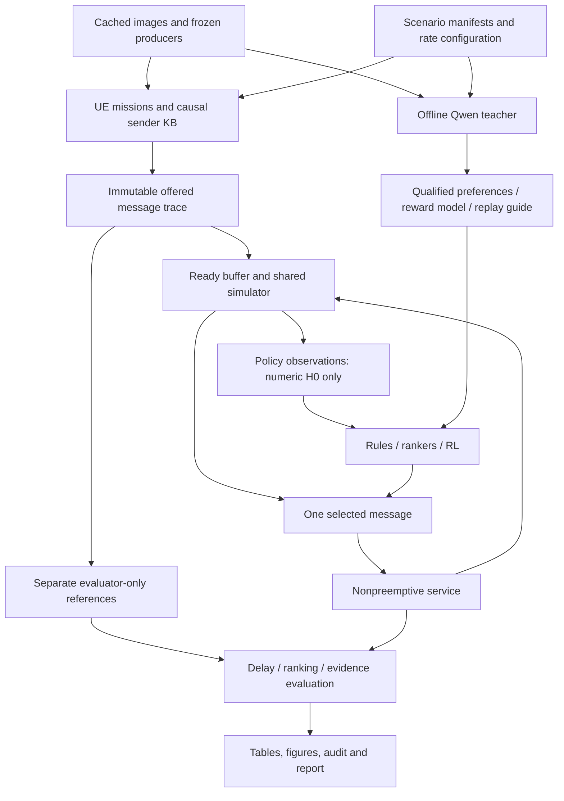

# Master scheduler notebook and study plan
Date: 2026-11-01. Status: PROPOSED; planning only, no new training/GPU submission.
Canonical repository: SemanticSchedulerEnd2End, accessed through WSL Ubuntu-26.04/Satya.
This is the execution plan for the existing research design in docs/decoder_context/SEMANTIC_RANKING_RESEARCH_DESIGN.md. It preserves the scheduler boundary and model families; it does not replace them with a smaller undisclosed experiment.

## 1. Outcome and claims

Build one master notebook that orchestrates the complete approved study: source/data verification, automated tests, UE streams, teacher reliability and labels, every learner, checkpoint recovery, independent evaluation, profiling, comparison tables and failure analysis.

The runtime system selects one COMPLETE received opaque message when a single decoder becomes free. Arrivals continue during service; jobs are nonpreemptive. There is no learned WAIT action, resource grant, retransmission, codec redesign or SPI-classifier training in this study. Decoder execution remains a synthetic service model until the separately supplied digital codec is integrated.

“Perfect” is not an acceptance criterion. Correctness, reproducible execution, complete method accounting and evidence supporting each reported claim are. Completing training steps does not demonstrate convergence; a formatted table does not make weak labels independent truth.

Primary scientific question: can parameter-only contextual scheduling improve early service of independently supported important observations compared with strong same-information rules? Secondary questions: do context/history and temporal models add useful information; does VLM feedback help; does sequential optimization outperform simpler ranking; how do those effects change with offered load?

## 2. Verified starting point and gaps

| Item | Current evidence | Required before the main study |
|---|---|---|
| Shared simulator, parameter adapter and learning implementations | Local regression suites and bounded real-cache training/export pilots | Freeze an exact source snapshot and rerun the release checks |
| Seventeen learner mechanisms | Bounded GPU/CPU optimization/export checks, not full training | Full declared training schedules and saved learning curves |
| Qwen JSON/control path | 32 narrow controls plus candidate/prefix/replay format checks across repair versions | Larger task-specific qualification and adequate independent preference support |
| UE rate simulator | Mixed, mission and manifest-supported incident API; 240 paired development comparisons | Curated incident manifests and validation of scenario composition |
| Image pool | 6,000 records, 5,952 unique image hashes; complete cached embeddings | Group/provenance audit and fresh final-reference cohorts |
| Priority reference | Development-exposed image-level VLM silver labels | Independent final urgency references, or restrict conclusions to silver-label agreement |
| Real temporal correspondence | Controlled fixtures; not established for the entire pool | Supported scene/view/condition sequences before natural temporal claims |
| Encoder/decoder | Outside this increment | Keep optional integration clearly separate |
| Adaptive teacher round | Replay relabeling components exist; complete round controller is not established | Implement and test versioned collection/update/resume before claiming two-round RLAIF |

Existing results stay development evidence. New queue seeds do not turn previously exposed images into a fresh test set.

## 3. Architecture and ownership

| Owner | Responsibility |
|---|---|
| parameters | Frozen scene/SPI evidence and producer meanings; no retraining by this notebook |
| Evaluation | Message lifecycle, causal streams, timing, annotation joins and metrics |
| Scheduler | Parameter-only inference and existing learner implementations |
| experiments/master_study | Orchestration, configuration, packaging, run accounting, reports |
| Codec | Remains a separately versioned optional future integration |

Reuse Evaluation/semantic_learning_env.py, Evaluation/ue_scenarios.py, Scheduler/semantic_learning_policy.py and Scheduler/training/*.py. Do not fork these inside the notebook.

Proposed additive experiment files:
- experiments/master_study/PLAN.md — this plan and its decisions.
- experiments/master_study/config.yaml — full resolved study specification.
- experiments/master_study/master_suite.py — stage orchestration and method ledger.
- experiments/master_study/package_snapshot.py — verified dependency closure and immutable Kaggle input package.
- experiments/master_study/report_study.py — tables/figures from saved records, never notebook memory.
- experiments/master_study/runs/<run-id>/ — all logs, data manifests, models and results.

Retain the established canonical Kaggle notebook path and owner/slug:
experiments/stream_scheduler/kaggle/Semantic_Decoder_Scheduler.ipynb;
satyapaladuguplus/semantic-decoder-scheduler-20261030.
A master study is a new version of that identity, not another identity.

## 4. Runtime and data contracts

Runtime inputs remain the frozen numeric evidence, availability/cold-start masks, permitted timing, queue summaries and bounded per-UE/receiver header history. No RGB, raw CLIP vectors, labels, evaluator fact identities, free-text teacher explanations, future arrivals or realized future service durations enter the actor.

The current received feature vector is387 values/masks; derived models have their existing389-token/summary representations. Freeze this registry by hash. Do not silently redefine it to make a model run.

Each trace stores arrival/capture times, routing identities, payload references, source/session, image association and scenario provenance. Evaluator annotations live in a separate store. Keep image pixels and teacher inputs offline. Preserve exact-copy identity; do not call cosine similarity physical-asset correspondence.

Three separate reference tracks:
1. D: image priority/deferral references, with origin explicitly identified. Current pool is silver development evidence.
2. P: qualified mission/history-conditioned preferences from the teacher. They are weak supervision, not independent gold truth.
3. E: distinct supported evidence, only where exact repeats or annotated correspondence justify it.

Split parent/duplicate/event/sequence groups before constructing streams or teacher comparisons. All derivatives and paired views stay together. Audit cross-source overlap. Freeze preprocessing/calibration on training groups. Validation controls selection; final test remains inaccessible to training and early stopping.

Same collection may support SPI and scheduling development, but final groups must be excluded from both fitting pipelines. Record frozen vision-producer exposure separately from scheduler exposure. If independent priority labels are unavailable, report a development/silver study rather than filling a “gold test” table.

## 5. UE episodes and rate study

Fifteen existing device/mission templates remain available. Device identity never establishes urgency. Phone reports can be critical; disaster drones can send routine/redundant content.

Modes:
- Mixed IID: diverse unrelated images, with declared artificial chronology.
- Mission-conditioned: supported mission pools plus background. The existing CLIP upper-quartile fallback is a sampling proxy, not a human annotation.
- Shared incident: one supported incident per initial episode, related views and condition changes under a shared timeline, exact repeats and continuing background traffic. Multiple simultaneous incidents are a later sensitivity case only after single-incident integrity passes.

Real incident manifests require image identity, mission support, provenance, incident/sequence/evidence identities, order and supported condition changes. Missing correspondence blocks this arm. No arbitrary “similar photo = new angle/new damage” labels.

Separate intended and achieved traffic:
lambda_total = sum of active UE arrival rates;
mu =1/E[service];
rho = lambda_total*E[service].
These use synthetic time units until physically calibrated.

Core evaluation grid: UE counts12/50/100; target loads0.5/0.9/1.2; burst factors1/4; each supported mode. Add60UE as an interpolation test and4UE as a compatibility control. Normalized bursts preserve expected full-window volume before availability effects.

Separate fixed-per-UE extension: rates0.01/0.02 per synthetic unit so aggregate load rises with population. Report achieved rate, active-UE counts, message counts, burst concentration and capture intervals. Higher physical vehicle/drone speed is not simulated without trajectories and real sequences.

Training samples a fixed declared mixture of these regimes, with separate RNG streams for source profiles, timing, content, service and learner initialization. Primary offered training-stream seeds are independent of model initialization; share offered-stream factories across methods rather than multiplying the trace seed by the model seed as older runners did. Exploration may produce different visited states, which is legitimate. Validation and final trace manifests are frozen and shared across policies. Keep all-success constant-service control; add variable service and independent failures only as separately labeled stress tests. Never redraw outcomes by policy order.

Large-stream checks (50 images/UE on average) test mechanics and scaling separately from the main statistical evaluation. Queue size is measured, not equated with UE count. Policy computation time is reported separately; synthetic-time results cannot be advertised as real milliseconds.

## 6. Complete method registry

There are17 retained primary learner arms. Additional label-source variants are experiments, not new architectures. Deduplicate VisionPrefer across the primary registry and P-student registry:14 D arms +7 P student variants +1 learned-reward RL +1 guided-replay RL =23 learned experiment configurations, or69 model-seed jobs at three seeds, before optional extensions. The eight existing rules plus the proposed marginal-risk rule are references, not trained models. A blocked configuration still has a ledger row.

| ID | Learner | Training target/loss |
|---|---|---|
| linear_choice | Shared linear candidate scorer | Cross-entropy over supported best ties |
| mlp_choice | Shared64/32 MLP | Same choice loss |
| delay_huber | MLP marginal-risk regression | Huber on fixed-normalized D gain |
| ranknet | MLP pairwise ranker | Logistic pair loss; explicit ties handled separately |
| lambdamart | LightGBM grouped ranking | LambdaRank, integer grades, explicit linear label gains |
| priority_classifier | Contextual four-tier classifier | Training-balanced CE; correct posterior tilt before expected-risk inference |
| deepsets_ranknet | Set-pooled scorer | Pairwise preference loss |
| set_transformer_ranknet | Candidate/history attention | Same preference labels for fair architectural comparison |
| listmle | Existing bounded listwise scorer | Existing sampled ordered-triple ListMLE-style loss; label this approximation explicitly |
| temporal_deepsets_ranknet | Shared per-UE GRU plus set pooling | Same preferences, causal bounded history |
| masked_ppo | Candidate actor/pooled critic | Clipped PPO surrogate, value loss and entropy |
| masked_double_dqn | Candidate Q scorer | Double-DQN Huber TD loss with legal next candidates |
| td_per | Same Q learner | Same reward, TD-prioritized replay and probability-corrected weights |
| ranknet_warmstart_ppo | Frozen initial pretrained Deep Sets actor | PPO after initialization; preserve original warmstart on resume |
| rl_vlm_f | Learned preference reward plus DDQN | Prefix preference BCE, then frozen-block reward learning |
| vlm_replay | DDQN with teacher replay guidance | D reward unchanged; teacher affects sampling only |
| visionprefer | Four-aspect teacher preference adaptation | Pairwise scorer using supported aspect-derived preferences |

Run the existing seven P student variants (linear, MLP choice, MLP RankNet, Deep Sets, Set Transformer, temporal Deep Sets and VisionPrefer adaptation) under their P label-source IDs. Compare neural architectures on the same accepted preference set; compare label sources using matched architectures. Do not compare differently supervised models and attribute the result solely to architecture.

Untrained references: FIFO, RR, seeded random, SPI–FIFO, relevance-only, novelty-only, SPI–novelty and predicted EDF. Add a strong predicted marginal-risk/aging rule using runtime predicted SPI and the same declared D risk curve. Its purpose is to test whether learning improves beyond the objective's obvious simple policy. This is an implementation addition to test, not an already measured result.

EDF uses experimental class budgets, not true emergency deadlines. SJF is only diagnostic when service estimates are actually permitted; hidden realized service is never supplied.

## 7. Targets and training schedules

For arrival a, dispatch b, finish f:
waiting W=b-a; service S=f-b; turnaround=f-a.
Primary controlled endpoint is waiting. Report completion outcomes separately.

Retain declared delta=(2,4,8,16) synthetic units and
ell(W,delta)=W/delta+max(W/delta-1,0).
D cost L_D(t) accumulates for waiting reports, freezes at dispatch and includes censored reports until the declared horizon.
J_D=L_D(T)/N_assessed.
D reward r=-(L_D(next)-L_D(now))/100, gamma1.
Test reward telescoping independently. Fixed reward scale100 is not the same normalization as J_D; report this and stratify variable-size episodes instead of claiming identical cross-episode weighting. No actor receives the true tier or future offered count.

Pair loss: BCEWithLogits(s_A-s_B,p), where p=1/0 for strict direction and0.5 for explicit ties. Uncertain/unsupported comparisons are excluded. A predicted exact tie does not count as a correct strict answer.

Keep existing defaults: MLP64/32, Adam3e-4, weight decay1e-4, batch up to64 decision groups, max50 epochs, patience8. Select by the registered validation objective. Save actual updates and epochs. Architecture definitions and budgets freeze before final evaluation.

RL default20,000 aggregate action selections per arm per training seed. This is an initial specified training schedule, not a convergence guarantee. Validate every2,000 actions. Full execution means reaching the declared schedule or documented validation stop, not hitting an arbitrary time cap and calling it finished. If curves justify expansion, decide using validation only and apply matched additional budgets within comparison families.

Retain PPO256 aggregate transitions/four envs/four update epochs, gamma1/GAE0.95/clip0.2. DDQN warmup500, batch64, update every4 actions, target sync500; exploration horizon half the planned budget, preserved during resume. TD-PER and VLM-mixture probabilities remain distinct. Freeze reward models during blocks and relabel ALL stored rewards when the model changes.

Use three initial training seeds1729/2718/31415. Report their spread honestly; add seeds only when a prespecified uncertainty assessment justifies the cost. Episode replication does not replace independent data groups.

## 8. Teacher and RLAIF protocol

Pinned candidate: Qwen/Qwen2.5-VL-7B-Instruct, revision cc594898137f460bfe9f0759e9844b3ce807cfb5, NF4_double_FP16. Changing the teacher creates a separate experimental factor and requires new qualification.

Use static tokenizer data once per session with a fresh constrained parser per answer. Validate JSON after generation. Save model/weight/processor/prompt/input hashes, output version, raw text, parsed result, timing and rejection reason. Constraint success proves syntax, not truth.

Retain32 narrow controls, but add task-specific controls with independently supported preferences, same-priority comparisons, repeated evidence, no-new-information ties and unanswerable scenes. Image-order swaps, abstentions, unsupported claims and aspect availability are measured separately. Qualification thresholds freeze before data collection. Existing person/tie/blank success cannot certify disaster urgency.

Teacher sees actual candidates, their mission paragraphs, causal history and necessary timing; hide student scores and extracted SPI values initially. Students see only permitted H0. Prefix comparisons have equal starting states and equal elapsed endpoints. Replay guidance concerns learning value, not runtime urgency.

The old216-call allowance was a pilot cap, not a sufficient journal label budget. New collection is governed by accepted-label yield and compute, with separate quotas for training/validation/final silver comparisons. The16-train/8-validation strict-pair threshold remains an engineering minimum, not adequate statistical support by itself.

Round0 collects qualified labels and fits students/reward/guide. Round1 samples training-only disagreements or informative experiences under a frozen selection rule, collects additional feedback, updates the reward/guide, relabels replay, and resumes saved learners. Keep validation queries out of active selection and test queries sealed. Test this complete round controller before using its results.

No teacher arm silently falls back to SPI labels. Failed qualification or insufficient accepted support produces a blocked arm with exact counts. Such an arm appears in the completeness table, not as a trained result. Models not requiring the teacher continue normally.

## 9. Master notebook cell plan

Every computational cell prints purpose, configuration, paths, start/progress/end, elapsed time and outcome. Subprocess stdout/stderr and errors are persisted incrementally; executed notebook and important rich outputs are retained where exposed.

| Cell | Work | Required saved output |
|---|---|---|
|00|Study identity, questions, scope and run mode|Protocol ID; FULL_STUDY versus explicitly named diagnostics|
|01|Actual environment/account/hardware|Python, packages, GPUs, quota and reserved budget|
|02|Verified source/input snapshot|Hashes, dependency closure, private source staging receipt|
|03|Configuration and expected methods|Resolved config; every arm/seed initialized in ledger|
|04|Data/provenance/split audit|Groups, duplicate components, exposure, exclusions|
|05|Scene/mission/incident manifest audit|Support matrix and unavailable cells|
|06|Release tests and isolated package tests|JUnit, numerical references, CPU/CUDA distinctions|
|07|Cached producer/interface verification|No unnecessary SPI/vision reruns; availability audit|
|08|Teacher technical and semantic qualification|Raw controls, schema/accuracy/abstention reports|
|09|Teacher Round0|Accepted/rejected preferences and provenance|
|10|Freeze train/validation/final trace manifests|UE profiles/rates/captures/service realizations|
|11|Untrained and strong semantic rules|Reference traces and metrics|
|12|D supervised/tree/classifier training|All weights, optimizers, learning curves, portable exports|
|13|P preference student training|Same-information architecture comparisons|
|14|D PPO/DDQN/PER/warmstart training|Action/update counts, checkpoints, validation curves|
|15|Learned reward and replay guidance|Reward validation, sampling distributions, version IDs|
|16|Teacher Round1 and learner resume|New requests, relabeled replay, recovery verification|
|17|Validation-only model selection|Frozen checkpoint IDs and selection evidence|
|18|CPU/GPU inference profiling|Selection ms, memory, parameters, partial FLOPs conventions|
|19|Release lock and evaluator-only final replay|No fitting; paired traces and per-group outcomes|
|20|Rate/load/generalization/robustness studies|Stratified metrics, no silent factorial expansion|
|21|Targeted ablations|Matched inputs/labels and validation-selected variants|
|22|Group-aware uncertainty and failure cases|Paired effects, counts, assumptions and exceptions|
|23|Journal tables and figures|CSV, Markdown, LaTeX, vector plots; visual checks|
|24|Completeness, budget and recovery audit|All required arms, true status and reproduction commands|

The notebook is a controller, not a giant embedded implementation. Kaggle's observed source limit is1MB. Put substantial source/data/checkpoints in a pinned private managed input or supported staged package; do not embed vectors in notebook text. Reusing the current identity does not authorize creating a new private dataset silently: propose the exact source/input transport before upload.

Test the extracted package with an explicit pytest config/root/confcutdir and no parent repository path. The earlier “sterile” check leaked the parent repository and masked missing modules; compile-only checks are insufficient.

## 10. Test matrix and acceptance

| Area | Tests to execute | Acceptance |
|---|---|---|
|Source/environment|Exact hashes, dependency versions, offline imports, missing files, wrong producer/model versions|Fail before expensive work; no implicit canonical-repo fallback|
|Transport|Scene roundtrip, sparse/dense boundaries, masks, corruption, completeness, identity collisions|Exact declared representation preserved; invalid input rejected|
|Lifecycle|Busy dispatch, concurrent arrivals, future-only/empty queues, foreign/duplicate completions, failure, no retry, reset|One in-flight job, conserved accounting, correct history semantics|
|Parameters|Available zero versus missing, cold start, same-image repeats, per-session KB, recompute after changed UE order|Causal query-before-commit; no evaluator fields in observations|
|Streams|All modes, mission pools, unsupported manifests, sequence ordering, background during incidents, copies, joins/pauses/departure/session cases|Only implemented lifecycle cases claimed; unsupported cases explicit|
|Rates|Fixed-total versus fixed-per-UE, normalized bursts, achieved versus intended rate, low load, overload, zero offers|Correct units and workload accounting; reproducible traces|
|Objectives|Hand calculations, idle intervals, mid-service arrivals, censoring, zero-label/zero-fact cases, reward telescoping|Independent reference agreement|
|Ranking|nDCG ideal/reversed/ties/undefined, strict predicted ties, permutation equivariance, pair/list unknowns|Correct scores and denominators|
|Learners|Every arm meaningful update, known-direction fixtures, finite gradients, no-update rejection|No import-only or arbitrary-loss “training pass”|
|Export|All architectures, trees near float thresholds, malformed shapes, nonfinite weights, selected identity|Native/NumPy tolerance and decision checks pass|
|Recovery|Model/optimizer/RNG/progress/replay/env restore; warmstart immutability; incompatible signatures|Resume distinguished from weights-only loading|
|RL|Legal dynamic candidates, terminal bootstrap, target-network separation, PPO rollout boundaries, PER mixture/IS weights|Correct update semantics, deterministic reference checks where applicable|
|Teacher|Single/multiple/max-image inputs, structured outputs, truncation, swaps/ties/abstentions, cache integrity, no unnecessary reload|Technical and semantic gates reported separately|
|Feedback|Strict-pair support, preference reward validation, equal-time prefixes, two-round update, full replay relabeling|No stale rewards; failed teacher cannot promote labels|
|Isolation|Poison labels/IDs/future data, mutate held-out labels, group leakage, chronology checks|Actor inputs and training selection unaffected|
|Statistics/reporting|Missing-arm rows, mismatched objectives, group bootstrap, table arithmetic, plot labels|No missing results or unsupported significance claims|
|Deployment boundary|Opaque payload fixtures and injected decoder lifecycle|No actual-codec success claim without the separately supplied codec|

Run existing active suites in their established locations plus new experiment checks. Archived originals are preserved. The latest reported local baseline is307 passed/3 skipped, with subsequent focused streamer refinements tested separately; collect a fresh exact total at the new frozen snapshot rather than copying historical counts.

## 11. Evaluation metrics

Primary: reference-class waiting, restricted mean waiting with sufficient follow-up, exposure/dispatch within experimental budgets, and J_D. Report Critical/High/Medium/Low separately, offered/assessed/censored counts, failures, queued fraction, selected-only medians/p95 with their selection bias explicit. No invented image-specific “gold delay.”

Supporting: nDCG@1/3/5 on common supported graded snapshots; preference agreement on independently held-out silver pairs; exact-repeat selections and distinct supported evidence where correspondence exists. SPI-only grades cannot prove within-SPI semantic ordering.

Load diagnostics: offered/achieved rates, active UEs, interarrival distributions, peak and time-average queue length, busy fraction and backlog. With work-conserving policies and identical constant service, aggregate queue length/mean wait can be equal across orders. That is expected and is not proof that semantic scheduling fails.

Runtime: median/p95 selection and context construction ms versus actual queue size, training elapsed time, action/update/label counts, peak CPU/GPU memory, parameter count, artifact size and supported-operator FLOPs with counting exclusions. Teacher setup/generation/extraction costs remain separate. FLOPs are not a substitute for measured latency.

## 12. Comparison tables and figures

Each table includes label/reward source, reference scope, number of independent groups, training seeds, undefined counts and hardware where relevant. Blank means unavailable with a reason; zero means a measured zero.

1. Method/completeness table: architecture, objective, inputs, seed, steps/epochs, status, blockers.
2. Dataset/provenance table: source, groups, annotations, producer exposure, split and correspondence limits.
3. Main outcomes: J_D, Critical and High restricted waits, within-budget fractions, unselected fraction, paired difference from strong baseline.
4. All-class service table: each priority's offered count, waits, misses and tails.
5. Within-SPI semantic comparisons: relevance/novelty/scene contrasts only where supported preferences exist.
6. Rate/population table: fixed-total and fixed-per-UE separated, achieved rho, burst setting, outcomes.
7. Repetition/change table: exact copies, supported views, changed conditions, unrelated distractors.
8. Architecture comparison on identical supervision: MLP/Deep Sets/attention/temporal/tree.
9. RL mechanism comparison: supervised versus RL, uniform versus TD-PER versus teacher replay, warmstart.
10. Supervision comparison: D versus P, teacher reward versus reference reward, VisionPrefer adaptation, two-round feedback.
11. Teacher reliability/cost: control and task-specific accuracy, swaps, abstention, unsupported claims, valid-label yield and GPU cost.
12. Ablations: SPI/R/N/scene, history, temporal state, missingness; remove fields from all derived features too.
13. Generalization: held-out groups, supported domains/missions, seen versus unseen conditions, explicit producer exposure.
14. Systems table: selection ms versus queue size, memory, parameters, partial FLOPs, training/teacher costs.
15. Negative-results/limitation table: blocked methods, data failures, nonconvergence, regressions and failure cases.

Figures: end-to-end diagram; matched UE/arrival/service timeline; training curves by decisions and time; class-conditioned waiting CDFs with misses; load-delay curves; critical exposure under bursts; preference/reward diagnostics; runtime versus queue size. No 3D chart decorations or fabricated error bars.

Use paired independent-group uncertainty. Resample parent/event/duplicate groups, regenerate matched queues, and retain model-seed effects. Queue seeds alone are not independent disasters. Prespecify primary comparisons and effect sizes; label secondary/ablation analyses exploratory or apply a declared multiplicity procedure.

## 13. Execution, budgets and failure policy

No new GPU launch follows from this planning document. The prior six-hour pilot allowance is largely consumed and cannot silently fund the master study.

First run timed, recoverable preflight batches: one training epoch per family,1,000 actual RL actions, and a small balanced teacher batch. Project cost using the post-repair runtime, not the old time-limited counts. Include setup, model download/load, assigned-idle GPUs, validation and artifact retrieval. Dual T4 allocation counts both GPUs even when one waits.

Example accounting only:1,000 teacher calls averaging20seconds require5.56 device-hours of generation; retaining two allocated devices throughout makes the allocation11.11 aggregate hours before setup. This is arithmetic, not a new runtime prediction. Swapped comparisons consume two calls. Accepted-label counts may be much lower than call counts.

Produce a reviewed execution schedule after preflight with exact teacher-call ceiling, learner action budgets, wall limits, device placement and total aggregate cap. A one-GPU teacher job can be cheaper than holding an idle second GPU, subject to measured fit. Small policies may train on CPU if measured faster; never silently substitute CPU for requested GPU. Reuse the established environment and pin compatible versions.

Master stages are resumable and may span notebook versions/sessions. One master notebook does not imply one uninterrupted Kaggle session. No new notebook identity or overlapping duplicate job. Stop cleanly at resource caps, save partial artifacts and mark partial_budget. Never label a capped arm trained-to-schedule.

Every arm/seed exists in the ledger before work starts: pending, running, trained_to_schedule, stopped_validation, partial_budget, blocked_data, blocked_teacher, failed, evaluated. Record exact failure stage and recovery action. Unexpected subprocess failure appears in overall status even if other arms finish.

## 14. Deliverables and release gates

Artifacts per unique run:
manifest/config/environment; immutable source/data/split/trace hashes; executed notebook and stage logs; raw and accepted teacher records; models/preprocessing/portable exports; optimizer/RNG/replay/environment checkpoints; per-decision/trace/group metrics; CSV/LaTeX/Markdown tables; standalone figures; test JUnit; cost ledger; report and limitations.

Maintain parameters/KAGGLE_RUNS.md as the single remote artifact map. Verify retrieved checksums and representative resumable checkpoints. “Kaggle COMPLETE” alone is not acceptance.

Gate A: architecture/config/protocol approved.
Gate B: valid references/splits/manifests and complete extraction cache.
Gate C: full local tests plus truly isolated remote package tests pass.
Gate D: measured compute schedule fits a newly approved cap.
Gate E: every learner executes its declared schedule, or records a visible blocker/partial.
Gate F: checkpoints frozen, final evaluator opened once, no fitting thereafter.
Gate G: tables regenerate solely from saved artifacts; claims match reference quality and tested scope.

Implementation order: registry/config and stage ledger; dependency-safe packaging/master notebook; data/trace audits; shared training adapters including missing two-round feedback controller; unified evaluator/report generator; end-to-end preflight; full approved execution; locked evaluation. The user reviews this concrete design before substantial notebook implementation and new remote execution.

## 15. Mechanism references

- Deep Sets: https://arxiv.org/abs/1703.06114 — set invariance/equivariance motivates variable-size queue pooling.
- PPO: https://arxiv.org/abs/1707.06347 — policy surrogate/value training, not evidence of superiority for this scheduler.
- RL-VLM-F: https://arxiv.org/abs/2402.03681 — visual preferences to learned reward to RL; our receiver task is an adaptation.
- LightGBM ranker: https://lightgbm.readthedocs.io/en/stable/pythonapi/lightgbm.LGBMRanker.html — decision grouping and ranking labels.
- Existing canonical research design and repair/rate artifacts supply the local contracts and measured implementation evidence. A master notebook does not turn their pilot outcomes into independent journal results.

## Implementation repair checkpoint — 2 November 2026

Canonical implementation was repaired and validated under runs/repair-20261102/REPORT.md. Use one seed per method; preserve v9 as development controls. CPU source/reference coverage is checked before GPU work. D and independently labeled E objectives remain separate. No new training or Kaggle submission at this checkpoint. Missing independent source labels, mission utility references and reliable teacher feedback remain explicit blockers rather than inferred negatives.

## Active codec change — 2 November 2026
Receiver codec is now SQ-GAN, selected via Codec/config/scheduler_codec.json and build_scheduler_codec().
Its complete payload is SQ01 digital bytes (VQ indices, image/semantic masks, header/CRC), not continuous SwinJSCC I/Q samples.
Use the user's teammate-2 bundle20261028T130100Z-eea4f3aa from the sibling SemanticLossless/Semantic_Lossless export.
Weights are verified and fine-tuned last.pt inference components strictly restored. Do not silently use only the original constructor components.
SwinJSCC files remain historical references; active exported-model integration tests now exercise SQ-GAN.
Scheduler-policy training timings remain synthetic unless an experiment explicitly supplies measured SQ-GAN service times. No scheduler was retrained by this codec switch.

## Active two-account execution plan — 2 November 2026
The current runnable notebook sources are paired_kaggle/wsl/Scheduler_WSL_Ranking_VLM.ipynb and paired_kaggle/windows/Scheduler_Windows_RL.ipynb. Read paired_kaggle/README.md first.
WSL:ten supervised D candidates plus conditional teacher/P/feedback methods, frozen SQ-GAN payload checks and budget-permitting baseline rate study.
Windows:four RL candidates plus a local Deep Sets initialization prerequisite.
Both:one seed1729,50epoch maximum/20kRL decisions, identical frozen input cache and evaluator trace identities.10.5h learner window,11.5h finalization,12h platform limit.
Notebook generation/source manifests, input requirements and account-access limitations are recorded in paired_kaggle/. No new submission or real-data training performed in preparing these sources.
Local validation evidence: runs/paired-notebooks-20261102/FINAL_VALIDATION.json. Independent final/mission labels and reliable VLM preferences remain explicit requirements.

## 3 November2026: targeted gap repair
Canonical repair decisions and current evidence: [REPAIR_RECORD.md](runs/gap-repair-20261102T221315Z/REPAIR_RECORD.md). Full CPU/WSL rate grid passed320rows; targeted teacher recovery preserves the fourteen completed models and unchanged qualification thresholds. GPU teacher qualification remains to be measured.
