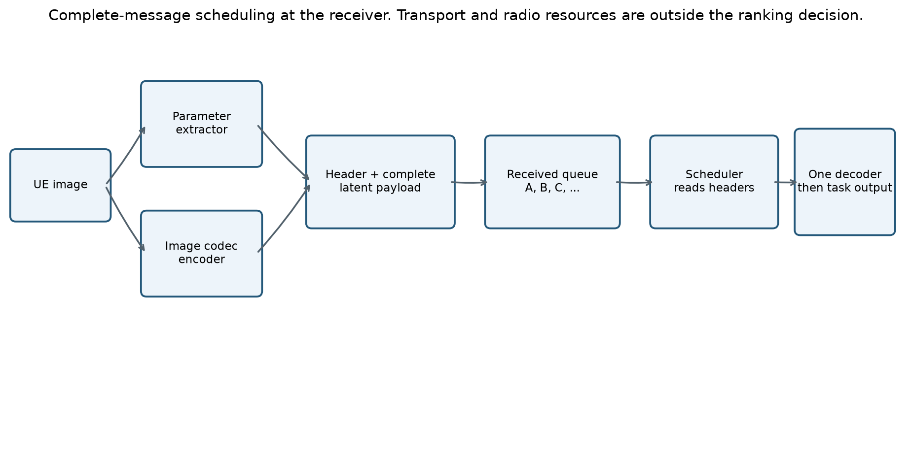
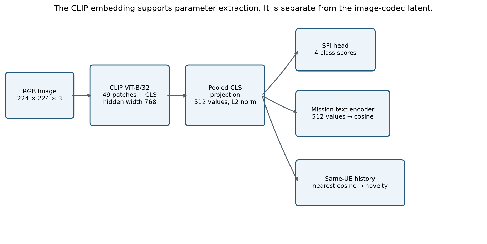
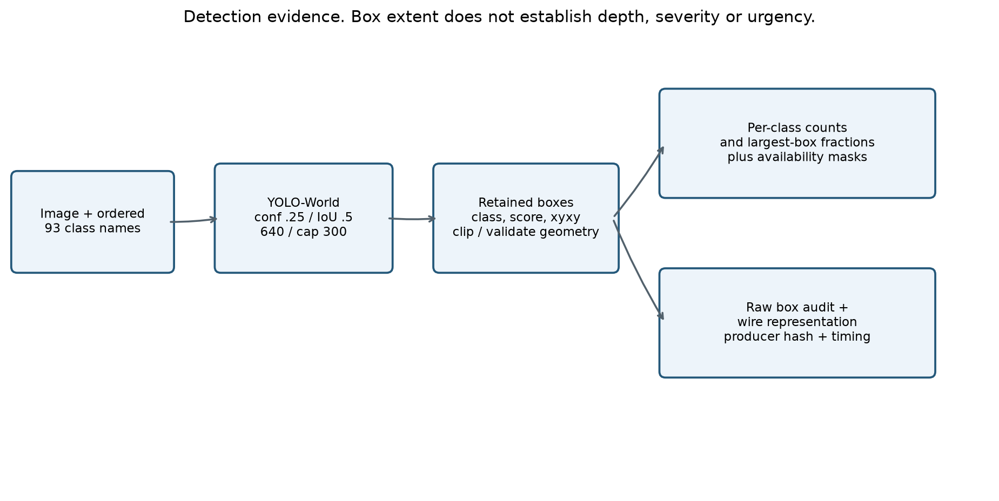
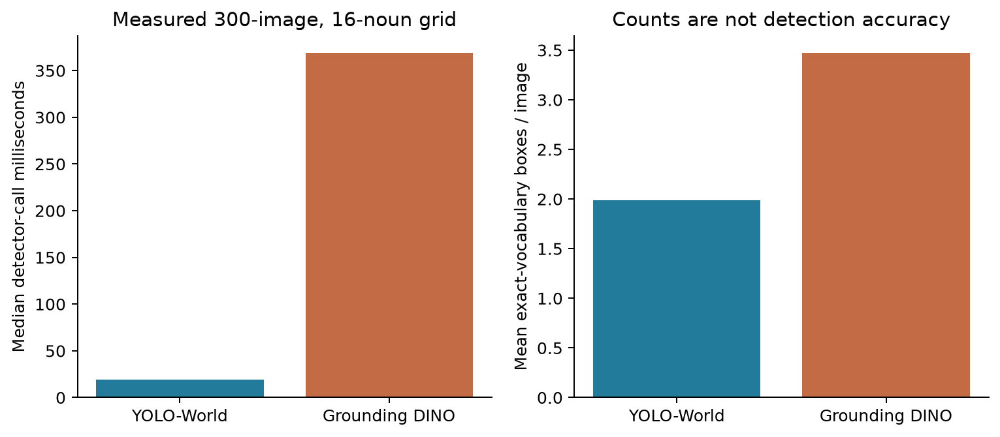
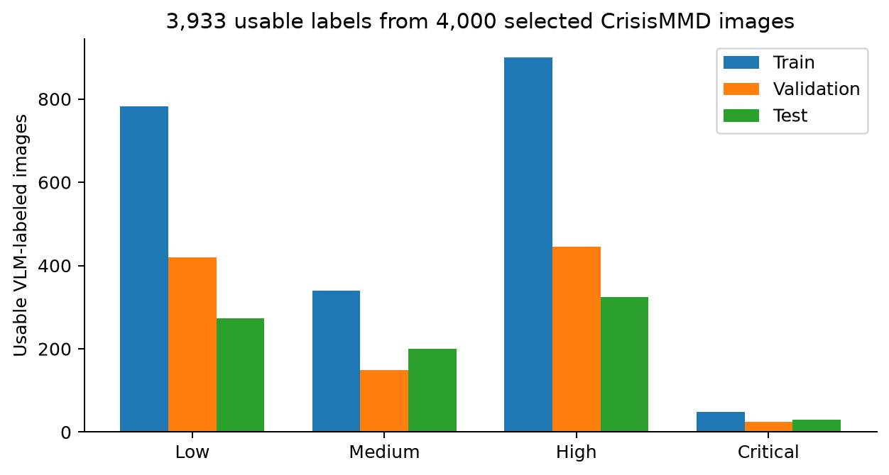
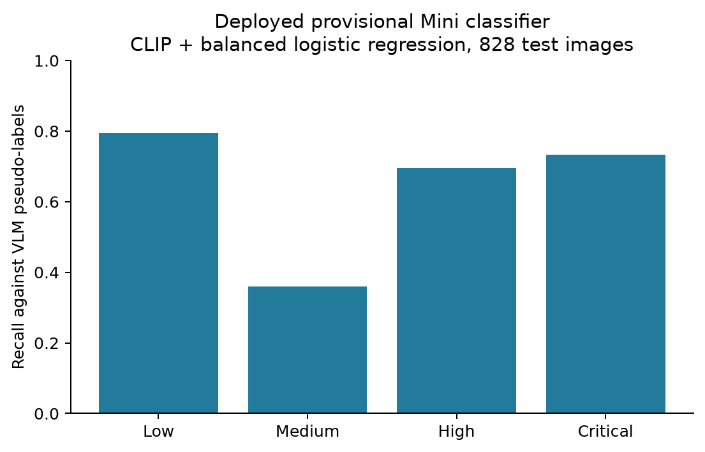
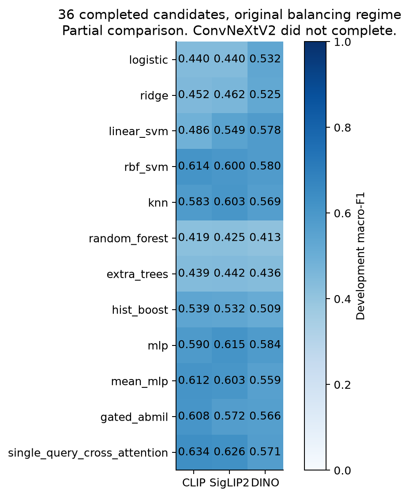
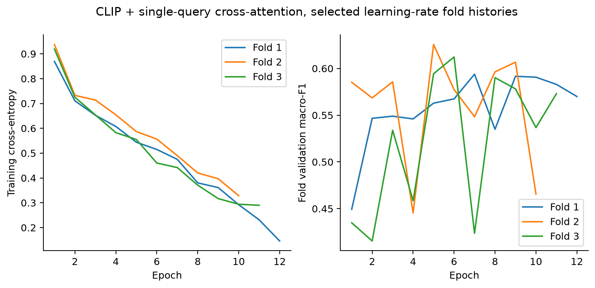

# Parameter extraction for a semantic-aware decoder scheduler

Evidence reviewed on 4 November 2026. This report explains the parameter system and the measurements available in the canonical SemanticSchedulerEnd2End repository. It distinguishes the completed Mini dataset from the unfinished encoder and classifier comparison. Figures show saved measurements unless their captions identify them as architecture diagrams.

## 1. Project goal and the compute limitation

The receiver accepts complete image messages. Each message contains a parameter header and an encoded image payload. Several messages may wait for the same decoder. The scheduler chooses which complete payload to decode next so the operator receives useful, mission-relevant evidence early.

The project therefore concerns the order in which the receiver exposes information. It does not allocate radio resources. Changing the decode order does not reduce the bytes that have already arrived. A useful result must show better early evidence, lower waiting time for independently identified important observations, or another declared semantic objective. Throughput alone cannot establish that result.

DeepJSCC provides background for learned image transmission. It maps images to channel representations and reconstructs them after a noisy channel. Its image-transmission objective is different from our receiver queue decision. See [Bourtsoulatze, Kurka and Gündüz, Deep Joint Source-Channel Coding for Wireless Image Transmission, 2019](https://arxiv.org/abs/1809.01733).

**Compute and completion disclosure.** Our experiments have struggled with model-loading cost, repeated image extraction, sequential labeling, feature storage and training orchestration. The parameter comparison also failed on preprocessing, split reconstruction and disk exhaustion. These are documented engineering failures. They are not evidence that the scheduler objective is impossible or that a model has poor accuracy. The wider scheduler experiments compete for the same practical GPU resources, but this report does not assign them an invented training duration or claim that compute is their only bottleneck. The available evidence supports a completed provisional parameter pipeline and an incomplete broader model comparison.

The two-T4 Kaggle setup limited the teacher candidates we could test. A quantized 7B or 9B VLM was feasible within that workflow. Model weights are only part of GPU memory use. Activations, image tokens, generation state and framework buffers also consume memory. Quantization reduces weight storage; it does not remove inference cost. A 72B candidate was outside the approved practical comparison. Parameter count alone cannot prove a model fits or predicts correctly.

## 2. Complete message, header and latent payload

The diagram describes the receiver boundary. The transmitter has two jobs. The image codec creates the representation needed for reconstruction. The parameter extractor creates the small observations used for scheduling. The receiver first obtains a complete message, validates its metadata and payload compatibility, then places it in the ready queue. One decoder processes one selected payload at a time.

For example, messages A, B and C can arrive before the decoder is free. Their arrival order can be A, B, C while their decode order is C, A, B. The scheduler reads the available header and queue context before making this decision. It must not read evaluator labels or reconstruct every image first to decide which image deserves reconstruction.

The payload format depends on the codec. A digital semantic codec can serialize quantized latent values, codebook indices or entropy-coded bytes. A learned analog JSCC system can instead produce complex channel symbols. In that case, received latent samples can form an internal decoder job after reception. Such samples do not become an ordinary packet merely because we call them a payload. The transport and codec adapter must define dtype, shape, model version and framing. Our message interface abstracts this distinction; it does not resolve physical-layer implementation by itself.

One complete scheduler job also need not equal one IP packet or one OFDM symbol. A large latent may require lower-layer framing before the receiver assembles it. Our experiment's one-shot condition means no application-level retry is introduced by this scheduling mechanism. It does not demonstrate lossless delivery, one-symbol transmission or arbitrary compression.

## 3. Why the scheduler needs parameters

An opaque latent is difficult to interpret before its decoder runs. A source identifier, file size or arrival time does not tell the scheduler whether the observation matches the mission, repeats earlier observations or depicts an urgent problem. Parameters provide a common input contract across codecs and image sizes.

The parameters are a compact description of selected evidence, not a complete representation of the image. An image of one person in a bedroom and an image of one person trapped near a vehicle may share counts and box fractions. This is why geometry alone is inadequate. SPI, mission relevance and history provide different information, and their benefit must be tested rather than assumed.

| Parameter group | Question it addresses | Why we retain it | Literature link and actual scope |
|---|---|---|---|
| SPI | What intervention need does the image appear to depict? | Gives the scheduler an image-level assessment beyond object counts | CrisisMMD and MEDIC motivate crisis-image tasks. Neither gives us the four-class SPI truth used here. Our urgency rubric is project-defined. |
| Context relevance | Does this image match this UE's assigned mission? | A severe-looking image can be irrelevant to the operator's task | CLIP supports image-text comparison. It does not establish emergency importance. |
| Transmitter novelty | How different is this image from comparable prior observations at this UE? | Helps distinguish repetition from appearance change | Relevance and diversity objectives motivate considering history. Our cosine-distance implementation is an engineering proxy, not a proof of new facts. |
| Capture metadata | When was the image captured, and what delay did the operator permit? | Supports age, deadline and slack calculations without a fabricated decay curve | Age-of-information research supports freshness as distinct from throughput. It does not determine our mission's allowed delay. |
| Scene evidence | Which configured entities were detected, how many, and at what image extent? | Preserves distinctions hidden by one scene summary scalar | YOLO-World and Grounding DINO support text-conditioned detection. They do not justify treating large boxes as urgent. |
| Availability and producer identity | Was the measurement actually produced, and by which configuration? | Prevents failure, missing vocabulary and observed zero from collapsing together | This is a measurement and software contract, rather than a new semantic theory. |

We removed rarity as a primary field. A rare concept in a small local history need not be urgent or useful. It also overlaps with novelty unless its reference population and purpose are defined. We did not replace it with arbitrary importance weights.

The exact joint design is our proposal. The papers motivate components; no cited paper proves that these fields are sufficient for semantic scheduling. The correct sufficiency test is whether the available fields distinguish the decisions the task requires, including counterexamples where similar headers correspond to different priorities.

## 4. Image to embedding, and what the embedding buys us

An image is first oriented using EXIF metadata, converted to RGB, resized while preserving aspect ratio and padded to 224 × 224 with gray value 127. The CLIP processor applies its native normalization. We record this preprocessing because a different crop or normalization changes the representation.

For the retained CLIP ViT-B/32, a 224 × 224 image yields a 7 × 7 patch grid. There are 49 image patch tokens plus a class token. The transformer uses hidden width 768. The pooled image representation passes through the visual projection to produce 512 values. L2 normalization gives a unit vector z.

The text encoder maps a mission description into the same 512-dimensional comparison space. For unit vectors z and t, cosine similarity is zᵀt. A cosine of 0.4 is a similarity score, not a 40 percent probability. These mechanics follow [Radford et al., Learning Transferable Visual Models From Natural Language Supervision, 2021](https://arxiv.org/abs/2103.00020).

The vector helps because one image forward can support mission similarity, nearest-history lookup and an SPI head. We can cache frozen features and compare small heads without running the vision encoder for every training epoch. A 512-value float32 vector uses 2,048 bytes in storage. That does not mean we transmit all 2,048 bytes. The scheduler can receive derived scalar fields while the transmitter keeps the embedding.

A vector is not universally better than the image. Pooling discards spatial detail; CLIP can miss small objects, text, counts and fine-grained conditions. Its pretrained associations can also create misleading similarities. A fixed vector head offers cheap training and inference, while token attention can preserve more spatial information at greater storage and training cost. We compare both for this reason.

The CLIP vector is also not the reconstruction codec's latent. CLIP was not trained here to reconstruct the original pixels. We use it to extract scheduling evidence. An image codec has its own objective and representation.

## 5. Context relevance and the UE paragraph

Each UE receives an operator-defined mission. A building-assessment drone might have this paragraph: "Document visible damage to buildings for post-event infrastructure assessment. Do not infer occupancy, structural safety, cause, or rescue urgency." A household-inventory camera can have a different paragraph about furniture and appliances. Device type is provenance, not a priority weight.

We keep the paragraph as the mission specification and derive a supported observable description for embedding. The current UE registry stores both `paragraph` and `conditions`. Its documented extraction path embeds the explicit condition text, rather than silently assuming the entire long paragraph enters CLIP unchanged. A building mission uses text such as "a photograph documenting visible damage to buildings." That distinction matters for reproducibility.

For a single condition, relevance is R = zᵀt, with values in [-1, 1]. Suppose z = [0.6, 0.8] and t = [1, 0]. Both have unit norm and R = 0.6. If a second mission has t = [0, 1], the same image gets R = 0.8. Relevance changes with the mission even when the image and its SPI do not change.

For a mission with several observable conditions, the aggregation rule must be declared and versioned. A maximum across clauses means that one matching clause is enough; an average asks a different question. Long mission paragraphs also need a token-length policy. Negations and constraints in natural language are not guaranteed to behave as logical rules in CLIP. We therefore retain the original paragraph, the actual encoded text and the producer signature.

Mission-text encoding is a reusable setup cost. It should not be charged as a new image inference on every frame unless the mission actually changes. A changed mission invalidates cached relevance, but not the image-dependent embedding or scene measurements.

## 6. Novelty and the transmitter knowledge base

The transmitter keeps a causal history for each UE and mission. It queries history before committing the new observation. The scheduler cannot treat a record as previously observed merely because it will appear later in an offline dataset.

For a comparable unit embedding z and history H, the implemented appearance novelty is N = [1 - max(zᵀh, h in H)] / 2. A repeat with maximum similarity 1 gives N = 0. A maximum similarity 0.8 gives N = 0.1. A maximum similarity -0.2 gives N = 0.6. The formula maps the cosine range to [0, 1].

This is appearance novelty relative to one UE's stored observations. It does not establish a newly discovered building, a newly damaged building or additional evidence from another viewpoint. A different angle can change the embedding without revealing anything useful. A small but important new crack can leave global embeddings almost unchanged. Cross-UE repetition also escapes separate UE histories unless a later mechanism shares information.

The current `SenderMemory` and UE-memory factory default to 64 FIFO entries. Earlier planning proposed 128. The executable default is 64 unless the caller supplies a different capacity. At 512 float32 values, the embedding component uses 128 KiB for 64 records or 256 KiB for 128, before Python and provenance overhead. Exact lookup over such a small history is a reasonable baseline. An approximate nearest-neighbor service is not automatically an improvement.

Cold start is explicit. The minimal extractor uses N = 1 with a `cold_start` flag when a valid embedding exists and history is empty. That value is a convention, not measured novelty. If history exists but no embedding has a compatible dimension and producer signature, novelty is unavailable. It must not silently become either zero or maximum novelty.

The operation order is query, produce the bundle, serialize successfully, then commit to the transmitter KB. This sender KB is different from receiver successful-decode history. A receiver can separately track what it has successfully delivered. Failure and success semantics must remain explicit at that boundary.

## 7. Capture metadata and freshness

We retain a trusted capture timestamp and an operator-supplied allowed delay. At decision time t, image age is t minus capture time. A deadline is capture time plus allowed delay. Slack is deadline minus t. These quantities answer different questions from visual severity.

For example, an image captured at time 100 seconds with a permitted delay of 20 seconds has deadline 120 seconds. At time 115 seconds, age is 15 seconds and slack is 5 seconds. No learned urgency interpretation is needed to calculate them.

[Kaul, Yates and Gruteser, Real-Time Status: How Often Should One Update?, 2012](https://www.winlab.rutgers.edu/~gruteser/papers/sanjitnew.pdf) motivates treating information age as its own communication quantity. Classical age of information at a receiver refers to the generation time of its freshest delivered update. The age of an individual queued image is related but is not automatically that receiver process.

Many source images lack verified capture timestamps. Download time and social-post time must not silently replace capture time. Missing or untrusted timestamps remain unavailable. We do not invent an exponential freshness decay or claim a universal delay budget. A scheduler can use declared age or slack alongside semantic evidence.

## 8. Scene measurements and why we retained YOLO-World

YOLO-World accepts an ordered vocabulary through the implementation's class configuration. We freeze that dictionary, checkpoint and preprocessing, then extract category labels, confidence scores and bounding boxes. The detector does not receive a free-form prompt asking it to explain urgency.

The current dictionary contains the 80 COCO categories plus five object extensions, building, bridge, utility pole, traffic sign and animal. Eight region terms complete the 93 slots: road, water, debris, smoke, flame, snow, ground and grass. This is a configured vocabulary, not all possible visual concepts. It does not guarantee reliable recognition of every listed hazard. Generic animal and traffic-sign entries can overlap with specific categories, so summed counts cannot be described as unique physical entities.

For class c, the count is the number of retained class-c detections. Largest-box fraction is max[(x₂-x₁)(y₂-y₁)/(WH)] over that class's retained boxes. A box 100 pixels wide and 80 pixels high in a 400 × 200 image has fraction 8,000/80,000 = 0.1. This measures rectangular image extent. It does not measure segmented object area or physical distance.

The class-specific arrays preserve more meaning than global counts. Two images can both contain four detections while one has four chairs and the other has people and vehicles. The scheduler can learn different associations from those vectors, provided its training targets support them. It must not use the rule that more people, more boxes or larger boxes always means higher priority.

We distinguish object-count semantics from region extent. The array contract has count availability for 85 object slots and does not pretend that several water boxes are several independent floods. A successful zero detection differs from a failed detector and from a category outside the vocabulary. The cache also records saturation when the detection cap may have truncated results.

The historical compact scene summary contained total instances, category count, largest box fraction and union coverage. Exact union coverage avoids double-counting overlapping rectangles. The expanded cache adds per-class arrays and retains raw boxes for auditing. We do not compute a relationship knowledge graph, depth map, monocular distance estimate, REBEL relation graph or graph entropy in this final cached pipeline. The earlier nodes-plus-edges complexity proposal was not validated.

### Detector comparison and the actual selection basis

[Cheng et al., YOLO-World, CVPR 2024](https://arxiv.org/abs/2401.17270) motivates efficient open-vocabulary detection. [Liu et al., Grounding DINO](https://arxiv.org/abs/2303.05499) motivates grounded text-conditioned detection. Neither paper gives an urgency score or proves the superiority of our chosen deployment settings.

Our measured grid used the same 300 MEDIC images and a fixed 16-noun vocabulary. Twenty YOLO settings completed. Thirty-four of 56 Grounding DINO settings produced outputs, but the last of those had only 204 images and was excluded from complete-setting comparisons. The study did not contain reference bounding boxes.

| Operating point | Median call time | Mean exact-vocabulary boxes | Images with zero such detections |
|---|---:|---:|---:|
| YOLO confidence .25, IoU .5, size 640 | 19.00 ms | 1.99 | 40.0% |
| Grounding DINO box .35, text .25, IoU .5, size 640 | 368.69 ms | 3.47 | 13.7% |
| Grounding DINO box .35, text .35, IoU .3, size 640 | 369.64 ms | 3.52 | 12.7% |

YOLO provided lower detector-call latency and fixed canonical category labels in this run. Grounding DINO produced more exact-vocabulary boxes and fewer empty images, but also phrases that required explicit vocabulary filtering. More boxes do not establish better recall, and fewer boxes do not establish better precision. We chose YOLO as the lower-cost engineering baseline, not the proven accuracy winner.

The measured latency includes detector-call processing and synchronization, excludes file and model loading, and includes observed cold first calls. It is not a warmed CPU/GPU end-to-end comparison. The 93-class cache is a later configuration. The 16-noun experiment does not establish its accuracy or identical latency.

The retained YOLO settings are confidence 0.25, NMS IoU 0.5, input size 640 and maximum 300 detections. On the 300-image grid, caps 100, 300 and 600 retained identical detections; the maximum observed was 26 boxes. Size 960 increased latency and box count without annotated evidence that those boxes were more accurate. These findings justify retaining a baseline while reporting uncertainty, not declaring a universal optimum.

## 9. Header size, arrays and the scheduler input

The repository contains several protocol generations. The historical minimal core is 28 bytes. The scalar scene extension makes 35 bytes. The later 93-class scene-array block is 369 bytes on its own. It must not be described as fitting inside the old 35-byte format.

The expanded scene block carries 93 uint16 count slots, with the eight region counts marked unavailable, 93 uint8 area fractions, availability masks and producer/vocabulary identification fields. The learned scene feature representation has 374 components: 93 transformed count slots, 93 area slots, two sets of 93 masks and two status values. Masked region counts remain unavailable. Log1p(count) controls numeric scale without assigning importance weights.

Combining the scene block with another core requires a declared combined schema and its own measured byte count. JSON audit records, embedding storage, wire bytes and codec payload bytes are different quantities. The payload size still depends on the chosen image codec and operating point. The scene experiment does not establish that size.

The classifier label index and wire scheduling-class index also differ. The student classifier uses Low, Medium, High, Critical as indices 0, 1, 2, 3. The historical minimal wire class uses Critical, High, Medium, Low as 0, 1, 2, 3. Use label-aware conversion. Copying integers directly reverses their meaning.

The scheduler should receive the declared runtime fields and availability masks. Audit references, teacher targets, source-dataset identity and split membership must stay outside learned priority inputs unless an explicitly justified experiment says otherwise. Availability is useful, but a model can learn dataset or failure shortcuts from it. Missingness-matched controls are therefore relevant.

## 10. SPI target and the choice of four classes

SPI is our image-level prediction of depicted intervention need. It is not a validated measurement of an operator's real action urgency. The image may show severe damage after everyone has left. It may omit a person who needs immediate help just outside the frame. Context, time and mission remain necessary.

| Level | Proposed annotation meaning | Boundary to preserve |
|---|---|---|
| Low | No visible problem requiring intervention, or routine/low-impact content | Low does not prove that the wider situation is safe |
| Medium | A visible problem that warrants attention without clear immediate severe danger | Do not force every nontrivial incident into High |
| High | Serious visible damage or disruption supporting prompt attention | Severity alone does not establish an immediate life threat |
| Critical | Clear visible evidence supporting immediate severe intervention need | Do not invent hidden victims, imminent collapse or a dam failure |

These are four ordinal bins chosen for the project. They offer more distinction than binary incident detection while keeping annotation and a small classifier manageable. We do not claim that a cited dataset establishes these exact four universal urgency levels. Their separability and correctness require evaluation. A failure to learn Medium cannot be repaired by renaming examples to balance the histogram.

### Which images we used and why

The final labeling cohort selected 4,000 CrisisMMD images. The usable classifier cohort contains 3,933 available pseudo-labels and excludes 67 unavailable assessments. CrisisMMD offers incident imagery with text and humanitarian annotations, which makes it useful for studying crisis-related image parameters. [Alam et al., CrisisMMD, 2018](https://arxiv.org/abs/1805.00713) describes the multimodal dataset. [MEDIC](https://crisisnlp.qcri.org/medic/) offers broader disaster-image tasks and includes material overlapping CrisisMMD. They must not be counted as independent sources without overlap checks.

Earlier development used a 300-image LADI/MEDIC cohort, 220 LADI-v2 and 80 MEDIC images. Native labels described objects, damage, informativeness or humanitarian categories. They were not direct SPI urgency truth. TREC-IS post-level priority was discussed, but we did not convert its text priority into verified image-only urgency labels for this classifier.

We restricted SPI fitting to a crisis-image cohort because that was the available labeling and task context. This is a scope restriction, not evidence of generalization. The Mini dataset later adds 1,000 Open Images and 1,000 Places365 images to the 4,000 CrisisMMD images. Those extra sources broaden scheduler-development inputs. Applying the crisis-trained SPI classifier to them does not establish accuracy on routine scenes, screenshots, insurance claims or arbitrary phone photographs.

| Class | Training | Validation | Test | Total |
|---|---:|---:|---:|---:|
| Low | 782 | 419 | 273 | 1,474 |
| Medium | 339 | 149 | 200 | 688 |
| High | 899 | 445 | 325 | 1,669 |
| Critical | 48 | 24 | 30 | 102 |
| Total | 2,068 | 1,037 | 828 | 3,933 |

Class support improved compared with the earlier 1,000-image experiment, where Medium had only two training examples. Class balancing cannot manufacture independent evidence or correct wrong labels. The 102 Critical examples also limit confidence in per-class estimates.

## 11. VLM labeling, comparisons and hallucination

The teacher runs offline. It sees the image and a task-specific system prompt, then returns the declared four-class assessment. We keep the raw output, parse status, image hash, teacher version, prompt version and generation settings. Runtime SPI inference uses the small student, rather than a VLM call for every scheduler decision.

This is supervised learning from AI-generated labels. It is not automatically reinforcement learning from AI feedback. RLAIF requires a reinforcement-learning procedure that uses AI feedback; training a classifier from generated class labels does not supply that mechanism.

The retrieved comparison folders contain outputs for Qwen2.5-VL-7B, Qwen3-VL-8B, Qwen3.5-9B, InternVL3-8B and the configured google/gemma-4-E4B-it candidate. Their presence establishes that diagnostic outputs were saved. It does not establish a complete balanced benchmark or that all model/version/prompt pairs passed the same gate. A model name containing effective parameter count also need not equal total stored parameters. Our resource reasoning must use measured memory and runtime, not the name alone.

The adopted 4,000-image label file mixes 2,540 earlier checkpoint assessments and 1,460 continuation assessments. The continuation used pinned Qwen2.5-VL-7B-Instruct, revision `cc594898137f460bfe9f0759e9844b3ce807cfb5`, with thinking disabled. This is not a single-teacher, single-prompt labeling run. The teacher protocol must remain attached to each image. Differences between protocols can confound class distributions and model learning.

The prompt defines visible evidence, the four levels and output structure. It asks the model to avoid unsupported causes, hidden victims and invented imminent events. Thinking-disabled generation reduced the risk of long reasoning consuming the output budget before valid JSON appeared. Earlier thinking-enabled attempts often ran to their token/time limits without a final parseable answer. A strict output parser distinguishes a valid class assessment from a failed execution. It does not establish that a valid answer is true.

**Hallucination remains an issue.** Earlier teacher diagnostics included unsupported dam or bridge claims. Removing explanations does not remove incorrect labels. Distillation can copy those errors into the student. We therefore cannot write that hallucination would not be an issue. We can write that offline labeling keeps VLM latency out of runtime, retains auditable evidence and permits bounded reviews before labels are reused.

Useful controls include unchanged-image repeatability, contradicted-caption tests, images with no visible emergency, clearly distinct intervention levels, unsupported-detail rejection and abstention/failure accounting. These controls must not become the same examples used to tune every prompt and then be advertised as a fresh final test. Native annotations can verify supported object/damage claims, but cannot validate invented urgency levels by themselves. Independent urgency review remains unresolved.

The teacher's job must also stay separate from the proposed JSON audit. Asking a VLM whether an image agrees with a parameter JSON is a model-assisted consistency check. A yes answer does not prove that the JSON captures all decision-relevant information. Omitted critical facts require their own checks, and numeric predictions need interpretable definitions before a VLM can assess them.

## 12. Encoders and classifiers we compared

The four encoder candidates test distinct representations. CLIP offers an image-text space reusable for relevance. SigLIP2 supplies another pretrained visual-language representation. DINO supplies self-supervised visual features. ConvNeXtV2 supplies a convolutional representation. Their role is frozen feature extraction in this study, not full encoder fine-tuning.

Feature compatibility is strict. A head fitted on a SigLIP2 representation must receive the same encoder, revision, projection and preprocessing at inference. CLIP vectors cannot replace it just because both are vectors. The complete inference pipeline still accepts a raw image, then runs the matching encoder and head.

| Classifier family | Why compare it | Main limitation |
|---|---|---|
| Logistic regression | Cheap linear decision boundaries and a useful transparent baseline | Cannot model nonlinear feature interactions |
| Ridge classifier | Regularized linear reference | Scores are not calibrated probabilities |
| Linear SVM | Another regularized linear boundary | Decision scores do not equal probabilities |
| RBF-SVM | Nonlinear boundaries without a large neural head | Support-vector storage and inference can grow |
| kNN | Tests whether nearby feature vectors share the label | Retains fitting data and has query cost |
| Random Forest / Extra Trees | Nonlinear tabular baselines | Dense pretrained embeddings may not favor axis-aligned splits |
| Histogram boosting | Small boosted-tree alternative | Needs enough label support and tuning |
| MLP | Nonlinear learning from pooled vectors | May overfit a small, imbalanced label set |
| Mean-MLP | Pools token features before classification | Loses token-specific interactions |
| Gated attention MIL | Learns a weighted aggregation over image tokens | Attention weights are not verified object explanations |
| Single-query cross-attention | Learns a query that aggregates spatial tokens for the class decision | More computation and masking complexity |

Nine vector families plus three token families give 12 heads per encoder and 48 nominal pairs. The class-weighted setting excludes unsupported class-weighted kNN, leaving 44 supported pairs in that regime. The other regimes include original, random oversampling and moderate undersampling. Oversampling duplicates training rows only; it must not alter validation/test or claim new independent examples.

Linear and tree estimators do not share a 15-epoch limit. The saved setup uses up to 1,000 logistic solver iterations, 10,000 for Linear SVM, 100 trees for forests, 50 boosting iterations and up to 100 sklearn-MLP iterations. Neural token heads allow up to 30 epochs with patience five on fold validation macro-F1. Final neural fitting uses a training-fold-derived epoch count. An observed 15 epochs can be a selected duration, not a universal training cap.

## 13. Results and the distinction between a deployed model and a partial leader

### Completed provisional Mini classifier

The Mini pipeline trained CLIP plus class-balanced logistic regression using 2,068 training rows. It compared C = 0.1, 1 and 10 using the 1,037 validation rows. C = 10 won. The model then received one evaluation on the saved 828-image test split.

| Metric | Result |
|---|---:|
| Validation macro-F1 | 0.60245 |
| Test macro-F1 | 0.59997 |
| Test accuracy | 64.86% |
| Low recall | 79.49% |
| Medium recall | 36.00% |
| High recall | 69.54% |
| Critical recall | 73.33% |

This is the selected model actually used to populate the 6,000-image Mini cache. It was selected within a small logistic-regression experiment, not declared the winner across every encoder and head. The four-output linear head has 4 × 512 coefficients plus four intercepts, 2,052 scalar parameters. The encoder dominates its compute cost.

The Mini archive contains all 6,000 images, all 6,000 available SPI predictions and all 6,000 scene records. Its predicted distribution is Low 3,189, Medium 1,053, High 1,539 and Critical 219. That is a distribution of model outputs, not independent truth. The archive SHA-256 is `0F8C6186B09DCF6AB87911DF642612919377157BB1585082BED1C93B1506FE2C` and its size is 941,352,960 bytes.

### Full comparison, partial results

The earlier 1,000-image study completed 188 supported configurations. Its development-selected SigLIP2 plus class-weighted RBF-SVM had test macro-F1 0.5388 and zero Medium recall. Every one of its 48 selected pair results also had zero Medium recall. That result motivated addressing label support rather than assuming a larger head would solve the problem.

The 4,000-image continuation labeled the cohort but failed the full matrix when SigLIP2 encountered an image with no unpadded token centers. A subsequent run failed because the setup regenerated development splits and then compared them with the saved assignments. We corrected preparation to restore the recorded splits directly.

Version 11 progressed further, but Kaggle storage filled after about 97 minutes. The original-balancing regime saved all 12 heads for CLIP, all 12 for SigLIP2 and all 12 for DINO. ConvNeXtV2 failed during feature extraction. The other balancing regimes, full final selection and full final test evaluation did not complete.

The development leader among those 36 saved candidates is CLIP plus single-query cross-attention, macro-F1 0.6336517065. It is a provisional leader in a partial comparison. Its test result is not supplied here because the full final evaluation did not run. The per-candidate measurements are in `completed_comparison.csv` alongside this report.

These are the actual saved training-fold histories for the leader's selected learning-rate configuration. The loss and validation curves are separate quantities. Their purpose is to show training behavior and early stopping, not to replace independent evaluation. We did not draw a fabricated smooth curve or assign the provisional leader the Mini classifier's test score.

The Mini evaluation has already exposed the native test cohort to development. Later experiments can keep its labels out of fitting and selection, but cannot describe that same cohort as a newly untouched final test. A fresh independent cohort is needed for confirmatory claims.

## 14. Costs, FLOPs and the practical bottleneck

The completed Mini profile measured raw-image-to-SPI inference with the same ten development images. CPU used three repetitions per image after ten warmups. GPU used ten repetitions per image after ten warmups, with synchronization.

| Scope | CPU | GPU |
|---|---:|---:|
| SPI pipeline p50 | 104.74 ms | 28.56 ms |
| SPI pipeline p95 | 112.46 ms | 38.84 ms |
| Measured calls | 30 | 100 |

These timings include the CLIP-plus-head SPI path. They are not the complete deployed header extractor with detector, mission lookup, KB updates and serialization. Host/backend details remain in the archived profile records. The older detector timings use a different measurement scope, so adding their p95 values cannot produce a valid full-pipeline p95.

We count two floating-point operations per multiply-accumulate when that convention applies. Neural profiling reports supported operators and unsupported operations separately. Quantization does not make arithmetic zero. Scikit-learn iteration counts and wall time are not FLOPs. Unsupported FLOPpy estimators remain unmeasured or partial. Encoder extraction, head search, teacher labeling and deployment cost must be reported separately.

Storage was a demonstrated bottleneck. Global vectors are small, but token arrays are much larger. A single CLIP token tensor with 49 tokens and width 768 requires 150,528 float32 bytes per image before compression. At 3,933 images that is about 565 MiB. Higher-resolution token grids and multiple checkpoint copies multiply storage. Feature shards, consolidated banks, duplicated all-feature checkpoints, downloaded encoder weights and images can fill the runtime even when the classifier heads themselves are small.

The recovery should persist one verified feature bank per encoder, avoid redundant full-bank copies, reserve space before extraction and package successful heads and metrics incrementally. A failed final notebook cell must not be the only route to saving a trained model. These are concrete changes justified by the disk failure. We do not attribute that failure to poor model architecture or claim that the failed run established a final winner.

## 15. What the parameter experiment establishes, and what remains to test

The completed pipeline establishes software extraction and cache coverage for the acquired Mini pool. It establishes a provisional classifier's agreement with pseudo-labels. It establishes observed detector operating behavior and the runtime costs measured under their stated scopes.

It does not establish universal scene understanding, independently verified emergency urgency, complete cross-view novelty or a scheduling gain caused by every parameter. A successful serialization test establishes compatible bytes, not semantic correctness. A VLM consistency check establishes a model's judgment, not ground truth.

The parameter validation should ask distinct questions. Does each measurement match its definition? Does it remain available across sources? Does it add information beyond SPI and relevance? Do identical facts with different appearance fool novelty? Can different facts produce similar headers? Does quantization change rank decisions? Does a mask reveal dataset identity rather than useful semantics?

Useful scheduler comparisons hold the message pool, arrivals, decode costs and failures fixed while varying the permitted parameters. Compare SPI alone, relevance alone, novelty alone, scalar scenes, class-specific scenes and combinations. Train/validation separation must include duplicates, parent images and temporal sequences. Report policy effects with and without transmission/extraction overhead. Independent evaluator facts must stay outside the runtime header.

Delay by class is useful but not sufficient by itself. A policy could lower predicted-Critical delay by trusting a biased classifier. Independent semantic coverage and missed-useful-evidence measurements are needed to assess whether the earlier outputs actually help the mission. A10 can measure average normalized distinct-evidence coverage over the first ten decode opportunities when defensible fact correspondence exists. It must not count repeated views as distinct facts merely because their file IDs differ.

The immediate deliverable is therefore a reusable, auditable parameter dataset and a declared provisional model. Completing the broader model comparison and independently validating urgency remain separate tasks. The report preserves those boundaries so the scheduler paper can state what the evidence supports.

## 16. Reproduction and local evidence

Run `python experiments/parameter_extraction_report/build_report.py` from the canonical project environment to rebuild the plots and CSV from saved artifacts. This command does not train models or launch Kaggle jobs.

Key evidence files are:

- `experiments/dataset_detector_grid/runs/analysis_v18/REPORT.md` for the 300-image detector study and its limits.
- `experiments/spi_comparison_4000/runs/20261101T074756Z/ops/remote_compact/` for version 11 candidates, failures and study status.
- `experiments/full_medic_labeling/runs/crisismmd4000_qwen25_ops/v9_compact/` for per-image labels, support and exclusions.
- `experiments/mini_dataset/runs/mini_spi_20261030_v1/downloads/Mini_dataset_6000.tar` for the verified package.
- `experiments/mini_dataset/runs/mini_spi_20261030_v1/downloads/remote_compact/training_receipt.json` for the provisional classifier's measured scores.
- `parameters/minimal_parameters.py`, `parameters/extractor.py`, `parameters/ue_profiles.py`, `parameters/scene_arrays.py` and `parameters/scene_vocabulary.py` for the extractor and protocol contracts.

`evidence_manifest.json` records hashes of the plotted inputs. The accompanying PNG and SVG figures are standalone exportable files. A saved result path does not imply that every referenced cloud checkpoint has been retrieved locally.

## 17. Mechanisms and additional primary references

[Carbonell and Goldstein, MMR, 1998](https://www.cs.cmu.edu/~jgc/publication/The_Use_MMR_Diversity_Based_LTMIR_1998.pdf) combines query relevance and dissimilarity from already selected documents. This motivates keeping context relevance and redundancy separate. Our image-history novelty is an adaptation, not the complete MMR algorithm.

[Maatouk, Assaad and Ephremides, The Age of Incorrect Information](https://arxiv.org/html/2012.13214v3) combines content mismatch with its duration. It motivates considering content, receiver knowledge and time jointly. Its source/channel model and threshold-policy optimality do not establish optimality for our image scheduler.

[Qwen2.5-VL Technical Report, 2025](https://arxiv.org/html/2502.13923v1) describes a visual encoder, spatial merger and language decoder with structured-output capability. That supports automated labeling, but does not validate our urgency taxonomy or project labels. [MEDIC's paper](https://arxiv.org/html/2108.12828v4) describes four annotation tasks, not four urgency classes.

Representation references are [CLIP, 2021](https://proceedings.mlr.press/v139/radford21a.html), [SigLIP 2, 2025](https://arxiv.org/abs/2502.14786), [DINOv2, 2023](https://arxiv.org/abs/2304.07193), and [ConvNeXt V2, 2023](https://arxiv.org/abs/2301.00808). They motivate different pretrained feature families. Their published benchmark rankings do not predict our SPI winner. Read the actual DINO checkpoint/fallback from the encoder identity, rather than treating the short name `dino` as an exact model specification.

[Ilse, Tomczak and Welling, Attention-based Deep Multiple Instance Learning, 2018](https://proceedings.mlr.press/v80/ilse18a.html) motivates learned aggregation over instance features. Our token heads apply that idea to image patches. Attention weights are not verified emergency localizations.

### What the classifiers calculate

The logistic head computes a = Wz + b. The input z has 512 components, W has shape 4 × 512, and b has four values. Softmax normalizes the four logits. Class-weighted cross-entropy changes the influence of training examples, not their independent information content. Scores remain uncalibrated unless separately calibrated.

A token head receives a matrix H with one row per patch. Mean-MLP averages the rows. Gated attention MIL learns normalized weights over valid rows and forms a weighted sum. Single-query cross-attention learns a query q, keys K and values V, then computes softmax(qKᵀ / sqrt(d))V before classification. The padding mask excludes invalid image regions. The empty-mask correction retains patches intersecting content when no patch center lies inside it. This is a handling correction, not evidence of improved accuracy.

A linear head tests whether the representation already separates labels. RBF-SVM, trees and MLP test nonlinear decision functions. Token attention tests whether global pooling hides useful spatial distinctions. This is why the comparison includes several mechanisms rather than only bigger heads.

For each class, precision = TP / (TP + FP), recall = TP / (TP + FN), and F1 = 2PR / (P + R). Macro-F1 averages the four class F1 values equally. Accuracy averages correctness across images and can conceal minority-class failure. The Mini test's Medium recall of 0.36 corresponds to 72 correct predictions among 200 pseudo-labeled Medium images.

### Numerical results for all 36 completed original-setting pairs

These are development macro-F1 values, not final test scores.

| Head | CLIP | SigLIP2 | DINO |
|---|---:|---:|---:|
| logistic | 0.4398 | 0.4401 | 0.5317 |
| ridge | 0.4517 | 0.4624 | 0.5249 |
| linear_svm | 0.4862 | 0.5490 | 0.5783 |
| rbf_svm | 0.6141 | 0.6003 | 0.5796 |
| knn | 0.5832 | 0.6031 | 0.5686 |
| random_forest | 0.4193 | 0.4250 | 0.4130 |
| extra_trees | 0.4386 | 0.4424 | 0.4364 |
| hist_boost | 0.5386 | 0.5320 | 0.5092 |
| mlp | 0.5896 | 0.6152 | 0.5835 |
| mean_mlp | 0.6120 | 0.6031 | 0.5592 |
| gated_abmil | 0.6079 | 0.5717 | 0.5661 |
| single_query_cross_attention | 0.6337 | 0.6263 | 0.5710 |
