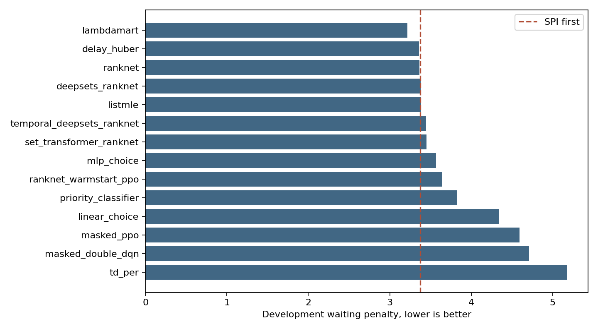
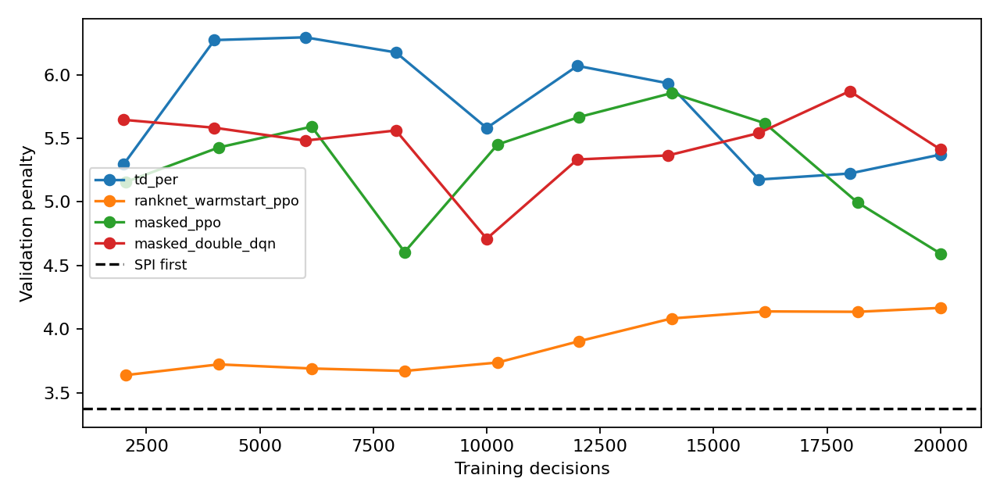
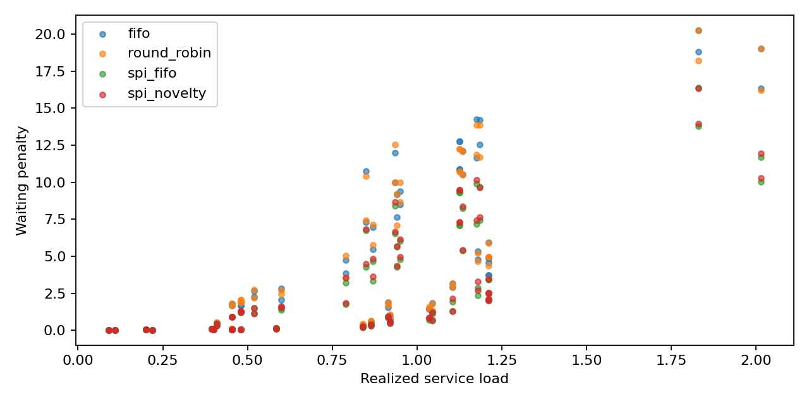

# Advanced development result analysis

## Scope
This is read only analysis of saved development results. No training or final test access occurred. Time values are simulated ms under the agreed unit convention. No statistical significance claim is made from queue repetitions.

## Strong baseline changes the conclusion
FIFO penalty is 5.822023. SPI first is 3.374083. SPI first reduces penalty by 42.05% relative to FIFO.
LambdaMART reduces penalty by 4.62% relative to SPI first. Only 3 of the 14 learned methods beat SPI first numerically. Small differences remain unconfirmed without paired per episode learned outcomes.

| Method | Penalty | Improvement over SPI first percent |
|---|---:|---:|
| lambdamart | 3.2183 | 4.62 |
| delay_huber | 3.3573 | 0.50 |
| ranknet | 3.3642 | 0.29 |
| deepsets_ranknet | 3.3819 | -0.23 |
| listmle | 3.3859 | -0.35 |
| temporal_deepsets_ranknet | 3.4480 | -2.19 |
| set_transformer_ranknet | 3.4520 | -2.31 |
| mlp_choice | 3.5675 | -5.73 |
| ranknet_warmstart_ppo | 3.6375 | -7.81 |
| priority_classifier | 3.8271 | -13.43 |
| linear_choice | 4.3392 | -28.60 |
| masked_ppo | 4.5935 | -36.14 |
| masked_double_dqn | 4.7099 | -39.59 |
| td_per | 5.1757 | -53.40 |

## Class trade offs in the matched baseline cohort
Counts pool the same 15 validation episodes. Restricted waits weight each eligible follow up observation. Selected mean excludes unselected messages and must be read with their count.

| Policy | Class | Offered | Unselected | Selected mean wait | Restricted wait | Within budget |
|---|---|---:|---:|---:|---:|---:|
| fifo | Critical | 75 | 9 | 21.441 | 10.066 | 0.173 |
| fifo | High | 1087 | 92 | 22.099 | 9.916 | 0.333 |
| fifo | Medium | 435 | 39 | 20.884 | 9.583 | 0.425 |
| fifo | Low | 846 | 69 | 19.282 | 9.555 | 0.528 |
| spi_fifo | Critical | 75 | 0 | 2.929 | 1.684 | 0.893 |
| spi_fifo | High | 1087 | 12 | 8.314 | 4.830 | 0.636 |
| spi_fifo | Medium | 435 | 16 | 15.005 | 6.487 | 0.634 |
| spi_fifo | Low | 846 | 181 | 34.582 | 10.679 | 0.394 |
| spi_novelty | Critical | 75 | 0 | 3.102 | 1.237 | 0.947 |
| spi_novelty | High | 1087 | 10 | 8.356 | 3.979 | 0.744 |
| spi_novelty | Medium | 435 | 15 | 14.347 | 5.494 | 0.690 |
| spi_novelty | Low | 846 | 184 | 30.883 | 10.075 | 0.433 |

## RL learning dynamics
- td_per: best observed checkpoint at 16000 decisions, penalty 5.1757; final checkpoint penalty 5.3716. Observed checkpoints do not prove convergence.
- ranknet_warmstart_ppo: best observed checkpoint at 2048 decisions, penalty 3.6375; final checkpoint penalty 4.1661. Observed checkpoints do not prove convergence.
- masked_ppo: best observed checkpoint at 20000 decisions, penalty 4.5935; final checkpoint penalty 4.5935. Observed checkpoints do not prove convergence.
- masked_double_dqn: best observed checkpoint at 10000 decisions, penalty 4.7099; final checkpoint penalty 5.4125. Observed checkpoints do not prove convergence.

## Rate study paired effects
Effects below compare policies on identical saved traces. Wins mean strictly lower waiting penalty. These traces are workload variations from one seed, not independent emergency events.
- round_robin: 80 paired traces; mean delta versus FIFO -0.02059; median 0.00547; wins 32, ties 5, losses 43.
- spi_fifo: 80 paired traces; mean delta versus FIFO -1.70285; median -0.97357; wins 74, ties 6, losses 0.
- spi_novelty: 80 paired traces; mean delta versus FIFO -1.62261; median -0.93560; wins 74, ties 6, losses 0.

## Interpretation and next experiments
The implemented target depends on reference priority and waiting. The current comparison cannot establish a distinct benefit from novelty or all 93 scene categories. Within class marginal costs often tie, leaving no training signal for a finer semantic order.
Keep LambdaMART, RankNet and delay regression as the principal learned candidates. Retain SPI first as the strong comparator. Attention and temporal complexity are not justified by the present aggregate scores.
Do not infer that replay prioritization is universally harmful. Its poorer result may reflect training distribution, optimization settings or reward target properties. Saved learning curves establish instability or regression only in this run.
Run matched no scene, compact scene and full scene ablations. Add SPI only learned models to distinguish better priority estimation from extra semantic reasoning. Keep the final test closed until these decisions are fixed.
Per episode learned outcomes, critical safeguards, measured inference profiles and feature ablations are not present in this retrieved evidence subset. Therefore no learned class benefit, confidence interval, Pareto deployment winner or feature importance is invented.
Training status seconds can include validation and concurrent resource contention. They are not pure training throughput measurements.

## Figures

