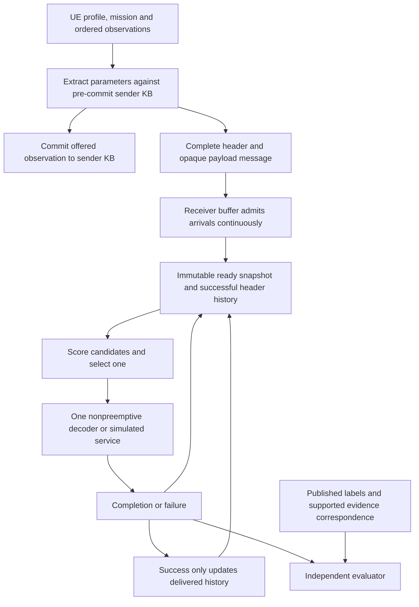

# Consolidated semantic-aware decoder scheduler plan

Restored and consolidated: 29 October 2026. This document restores the decisions from the conversation, including the dynamic-UE requirements added on 28 October. It is the current design reference for this scope. It does not claim that the proposed expanded simulator, teacher qualification or new models have been executed.

## 1. Objective and boundaries

Build a receiver that selects the most useful complete message from the currently available buffer, sends it to one decoder, and selects again after completion. The objective is early exposure of important, mission-relevant and additional image evidence. Throughput alone is not the semantic objective.

The message is logically `[ParameterHeader][CompletePayload]`. Payload contents remain opaque to the scheduler. Jobs are nonpreemptive: arrivals continue while decoding, but cannot interrupt the current job. There are no radio-resource grants, retransmissions, new codebooks or encoder redesign in this study. Codec work remains paused pending the user's digital-payload codec.

Use one canonical repository and its current ownership:

| Owner | Responsibility |
|---|---|
| `parameters/` | Parameter extraction, SPI producer, device/mission interpretation, causal transmitter KB |
| `Scheduler/` | Policies, learned scoring and training implementations |
| `Evaluation/` | Buffer, service lifecycle, event simulator, independent references and metrics |
| `Codec/` | Payload encoding/decoding when that work resumes |
| `experiments/` | New experiment scripts/notebooks and uniquely identified run artifacts |

Preserve historical code/results and the archived owners. Do not create a second project implementation. Older references to INFRA, SemParam and EncDec describe the previous layout.

## 2. Main research decision

The main candidate is a **contextual neural ranker**, using SPI, context relevance, novelty and spatial evidence together. SPI is an input, not a mandatory cross-class gate. Strict SPI-first selection remains an essential baseline.

Start with **Deep Sets candidate scoring trained with RankNet-style preferences**. Deep Sets represents the variable-sized ready queue/history; RankNet is the preference loss. Compare against simpler scorers, LambdaMART, a small Set Transformer and matched RL/AI-feedback methods. A literature-backed candidate is not a measured winner.

Separate three questions:

1. What independent evidence defines importance for a declared mission?
2. How does a policy infer a next choice from its permitted parameters?
3. Did important evidence become available sooner, with acceptable misses and costs?

Delay is the main operational outcome, not the only measurement and not a required rule for choosing a message. Do not invent an expected deadline for each image merely to manufacture a target.

## 3. Runtime inputs and parameter contract

The accepted semantic families are:

| Family | Treatment and purpose |
|---|---|
| SPI | Planned Critical/High/Medium/Normal classes; categorical probabilities if supplied. Defines coarse predicted urgency, not guaranteed truth or a physical cost scale |
| Context relevance | Relation between observed evidence and the declared UE mission/device description |
| Novelty | Sender-history-dependent difference; preserve appearance, concept or changed-condition distinctions if the upstream extractor provides them |
| Spatial understanding | Supplied entity/geometry/relation evidence with availability states; prominence alone is not distance or urgency |

The actor may also use permitted causal timing, current queue summaries and successful delivered-header history. It receives no RGB, raw embeddings, latent contents, annotations, evaluator fact IDs, future arrivals or hidden future service times. Routing identity is not a learned semantic feature.

Freeze definitions, units, ranges, availability, uncertainty and KB semantics from the actual upstream schema. Available zero/false, missing and cold start differ. State whether SPI is global report priority or mission-conditional priority. Optional SPI subclasses require actual supported definitions; do not invent them merely to add features.

The UE mission paragraph is used by extraction and offline teacher labeling. Initially its runtime meaning reaches the selector through mission-relative parameters. A profile ID must not become a shortcut for urgency. Arbitrary unseen natural-language mission understanding would need a separately validated representation; it is not established by this plan.

**Current implementation gap:** the current README reports a 35-byte header not yet integrated with the receiver queue, and an SPI head with Low/High/Critical while Medium remains unresolved. Four-class support is a target, not a current capability. Preserve Low-to-Normal as an explicit alias where applicable. Do not invent Medium by interpolation. Measure the final serialized header and payload bytes after the interface is frozen; old 32-byte and Scene JSON records are different formats.

## 4. End-to-end workflow

The service controller is the sole owner of queue mutation, in-flight state and completion. Busy means no second dispatch. Reject foreign/duplicate completions and invalid clocks. Failure consumes time, exposes no successful evidence and triggers no automatic retry. Reset clears queue, in-flight state, rotation and history.

Sender KB updates follow the offered stream independently of the receiver policy. Receiver history changes only after successful completion. Sender novelty cannot by itself identify cross-UE repeats. Preserve the existing bounded history initially and test truncation explicitly.

## 5. Dynamic UE and episode simulator

Build a seeded, replayable, event-driven simulator with declared assumptions and validated behavior. Do not claim perfect reproduction of all real environments.

Support 4/12/32 UEs as controls and 50/60/100 UEs as scale experiments, including population changes within episodes. UEs join, leave, pause and resume; sessions may restart under explicit KB-reset rules. A departing UE does not erase its already received messages. The number of queued images varies independently of the UE count.

Vary profile composition, stream length, capture intervals, burst duration and offered image count. Use independent random streams for workload generation, service realizations, training and evaluation. Keep scenario-compatible profile mixtures; arbitrary mixtures are a separate stress test.

Construct a coherent common incident/environment. Nearby cameras may observe the same incident; moving cameras follow plausible trajectories; condition changes persist across observations. Prefer real ordered sequences where available. Label controlled crops/repeats, constructed chronology and fully synthetic scenarios separately. Randomly assigning unrelated photos does not establish realistic novelty behavior.

Compare both fixed-total-load population scaling and fixed-per-UE-rate scaling so the effect of source count is not confused with congestion.

### Fifteen UE profile templates

Each template must become a versioned device-description paragraph plus mission paragraph, with compatible image pools and limitations.

| # | Profile | Mission |
|---|---|---|
| 1 | General-purpose smartphone | Neutral ordinary photo sharing; no presumed emergency task |
| 2 | Citizen incident-reporting phone | Document visible incident hazards and supported changes |
| 3 | Structural-damage survey drone | Clarify building condition and newly observed damage |
| 4 | Person-search drone | Search for visible people and relevant surroundings without inferring invisible distress |
| 5 | Flood/evacuation-route drone | Observe inundation, blocked access and route changes |
| 6 | Wildfire observation drone | Observe visible fire/smoke extent and relevant infrastructure |
| 7 | Bridge/road inspection drone | Inspect visible structure, surface and access conditions |
| 8 | Ordinary connected-car camera | Routine road conditions and meaningful driving-scene changes |
| 9 | Emergency-response vehicle camera | Response-route access, hazards and relevant incident updates |
| 10 | Traffic-intersection CCTV | Obstruction, visible collisions and traffic interactions |
| 11 | Building/public-space CCTV | Access and visible safety changes; occupancy alone is not danger |
| 12 | River/underpass monitoring camera | Water coverage and access changes; no uncalibrated physical depth claims |
| 13 | Industrial inspection robot | Visible equipment/obstruction changes on an assigned inspection route |
| 14 | Agricultural survey drone | Task-relevant field changes, including a non-emergency aerial domain |
| 15 | Infrastructure-maintenance field camera | Asset condition and repair-relevant observations |

These are project-designed profiles informed by use-case families, not fifteen standardized 6G classes. Ground them in [ITU IMT-2030](https://www.itu.int/en/ITU-R/study-groups/rsg5/rwp5d/imt-2030/pages/default.aspx), [IETF RFC 9450](https://datatracker.ietf.org/doc/html/rfc9450) and relevant 3GPP UAV/public-safety video material. Earlier 3GPP Highlights evidence was indexed; direct PDF retrieval returned 403, so no detailed clause verification is claimed.

Device type does not define reference importance. An ordinary phone can capture Critical evidence and a rescue drone can send an irrelevant repeat.

### Timing and metadata

Record capture, extraction-ready, send-ready, complete receiver arrival, dispatch and completion separately. Define monotonic simulator time and its mapping to generated wall-clock timestamps. Under a common trusted clock enforce causal ordering. Model clock offset/uncertainty as an explicit stress test rather than silently breaking causality.

Generate coherent position/trajectory, coordinate system, location accuracy, and available camera orientation/altitude. Preserve observed, derived, simulated and unknown provenance. Generated coordinates attached to downloaded imagery are not its true GPS. Keep original metadata separately. Unsupported depth, distance or exact object identity remains unknown.

### Load and service regimes

Start with constant service d0 as a control. Add fixed message-qualified lognormal service with mean d0 and log standard deviation 0.5. Use nominal background loads near 0.5, 0.85 and 1.2, two-state bursts and synchronized incident surges. Report actual finite-trace queue sizes, rates and utilization. These distributions are simulation assumptions until calibrated against measurements.

Retain the small four-UE/48-message/eight-initially-ready compatibility case, then variable-length and larger populations. Allow sufficient final follow-up for the selected metric budgets. Do not supply future actual service duration to the policy. Later actual-codec integration reuses identical received payloads across policies; it remains paused now.

## 6. Data, references and splits

Maintain three separate reference panels:

| Panel | Source | Supported claim |
|---|---|---|
| Priority | Published assessed priority with verified input scope | Delay/exposure by independently assessed report priority |
| Task evidence | Published object/condition annotations and declared mission | Earlier exposure of independently annotated useful/distinct evidence |
| Fine preferences | Qualified VLM choices under mission/history | Weak supervision and student agreement with AI judgments |

TREC-IS is a candidate for report priority, not yet a verified image-only urgency benchmark. Audit actual image/post joins, multiple images, missing media and priority justified only by text. Preserve source Low/Medium/High/Critical semantics. [Official task](https://www.dcs.gla.ac.uk/~richardm/TREC_IS/2020/participate.html).

LADI/xBD/RescueNet-type annotations can support narrower building/task evidence when available. Damage severity is not rescue urgency. Exact copies and controlled annotated overlap support repeat/fact correspondence; image similarity does not prove natural cross-view identity. Other datasets enter only after access, annotation and mission-fit audits; no full-download assumption.

Use the SPI image collection if useful, but split event/site/parent/near-duplicate groups before fitting SPI, teacher selection, parameter calibration or scheduler models. Prefer out-of-fold producer predictions for scheduler training. Final groups must be held out across upstream and downstream training where possible. Disclose frozen vision-model exposure when exclusion is impossible.

Distinguish synthetic RGB images from real images with synthetic/VLM labels. Neither becomes independent operational truth by being plentiful. Missing labels remain unknown. Queue seeds and image derivatives are not independent events. Previously inspected pilot groups remain development-exposed.

## 7. Model and policy registry

### References

FIFO, source round robin, seeded random; predicted SPI then FIFO; relevance-only, novelty-only and spatial-only when a defensible scalar exists; SPI then novelty; SPI then learned within-class score; and a learned linear choice score.

SJF is conditional on a permitted service estimate. EDF requires genuine application deadlines. Gold-SPI/fact-aware policies are privileged diagnostics, not fair deployed competitors.

### Supervised comparisons

| Method | Learning mechanism |
|---|---|
| Contextual useful-next classifier | Supported useful-new/no-useful-increment targets, distinct from upstream SPI classification |
| Shared MLP choice | Masked cross-entropy over supported best-action sets |
| MLP RankNet | Shared scores with accepted pair preferences |
| LambdaMART | Decision-grouped integer grades and explicit gain table |
| Deep Sets RankNet | Main candidate: learned queue/history representation plus pairwise loss |
| Small Set Transformer | Attention-based candidate interactions on the same input/labels |
| Small-list Plackett-Luce/ListMLE | Conditional comparison using qualified listwise preferences |

Retain historical regression as a control without relabeling it as a different algorithm. Compare architectures with the same supervision. In the grade block, derive choice/pair labels from common grades; in the preference block, supply identical accepted pairs to compatible scorers. Do not give a neural model richer labels and attribute improvement over a tree solely to architecture.

### RL and VLM methods

| Method | Controlled factor |
|---|---|
| Masked Double DQN, uniform replay | Sequential value learning using independent reference reward |
| Double DQN + TD-PER | Replay proposal changes; reward/architecture fixed |
| Masked PPO | Policy optimization under the same information/objective |
| Ranker-warmstarted PPO | Preference initialization versus random initialization |
| RLAIF / RL-VLM-F-inspired Double DQN | Reward learned from qualified VLM prefix preferences |
| VLM-guided replay | Annotation reward unchanged; teacher changes replay selection only |
| VisionPrefer-inspired aspect preferences | Explicitly adapted aspect-label generation for a small ranker; no aesthetic reward |

Keep all requested historical arms, but execute staged comparisons rather than a giant factorial study. Conditional recent candidates are listwise VLM feedback and FSP-inspired interpretable additive/pair-interaction scoring. An additive supervised variant is not a literal FSP reproduction. IPL is conditional on measured reward-model error and adequate offline transition/preference coverage. DPO/GRPO names alone do not define a correct queue objective.

## 8. Neural architecture and losses

For candidate vector x_i, encode e_i=phi(x_i). Pool ready-set encodings and successful-history encodings, retaining availability and set-size indicators. Score each candidate using its encoding and those summaries. Start with 64-dimensional encodings and a 64/32/1 scoring head; sizes are engineering defaults, not optimized results. A small attention comparator can use two 64-wide blocks/four heads without arbitrary list-position encoding.

Choose argmax score; a permanent full sort is unnecessary. Ties resolve by arrival, sequence and full routing identity. Permuting candidate-array order must preserve identity-associated scores except declared ties.

For preference i over j use:

\[
p_{ij}=\sigma(s_i-s_j),\qquad L=-y\log p_{ij}-(1-y)\log(1-p_{ij}).
\]

Strict preference uses y=1 or 0; a genuine tie can use 0.5; uncertainty is not a tie. Class equality alone does not establish semantic equivalence. Normalize loss by decision/episode; deterministic pair sampling must not favor array orientation. Small-list likelihood is a separate loss comparison with the same labels/cost accounting.

Fit preprocessing only on training groups. Start with Adam 3e-4, validation early stopping and portable inference exports. Select on held-out decisions and causal outcomes, not training-loss reduction alone. Nearly identical observable headers with conflicting teacher choices indicate possible missing information; a larger network cannot recover an absent fact.

## 9. VLM teacher qualification and use

Qwen3.5-9B is the leading candidate, not an already-qualified winner. Pin exact model revision, quantization, processor, input resolution, backend and prompt. Test one image, pairs and planned small-list/prefix sizes; verify memory, finite outputs and latency before collecting labels.

For offline action preferences the teacher sees actual training images, mission text and necessary causal delivered-history context. Hide predicted parameter scores, policy names/scores and reference labels initially to reduce anchoring. Ask for strict preference, tie or uncertain, supported by visible evidence. Preserve raw outputs, hashes, parsing failures and exclusions.

For RL preferences compare two recorded prefixes from the same starting state, same exogenous realizations and same elapsed endpoint. Display actual completion times. More pictures or prettier pictures must not automatically mean better. The teacher does not see future unarrived jobs and is not a live feed watching every buffer update.

Run controls for order reversal, list-position permutation, duplicates, clear mission contrasts, absent-versus-unknown evidence, low resolution, misleading overlays, unanswerable cases, unsupported factual claims and preference cycles. Inspect class/source-conditioned errors. A second model family is a diagnostic, not independent truth.

The earlier initial engineering gates were 95% schema validity, 0.80 balanced strict-preference accuracy and 0.75 tie/unanswerable handling. Predeclare denominators and uncertainty; a small passing panel does not establish emergency-grade reliability. Failed teacher arms remain blocked while independent annotation arms continue.

Cache and version teacher labels. Student runtime uses parameters only. Separate teacher-to-reference accuracy from student-to-teacher fidelity. A privileged RGB teacher is not a fair latency comparator to a parameter-only student unless its extra information/compute is disclosed. Never use the same VLM to supply all training labels and certify independent correctness.

## 10. RL objective and reward consistency

This is an event-driven, partially observed, variable-duration decision problem. Dynamic arrivals alone do not prove RL will help. Useful sequential effects include delivered-history-dependent marginal evidence, variable service and finite exposure opportunities.

For independently supported fact/report f with first arrival a_f, first successful exposure c_f, declared utility w_f and fixed horizon T:

\[
L=\sum_f w_f[\min(c_f,T)-a_f]_+.
\]

Unexposed evidence has c_f=infinity. L is the integral of arrived, unresolved reference utility. Equivalent normalized first-exposure reward is:

\[
r_f=w_f(T-c_f)/Z,\qquad Z=\sum_f w_f(T-a_f),\qquad \sum r_f=1-L/Z.
\]

The identity requires a fixed offered trace, arrivals within T and Z>0. Repeats earn no new fact reward, failures consume time and expose nothing. Zero-utility traces are separately counted. Reward normalization/reference labels never become actor future information. Discount 1 matches the finite-horizon identity.

Use unit weights for distinct task-evidence experiments. Any class gain map is an explicit utility convention with sensitivity analysis, not a discovered harm scale. If all jobs are distinct, equal duration, already ready and perfectly graded only by SPI, descending priority already minimizes the corresponding weighted completion objective. Include this as a simple-optimal control rather than expecting neural superiority.

Double DQN must mask current/next legal actions and store immutable snapshots plus chosen identity. Use Huber loss and target-network updates; monitor Q/empirical-return calibration. Existing bounds for nonnegative coverage returns cannot be reused for arbitrary signed AI rewards. PPO uses fresh masked rollouts and a pooled value head, not stale DQN replay.

Initial feasibility defaults remain 20,000 decisions per RL arm with validation checkpoints; this is not a convergence promise. Train the RLAIF reward model on prefix preferences with duration-aware segment scores. Freeze it within a block; after updates relabel affected replay and version the checkpoint. Evaluate independently, not by its own reward.

For VLM replay, preserve uniform sampling support, for example p(i)=0.5/N+0.5*p_guided(i), and use the actual mixture probability for importance correction. Training-value priority differs from image urgency. Compare uniform/TD/VLM replay with identical annotation rewards.

## 11. Evaluation metrics

### Time and missing outcomes

For arrival a_i, dispatch b_i and finish c_i: queue wait W_i=b_i-a_i; service S_i=c_i-b_i; receiver completion delay D_i=c_i-a_i. Trusted capture-to-completion is separate.

For independent reference class q:

\[
\overline D_q^{cap}(\tau)=N_q^{-1}\sum_{i\in q}\min(D_i,\tau),
\qquad E_q(\tau)=\#\{i\in q:\text{success},D_i\le\tau\}/N_q.
\]

Unexposed/failed outcomes use infinite delay. Require adequate follow-up or a separately specified censoring method. Pair capped delay with exposure/misses so unserved reports cannot disappear from an average. Report Critical and High prominently and all classes alongside, with counts, failures and delivered-only median/p95.

Use time-budget curves, initially tau/d0 in 1/2/5/10 as diagnostic settings. Fix the primary operating budget before final evaluation. These are evaluation windows, not invented operational deadlines. Report physical message delay and distinct-evidence first exposure separately.

Overall mean delay can be invariant to semantic order for equal-duration jobs. Even class mean is invariant to some within-class swaps. Therefore time alone cannot prove relevance/novelty decisions are correct.

### Ranking and evidence

Use nDCG@1/@3/@5 on **shared held-out ready snapshots with fixed history**:

\[
DCG@k=\sum_{r=1}^k (2^{y_{\pi_r}}-1)/\log_2(r+1),\qquad nDCG=DCG/IDCG.
\]

SPI grades 0/1/2/3 define an explicit `nDCG_SPI` diagnostic with linear-gain sensitivity. Zero ideal gain is undefined, with counts reported. SPI nDCG cannot distinguish equal-class images. Task-grade nDCG needs independent supported grades; VLM grades are named silver. Pair preferences do not automatically create absolute grades.

Also report tie-aware best-choice accuracy, pair agreement, distinct Critical/High evidence exposed at fixed times and completion counts, repeats and supported condition changes. Do not rank all future arrivals as if they were available at the decision. Diversity metrics require valid fact/subtopic labels and honest ideal-normalization scope.

Gold-SPI and fact-aware greedy are information diagnostics. Tiny legal-sequence exhaustive search checks optimality/headroom; a clairvoyant future-aware optimum is a privileged lower bound. Do not count unavoidable blocking by an already-running job as an avoidable inversion.

### Compute and teacher measurements

Measure selector, extractor and teacher inference separately in milliseconds. Include cold/warm scope, hardware, precision, batch size, candidate/history counts, synchronization and memory. Report both model-forward and complete context-build/select overhead. Tail statistics need enough cases.

Measure parameters and supported-operator FLOPs per declared input. State MAC versus FLOP convention, omitted operators and dynamic-shape coverage. Quantized/VLM FLOPs may be estimates; image/token counts and prefill/decode scope matter. FLOPs do not replace measured latency.

Offline VLM labeling is training cost. Any actual live upstream inference is charged once in capture-to-completion timing; do not subtract annotation latency from a supposed deadline. Report teacher calls/images/tokens, accepted-label yield, unsupported claims, abstentions, consistency and cost. Report SPI confusion, Critical false negatives and calibration separately from scheduler quality.

## 12. Required experiments and tables

| Study | Essential comparison |
|---|---|
| Core outcomes | Policies versus Critical/High capped delay, exposure, distinct evidence and runtime |
| All classes | Counts, capped mean, delivered median/p95, misses and failures per class |
| Within-class meaning | Same SPI, different independent relevance/repeat/change evidence |
| Parameters | SPI-only, incremental families, full, leave-one-family-out; remove derived features too |
| Architecture | Linear/MLP/tree/Deep Sets/attention with matched labels and inputs |
| Feedback | Annotation, direct VLM preference and structured aspects with provenance |
| RL mechanisms | Uniform/TD/VLM replay, PPO warmstart and annotation versus learned reward |
| Workloads | UE population, joins/leaves, load, bursts, service variability and failure |
| Transfer | Held-out event/domain/mission/profile, producer exposure disclosed |
| Robustness | Missingness, cold start, SPI corruption, independent/systematic teacher errors |

Include no-backlog, balanced and natural-imbalance cases; all-high queues; local/cross-source repeats; changed angle versus changed facts; late Critical arrivals; overload starvation; false Critical and underclassified Critical reports; mission swaps and information collisions. Do not run an uncontrolled full factorial. Start core comparisons, then diagnostic stresses.

Compare identical frozen traces. Use grouped development selection and locked final groups. Paired uncertainty resamples independent source/event groups, not queue seeds. Shortlist multiple training seeds if measured resources allow; label one-seed feasibility honestly. Choose a validation trade-off between Critical/High exposure/delay, semantic choice quality, lower-class harm and runtime, then freeze the rule. Never choose whichever final metric makes each model look best.

## 13. Build, test and integrate sequence

| Phase | Build | Acceptance evidence |
|---|---|---|
| 0. Preserve | Record canonical source/dirty state, environment, prior artifacts | Source identity and one plan; no discarded work |
| 1. Contract | Consume actual upstream fields, mission and payload envelope | Missingness, class mapping and byte accounting explicit; resolve Medium |
| 2. Lifecycle | Ready buffer, sole service controller, immutable contexts | Busy/arrival/failure/reset/exact-once checks |
| 3. References | Annotation adapters, group manifests, separate silver labels | Supported target scope and no split leakage |
| 4. Simulator | Dynamic UE profiles/streams/metadata and event engine | Causal replay, population changes and conservation accounting |
| 5. Teacher | Qwen preflight, reliability controls, cached labels | Qualified or explicitly blocked; cost measured |
| 6. Rankers | References, simple learned models, contextual scorer | Meaningful training, export parity, shared probe/replay evaluation |
| 7. RL/AI feedback | Masked RL, warmstart, preference reward/replay arms | Objective identity, masks, replay/resume integrity and matched comparisons |
| 8. Scale/transfer | 50/60/100 UEs and held-out profiles/events | Measured quality/runtime under changing populations |
| 9. Final study | Freeze protocol/checkpoints, run locked groups | Reproducible artifacts and bounded claims |
| 10. Codec later | Integrate the user-selected digital-payload codec | Separate authorization/readiness; currently paused |

Before expensive training test: event/timestamp ordering; empty/future-only queues; duplicate/foreign completion; arrivals during service; joins/leaves/restarts; source KB policy independence; failure history; unknown/false/cold-start distinctions; candidate permutation; identifier/evaluator/future leakage; pair-gradient direction; training-only preprocessing; exported threshold behavior; reward-integral equivalence; tiny exhaustive cases; masked bootstrapping; teacher-reward replay relabeling; and resumable optimizer/RNG/replay state.

Use learning/failure controls, not tests demanding a neural win. Investigate baseline wins through data validity, objective information, implementation and fitting separately.

## 14. Execution, artifacts and resources

Use the existing local environment. CPU correctness and small-model preflight first. Kaggle training follows data and teacher gates. Reuse established notebook identities/versions and `parameters/KAGGLE_RUNS.md`; verify access, inputs, actual versions, logs, checkpoints and retrieved artifacts.

Every computational notebook records actual interpreter/dependencies/hardware, source/data hashes, configuration and seeds. Each cell exposes purpose, progress, timing, destinations and errors; save executed notebooks, logs and incremental checkpoints. Platform COMPLETE is not proof of scientific success.

New experiment runs live under `experiments/<experiment>/runs/<run-id>/`, with manifest/config, logs, data provenance/splits, models/checkpoints, metrics, figures, validation and report. Keep source edits separate from runtime outputs. Do not overwrite old evidence.

The earlier six aggregate GPU-hour pilot ceiling remains a ceiling, not a new allocation or proof every comparison fits. Count assigned idle GPUs too. Project cost from timed first batches; checkpoint and label partial/blocked rather than relaunch blindly. No new GPU run is authorized merely by restoring this document.

Main Sol owns implementation/integration and scientific synthesis. Medium provides bounded assessment only at consequential checkpoints. Luna High executes agreed tests/operations and Kaggle bookkeeping where supported and authorized. No delegate may silently change labels/objectives or treat job completion as research validity.

## 15. Literature anchors and limitations

The earlier review used these primary sources; this restoration preserves the references and does not claim a new literature search:

- [RankNet / Burges overview](https://www.microsoft.com/en-us/research/uploads/prod/2016/02/MSR-TR-2010-82.pdf): pairwise scoring and ranking objectives.
- [Deep Sets](https://arxiv.org/abs/1703.06114) and [Set Transformer](https://proceedings.mlr.press/v97/lee19d.html): variable-sized, permutation-aware representations.
- [RankGPT](https://arxiv.org/abs/2304.09542): teacher permutations distilled into a small ranker; text retrieval gains do not transfer automatically.
- [Decima](https://web.mit.edu/decima/content/sigcomm-2019.pdf): event-driven scheduling and elapsed-time objectives; our system has no cluster DAG allocation.
- [Semantic-aware monotonicity-driven scheduling](https://arxiv.org/abs/2305.13706): task/AoI costs, not a theorem about image novelty.
- [Semantic Scheduling for LLM Inference](https://arxiv.org/abs/2506.12204): urgency-conditioned latency; its batching/preemption is outside this system.
- [PEBBLE](https://arxiv.org/abs/2106.05091), [RL-VLM-F](https://arxiv.org/abs/2402.03681), [RLAIF](https://arxiv.org/abs/2309.00267): preference feedback and reward learning, adapted here.
- [VL-RewardBench](https://openaccess.thecvf.com/content/CVPR2025/html/Li_VL-RewardBench_A_Challenging_Benchmark_for_Vision-Language_Generative_Reward_Models_CVPR_2025_paper.html): qualify visual judges rather than assume reliability.
- [Listwise VLM supervision, 2026](https://arxiv.org/abs/2608.25350), [FSP, 2026](https://arxiv.org/abs/2609.36578), [structure-aware ranking RL, 2026](https://arxiv.org/abs/2607.25268): conditional newer mechanisms, not proven superior decoder schedulers.
- [IPL](https://arxiv.org/abs/2305.15363): optional implicit-reward preference learning with coverage/assumption requirements.

The intended contribution is a mission-aware, parameter-only receiver selector with qualified feedback, reproducible dynamic episodes and independent semantic timing/evidence evaluation. Combining model names is not itself novelty. Natural cross-view correspondence, real rescue urgency and arbitrary mission generalization remain claims requiring additional evidence.

## 16. Immediate next step and honest status

Obtain the actual final parameter examples and definitions from `parameters/`, resolve four-class SPI support, freeze label scope/grouping, and turn Phases 1–4 into the first implementation slice. Do not train against invented headers or manufactured deadlines.

This file is a restored plan. The earlier conversation recorded numerical reference checks, but they were not rerun or recovered as evidence in this restoration. The expanded 100-UE simulator, Qwen qualification, FLOP measurements and new trained-model comparison are requirements, not demonstrated results.
