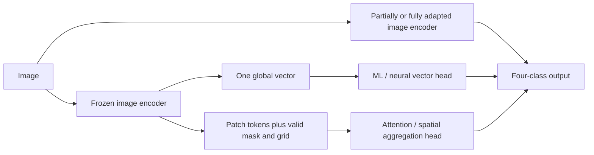

# SPI image classification: encoder, classifier and adaptation comparison

Research snapshot: 28 October 2026. Scope: image-only four-class SPI (Low, Medium, High, Critical). This review covers relevant architecture families, not every checkpoint ever released. A model's ImageNet, pathology or video result is not its SPI accuracy. No new cloud benchmark was launched for this review.

## 1. Main conclusion

Do not choose the encoder and classifier independently, and do not restrict the comparison to linear heads. Compare three distinct pipelines:

My quality-oriented candidates are SigLIP 2, DINOv3 and Perception Encoder, alongside CLIP/SigLIP/DINOv2 controls; gated attention, class attention and ACMIL are serious head candidates. ConvNeXt V2 and Swin V2 are end-to-end alternatives. These are **hypotheses to test**, not a declared winning combination. Stronger architecture cannot establish that our pseudo-labels are correct.

Keep the complete source/code detail for attention methods in [ATTENTION_LITERATURE.md](ATTENTION_LITERATURE.md). That companion includes implementation pitfalls, licenses and exact inspected code revisions.

## 2. What the existing experiment actually tells us

Current cohort: 300 images (220 LADI, 80 MEDIC); 204 training and 96 development-validation. All are development-exposed. Available grouping is not verified event-held-out grouping. SPI targets are teacher-generated, not native independently verified urgency annotations.

| Measured candidate | Development macro-F1 | Low / Medium / High / Critical recall | Interpretation |
|---|---:|---|---|
| CLIP + balanced logistic reference | 0.4637 | .535 / .625 / .421 / .714 | Reference fails readiness |
| Frozen SigLIP + logistic, earlier bounded probe | 0.5087 | .721 / .375 / .474 / .714 | Some gains, Medium still weak; not a winner selected independently |
| EfficientNet-B1 partial fine-tuning | 0.4462 | .558 / .375 / .579 / .429 | This adaptation did not fix the problem |
| Ordered cumulative-logit local probe | 0.4466 | .605 / .125 / .395 / .857 | Better Critical recall came with poor Medium recall |

The separate matched 18-combination pilot uses its own fixed selection procedure; its SigLIP logistic result differs from the earlier probe. Do not mix these into one ranking or choose hyperparameters from the 96 validation images. See `runs/joint_head_pilot_20261028_143645/results.json` and `JOINT_PILOT_REVIEW.md`. Current resource samples are provisional and do not establish complete CPU/GPU deployment costs.

None passes the existing per-class recall gate. Repeated selection on these 96 images cannot create a final test. The two primary competing explanations remain insufficient/discarded representation versus ambiguous or limited supervision; compare models while auditing difficult labels separately.

## 3. Encoder literature and architecture comparison

Years below refer to initial paper release where different from conference year. Exact variants, resolutions and licenses must be pinned before execution. The representative variants are proposed comparison points, not all installed or executed models.

| Family / year / primary reference | Mechanism and original evidence | Proposed representative / SPI contribution | Main limitations |
|---|---|---|---|
| [ResNet, 2015/2016](https://arxiv.org/abs/1512.03385) | Residual CNN; supervised recognition backbone | ResNet-18/50; familiar CNN transfer anchors | ImageNet semantics need adaptation; small urgency cues may disappear in pooling |
| [MobileNetV3, 2019](https://arxiv.org/abs/1905.02244) | Hardware-oriented efficient CNN design | Small/Large; low-cost boundary of the comparison | Efficiency does not imply enough representation capacity |
| [EfficientNet, 2019](https://arxiv.org/abs/1905.11946) | Compound scaling of depth, width and resolution | B0/B1; existing B1 experiment is a direct control | Resolution, training recipe and variant alter cost substantially |
| [ViT, 2020/2021](https://arxiv.org/abs/2010.11929) | Transformer over image patches; large-scale pretraining | ViT-B/16; baseline for patch attention and adaptation | Full attention scales quadratically with token count; small-data tuning can overfit |
| [DeiT, 2020/2021](https://arxiv.org/abs/2012.12877) | Data-efficient ViT training and teacher distillation | Small/Base; supervised/distilled transformer control | Its original training-data efficiency is not proof of effective training from 204 examples |
| [CLIP, 2021](https://arxiv.org/abs/2103.00020) | Contrastive image-text alignment; broad zero-shot transfer | ViT-B/32 current control, B/16 or L/14 quality extension; supports mission-text relevance | Global alignment may miss local damage; B/32 has coarse patches. Raw patch tokens are not automatically aligned like its projected global vector |
| [Swin, 2021](https://arxiv.org/abs/2103.14030) / [Swin V2, 2021/2022](https://arxiv.org/abs/2111.09883) | Hierarchical shifted-window attention; classification and dense prediction | Tiny / V2 Tiny; structured multiscale fine-tuning alternative | Local windows do not by themselves learn urgency; adaptation and resolution remain important |
| [ConvNeXt, 2022](https://arxiv.org/abs/2201.03545) / [ConvNeXt V2, 2023](https://arxiv.org/abs/2301.00808) | Modern CNN; V2 combines fully convolutional masked autoencoding and global response normalization | V2 Tiny; strong non-transformer quality candidate | Native evidence is recognition/detection/segmentation, not urgency; frozen and fine-tuned features need separate tests |
| [SigLIP, 2023](https://arxiv.org/abs/2303.15343) | Pairwise sigmoid image-text objective | Base/16 current alternative; mission compatibility | Similarity is not calibrated relevance probability; improved pretraining does not guarantee SPI improvement |
| [DINOv2, 2023](https://arxiv.org/abs/2304.07193) | Self-distilled visual features with strong global and dense transfer | Small/Base; tests visual self-supervision against language alignment | No native paired text encoder for mission similarity; CLS/register/patch outputs need explicit handling |
| [I-JEPA, 2023](https://arxiv.org/abs/2301.08243) | Predicts target-block representations from visible context in representation space | Published ViT-H/14 checkpoint; tests predictive visual representation | Large checkpoint; no interchangeable CLIP text tower or standard CLIP global output. Inspect weight license (published checkpoint has noncommercial restriction) |
| [EVA-02, 2023](https://arxiv.org/abs/2303.11331) | Masked visual representation learning using strong semantic targets | Small/Base; alternative pretraining recipe | Checkpoint recipe and feature interface must be specified; not inherently an SPI model |
| [EfficientViT, 2023](https://arxiv.org/abs/2305.07027) | Memory-efficient cascaded group attention | MSRA M-series; efficient attention-based image backbone | Several unrelated projects use EfficientViT naming: pin this paper/implementation. Original speed ratios are hardware/workload specific |
| [MobileCLIP, 2023/2024](https://machinelearning.apple.com/research/mobileclip) | Efficient image-text models trained using multimodal knowledge transfer | S0/S1/S2; efficiency-oriented aligned encoder alternative | Original mobile measurements cannot be substituted for laptop CPU or T4 results |
| [SigLIP 2, 2025](https://arxiv.org/html/2502.14786v1) | Combines sigmoid alignment, captioning, self-distillation, masked prediction and data curation; includes variable-aspect NaFlex variants | Base/16 first, larger variant conditional; strong aligned global/dense candidate | Fixed-pad and native NaFlex protocols are different experiments. Better general semantic/localization benchmarks are not four-class SPI evidence |
| [Perception Encoder, 2025](https://arxiv.org/html/2504.13181v1) | Contrastive image/video encoder; studies useful intermediate layers and distinct language/spatial alignment | PE Core Base/Large; compare a declared feature layer and pooling | Last layer is not automatically best for every task. Choosing layers using validation repeatedly creates extra selection bias |
| [DINOv3, 2025](https://arxiv.org/html/2508.10104v1) | Scaled visual self-supervision, Gram regularization for dense features and distilled model family | Small/Base student first; strong local-feature candidate | Access/license and actual model variant require verification. Native visual checkpoints do not automatically support CLIP-style relevance |
| [CrisisViT, 2023/2024](https://arxiv.org/html/2401.02838v1) | Disaster-domain ViT pretraining/adaptation using incident/place information | Domain-specific reference if checkpoint access is legitimate | Disaster-task accuracy is not SPI urgency accuracy; MEDIC/incident pretraining exposure must be disclosed |

CLIP-like alignment and visual-only representation address different objectives. It is valid to choose a visual-only encoder for SPI while retaining CLIP for relevance/novelty, but then deployment contains two encoders. Count both if both run. Conversely, shared image features can reduce extraction cost only if the shared configuration is actually used.

### What is genuinely newer here?

SigLIP 2, DINOv3 and Perception Encoder are substantial 2025 representation alternatives, not renamed classifier heads. ACMIL (2024) is a substantive attention-aggregation candidate. Newer date alone is not a reason to discard strong CNN or SVM controls. This is relevant-family coverage rather than a claim that these are the newest possible releases as of every day in 2026.

## 4. Classifiers operating on one global vector

Let `z ∈ R^d` be a frozen encoder output. Every encoder supporting a valid global representation can be paired with these heads. Fit scaling, calibration, feature selection and all hyperparameters inside training folds.

| Head | Mechanism / strength | Failure mode / comparison role |
|---|---|---|
| Majority / stratified dummy | No visual information | Essential chance and imbalance controls |
| Logistic / softmax regression | Linear separating surfaces; regularized probabilistic output | Cannot recover discarded spatial information; strong small-data control |
| Ridge classifier | Regularized squared-loss class scores | Scores are not probabilities without calibration |
| Linear SVM | Margin-based linear separation | Probability calibration costs extra and belongs inside folds |
| RBF SVM | Nonlinear kernel boundaries | Scaling and kernel width matter; support-vector count affects memory/latency |
| kNN / nearest centroid | Local similarity / class prototypes | kNN retains reference vectors; sensitivity to embedding geometry and label noise |
| Decision tree | Interpretable nonlinear partitions | Unstable with few samples; diagnostic rather than assumed strongest model |
| Random forest | Bagged randomized trees | Axis splits may poorly exploit dense rotated embeddings; inference size grows with forest |
| Extra Trees | Stronger split randomization | Useful nonlinear baseline; large development score alone is not a reason to select it |
| Histogram gradient boosting | Sequential boosted trees | Can overfit tiny minority classes; number/depth/leaf constraints matter |
| XGBoost / LightGBM / CatBoost | Mature boosting alternatives | Additional dependency/search cost; dense image vectors do not automatically favor them. Include as explicit optional library candidates, not three guaranteed improvements |
| Shallow and deeper MLP | Learns nonlinear interactions | Width/depth/dropout/weight decay need controlled search; small targets can overfit |
| Residual MLP | Skip connections stabilize deeper vector transformations | A proposed head family, not a published disaster-specific architecture |
| Gated / SwiGLU MLP | Feature-dependent gating and nonlinear channel interactions | More parameters/activation traffic; test against parameter-matched ordinary MLP |
| Cosine classifier | Normalized feature and class-weight similarity with scale | Useful geometry control; not automatically calibrated |
| Prototype / metric head | Learns class representatives or metric | Critical class may be multimodal; too few examples for reliable metric learning |
| CORAL / CORN ordinal head | Ordered exceedance / conditional probabilities | Tests known class order; exact-class performance can worsen even when ordinal error improves |

MLP variants above are standard architectural adaptations, not newly discovered named SPI algorithms. Attending across arbitrary embedding coordinates is a different hypothesis from attending across image patches; coordinate order does not have the image's spatial meaning.

## 5. Attention classifiers: retain spatial tokens

For token features `H ∈ R^(B×N×d)`, preserve actual grid, coordinates and valid-token mask. The bag is the patches of **one image**, not a collection of unrelated users' images. CNN feature maps can also supply tokens. A pooled-vector cache cannot reconstruct these inputs.

| Method / year / reference | Actual mechanism | Why compare for SPI / limitation |
|---|---|---|
| Mean/max pooling + linear/MLP | Uniform or maximum aggregation | Required control: establishes whether selective attention adds value at all |
| [ABMIL / gated ABMIL, 2018](https://proceedings.mlr.press/v80/ilse18a/ilse18a.pdf) | Learned softmax instance weights; gated form multiplies tanh and sigmoid branches | Simple trainable selection of local cues. Original MIL evidence is not disaster-image classification; no explicit spatial relation reasoning |
| [DSMIL, 2021](https://arxiv.org/abs/2011.08939) | Combines instance classification and similarity-based bag aggregation around critical instances | Tests decisive local evidence; a spurious maximum can dominate. Original WSI setup requires adaptation |
| [CLAM, 2021](https://pmc.ncbi.nlm.nih.gov/articles/PMC8711640/) | Gated single/multi-branch pooling with auxiliary instance clustering | Multiple class-related evidence streams. Full auxiliary loss makes patch-label assumptions not guaranteed by whole-image urgency |
| [CaiT, 2021](https://arxiv.org/abs/2103.17239) | Class token attends to patch representations in dedicated class-attention blocks | Direct natural-image precedent for learned readout. A frozen-token head inspired by it is not full CaiT training |
| [TransMIL, 2021](https://arxiv.org/abs/2106.00908) | Approximate self-attention and positional encoding of correlated WSI instances | Tests relations/geometry. Must use real grid/masks rather than arbitrary square padding; original WSI results are not SPI predictions |
| [Perceiver, 2021](https://arxiv.org/abs/2103.03206) | Small latent set cross-attends to inputs, then processes latents | Useful long-sequence bottleneck; additional machinery may not help with only 49–256 tokens |
| [ACMIL, 2024](https://www.ecva.net/papers/eccv_2024/papers_ECCV/papers/06954.pdf) | Multi-branch attention and concentration-reducing training mechanisms | Tests complementary local cues rather than one dominant region. Masking the only real emergency cue may hurt; ablate masking/diversity separately |
| [V-JEPA 2 attentive probe, 2025](https://github.com/facebookresearch/vjepa2) | Learned-query attention readout; published probe includes token self-attention before readout | Strong representation-probing precedent. Image-token adaptation differs from video protocol; depth-one code default is not full published four-block probe |
| Generic class-query Transformer | Several learned queries attend to patch tokens | Valid proposed experiment, **not an identified published SPI model**; compare to named heads and disclose exact query/output design |

Attention maps are inspectable aggregation weights, not independently validated causal explanations. Pathology bag AUC cannot be compared numerically with our four-class macro-F1.

## 6. Frozen versus adapted encoder: a separate axis

| Regime | Trainable state | Benefit hypothesis | Cost / risk |
|---|---|---|---|
| Frozen encoder + head | Head only | Low fitting cost, stable cached representations | Cannot change missing visual features |
| Last block/stage + head | Upper encoder layers | Adapt higher-level evidence without full training | Requires image training, augmentation, optimizer/checkpoint state; current B1 result was unsuccessful |
| Low-rank adapters | Selected low-rank updates + head | Parameter-efficient adaptation | [LoRA](https://arxiv.org/abs/2106.09685) originated in language models; image application is an adaptation choice. Few trainable parameters do not mean frozen-forward-only compute |
| Full fine-tuning | Whole encoder | Maximum task adaptation capacity | Highest overfitting and training-memory risk on 204 training examples |
| Teacher-to-student distillation | Student logits/features | Transfer bounded teacher decisions to cheaper model | Agreement reproduces teacher biases; requires independent label audit and a separate teacher-cost account |

Do not train a large ViT from scratch here. Pretrained adaptation is the meaningful comparison. Original pretraining GPU-hours are historical context, not the incremental SPI training cost.

## 7. Cost comparison: calculations before measurements

There is no honest universal table of CPU latency, GPU latency and training FLOPs for these families without exact checkpoints and a common protocol. Published throughput on different accelerators is not interchangeable. Blank/unmeasured entries remain explicitly unmeasured.

With four classes, hidden width `h`, `N` tokens and two FLOPs per multiply-accumulate:

- Linear head: parameters `4d+4`; matrix arithmetic about `8d` FLOPs/image, excluding preprocessing, normalization and softmax.
- One-hidden-layer MLP: parameters `dh+h+4h+4`; matrix arithmetic about `2dh+8h` FLOPs/image.
- Example `d=768,h=128`: linear 3,076 parameters / 6,144 matrix FLOPs; MLP 98,948 parameters / 197,632 matrix FLOPs. These are **head-only analytical counts**, not whole-image model FLOPs.
- Gated attention pooling with hidden width `a` includes about `2Nda` multiply-accumulates for its two input projections, plus attention scores, elementwise gates and weighted reduction. Count the exact implementation, not merely a family label.
- Full token self-attention has pairwise interaction scaling `O(N²d)` and projection/MLP costs. Query-only cross-attention with fixed query count has linear interaction scaling in `N`; its key/value projections still cost compute.
- Raising a patch-transformer's resolution from 224 to 448 approximately quadruples token count; its quadratic attention interaction term can grow about 16-fold. This does not imply whole-model latency grows exactly 16-fold.
- FP32 parameter storage is roughly `4P` bytes, FP16 `2P`; activation memory, optimizer state, buffers, framework and download checkpoint are separate. Adam training has gradients and moment states; mixed precision details change totals.
- SVM inference depends on support vectors/kernel work; forests depend on traversed nodes. Do not label these zero FLOPs simply because a neural profiler cannot trace them.
- Training FLOPs depend on batches, steps, frozen/trainable regions, backward graphs and search repeats. A blanket “training = three times inference” is an estimate, not a measured count.

For each exact pair record: accuracy, macro-F1, balanced accuracy, all class precision/recall/F1, confusion, ordinal MAE, Critical underprediction; probability metrics only for valid calibrated probabilities. Cost fields: deployed parameters, serialized state, dtype, download bytes, CPU process RSS, GPU allocated/reserved peaks, cold-load time, warmed batch-one p50/p95, throughput at declared batch, one-fit time, complete selection time and profiler coverage.

Report CPU and GPU equally in separate tables/Pareto plots. Measure complete preprocess → encoder → head → output on each target. Hybrid GPU-encoder/CPU-head timing includes transfers. Do not sum CPU measurements from a laptop with GPU measurements from Kaggle and call that measured pipeline latency. Warmup, CUDA synchronization and timing runs must be explicit; run memory sampling separately from latency timing to avoid instrumentation distortion.

## 8. Concrete comparison matrix and experimental sequence

This is the proposed expansion of `JOINT_BENCHMARK.md`, not a claim that the current scripts implement all families.

1. **Pooled vectors:** current CLIP/SigLIP plus SigLIP 2, DINOv2, DINOv3, PE, EVA-02, I-JEPA and efficient CNN/aligned anchors. Compare all compatible core vector heads on the same frozen features and folds. Conditional larger variants are a separate resource tier, not silently mixed into a small-model contest.
2. **Patch tokens:** use common token caches from the selected encoders, with mean-pool controls, gated ABMIL, one-query attentive pooling, CaiT-style class attention and ACMIL. Include DSMIL/TransMIL/Perceiver as declared alternatives testing local criticality, relations and bottlenecks. Token widths differ: account for projection parameters and include width-matched controls.
3. **Adaptation:** compare frozen versus upper-block adaptation on strong candidates; CNN/ConvNeXt/Swin controls and bounded low-rank adaptation where supported. Keep training and search budgets visible rather than claiming unequal experiments isolate architecture.
4. **Output/loss:** compare nominal cross-entropy to CORAL/CORN on matched representations. Class weighting belongs inside folds; do not oversample validation. Report dangerous underprediction and calibration separately from macro-F1.
5. **Deployment:** profile shortlisted complete pipelines on CPU and GPU; higher accuracy may justify more compute, but no single weighted accuracy-latency sum is imposed without an application requirement.

For expensive token/adaptation comparisons, predeclare the resource budget after ten-image timing/memory preflight. A full Cartesian product of every scale, layer, loss and head is not authorized by a literature review and is not necessarily scientifically useful. Record what was excluded and why. Do not prune all attention models merely because their encoder's linear probe was weaker: encoder–head interactions are part of the question.

Use grouped nested selection only where class/group support permits. Keep labels and preprocessing fitted inside the appropriate roles. The 96 exposed examples are descriptive; acquire or reserve genuinely fresh groups before a journal superiority claim. Selection across many models increases optimism even when every individual fit is correct.

## 9. Decision and implementation gaps

**Keep:** the existing nine-family vector pilot as controls, modern visual and aligned encoders, real token-attention heads, ordinal alternatives and explicit encoder adaptation. **Reject:** choosing the newest/largest model from marketing benchmarks; inventing CPU/GPU numbers; calling pseudo-label agreement human urgency accuracy; using attention on a single pooled token as a spatial experiment.

Before another launch: fix provenance and timed-memory interference noted in `JOINT_PILOT_REVIEW.md`, preserve incremental logs on timeout, add patch-token/mask cache contracts, pin accessible revisions/licenses, and estimate the expanded compute budget. These are implementation gaps, not completed work.

The immediate scientific question is: **on the same images and supervision, do richer frozen representations, selective patch aggregation or encoder adaptation improve held-group four-class behavior—and at what actual deployment cost?** If none improves minority-class behavior reliably, revisit supervision and sample support before adding another architecture.

## 10. Evidence coverage

Attention companion: detailed primary methods and official code inspection, with explicitly recorded retrieval gaps and licenses. Encoder section: primary papers/model descriptions and official implementation leads; not a line-by-line audit or reproduction of all training recipes. EfficientViT/MobileCLIP are additional bounded literature candidates, not executed models. Current measured rows come from saved project runs; no published benchmark is presented as a locally measured SPI outcome. This review is broad relevant-family coverage, not an exhaustive systematic review or proof of state of the art.
