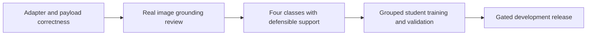

# SPI failure diagnosis — 28 October 2026

The project is blocked at SPI pseudo-label reliability and class support, not at
scheduler optimization. No four-class student exists from the current campaign.
This diagnosis is based on retrieved execution evidence, not model agreement.

| Failure | Evidence | Cause | Correction/status |
|---|---|---|---|
| v2 visual transport failed | 10 raw responses were complete fenced JSON | Parser accepted bare JSON only | Exact complete fence normalization fixed; offline 10/10 replay; v3 completed labeling |
| v3 four-class support failed | 300 labels: Low159, Medium5, High14, Critical119, unknown3 | Current cohort/teacher does not provide sufficient class support | Correctly blocked training; never fill quotas or remove Medium |
| v3 visual evidence unreliable | Bridge above canal described as submerged; dam discharge treated as failure | Written rubric conformance was treated as sufficient entry to image labeling | Freeze 24 development images; compare both teachers on identical tightened prompt; no automatic bulk labeling or promotion |
| v3 direct prompt mostly invalid | Available classes returned non-null reason | Response contract nonconformance | Do not call this classification error; direct arm not used in corrective diagnostic |
| v4 failed before inference | Real reviewer rejected missing text-only flag | Experiment adapter omitted required keyword; mock did not enforce it | Explicit flag/prefix forwarding; real runner boundary regressions added; v5 running |
| v3 export showed cell3 running | ZIP created inside still-open recorder scope | Capture timing | Package only after recorder closes; no rewrite of old evidence |

## What has changed

The adapter now explicitly distinguishes image requests from hypothetical text
controls. Text controls use no-image metadata and an explicit hypothetical-only
prefix. The local test suite exercises the actual orchestration method of both
Qwen adapter classes through template rendering, tensor preparation, scripted
CPU generation, parsing, image receipts, and persisted failure artifacts. GPU
synchronization is stubbed; the processor/model are deterministic fixtures.
This tests software integration, not real model accuracy or GPU compatibility.
Mock fixtures also enforce the actual keyword-only modality contract.

The v5 source is frozen at SHA-256
`11c88ee29e3389be4c36d75d48ae72d174239984c0eec3f7ee32d220e1a90210`.
New local tests do not modify or replace that healthy execution. V5 reuses the
same private notebook, models, data and 24-image diagnostic panel. Its cap is
3600 seconds / 2 aggregate GPU-hours. Actual status and retrieval belong to
`parameters/KAGGLE_RUNS.md`; RUNNING is not a success result.

## Release decision

Passing authored text controls establishes policy conformance on those controls.
Image response validity establishes only transport/schema compliance. Neither
establishes correct urgency. A healthy software path cannot manufacture missing
priority labels or prove immediate danger from ambiguous static images.

Review the known bridge/dam errors and all changed decisive visual claims after
v5. Agreement or a more balanced histogram cannot select the teacher alone.
Repeated decisive hallucinations reject a candidate. Improvement on this exposed
panel requires a separate confirmation panel before bulk labeling. If support
still fails, acquire genuinely distinct supported examples; do not relabel to
fill classes, change final-test splits, or train a superficially four-output
classifier and call it validated. The old three-class model remains historical.

## Evidence

- v3: `runs/20261027_spi_evidence_v3b/retrieved_version3/analysis_recomputed/REPORT.md`
- v4: `runs/run20261028_spi_grounding_v1/retrieved_version4/`
- v5: `runs/run20261028_spi_grounding_v2/`
- Current adapter: `visual_reliability.py`; actual runner tests:
  `test_reviewer_boundary.py`; modality/recovery tests: `test_visual_reliability.py`.
- Canonical journal: `../../parameters/JOURNAL.md`; run identity map:
  `../../parameters/KAGGLE_RUNS.md`.

Remaining limitations: exposed development images, no independent natural-image
urgency gold, no validated general-purpose four-class classifier. No fresh GPU
benchmark, training completion or model promotion is claimed by this document.

## Additional input audit and adapter execution

The actual runner boundary tests passed 14/14 using scripted CPU outputs and
both real adapter methods. All 300 v3 request receipts were audited: correct
source image hash in each request, 300 distinct image hashes and 300 distinct
processed pixel hashes, no missing request receipt, no unintended payload fields,
and thinking OFF verified. There is no evidence of image-routing/pixel-reuse
corruption in this run. This does not turn the VLM's statements into truth.
Evidence is under `runs/reviewer_boundary_20261028/`.
