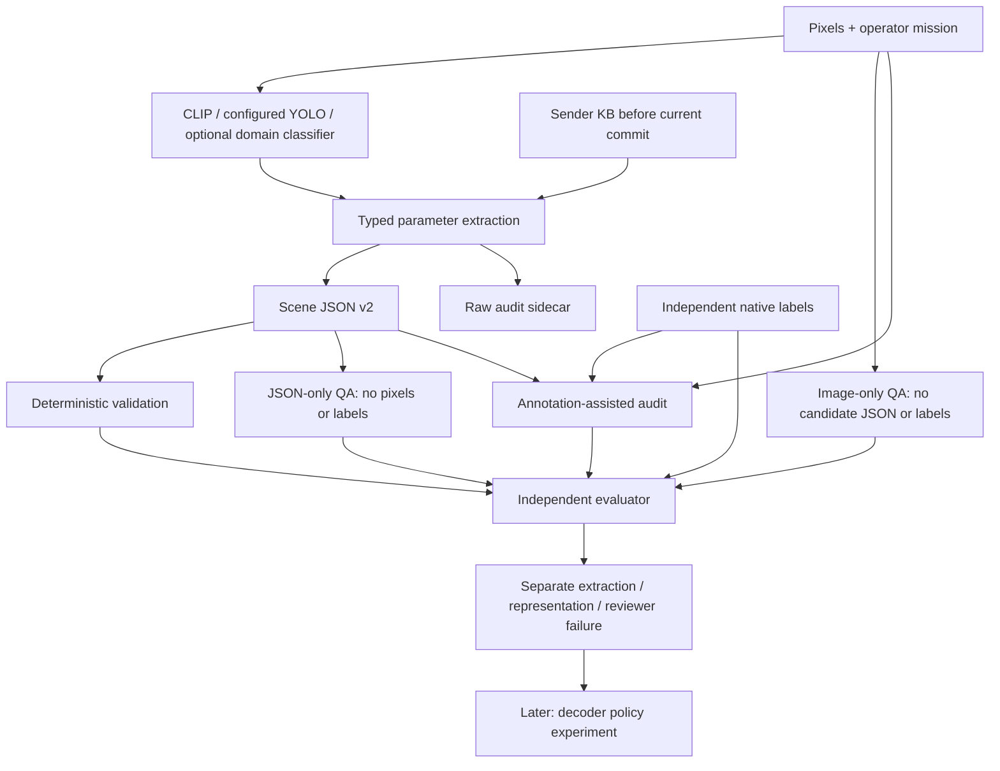

# BetterScheduler engineering handoff

**Sequence update, 26 October:** follow the active phases in [PLAN.md](PLAN.md).
Begin with the Phase 0 SPI data audit/classifier. The v2 reviewer pilot described
below is deferred to optional Phase 2; this handoff remains a source/evidence snapshot.

**Prepared: 26 October 2026, Asia/Kolkata.**

This is the standalone handoff for a teammate and their Codex session. It explains
the objective, contracts, implementation, measured evidence, remaining work and
how to reproduce the local checks without this chat or the original laptop.

For a ready-to-paste assignment use [CODEX_START_HERE.md](CODEX_START_HERE.md).
`PLAN.md` remains the canonical design/decision record. This document is a dated
handoff snapshot, not a second evolving master plan.

## 1. What the project is actually trying to establish

The long-term receiver accepts complete image messages:

```text
UE-A → [ParameterHeader A][CompleteLatentPayload A] ┐
UE-B → [ParameterHeader B][CompleteLatentPayload B] ├→ Ready queue
UE-C → [ParameterHeader C][CompleteLatentPayload C] ┘       ↓
                                                 Select one message
                                                        ↓
                                                   Single decoder
                                                        ↓
                                                Completion or failure
```

This is receiver-side scheduling of already received complete messages. There is
no resource-grant protocol in this study. Radio-resource allocation, encoders,
codebooks and compression models are outside your assigned slice.

The immediate research question is upstream of policy training:

> Does the parameter JSON preserve observable scene evidence needed by the
> operator's mission, including the information required to assess operator
> action urgency? Can an offline VLM judge that reliably?

The user explicitly chose **operator action urgency first; derive decoder priority
afterward**. Visible severity, image novelty, decoder priority and actual urgency
are different quantities. A visually severe old photograph need not require an
immediate operational response.

Do not optimize for more VLM approvals. A positive result can be wrong; a negative
result can expose a real parameter gap or merely a reviewer error. Separate them.

## 2. Current status: what is done and what is not

| Component | Status | Evidence/limitation |
|---|---|---|
| Completion-aware decoder infrastructure | Existing baseline outside this task | Read root PROJECT_MAP; do not rewrite it |
| Image parameter extraction | Implemented and exercised on bounded pilots | Producer coverage/accuracy remain domain-dependent |
| JSON v2 schema/export | Implemented; local contract tests and cache replay passed | Not a compressed transmission header |
| YOLO/CLIP settings audit | Completed locally from source, cached processor and saved cloud provenance | Full resolved old YOLO predictor namespace was not recorded |
| Legacy JSON/Qwen9B review `20261026i` | Complete: 30/30 valid reviews | Reviewer quality gate failed |
| New v2 review/QA/urgency modules | Implemented prototype under local validation | **No new v2 GPU run has been launched** |
| Real whole-scene completeness validation | Not established | Current native labels cover only supported annotated concepts |
| Relationships/interaction extraction | Not enabled | JSON explicitly reports unavailable |
| Real operator-urgency labels | Not available in current pilot | Synthetic policy controls are not real urgency validation |
| New scheduler policy training | Deferred | Do not start while representation/evaluation is unresolved |

The final handoff test receipt is in `handoff/VALIDATION.json`; older evidence
receipts describe older snapshots. Read actual executed checks, not anticipated
counts in historical prose. A green unit test suite does not validate the scientific
claim, the GPU path or the next notebook run.

## 3. Repository, branch and ownership

- Remote: `https://github.com/saltypal/SemanticSchedulerEnd2End.git`.
- Shared branch carrying this handoff: `new-scheduler`.
- Original local checkout:
  `D:\Bunker\BaseCamp\WirelessCommunication\SemanticCommunication\SemanticSchedulerParameterAudit`.
- The main chat's cwd sometimes pointed at sibling `SemanticLossless`; that is
  **not** the implementation root. Resolve the root with `git rev-parse --show-toplevel`.
- The existing base revision before this publication was
  `8947b399c6d0c178fe4cf870aa8a4700a960cf35`. The actual handoff commit is the HEAD
  you fetch from Git; per-file hashes/receipts identify noncommitted experimental snapshots.

Create `teammate/json-v2-validation` from the handoff. Keep edits in a separate
checkout/branch. Do not reset the owner's dirty checkout, share writable runtime
state, force-push or overwrite old runs.

Your assigned ownership is the offline validation modules/configs/tests and
review-specific documentation. Coordinate before changing `scene_json.py`, visual
producer algorithms, task definitions or the decoder scheduler. Preserve others'
work. Root `AGENTS.md` and `PROJECT_MAP.md` describe module boundaries.

## 4. Read these documents in order

1. `CODEX_START_HERE.md` — assignment and authority boundary.
2. This handoff — end-to-end context and execution sequence.
3. `PLAN.md` — current objective plus preserved historical decisions.
4. `docs/OFFLINE_VALIDATION_REDESIGN.md` — three-part experimental design.
5. `docs/SCENE_JSON_V2_AND_MODEL_SETTINGS.md` — schema semantics and full settings.
6. `docs/SEMANTIC_VALIDATION_I_RESULTS.md` — measured legacy-review failures.
7. `JOURNAL.md`, `PARAMETER_DECISIONS.md`, `KAGGLE_RUNS.md` — history, decisions,
   run identity, retrieval paths and limitations.

Older documents mention training grids, strict-key prompts, different source
cohorts and discontinued automatic launch chains. They are historical evidence,
not permission to resume them. The original-image-ID/copy benchmark cannot prove
natural cross-view semantic understanding.

## 5. Data flow and information boundaries



Runtime predictions must never contain `native_labels`, evaluator facts, expected
verdicts, dataset splits or future observations. Annotations are intentionally
visible **only** in the annotation-assisted audit route. That route is not an
independent visual-recognition benchmark.

Sender observation history differs from successful receiver-delivery history.
Novelty is query-before-commit; serial causal commits happen only after successful
serialization/acceptance. The current static UE stream is constructed, not a
natural timestamped disaster video.

## 6. JSON v2 contract

Identifier: `semantic_scene_evidence_v2`. This is our schema version, not a new
version of the JSON standard.

| Section | Contents |
|---|---|
| `observation` | Observation/source/image identity and original dimensions |
| `mission` | Operator context, observable clauses, target categories, unsupported clauses |
| `scene.claims` | Named boolean predictions with status, method, producer and score semantics |
| `scene.detections` | Per-category accepted-box counts and area summaries |
| `scene.relations` | Supported relationship evidence, currently unavailable |
| `measurements` | Context alignment, novelty, rarity, spatial geometry, diversity, temporal/geographic evidence |
| `similarity_signals` | Raw cosine/producer similarities, explicitly not probabilities |
| `diagnostics` | Producer disagreement or caller-declared ontology conflicts |
| `provenance` | Producer identities/settings and optional ontology |

Important invariants:

- `value:false,status:"available"` is a negative assertion, not missing information.
- Unavailable evidence has null value and a reason. Cold start has null value and
  a distinct `cold_start` status. Available zero/empty lists remain valid.
- The score for a sigmoid claim is the **positive-class score**. A score0.1 with
  a negative prediction is not automatically a calibrated90% absence probability.
- No detector box means no accepted detection, not proof of category absence.
- Counts are exact accepted-box integers, not verified real object totals. Area
  is bounding-box area/union, not segmentation area or physical distance.
- Appearance novelty and concept rarity are causal history measurements, not
  event identity, urgency or guaranteed newly revealed information.
- Optional domain ontology rules only flag conflicts. They do not repair predictions
  or manufacture annotation truth. No LADI ontology is implicitly universal.
- V2 preserves a separate raw audit containing original bundle/visual evidence.
  It is not silently compatible with the archived reviewer input format.

The replayed v2 research documents are roughly13–15KB; they include explicit
semantics/provenance. Binary header selection/quantization is a later study. Do
not report JSON bytes as latent payload bytes, complex channel uses or compression.

## 7. Core source map

| File | Responsibility |
|---|---|
| `contracts.py` | MissionSpec, ParameterValue, ParameterBundle, method identities |
| `extractor.py` | Typed visual evidence, causal memory, base extraction |
| `pilot_parameters.py` | Novelty/rarity, canonical categories, scene/geometry summaries |
| `vision.py` | Frozen shared CLIP/SigLIP feature extraction and text/crop policy |
| `pilot_producers.py` | CLIP + configured YOLO-World + optional image-claim provider |
| `image_claims.py` | Optional LADI aerial image classifier, explicit sigmoid decisions |
| `scene_json.py` | Typed runtime evidence to v2 document/audit; schema/invariant validation |
| `build_scene_schema.py` | Generates `schemas/semantic_scene_evidence_v2.schema.json` |
| `scene_json_replay.py` | Hash-checked CPU conversion of retained runtime caches |
| `scene_review.py` | New v2 prompts, controlled cases, payload routing, parser, metrics, synthetic policy |
| `scene_review_run.py` | Prepares six v2 documents and runs bounded offline review |
| `build_scene_review_notebook.py` | Packages immutable private44-call Kaggle notebook |
| `qwen_reviewer.py` | Shared bounded multimodal/text-only generation and legacy wrapper |
| `qwen35_reviewer.py` | Pinned9B NF4 loading and GPU1/kernel checks |
| `annotation_review.py` | Legacy annotation-assisted format; preserve historical protocol versions |
| `semantic_contract.py`, `semantic_panel.py` | Legacy two-building-fact decoding/evaluation |
| `review_only.py`, `build_review_only_notebook.py` | Completed legacy review-only execution path |
| `artifacts.py`, `cloud_notebook.py` | Stage/cell logs, run identity, notebook evidence |
| `handoff_tools.py` | Restore small fixture from Git + public/local image bytes; no models |

The new prototype refactors legacy `.review(...)` through `.review_structured(...)`
so parsers/prompts can be versioned without duplicating inference. Regression tests
must still cover old modality checks, template behavior and response parsing.

## 8. Actual producer settings and their limitations

The h3 extraction used YOLO-Worldv2-small, `yolov8s-worldv2.pt`, Ultralytics8.3.237:

```text
conf=0.05, iou=0.50, imgsz=640, max_det=300
agnostic_nms=false, half=false, augment=false, verbose=false
device=cuda:0, one PIL image per predict call
```

The class default confidence is0.25; the experiment explicitly used0.05.
The16-category default vocabulary is:

```text
building, road, person, car, truck, bus, motorcycle, bicycle,
debris, chair, couch, dining table, television, refrigerator, tree, water
```

Vocabulary is now configurable. Canonical aliases are consistent across boxes
and searched-category status. The recorded vocabulary/settings are part of KB
comparability. Source-derived inherited defaults are not retroactively measured
runtime settings. New code records resolved prediction arguments on future runs.

Shared CLIP: `openai/clip-vit-base-patch32`, pinned revision
`3d74acf9a28c67741b2f4f2ea7635f0aaf6f0268`,224x224RGB,32px patches,512-dim
L2-normalized embeddings, raw cosine,77text tokens including special tokens.
No fine-tuning, softmax probability interpretation or silent truncation. Current
five paragraphs tokenize to30,34,28,23,30tokens. h3 chose native center-crop;
the constructor's aspect-preserving padding alternative remains explicit.

The12native image claims come from the optional
`MITLL/LADI-v2-classifier-small-reference`, revision
`6ba5a0300601284bc6b69dddb46c8991a8ac196c`, native448px crop, sigmoid threshold
`>0.5`. It is aerial-domain evidence, not a universal classifier or a YOLO result.

Confirmed software repairs: threshold propagation, alias/vocabulary consistency,
preprocessing signatures, settings provenance, raw count units and explicit
missingness/cold starts. Unresolved: actual detection accuracy, crop border loss,
weak0.05boxes, text capacity, calibration, relationships and domain transfer.
No model weights were fixed by changing the JSON.

## 9. Measured results you must preserve

| Evidence | Result | Correct interpretation |
|---|---|---|
| JSON-v2 local checkpoint |92tests passed;19focused checks passed | Contract/software validation, not visual accuracy |
| Cached v2 replay |15observations,12unique images,180classifier claim values preserved | Transformation preservation; no new inference |
| Optional ontology |5warnings with LADI rules,0without rules | Configuration-driven consistency checks, not newly discovered ground truth |
| h3 extraction |24/24comparisons correct for two primary building facts | Narrow development panel; secondary heads have errors |
| Legacy9B run i |30/30valid outputs; thinkingOFF; noOOM;617.17sworker | Runtime succeeded |
| i controls |16/24joint correctness; consistencyBA0.7083,sufficiencyBA0.75 | Reviewer gate failed |
| i actual JSONs |4/6accepted;2false rejections | Reviewer confused available negative claims with missing information |
| i artifact audit |69/69output entries and69/69submitted source ZIP entries verified | Full runtime source .py tree was not individually retrieved |

All six actual legacy-review representations matched the **two primary building
facts**; this does not establish all12heads or every scalar parameter. Do not
turn4/6review approvals into parameter accuracy. Eight native answers in the new
six-parent broader question cohort differ between extracted JSON and reference;
verify the exact count from the current prepared cases before quoting it.

Old h/h2a runs failed before inference or during environment setup; f/g/c/e had
different prompts/cohorts. Preserve their documented scopes. The completed i
review used old JSON, not v2. No v2 reviewer accuracy has yet been measured.

## 10. New44-call experiment: exact design

Six previously exposed development parents; source h3 preserves12full parents.

| Route | Calls | Inputs visible to Qwen | Scoring |
|---|---:|---|---|
| Annotation-assisted audit |30|Image, v2JSON, requested facts, known reference facts|Per-claim judgments and final consistency/sufficiency |
| JSON-only QA |6|JSON, mission, requested questions, policy/context; **no pixels/labels**|Encoded-answer fidelity and independent native accuracy separately |
| Image-only QA |6|Image, mission, questions, policy/context; **no candidate/labels**|Native fact accuracy; missing relation reference ungraded |
| Synthetic policy context |2|Same JSON with fresh vs stale declared context|Policy-following engineering control only |

Each audit parent supplies actual, complete-control, omitted, flipped and masked
variants. Control values use independent labels and are explicitly evaluator
constructions, not repaired extraction. The controlled target is building
affectedness. Reference unknowns remain unknown.

QA asks all supported native facts plus a person-inside-building relation probe.
The latter has no independent label in this cohort: do not score a null reference
as verified absence. JSON-only encoded-answer fidelity may test whether the model
correctly notices the missing relation, while image-route visual correctness for
that relation remains ungradable.

The synthetic policy is `synthetic_inspection_response_v1`: only trusted recent
evidence can yield a response-window decision; stale/missing time is indeterminate,
not automatically low urgency.30minute/24hourwindows are arbitrary **engineering
fixtures**, not expert medical/emergency recommendations. They do not establish
what a real operator should do. The old mission text forbidding urgency inference
stays intact; the new payload separately declares the action policy.

Metrics distinguish:

- Reference fact correctness versus what the JSON actually encoded.
- Reference-based synthetic urgency correctness versus following the policy using
  route-available evidence. A wrong extractor prediction can still be followed
  faithfully; that must not be called a policy-reasoning failure.
- Attempted, valid, invalid and unattempted cases, per route/arm.
- Unknown-reference counts, exact denominators, memory, latency and token limits.
- Reviewer controls and actual outputs: never pool them into one accuracy score.

The pilot gate uses95%valid,80%BAperendpoint,75%perclass/controlledarm. These are
engineering gates on exposed data, not statistical certification. The new v2
audit is an explicit inventory contract; do not compare it as identical to the
legacy v5 logical-closure rubric. Whole-scene/real-urgency flags remain false.

## 11. Known open issues and checks before launch

**Do not call this notebook ready merely because it builds.**

1. Current control construction assumes every requested native fact has a claim
   row. That holds for this frozen classifier cohort, not arbitrary producers.
   Generalize explicitly or restrict/validate the constructor before wider use.
2. The new prototype needs a full real-document memory/token preflight under its
   512output-token setting. The old192-token i run cannot certify this workload.
3. Both manifests must show1800server/1650internal seconds/1aggregateGPUhour.
   An adviser reported an inherited-manifest risk. The base builder already
   synchronizes manifests, and the scene builder now sets limits explicitly;
   still verify actual built artifacts before choosing a CLI timeout.
4. A scoring concern was corrected during handoff: `policy_following_correct`
   now uses route-available facts separately from `urgency_correct` based on
   reference facts. A regression covers wrong extracted presence. Recheck it.
5. The encoded-answer denominator exists separately from native-fact counts;
   relation questions are ungraded on reference accuracy.
6. Shared reviewer refactoring must preserve legacy behavior and failure logging.
7. Operator urgency remains unsupported as a real-world outcome without suitable
   labels/context. Do not close this gap with Qwen-generated truth.
8. Whole-scene relations, natural cross-view complementarity and broad non-disaster
   coverage need compatible datasets/annotations. Six aerial parents do not suffice.
9. The old monitor had a Windows Unicode retrieval error and faulty terminal retry
   handling. Do not copy it blindly. Use status-only polling, bounded retrieval
   attempts, explicit UTF-8 and local checksum verification before redownloading.
10. Check access to private h3 outputs. The owner's private notebook is not
    automatically available to a teammate's account; do not share API keys.

## 12. Get a clean checkout and local environment

Use the Git-hosted branch and a separate checkout. Example PowerShell:

```powershell
# Git LFS should be installed; avoid fetching unrelated model/result blobs.
$env:GIT_LFS_SKIP_SMUDGE = '1'
git clone --filter=blob:none --branch new-scheduler https://github.com/saltypal/SemanticSchedulerEnd2End.git
Set-Location SemanticSchedulerEnd2End
git switch -c teammate/json-v2-validation
git status --short
git rev-parse HEAD
Remove-Item Env:GIT_LFS_SKIP_SMUDGE

# Reuse a suitable project environment if it already exists.
py -3.12 -m venv .venv
& '.venv\Scripts\python.exe' -m pip install --upgrade pip
& '.venv\Scripts\python.exe' -m pip install torch torchvision --index-url https://download.pytorch.org/whl/cpu
& '.venv\Scripts\python.exe' -m pip install -r BetterScheduler/environment/requirements-handoff.txt
& '.venv\Scripts\python.exe' -c "import sys,torch,torchvision,transformers; print(sys.executable,sys.version); print(torch.__version__,torchvision.__version__,transformers.__version__)"
```

On Linux use `python3.12 -m venv .venv` and `.venv/bin/python`. These setup
commands are a teammate bootstrap route; they have not been executed on their
machine. Resolve installation failures from the actual environment, not by silently
falling back to a global interpreter. Local tests need no CUDA GPU or Qwen weights.
Choose a matching Torch/Torchvision build from the official installation guide:
https://pytorch.org/get-started/locally/.
The observed original environment is saved in `handoff/evidence/LOCAL_ENVIRONMENT.json`;
it is provenance, not a cross-platform lockfile.

The original working environment was the sibling
`SemanticSchedulerEnd2End\.venv\Scripts\python.exe`, Python3.12.14. An accidental
global Python3.14 test run emitted an access-violation trace despite an exit0;
it was not accepted as the project validation. Do not repeat that fallback.

Kaggle uses its managed environment, not the local .venv. The9B-only notebook pins
Transformers5.3.0, Accelerate1.12.0, bitsandbytes0.49.2 and Hub1.5.0 while retaining
managed matching Torch/Torchvision. These are intentionally different from the
local4.57.6/Hub0.36.2 development stack. Keep them separate.

## 13. What is included in Git and what is not

Included: project source/config/schema/tests; diagrams/docs; executable notebook
builders and the laptop teaching notebook; a small handoff evidence pack containing
exact h3 metadata/prediction caches, legacy i reviews/raw reasons/metrics/provenance,
v2 example documents, settings and selected validation receipts.

`handoff/evidence/EVIDENCE_MANIFEST.json` records copied bytes and source hashes.
`h3/FIXTURE_MANIFEST.json` identifies the exact consumed subset. Historical run
manifests list files outside this subset; do not claim all those original files
were copied. Original absolute paths are provenance, not portable filesystem routes.

Excluded from new Git content: raw prepared datasets, model weights, temporary
environments, generated Kaggle staging packages, credentials and redundant bulk
logs/caches. They remain on the owner's disk. KAGGLE_RUNS documents remote source
and output identities. Git is not a multi-GB dataset/model artifact store.

No raw image is needed to inspect v2 JSONs/metrics. Restore the12pilot images
before running the fixture-dependent integration tests:

```powershell
# Downloads about5.5MB from official refreshed public image routes, verifies
# native labels/revision and pixel hashes; max20MB total; no model inference.
& '.venv\Scripts\python.exe' -m BetterScheduler.handoff_tools --download-images

# If the original h3 outputs are already available, use their data/images instead:
# & '.venv\Scripts\python.exe' -m BetterScheduler.handoff_tools --image-source 'PATH_TO_H3_RUN'
```

The command restores the exact compatibility fixture location expected by existing
tests under ignored `BetterScheduler/results/ops/.../20261026h3`. It refuses
overwrite and records RESTORE_STATUS. It does not recreate missing old reviewer
outputs or pretend a new experiment occurred. If public access/schema has changed,
stop, preserve the error and retrieve the original bytes legitimately; do not
substitute different images under the same identity.

For a different destination add `--output FRESH_PATH`; then use that path for
replay/prepare. The existing tests currently expect the default compatibility path.
Without restored images, fixture-dependent tests skip or cannot execute. Report
that difference; do not announce full integration validation from synthetic tests.

## 14. Exact first local build/test sequence

```powershell
$env:PYTHONUTF8 = '1'
$env:OMP_NUM_THREADS = '1'
$env:OPENBLAS_NUM_THREADS = '1'
$env:MKL_NUM_THREADS = '1'
& '.venv\Scripts\python.exe' -m pytest BetterScheduler/tests -q
& '.venv\Scripts\python.exe' -m pytest BetterScheduler/tests/test_scene_review.py BetterScheduler/tests/test_scene_json.py BetterScheduler/tests/test_review_only.py -q

# Build only; this does not submit to Kaggle or load a model.
& '.venv\Scripts\python.exe' -m BetterScheduler.build_scene_review_notebook --output BetterScheduler/staging/TEAM_UNIQUE_TAG --tag TEAM_UNIQUE_TAG
```

Use a genuinely new output directory/tag for every build/run. The builders refuse
collisions. No deleting a previous run just to make the command work.

Then inspect:

- `pilot_manifest.json` and `review_manifest.json`: limits,44calls,thinkingOFF,
  exact upstream identity, source ZIP hash and intended purpose agree.
- `kernel-metadata.json`: private, T4, one h3 upstream, correct owner/canonical slug.
- All four notebook code cells compile; embedded ZIP equals staged ZIP; every
  archived source/config entry matches its source manifest.
- `scene_review_run.prepare` produces six documents/44cases on the restored
  cache without model inference. Verify references stay out of runtime documents.
- Tests prove route isolation and label poisoning cannot alter JSON-only inputs.
- Unknown relation answers are ungradable on reference accuracy; synthetic times
  remain evaluator engineering context, not source capture timestamps.

Save an interpreter/package/source receipt, actual commands, stdout/stderr, skip
counts and any failures to one new run folder. Tests are not model inference.
The root guidance references `scripts/refresh_graph.py`, which is absent in this
checkout; do not install unrelated tooling to disguise that gap.

## 15. Next milestones and acceptance

### M1 — Reproduce and inspect

Deliver LOCAL_VALIDATION_REPORT with restored artifact hashes, tests, route examples,
three actual JSON/image observations and a concise list of confirmed issues versus
untested concerns. No remote run is required.

### M2 — Correct the evaluation interface

Validate the known limitations in section11. Preserve native-answer accuracy,
encoded-answer fidelity and policy-following as separate metrics. Add cases with
wrong/missing producer predictions and contradictory/masked values. Bound unknown
reference semantics. Version any material rubric change; do not rescore old runs
as though they used it originally.

### M3 — One bounded pilot

Only after the owner accepts M1/M2, run one private notebook under the declared
budget. Largest real JSON first, then JSON-only and image-only preflight. Verify
actual image tensors/text-only absence, finite logits, NF4 modules, GPU1 placement,
thinkingOFF and measured memory/time. A partial/failed run is an outcome; do not
retry automatically or change gates after seeing the result.

### M4 — Interpret and decide

Recompute saved metrics independently, inspect raw errors and verify artifact
hashes/retrieval. Show extraction errors, omitted information, model hallucinations,
format failures and unsupported truth separately. Decide whether to repair a
producer, simplify the reviewer input, change a rubric or collect better labels.

### M5 — Broaden only when justified

Add compatible ordinary/non-disaster images and relations only when independent
annotations support them. Group duplicates/parent crops/events before splitting.
Existing exposed pilots stay development-only. Do not invent certainty about
natural cross-view novelty, severity or urgency. Parameter selection/scheduler
training is a later stage with its own strong baselines and independent evaluation.

## 16. Remote operations and recovery rules

- No paid API. Current Kaggle quota/access must be checked; old snapshots expire.
  `kaggle quota --format json` was available in the working CLI/SDK; do not assume
  quota is unavailable just because you missed the command. Redact credentials.
- Do not share the owner's account key. Private upstream access must be legitimate.
  Use collaboration access or a separately versioned input under the teammate's
  account, preserving the same bytes and identities.
- Exact proposed CLI timeout:1800seconds; internal1650; two allocated GPUs count
  toward one aggregate GPU-hour even though GPU0 performs no inference.
- Before launch record notebook/version/tag, source hashes, input IDs, quotas,
  actual timeout and expected artifact map in KAGGLE_RUNS.
- Status-only polling is sufficient. Do not block on a live session-output API.
- Incrementally flush raw responses, metrics and progress; keep executed notebook
  and per-cell logs. Verify actual persistence; `/kaggle/working` alone is not proof.
- On terminal status inspect experiment status before interpreting Kaggle COMPLETE.
  Compare existing local files to hashes before redownloading after an encoding error.
- Bound terminal-retrieval retries independently; a reset counter can otherwise
  loop after the job ends. Never relaunch inference to fix a download problem.
- The new v2 experiment has not been launched, so there are no v2 GPU results to
  retrieve or claim. Check actual account state before any new submission.

## 17. Team communication and final deliverables

Send the owner a commit/branch plus one clear report containing:

1. What changed and why, with artifact paths.
2. What actually ran: local/static/mock/model/GPU, exact scope and environment.
3. Tests/failures/skips, source/config/data identity and output verification.
4. Per-route/per-arm metrics, denominators and concrete raw error examples.
5. What the evidence establishes and its limits.
6. Next smallest useful action and any decision needed.

Stop broadening when label validity or missing runtime information explains the
failure. Do not add RL, fleets of YOLO models or a new VLM to avoid diagnosing the
existing question. Negative findings are useful. No claim about operational lives
saved, journal readiness, universal representation or urgency accuracy follows
from this pilot alone.
