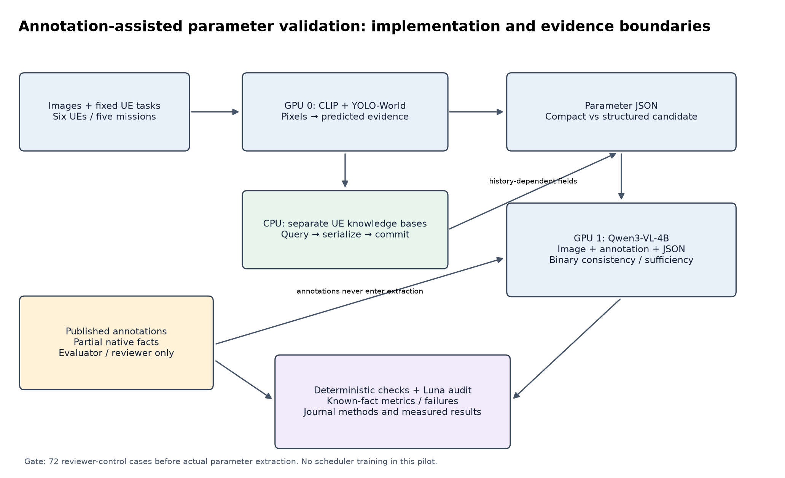
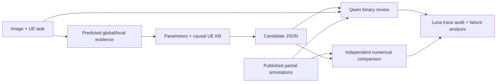
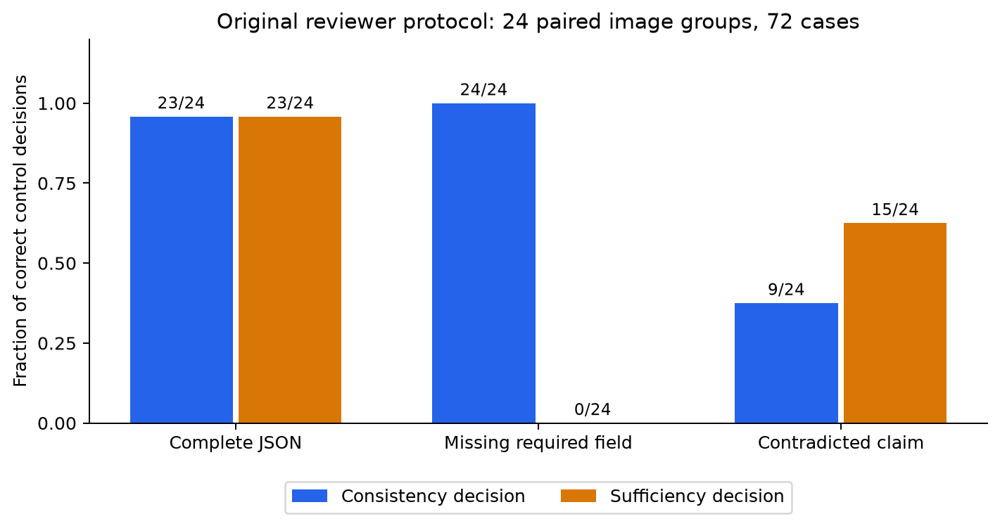
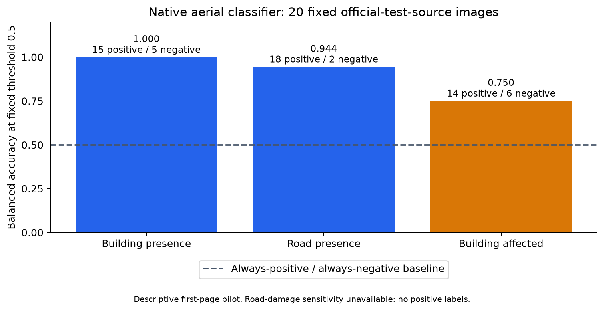
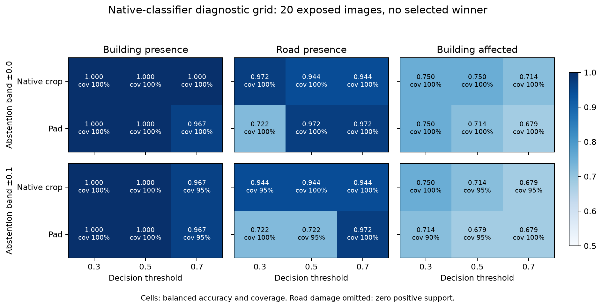
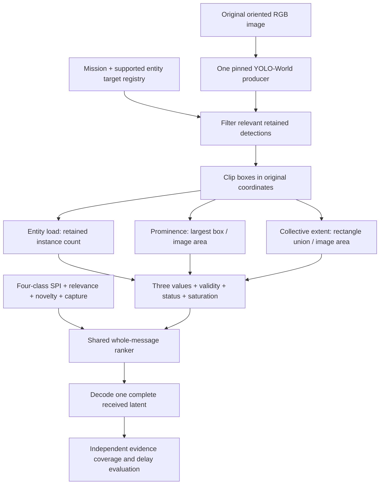

# BetterScheduler research journal: parameter representation validation

Working methods and evidence record,25October2026. This is a research prototype
journal,not a submission-ready paper or a claim of universal best parameters.
New scheduler development is staged in BetterScheduler. This increment validates
the parameter representation;policy training and codec comparisons are deferred.

## Review-only execution authorized after h3

Terminal result:all30reviews completed,all valid JSON,thinkingOFF throughout,noOOM.
Independent recomputation matched saved metrics. Controls:16/24jointcorrect,
BA0.7083forconsistency and0.75forsufficiency; predefined gatefailed. RealJSONs:
4/6accepted;two explicit available negative building claims were wrongly called
missing byQwen. All six match the two native building facts independently;do not
interpret4/6review approvals as parameter accuracy. Maxinput5159tokens,peakallocated
11.811GiB. See `docs/SEMANTIC_VALIDATION_I_RESULTS.md` for examples and limitations.

The user requested immediate review execution. The new `20261026i` run uses only
Qwen3.5-9B with thinking OFF and the existing 24 controls plus six real JSONs.
The largest serialized actual candidate is first, followed by three technical
controls. This is a practical memory check, not proof it is the largest tokenized
input. Exact predictions, references and v5 prompt remain unchanged; no extraction
or 4B inference is repeated. Cached inputs are pinned by manifest/checksum hashes,
verified before weights load and copied with only image paths rewritten.

Generation explicitly uses `logits_to_keep=1`, supported by both pinned Qwen
implementations. This avoids requesting full-position vocabulary projections;
it does not establish the cause of the earlier OOM. Input-token telemetry now
survives generation failures. The 9B-only notebook installs pinned packages in the
fresh managed kernel while preserving Torch/CUDA. No older imported Transformer
state is reused. Two assigned T4s are budgeted even though only GPU1 runs inference.
Server cap1800s/internal1650s; no automatic retry.

Local checks:83tests passed in12.72s under the project Python3.12.14 environment.
A preceding global-Python3.14 run also returned83passes but emitted an import-time
access-violation trace; it is preserved as wrong-environment evidence and was not
used as the accepted project test. A later builder-only fix synchronizes the two
package manifests; its targeted checks and frozen package receipts are recorded
in `results/ops/20261025T2356Z/review_only_package/`. Medium found no launch blocker.
Source ZIP:`6cd5e8abc3d99113eff24b53a7b601bf0bc08db6687eae2e5caf08828b01a566`.
Kaggle returned a canonical slug differing from the requested metadata ID; the
actual RUNNING URL is recorded in KAGGLE_RUNS. No model-quality result is implied.

Primary mechanism references:
[Qwen3.5 forward](https://github.com/huggingface/transformers/blob/v5.3.0/src/transformers/models/qwen3_5/modeling_qwen3_5.py)
and [Qwen3-VL forward](https://github.com/huggingface/transformers/blob/v4.57.6/src/transformers/models/qwen3_vl/modeling_qwen3_vl.py).

## h3 results-analysis checkpoint

Terminal h3 findings are in `docs/SEMANTIC_VALIDATION_H3_RESULTS.md`. Extraction
completed; 4B passed JSON parsing but approved all controls, then hit OOM on its
first actual JSON. 9B ran genuine NF4 on GPU1 with thinking OFF, returned three
controls and stopped at the fixed runtime projection gate. Overall status is
partial; no successful actual-JSON review and no evidence for promoting 9B.
Independent recomputation passed. No further GPU retry was launched.

The frozen remote h3 experiment was left unchanged during analysis review.
Medium found two local verifier issues: incremental reviews could not be analysed
without final metrics/provenance files, and some summaries pooled constructed
controls with real extractor cases. The analysis script now marks absent final
files explicitly, recomputes partial evidence, separates both arms and compares
only common attempted identities, retaining invalid answers. Incomplete subsets
are descriptive and cannot qualify the planned control gate.

Verification against retrieved h2a results passed. A copied-fixture check withholding
both final files recovered all three saved reviews, invented no paired cases and
preserved the source artifacts. Evidence:
`results/ops/20261026_semantic_validation/partial_verifier_check.json`.
These are analysis checks in addition to the frozen 80-test production checkpoint.

## Research objective

### Teammate/Codex transfer and Git publication checkpoint

The user requested a detailed standalone transfer and all project work on Git.
HANDOFF.md and CODEX_START_HERE.md provide the mission, current measured status,
contracts, information boundaries, code ownership, setup/recovery commands,
known limitations and staged acceptance. No new v2 GPU run was launched.

A bounded95-file evidence subset (about2.5MB before handoff additions) preserves
original h3 metadata/runtime predictions, legacy i reviews/raw reasons, v2 JSONs,
settings and validation receipts. Copies retain original hashes; model weights,
raw images, multi-GB datasets and generated staging are not newly uploaded.
Original local artifacts remain untouched. The fixture helper can verify/restore
the12public pilot images without model inference. Hash-pinned evidence attributes
prevent Windows/Linux line-ending conversion from invalidating copied checksums.

An adviser raised inherited package-budget ambiguity. The base builder already
synchronizes manifests; the final scene builder now additionally sets1800/1650s
and1aggregateGPUhour explicitly. A genuine metric limitation was corrected:
policy_following_correct now evaluates route-available facts separately from
reference-based urgency_correct. A regression demonstrates a wrong extraction
followed faithfully, avoiding misattributing extraction error to policy reasoning.
This is a software correction, not a new reviewer or urgency result.

The full local handoff suite/source identity is recorded in
handoff/VALIDATION.json. Raw historical results remain intact; the new44-call
experiment still needs its real full-document preflight and acceptance checks.

### Objective clarification: operator action urgency

The user explicitly selected operator action urgency first, then derived decoder
priority. The revised design is `docs/OFFLINE_VALIDATION_REDESIGN.md`; PLAN.md
links it as the current objective. No new experiment was launched. Existing
mission profiles prohibit urgency inference and remain historical evidence tasks.
The old Qwen run checked legacy JSON, not v2; neither its approval rate nor the
92schema/component tests establish whole-scene or urgency validity.

The proposed offline evaluation separates factual representation, independently
scored JSON-only task answerability and supported urgency judgments. Qwen must
pass controls; no model agreement is substituted for independent labels. Current
relation extraction is unfinished, and existing LADI labels do not establish
operator urgency. Unknowns distinguish missing producer capability, failure,
untrusted metadata, insufficient visual evidence and causal KB cold start.

### Domain-independent JSON redesign and settings audit — 26 October 2026

Implemented `scene_json.py`, a versioned JSON Schema, a single-pass extraction
wrapper and checksum-verified cache converter. Claims are boolean predictions
with explicit availability, producer and positive-class score semantics.
Accepted-box category counts/areas are distinguished from true object counts.
Scene relationships are unavailable when no producer supports them. Measurements
include raw context cosine and causal history; cold starts export null rather
than treating the legacy maximum sentinel as observed novelty or rarity.
All raw values, boxes and supporting calculations remain in a separate audit.

The structure is domain-independent; models are not. Optional LADI ontology rules
flag potentially inconsistent native predictions without repairing them. No
automatic fusion, new priority score or disaster-specific schema field was added.
The existing legacy JSON and archived reviewer results remain unchanged. V2 has
not been evaluated by a VLM and must not be fed silently into the old v5 prompt.

Medium identified two confirmed faults in the initial draft: unrestricted claim
value typing and raw-vocabulary/canonical-detection mismatch (`cars` vs `car`).
Both were corrected with focused regressions. An unused intermediate detection
collection was removed. New provenance records actual CLIP processor/text settings
and resolved YOLO prediction settings for future inference, including an explicitly
configurable detector vocabulary. No crop/threshold/precision defaults were tuned.

Validation:92tests passed in13.38s under the existing End2End Python3.12.14 env;
19affected tests passed8.22s. Replay15observations from12saved images preserves
180matching classifier claim values; this is not blanket preservation of every
legacy field or a new accuracy result. Three cold starts become unavailable
comparisons. With explicit LADI rules the saved conversion shows5warnings; without
domain rules the fresh replay has0ontology warnings. The source trace physically
contains evaluator-side audit fields, but export consumes runtime bundle/evidence
and identity fields only; evaluator case files are not read.

Canonical UTF-8 document sizes in the explicit-ontology conversion range from
13,061 to15,261bytes, compared with9,791to9,980legacy bytes. V2 is more explicit,
not a compression result. Audit sidecars are larger and remain research artifacts;
no binary header, payload size or channel-use saving is claimed.

Settings audit saved the complete pinned YOLO defaults, current overrides, cached
CLIP config/processor, actual h3 provenance and hashes. Processor-only test on a
synthetic1200x800RGB image produced1x3x224x224; current mission token counts are
30,34,28,23,30, all below77. No weights were loaded and no model inference ran.
Historical h3 explicitly used YOLOconf0.05(native classdefault0.25),IoU0.5,imgsz640;
shared CLIP used checkpoint-native crop rather than its constructor's padding
default. Native LADI classifier claims remain aerial-domain evidence.

Design and diagram: `docs/SCENE_JSON_V2_AND_MODEL_SETTINGS.md`.
Validation/config artifacts: `results/local/json_v2_20261026/`.
The repository-requested `scripts/refresh_graph.py` is absent in this checkout;
no unrelated graph tooling was installed. Source hashes in validation receipts
identify the tested implementation despite the existing uncommitted checkout.

Determine whether an interpretable parameter representation faithfully describes
scene characteristics relevant to a declared UE task,and whether it omits
necessary information. Separate extraction errors,representation information loss,
reviewer failures and missing reference evidence. A positive VLM verdict alone
does not establish correctness,optimality or operational emergency usefulness.

The latest user-selected protocol supplies the offline reviewer with **image,
published annotations,UE mission and extracted parameter JSON**. Annotations are
intentionally visible to the reviewer and evaluator,but never to extraction.
This is annotation-assisted auditing,not blind visual recognition evaluation.

## Workflow and information boundaries

GPU0 owns CLIP and one YOLO-World producer. GPU1 owns Qwen3-VL-4B-Instruct.
CPU code owns causal sender memories,geometry,frequency,metadata,serialization
and numerical evaluation. Both GPUs are explicitly bound;their memory is not
pooled. This role partition supersedes the previous DataParallel design.

Model/prompt/source hashes,preprocessing,history identities and raw responses
are persisted. Rich producer evidence and actual candidate JSON are kept separate.
An evaluator-only fact label must not become a runtime parameter feature.

## UE contexts and knowledge bases

Six simulatedUEs are bound to five fixed operator tasks in config/ue_task_profiles.json.
UE01/UE02 are building-inspection drones sharing identical text but independent
histories. UE03 surveys road blockage;UE04 documents road damage;UE05 inventories
household items;UE06 documents informative incident imagery. Hardware identity
does not assign priority. One image can be relevant to several tasks.

KB identity is UE+missionversion. Query before adding the current observation;
commit only after the candidate record serializes. PilotMemory retains normalized
embeddings,predicted concept presence and immutable prior-observation references.
Novelty/rarity are recomputed for history;they are not fixed image properties.
Receiver delivered history is distinct from a sender's observation history.

## Why these parameters and how each is evaluated

| Candidate | Mechanism and rationale | Validation / limitation |
|---|---|---|
| Context relevance | CLIP cosine between normalized image and fixed task text;retain task/mission identity | Compare native-compatible task facts and crossed task controls. Cosine is alignment,not calibrated importance |
| Novelty | Nearest prior embedding distance plus separately exposed predicted-concept changes | Exact repeats,causal history cases,new concepts. Does not establish natural asset identity or new disaster |
| Scarcity | Smoothed per-concept predicted-presence frequency in sender history | Hand-counted frequency references,cold start and window effects. Rarity is not urgency |
| Spatial prominence | Canonical relevant-target box extent,count and union area | Numerical geometry and compatible box/mask truth. Boxes do not give physical distance or exact visible-pixel area |
| Scene complexity | Relevant counts/coverage,class diversity and all-object diagnostic | Check raw counts,clutter/overlap and task dependence. Not a certified semantic-depth score |
| Scene/condition evidence | Named object presence and uncalibrated positive/negative CLIP condition contrasts | Native fact comparison and binary reviewer audit;false claims preserved rather than relabeled |
| Reliability | Claim/entity detection score and explicit calibration state | Per-claim correctness;do not interpret high score as high priority or proof |
| Time/deadline | Trusted timestamps and operator delay | Deterministic age/deadline/slack checks;static missing fields unavailable |
| Geography/source | Trusted mission-region metadata and source provenance | Unsupported metadata unavailable;source type is not importance |
| Task importance | Historical weightedIonly as baseline | No new arbitrary weighted score;mission facts and future declared decision objective remain separate |

### Numerical conventions

For normalized image/task features,`R_raw=e_image·e_task`. The existing bundle
maps it to`(R_raw+1)/2`;both values must retain their interpretation. With unit
history embeddings,appearance novelty is`(1-max cosine)/2`;cold start is explicit.

For a predicted concept c observed in h of N valid prior frames,
`p(c)=(h+1)/(N+2)`. Store raw surprisal`-ln p(c)` and normalize by`ln(N+2)` for
the bounded candidate field. The population is predicted sender observations,
not true event prevalence. No detections and unavailable detector are distinct.

Clipped normalized rectangle extent is`(x1-x0)(y1-y0)/(WH)`. Aggregate rectangle
union area instead of summing overlaps. Canonical aliases preserve TV/television
and vehicle-subclass applicability. Counts remain reported in raw units as well
as declared bounded summaries.

### Representation variants

The compact view contains generic parameter summaries and only facts deterministically
recoverable from them. The structured view additionally exposes named entity and
condition predictions from the same producer cache. This tests an information
extension,not a stronger policy with secretly different data. Actual final wire
selection is deferred;JSON audit size is not latent payload size.

## Data and reference validity

Prepared cohort verified by metadata retrieval:7,555 merged image records,
4,793LADI and2,762MEDIC. Downloaded14,392,072,243bytes. MEDIC is partial due to
HTTP500;conflicting affected-people labels are retained in its conflict report.
Event-level independence and natural view correspondence are not established.
The bounded pilot selects and hashes only its used development images,not the
whole14GB again. All touched groups are recorded as development-exposed.

Reference adapter preserves exact supported native facts. In particular,
`building.affected_or_greater` maps to LADI's native field,not an asserted
equivalence to every possible visible damage. Road damage is not road blockage.
MEDIC informativeness does not imply injury or building-specific damage. No
ordinary-household annotation cohort is available in the prepared snapshot;
household and road-blockage reference completeness can therefore be unavailable.
Those task cells must not be scored as negative or independently validated.

## VLM selection rationale

Qwen3-VL-4B-Instruct is the primary candidate based on its public instruction-tuned
weights,small-model visual benchmark evidence and plausible singleGPU footprint.
FP16 weights alone are approximately8GB for4Bparameters;actual vision/KV/runtime
memory must be measured. Gemma3 4B is a conditional comparator/fallback,not a
measured inferior method. Official published values:

| Benchmark | Qwen3-VL4B Instruct | Gemma3 4B IT |
|---|---:|---:|
| MMMU validation |67.4|48.8|
| MathVista mini/testmini |73.7|50.0|

These vendor-reported settings are not an identical local evaluation or evidence
of reliable disaster-image auditing. Benchmark figure/hash and sources are saved
in docs/evidence/vlm_benchmark_sources_20261025.json. No speed/memory/quality
advantage from this pilot is asserted before real outputs are retrieved.

## Reviewer controls and endpoints

Twenty-four reference-supported parent images produce72cases:complete-compatible,
incomplete-compatible,and contradicted. Their evaluator answer keys are not sent
to Qwen. The published partial annotation reference is intentionally sent.

- `parameters_consistent`:assessed assertions do not contradict supplied evidence.
- `representation_sufficient`:consistent AND all required mission facts are represented.

Each case has a frozen required-fact rubric. Unknown reference facts are not
negatives. Exact cosine,geometry,frequency,time and calibration are numerical/
reference checks,not values a VLM can certify from pixels alone. Control labels
can let a text-only auditor pass:the protocol therefore claims annotation-assisted
auditing only. Distinct-pixel inputs/device/tensor receipts check the vision path,
not visual recognition correctness.

The primary engineering gate requires>=95%valid strictJSON,>=80%balanced accuracy
on each endpoint,>=75%correct fraction in each reference class,and>=75%omission
rejection. Invalid outputs remain in relevant denominators. Always-yes/no reviewers
fail. These prespecified pilot gates are not statistical proof of broad reliability.
Raw outputs persist;no repeated generation until a preferred verdict appears.

## Implementation and tests

Canonical new modules:pilot_parameters.py,pilot_producers.py,annotation_review.py,
qwen_reviewer.py,annotation_pilot.py and build_annotation_notebook.py. Existing
core/contracts and historical pilots remain preserved. The Python environment
is the existing sibling SemanticSchedulerEnd2End/.venv;cloud uses its managed
runtime with recorded pinned installs rather than pretending the local venv transfers.

| Checkpoint | Observed test result | What it supports |
|---|---|---|
| Existing core/profile checkpoint |28tests passed in prior recorded run | Contracts,profiles and independent sender KBs;not real VLM accuracy |
| First new module pass |36tests passed,5.31s | Initial review/parser/geometry/concept-history paths |
| After review fixes |37tests passed,2.84s | Duplicate/unknown IDs,invalid fact-value accounting and atomic sidecar handling |
| Focused orchestration failure tests |11tests passed,3.91s | Includes synthetic/mocked technical-failure and degenerate-reviewer paths;producer never loads after failed gate |
| Final pinned suite |39 tests passed,5.42s | Luna execution;44 Python source hashes unchanged before/after; numerical and mocked integration scope |

Final suite receipts: `results/ops/20261025T114950Z/annotation_pilot_validation/`.
The source archive also passed isolated imports, all 41 packaged file checksums,
and compilation of every notebook code cell. These checks do not run GPU models.

### Remote pilot result — 25 October 2026

Private pilot `satyapaladugu/betterscheduler-annotation-pilot-20261025c`, version1,
completed. Two Tesla T4 GPUs were present; Qwen3-VL-4B-Instruct loaded on GPU1 in
FP16, 9.36GB peak allocated on that device. The model and parser processed all 72
cases: 72/72 outputs parsed as valid JSON. The reviewer-control gate **failed**;
the producer never loaded and no semantic parameters were extracted. This is an
intentional early-stop result, not a failed notebook execution.

| Control arm | Cases | Called sufficient | Correct sufficiency decisions | Consistency findings |
|---|---:|---:|---:|---|
| Complete JSON | 24 | 23 | 23/24 | 23 consistent; one false alarm |
| Required damage field omitted | 24 | **24** | **0/24** | All 24 called consistent |
| Damage claim contradicted reference | 24 | 9 | 15/24 | Only 9/24 contradictions flagged |

The bars show correct decisions per24paired image groups in each arm. Counts are
descriptive;72cases are not72independent images. The figure is recomputed from
saved case definitions and raw parsed reviews; supporting counts/digests are in
`docs/figures/reviewer_v1_controls.json`.

Across all controls, sufficiency balanced accuracy was0.6354 and consistency
balanced accuracy0.6771. The predeclared omission-rejection requirement was at
least0.75; observed omission rejection was **0/24 (0%)**. Valid-output fraction
was1.0. The model tends to infer the omitted fact from the visible image and
annotation, then judges the representation as if that fact were present in the
JSON. In some contradiction responses its reason explicitly describes a mismatch
while the Boolean `parameters_consistent` remains true. Thus technical execution
worked, but this VLM is not a reliable judge for the proposed binary
representation-sufficiency endpoint under this prompt/control design.

The run took about550.8seconds end-to-end in the notebook. With two GPUs allocated
for that duration, the approximate allocation is0.306 aggregate GPU-hours; this
is a wall-clock estimate from the notebook's reported duration, not a billing
receipt. Qwen model revision and checksums, environment, GPU, per-case answers,
raw outputs, metrics and executed notebook are preserved in
`results/cloud_annotation_pilot/20261025c/`.

The technical preflight verified two distinct source-file hashes and nonempty
pixel tensors, not distinct transformed pixel tensors or visual grounding.
Controls cover building facts only. Road blockage and household inventory lack
independent truth in this prepared cohort and remain ungraded. This outcome says
nothing yet about the quality of the extracted parameter candidates, because
they were deliberately not extracted after the gate failed.

**Method change supported by this result:** use a deterministic field-and-value
comparison against published labels as the primary sufficiency score wherever a
label maps directly to a parameter claim. Keep Qwen as an error-explanation or
ambiguous-mapping assistant only, not the binary pass/fail authority. A revised
reviewer experiment would need controls that force evidence provenance: ask it
to cite exact JSON paths for each required field and score those paths in code.
Any prompt change must be tested on new held-out controls; do not tune this same
72-case set and report it as confirmation. This pilot does not justify rerunning
the same design or spending more GPU time on Qwen until that control protocol is
changed and independently reviewed.

### Authorized reviewer correction and rerun

The user requested correction and rerun. `candidate_provenance_v2` moves the
candidate-only audit to the system role, explicitly distinguishes a missing key
from a false value, and gives generic examples of complete, incomplete and
contradicted representations. The reviewer must list discrepancies before its
binary verdicts. It cannot borrow a fact from annotations/images to complete the
candidate. A response claiming sufficiency while listing discrepancies is invalid;
it is not silently repaired or counted correct. Raw outputs remain preserved.

The original72 controls and labels are untouched. The rerun uses24 new groups
(72cases) excluding every prior control group. Thresholds and parameter-extraction
gate remain unchanged. Generic examples teach the audit rule, not new-case
answers; no precomputed missing-field flags or expected verdicts enter the prompt.
This is a revised reviewer method, not direct evidence that any parameter is
good. Real extraction still depends on the new controls passing. Run20261025d has
the same3600second server cap and3000second internal work limit, at most2aggregate
GPU-hours. Outcomes remain pending until saved artifacts are retrieved.

The v2 source passed40local tests in25.70seconds, with81file hashes unchanged
before/after testing. The archive passed isolated imports and compilation of all
46packaged Python members and4notebook code cells. Archive SHA256:
`b4306fc91bcdbeb386c39dd07fb9e9ab031d690aab23c81d91a28a313a794ca3`.
Private notebook20261025d was submitted as version1; a submitted notebook is not
a successful reviewer result. Test/launch receipts are under
`results/ops/20261025T133803Z/`. Tests validate the software change, not Qwen's
ability to follow the corrected instructions on real images.

Run20261025d stopped before the72 controls due to a transport regression:
`TypeError: string indices must be integers, not 'str'`. The system message used
plain string content, while Transformers4.57.6's multimodal processor iterates
typed content blocks for every role. No reviewer-quality result follows from
that failed preflight. The raw exceptions and executed notebook were retrieved.
The notebook used about155seconds wall time; the internal78second figure excludes
setup and must not be reported as total GPU allocation.

Main corrected the system message to a list containing a typed text block.
A CPU-only check using the actual pinned Qwen processor reproduced the exact old
TypeError, then successfully processed the corrected messages into584text tokens
and a280×1536pixel tensor, without loading model weights. Receipt:
`results/validation/reviewer_v2_processor_preflight.json`. The same real-processor
check now runs in the cloud setup before model loading. The next corrected run is
20261025e; its semantic prompt and control-group exclusion remain identical to d.

Corrected e was submitted as private version1 after40tests passed in6.31seconds,
with83Python hashes unchanged. The47packaged Python members and4notebook cells
compiled; isolated imports passed. Archive SHA256:
`36f0d55bbd73f89f3a7b515a3cf8fdd0460df943579b9c1a5d7e73ebf7a0b577`.
Reviewer-control and parameter outcomes are pending; package checks cannot establish
whether the v2 prompt detects incomplete representations on the new images.

#### Retrieved e outcome: reviewer qualifies, extraction runs

Kaggle reported COMPLETE at19:49IST on25October2026. Retrieved status and stage
records confirm44parent images,36UE observations and72binary parameter reviews.
All five stages completed: actual CLIP and YOLO-Worldv2-small inference onGPU0,
Qwen3-VL-4B onGPU1, causal parameter extraction and subsequent review. No scheduler
was trained. This is the immutable e snapshot, preceding the local extraction API
and paragraph-relevance corrections documented below.

| Reviewer control endpoint | Observed result |
|---|---:|
| Valid responses |70/72 (97.22%)|
| Omission rejection |22/24 (91.67%)|
| Consistency balanced accuracy |0.8958|
| Sufficiency balanced accuracy |0.8750|
| Predeclared engineering gate |Passed|

Invalid responses remain in class denominators. These are new24group controls
under the revised protocol; comparison with v1 is descriptive, not a paired
same-cohort effect estimate. Successful control qualification is not proof of
parameter quality or independent visual grounding.

The actual structured output had36/36valid reviews; Qwen judged13/36consistent
and4/36sufficient. Direct comparisons matched50/126available known annotation
facts. These126comparisons include all comparable known source facts, including
facts outside a specific mission, with repeated observations; they are not126
independent images or a mission-specific accuracy estimate. Only24/36observations
have complete native support for their declared mission rubric. The other12
(household/road blockage) remain exploratory.

The compact diagnostic had35/36valid reviews,7/35consistent,0/35sufficient and
4/18matching comparable facts. Its missing fields are deliberate information
removal; it is not the normal full extractor output. Both view-level review
fractions are model assessments, not final parameter-selection conclusions.

The result exposes weaknesses in actual predicted evidence and requires per-fact
error/availability analysis. It does not establish a good semantic representation.
Retrieved artifacts: `results/cloud_annotation_pilot/20261025e/`. The internal
run elapsed1321.4seconds, implying0.7341GPU-hours for that internal interval;
setup/allocation overhead is excluded and this is not the whole billed duration.

Per-fact recomputation from the actual structured JSONL localizes a major failure:

| Known source fact | Correct / compared observations | Predicted positive | Reference positive |
|---|---:|---:|---:|
| Building present |8/30|0|22|
| Building affected-or-greater |9/30|24|9|
| Road present |6/30|0|24|
| Road damaged |23/30|8|3|
| Incident informative |4/6|6|4|

The30LADI observations contain repeats and multiple mission assignments; these
are not30independent images. Object-detector non-detections were converted to
negative image-presence predictions, missing every annotated positive building
and road observation in this cohort. Meanwhile the global CLIP affected-building
contrast produced many positive claims (18false positives). This identifies a
producer/method suitability problem, not a missing JSON-field problem. Software
API and paragraph fixes do not establish a repair of these prediction errors.
The next extraction comparison must separate image-level presence from box-based
localization, assess calibration/missingness, and validate condition claims against
their native definitions. No further model/job is selected by this result alone.
Recomputed counts: `results/validation/reviewer_e_per_fact_analysis.json`.

### Actual extraction corrections after user clarification

The incomplete control records were deliberately altered reference fixtures;
they were never failed outputs from the image extractor. The user clarified that
engineering effort should address actual parameter extraction. Main inspected the
production path and corrected two confirmed faults:

| Fault | Correction | Evidence |
|---|---|---|
| Public `extract`/`extract_batch` passed missions, but the pilot producer accepted only images | Producer now accepts optional per-image missions, validates lengths and handles empty batches | Public extractor integration regression with the real classes and mocked networks |
| Relevance used only a short condition clause and ignored the operator paragraph | Producer embeds the paragraph under a complete mission-version key; extractor explicitly uses its cosine when available | Orthogonal paragraph/condition fixture distinguishes the two calculations |

The producer also supports an explicit CPU preflight device. Normal representation
export now defaults to structured evidence; the compact comparison is tagged
`is_ablation=true` and `output_role=diagnostic_information_removal`. Every required
scene claim gets an availability entry. Missing predictions are not replaced with
annotation labels, invented booleans or confidence. Historical caches without
paragraph features retain an explicitly named clause-based fallback. Probability
mode still uses its existing method.

Two focused regression tests passed in2.13seconds. Medium's focused review found
no confirmed blocker. These tests mock CLIP/YOLO inference and do not establish
image-model accuracy. Full paragraph alignment remains uncalibrated; negation and
instruction text may affect CLIP, so correctness of the implementation does not
prove better relevance. Current CLIP text context limits still apply.

Luna subsequently ran the full suite: **42tests passed in6.27seconds**, with85
source-file hashes unchanged. A real CLIP CPU preflight processed one existing
development image in12.0seconds, including10.22seconds model load. All five entire
mission paragraphs fit the77token context (30,34,28,23,30tokens). All six UE
bindings produced finite paragraph similarities. No annotations entered inference.

| Mission | Observed raw paragraph cosine on this single image |
|---|---:|
| Building damage |0.224677|
| Road blockage |0.242987|
| Road damage |0.236569|
| Household inventory |0.198566|
| Incident informativeness |0.215549|

These values establish a functioning paragraph-embedding path, not task accuracy,
importance or cross-mission comparability. Mapped values use(cosine+1)/2 and remain
uncalibrated. Detailed input/model hashes, actual package versions and timings:
`results/ops/20261025T140300Z/local_validation/clip_relevance.json`.
Ultralytics is absent in the local environment, so no real YOLO inference ran or
was claimed. Detector-related integration tests use mocked inference. No new
dependencies were installed for this check.

The running e notebook uses its immutable earlier snapshot. These local extraction
changes cannot alter that job and have not yet been exercised by it. No new GPU
job was launched for this correction. Subsequent extraction evaluation must use
real producer outputs, availability/error accounting and independent annotations;
the deliberately omitted control fields are not evidence of an extractor fault.

Tests use hand-calculated rectangle union,frequency and coverage fixtures. They
check alias/group matching,available-zero versus missing,prediction/reference
isolation,strict boolean parsing,duplicate verdict rejection,causal commit failure
and persistent gate-failure outputs. Synthetic/mocked tests do not establish
actualGPU execution,model accuracy,latency or memory. Source revisions/hashes
must accompany the final suite and notebook artifacts.

## Results of the new GPU experiment

At this journal checkpoint:no new GPU pilot result has been verified. Planned
order is real reviewer load/pixel/JSON preflight,then72review controls,then at most
36UE observations in compact and structured views if the reviewer qualifies.
Failed controls stop beforeGPU0production and are a reportable result.

Fill only from saved,checksum-verified outputs:

| Quantity | Current evidence |
|---|---|
| Actual reviewer device/dtype/VRAM |Not yet measured |
| Control consistency/omission accuracy |Not yet measured |
| Parameter/reference agreement |Not yet measured for this new pipeline |
| Compact versus structured sufficiency |Not yet measured |
| Reviewer failures and raw explanations |Not yet measured |
| Actual GPU-hours and timings |Not yet measured |

The earlier180-image CPU scheduling pilot is separate development evidence. Its
A10 values are not scene-representation validation results and are not copied
into this table. The new notebook server cap3600s limits2allocated GPUs to at
most2aggregateGPUhours;internalwork cap3000s leaves setup margin. No automatic
large-data continuation is permitted by a successful notebook exit.

## Interpretation and revision process

Preserve V0results. Diagnose a false verdict using reference support,image inputs,
parameter method/history and reviewer output. Fix units/state/aliases before
inventing fields. If rich evidence is correct but compact values lose a required
condition,test a bounded named-condition extension. If the producer is wrong,
compare an extraction method. If the label is unknown,leave the conclusion unresolved.
Never select parameters only to increase Qwen approval. Revisions use development
groups;confirmation requires new untouched groups and per-target uncertainty.

Luna audits saved traces and recomputes metrics with code. Its agreement with
Qwen does not create independent truth. Human urgency,complete scene understanding,
natural asset novelty and downstream lives saved are not established here.

## Actual producer repair: causes, implementation and measured check

The30LADI observation rows collapse to14unique groups;9contain annotated buildings
and11annotated roads. YOLO missed every target in these positive observation
groups. Original e pixels could not be retrieved (HTTP404), so no repaired-model
visual regression on those exact images is claimed. Predictions and lineage stay
preserved. This is a different cohort from the new test below.

Implemented corrections:

- Detection supports positive observations; no box means **not detected**, not
  absent. Native negative image claims require an explicit classifier decision.
- Raw CLIP positive/negative prompt scores and margins remain descriptive. Their
  sign no longer becomes a hard FEMA/native damage label.
- Optional `NativeAerialClaimProvider` uses all12independent sigmoid outputs from
  official small-reference BiT-50, fixed revision and published0.5threshold.
  Scores/decisions, methods, thresholds and calibration status remain visible.
  It is an opt-in aerial producer, not a universal phone/household classifier.
- Per-claim coverage and correct/all-reference counts prevent gains from hiding
  errors. Producer/ontology/threshold signatures protect rarity and concept novelty
  from classifier outages or model changes in the KB.
- Localization can be disabled while shared CLIP and native scene evidence run.
  Geometry and box complexity then remain explicitly unavailable.

Reference weights were trained on LADI train. Deployment weights include all
splits and were not used. Official resize/center-crop preprocessing is preserved
and recorded; edge evidence may be cropped. No localization follows from a
scene-level label. Scores remain uncalibrated.

### Fixed20image CPU check

Twenty fixed first-page images from the official test source were downloaded:
20unique hashes,7,800,372bytes, dataset revision
5f2dbfe8c466d32edafd1bab847ec5252309acdb. Annotations were evaluator-only and
never entered inference. No fitting, threshold search, calibration or GPU job.
The ordered sample is not representative. Partial dataset metadata reports1,049
test rows and a different estimate; those estimates are not used as sample support.

Checkpoint94,116,688bytes; SHA256
`57288c631557ec80d9d50e4f4b7f5b11aeb1c3fd9905fc3c6c6d59e7cbf45213`.
One-image preflight9.93seconds including load;20images19.11seconds inference,
24.79seconds total. Zero GPU hours.

| Claim | TP | TN | FP | FN | Balanced accuracy | Candidate F1 | Always-positive F1 |
|---|---:|---:|---:|---:|---:|---:|---:|
| Building presence |15|5|0|0|1.000|1.000|0.857|
| Road presence |16|2|0|2|0.944|0.941|0.947|
| Building affected-or-greater |7|6|0|7|0.750|0.667|0.824|
| Road damage |0|20|0|0|Undefined|Undefined|0.000|

Mixed-class constant-positive/negative balanced accuracy is0.5. Road-presence
accuracy is90%for both the candidate and positive constant; the candidate has
lower recall and no false positives. It is not superior under every objective.
Affected-building misses remain serious. No road-damage sensitivity can be
established with zero positives;100%accuracy on20negatives is not validation.

Continuous-score AUC on these same20images is1.0for building/road presence and
0.9286for building affected-or-greater (average precision0.9651). These are
descriptive score-separation results, not calibrated probabilities or validation
of0.5. No threshold was adjusted using this sample. Keep condition scores while
withholding a claim that binary damage is solved. Road-damage AUC/AP are undefined.
Calculation: `results/validation/claim_repair_soft_scores.json`.

No paired gain against the older e cohort is claimed. Version differences,
unknown event correlations, undetected near duplicates and small negative
supports remain. The official paper also reports substantial damage-performance
degradation under its test distribution.

### Tests and integration

The first frozen repair candidate passed47tests with100Python source hashes
unchanged. Real public API testing then caught integer class IDs in classifier
provenance, violating the bundle's string-key contract. Main fixed the metadata,
added load-time validation and a regression test. Failed traces are preserved.
Unverified local weights receive unknown revision/training exposure rather than
the official checkpoint's lineage. Source-aware KB and coverage-summary checks
were added after assessment. Subsequent real API tests cover image-to-JSON
serialization, causal commit, repeated images and independent UE histories.
Final executed results are recorded in the operations receipts below.

Final suite: **51tests passed in9.33seconds**, with100Python file hashes unchanged
before/after. The actual shared CLIP/native-classifier public API then completed
four offline CPU calls: UE-A image0, image1, repeat image0, and fresh UE-B image0.
All12native claims and paragraph relevance were available. With detection disabled,
geometry/complexity stayed unavailable. The same-image repeat had appearance
distance0and concept-new fraction0; UE-B independently cold-started at1.
Four canonical diagnostic JSONs serialized successfully at9,120–9,135bytes. These
contain rich provenance and are not compact radio headers or latent payload sizes.
The four API operations used4.38seconds after9.40seconds model load; no network,
annotations, GPU inference, fitting or threshold adjustment entered those calls.
Main independently inspected the exported methods, claims, masks and repeat/UE
history outcomes. Full report:
`results/ops/20261025T142100Z/final_integration/public_api_run4/FINAL_INTEGRATION_REPORT.md`.

Report: `results/ops/20261025T142100Z/claim_repair_20261025/REPORT.md`.
Public API traces/failures: `results/ops/20261025T142100Z/final_integration/`.
Decisions and method diagram: PARAMETER_DECISIONS.md. No Qwen reevaluation,
scheduler result, global parameter optimum or final generalization claim follows.

Primary sources: [LADI definitions](https://github.com/LADI-Dataset/ladi-overview),
[small-reference model](https://huggingface.co/MITLL/LADI-v2-classifier-small-reference),
[original paper](https://arxiv.org/abs/2406.02780).

## Configuration audit and staged search increment

The user requested a code/settings recheck before expanding parameter sets.
Main traced active extraction/review paths; primary-source inspection compared
YOLO-World8.3.237,OpenAI CLIP preprocessing,the native BiT classifier and Qwen3-VL
interfaces. Operational checks independently recomputed saved outputs and model
identities. Coverage/findings and full grid are documented in
`docs/MODEL_CONFIGURATION_AUDIT.md`; source and run records remain inspectable.

Confirmed corrections include: replacing a second hard-coded.25box filter with
the recorded prediction threshold; preprocessing/checkpoint-aware embedding KB
comparisons; detector/native preprocessing identity in concept KBs; explicit
review pre-resize/pixel/token budgets; raw failure-generation lengths; and
preserved producer conflicts before native-priority presence fusion. Earlier
image-to-JSON and metadata fixes remain in place.

Grid sizes:12native preprocessing/threshold/abstention settings,8CLIP alignment
settings,12YOLOsettings,4representation profiles and8reviewer settings. The
48native×representation profiles reuse predictions. These are stages with
separate objectives, not a promise to execute their full cross-product. Runtime
annotations remain excluded from extraction; reviewer annotations are explicitly
assisted. Prompt tests optimize control correctness, not positive approvals.

### Executed diagnostic evidence

The native grid ran20already-exposed images through two actual preprocessing
policies, then replayed12threshold/abstention configurations. CPU38.81seconds;
zeroGPUhours. Building-presence balanced accuracy ranged.967–1.000,road presence
.722–.972,building affected.679–.750. Road-damage sensitivity is undefined:zero
positives. Threshold.3versus.5did not recover any of the seven missed affected
buildings under native preprocessing. No setting was selected from this sample.

Actual CLIP comparison on4images and40text/image cosines showed mean absolute
score difference.0123,max.0453; crop-versus-pad embedding cosine.878–.950 and
highest mission paragraph changed on2/4images. This demonstrates preprocessing
sensitivity, not better task recognition. A KB must not mix those embeddings.

Saved e outputs show71/72parameter reviews valid and70/72controls valid. Successful
answers used40–185generated tokens with a192token limit; none reached that limit.
The malformed parameter answer lacked generation-length evidence, so truncation
cannot be established. A longer budget is a candidate, not a proven fix. Qwen
weight-shard hashes were found in the model artifact and preserved. The new
prompt/scope configurations have not yet been tested by GPU inference.

The first grid run recorded a source hash change in `approach_grid.py` while a
representation projection helper was added. That helper was not executed; native
inference modules and the emitted plan were unchanged. This drift is disclosed
rather than claiming an unchanged snapshot. Final verification uses cached scores
with current sources, avoiding repeated model inference.

Assessment found and main corrected a floating-point abstention-boundary issue
(strict band endpoints tested at.4/.6), and strengthened reviewer-grid provenance,
paired-triplet checks, corruption-target balance and prior-group exclusion receipts.
Initial focused checks passed16tests. Final current-source suite/replay/representation
and processor checks are recorded below when available. YOLO's new settings and
Qwen's prompt grid have not been executed in this increment; source inspection
and historical inference do not substitute for new model evaluations.

Operational audit:`results/ops/20261025T151126Z/model_config_audit/REPORT.md`.
Native cache/grid:`results/local/model_grid_20261025/`.

A later real Qwen processor check exposed an additional configuration fault:
`AutoProcessor(...max_pixels=262144)` reported that alias value, but its effective
fast-image `size.longest_edge` stayed16,777,216. Main switched to explicit `size`
and validates the actual grid pixel area before generation. Real1800×1200CPU
inputs without pre-resize now produce252,928pixels under a262,144cap, and564,224
under589,824. Historical e's preliminary512pxresize bounded its actual image
sizes; the alias error does not imply e processed full-resolution16MPimages.
Both preliminary resize and effective processor bounds are now recorded.

Final current-source validation: **59tests passed in10.17seconds**;115captured
source/test/config/schema hashes were unchanged. Current-source replay reproduced
all12cached configuration metric rows exactly. Sixteen actual representation
projections preserved both required claims/availability across all four source
outputs; smaller projections are not evidence of better semantic accuracy.
Diagnostic JSON mean sizes:1,098bytes required claims;1,587.5bytes claims+scores;
4,312.5bytes mission/context/history;approximately9.2KBfull. These are not compact
wire headers or payload sizes.

Eight real Qwen processor cases(two prompts×two pixel caps×pre-resize enabled or
disabled) passed. Processed areas stayed below their configured caps; hashes and
grid shapes are saved. No Qwen weights were loaded or answers generated. The
historical Ultralytics version8.3.237is verified in saved setup log line126.
No new Kaggle job or model download was used for the grid audit.

Full checks/provenance:
`results/ops/20261025T152519Z/final_source_validation/FINAL_REPORT.md` and
`FINAL_RECEIPT.json`. Model and parameter diagnostics remain descriptive; new
grouped data with road-damage positives is needed before selecting settings or
claiming validation beyond these samples.

## Pending-grid execution authorization and package

The user requested execution of the remaining grids. Campaign20261025f reuses the
prepared private source,20fixed LADI image hashes and24review controls from8new
groups, excluding48prior c/e groups. YOLO runs4raw low-confidence inference settings
(size640/1024×IoU.5/.7), then replays3confidence cutoffs for12rows. Two images per
setting are checked against direct.25inference before accepting cached replay.
These are image-presence proxies: published image labels do not validate boxes.

CLIP runs8combinations of preprocessing, paragraph/clause text and historical/
balanced aerial contrast wording. It emits raw scores, not binary native labels.
Qwen runs8prompt/token/pixel settings on the same24control cases per setting,
with explicit new-group exclusions and model provenance. Source truth/expected
answers remain outside prompts; annotations are deliberately visible comparison
evidence. No scheduler is trained and no automatic best configuration is chosen.

Run f submitted as private kernel version1 and API verified RUNNING. The exact
CLI push used `-t3600 --accelerator NvidiaTeslaT4`. Full current suite62tests
passed. All53archived manifest files matched hashes;4notebook cells and their
4embedded CellRecorder sources compiled; isolated imports and48prior-group
exclusions were verified. Source archive SHA256:
`40e59670657722b7f4c67ce90255c55ddf01d6de51c8019484e698a06956a9b3`.
Package/launch receipts:`results/ops/20261025T160614Z/grid_campaign_package/`.
Run link:https://www.kaggle.com/code/satyapaladugu/betterscheduler-model-grid-20261025f.
This is a launched experiment; no new detector/CLIP/Qwen result is asserted until
its artifacts are retrieved and checked.

The notebook uses GPU0for YOLO/CLIP and GPU1for Qwen. Requested server timeout is
3600seconds, internal3000seconds;ops must pass the actual CLI timeout explicitly.
At most2aggregateGPUhours are authorized. Account preflight reports4.524GPUhours
remaining and no active campaign. Setup prints real versions/devices, verifies
processor inputs before weight loading, and captures cell logs/executed notebook.
Independent stage failures are retained and yield partial status; kernel completion
alone is not scientific success. Exact source/launch/output records: KAGGLE_RUNS.md.

### Reference links

- [CLIP](https://proceedings.mlr.press/v139/radford21a.html):shared image/text alignment.
- [YOLO-World](https://arxiv.org/html/2401.17270v3):configurable localized object evidence.
- [Ultralytics YOLO-World](https://docs.ultralytics.com/models/yolo-world/):selected implementation/checkpoints.
- [CLIPScore](https://aclanthology.org/2021.emnlp-main.595/):alignment diagnostic rather than complete factuality.
- [Winoground](https://arxiv.org/abs/2204.03162):compositional distinctions can defeat alignment scores.
- [FaithScore](https://aclanthology.org/2024.findings-emnlp.290/):atomic fact consistency mechanism.
- [POPE](https://aclanthology.org/2023.emnlp-main.20/):controlled hallucination assessment.
- [Qwen model card](https://huggingface.co/Qwen/Qwen3-VL-4B-Instruct) and
  [Gemma3 card](https://ai.google.dev/gemma/docs/core/model_card_3):reported model-selection evidence.
- [MEDIC](https://crisisnlp.qcri.org/medic/):native label scope and source overlap.

Detailed prior design,source-access constraints and full future experiment registry
remain in PLAN.md and docs/. This journal records what is actually implemented and
tested;future scheduling policies will be added as separate increments.

## Run-f trace review and logging repair

The Kaggle UI log snapshot supplied after launch shows that the run was executing,
even though the CLI log endpoint available to the local monitor returned empty
snapshots. At the snapshot's reported 702.2 seconds, stages `00_data_and_controls`,
`01_detector_grid` (all 12 rows) and `02_clip_grid` (all 8 rows) had completed.
The reviewer stage had completed 3 of 8 configurations with 22, 23 and 22 valid
responses; each configuration's predeclared engineering gate was false. These are
intermediate control outcomes only. They do not establish parameter quality or
select a prompt/model setting. A fresh CLI status check in this turn still returned
RUNNING, so the terminal results remain pending.

The same logs exposed a confirmed observability defect: `artifacts.Tee` retained
file handles owned by completed stage contexts. Transformers later emitted
warnings through a logger holding one of those stale streams, causing
`ValueError: I/O operation on closed file` in logging. The exceptions came from
the logging handler; the observed notebook continued through YOLO, CLIP and into
Qwen, so this trace does not indicate failed inference. `Tee.write` and `Tee.flush`
now skip a closed capture file while continuing to forward to the terminal and
any current outer capture stream. Regression test
`test_tee_survives_stale_closed_stage_stream` reproduces nested/stale stream use.
The full BetterScheduler suite passes **63 tests** after this repair.

The follow-up verification adds an actual `logging.StreamHandler` regression,
retained after its stage file closes. It confirms a subsequent warning and flush
reach the live terminal without Python logging printing an error traceback.
All four focused campaign/logging tests pass (0.50 s). The original stage file
remains closed; late warnings are forwarded rather than appended to that file.
The full suite was not repeated for this test-only addition. Source/test hashes,
the supplied UI log and validation receipt are saved under
`results/ops/20261025_logging_stream_repair/`.

Run f uses a frozen uploaded source archive and is left running; this local fix
does not alter its execution. Future packaged runs use the repaired logger. The
attached snapshot and exact local source diff are retained as diagnostic evidence;
do not discard the already completed detector/CLIP outputs when the run terminates.

## Completed run-f grid: reviewer and aerial evidence limitations

Kaggle and run status both report complete; all 12 detector settings, 8 CLIP
configurations (160 rows), and 8 reviewer configurations (192 calls) finished
in 1266.58 internal seconds. Zero reviewer settings passed the fixed gate.
Both v2 resolutions rejected only 5/8 incomplete descriptions (minimum 6/8).
Concise v3 rejected only 1/8 or 0/8 and accepted all eight contradicted cases
as consistent. All six invalid responses had empty explanations, generated
33 tokens, and did not hit the generation limit. Token limits 192/384 give
identical aggregate results. These are paired eight-group control results.
YOLO presence recall across settings remains 0–2/13 for buildings and 0–1/14
for roads on the 20 development images. This search does not establish a
reliable aerial producer or reviewer. Further case-level diagnosis is required.
All 240 run-relative checksum entries verify with zero missing/mismatched
files. The initial monitor checksum receipt used the wrong base directory;
its zero verified count is not artifact corruption. Full review and paths:
results/ops/20261025T160614Z/grid_campaign_package/GRID_RESULT_REVIEW.md.

## Reviewer setting decision and prospective corrective check

The completed f outputs were recomputed from all eight raw JSONL files and
matched every saved metric row exactly. Low-resolution v2 at192tokens had18/24
jointly correct valid verdict pairs,8/8contradiction rejection and124.76summed
case seconds. High-resolution v2 had17/24,7/8and143.60s; it nevertheless had
better sufficiency balanced accuracy and validity, so there is no universal
winner. Both remain unqualified because omission rejection is5/8.

A focused independent assessment found no swapped sources, label inversion or
incorrect control expectations under the declared exact-key protocol. It did
identify a prompt/parser mismatch:successful candidates had no discrepancy to
name, yet the parser requires a nonempty reason. Versioned explicit v4 adds a
success sentence and reiterates missing-key handling. Historical v2 and gate
thresholds remain intact. This tests a combined wording repair, not the isolated
causal contribution of either sentence.

The proposed g experiment has72calls:original versusv4 on six exposed cases,
with/withoutimages(24), then24fresh image cases perprompt(48). All56prior groups
are excluded. Metadata preflight found7555unique source images, no group overlap,
and exact old-reference agreement. The fresh eight parents include4absent-building
and4affected-building images, with no intact-present-building stratum; this is a
coverage limitation and cannot qualify every building state. Text-only outcomes
are explicitly protocol diagnostics, not vision validation. GPU1owns inference,
GPU0is allocated idle;server1200s/internal900s caps account for both devices.

Full local suite68passed9.39s; actual CPU processor preflight passed both image
and text-only construction without loading model weights. Medium assessment found
no consequential launch blocker; actual server timeout and package/source identity
remain operational gates. Official pinned generation_config defaults to sampling;
our deliberate greedy override is held fixed for this comparison. No model upgrade,
parser relaxation or automatic further grid is justified by the current evidence.
See docs/REVIEWER_SETTINGS_DECISION.md and KAGGLE_RUNS.md for configuration,
primary source link, launch identity and actual result status.

## Completed g: preferred pilot setting and remaining construct issue

All72reviews completed in478.72internal seconds. All109manifest-listed files
verified, all6metric rows recomputed exactly, raw-file/modality/pixel-limit checks
passed, and no closed-file logger errors appeared. V4 had36/36valid responses
across its three cells; v2 had34/36(two exposed diagnostics had empty reasons).
No generation reached its token cap.

On the same24fresh cases, v2 was19/24joint-correct, consistencyBA.9375,
sufficiencyBA.84375,contradiction7/8,omission4/8. Explicitv4 was20/24joint-correct,
consistencyBA1.0,sufficiencyBA.875,contradiction8/8,omission4/8. Both remain failed
under the predeclared gate. Paired outcome:19bothcorrect,4bothwrong,1v4-onlycorrect.
One case improvement across8groups does not establish general superiority.

Retain v4/192tokens/512-side/262144pixels/greedyFP16SDPAmission-scope as the
preferred diagnostic candidate, not a qualified universal evaluator. Original
384token settings did not change aggregate f results; v3 remains rejected.
Recommendation and exact status:config/reviewer_pilot_recommendation.json.

All4remaining v4errors approve omitted damage keys when building.present=false.
This fails literal completeness, but semantic sufficiency depends on a declared
ontology/decoder:absence could entail no affected building. The implication cannot
prove a predicted absence is correct, and detector non-detection/unknown labels
must never be converted into that premise. Logical inference, reference copying
and visual substitution remain competing explanations. Exposedv4text6/6 versus
image5/6 is suggestive only. Preserve original scores; next separately preregister
literal completeness, semantic closure and factual correctness, including intact
buildings with missing conditions, unknowns and incorrect-presence predictions.
No further GPU run was launched. Detailed measured costs, matrices, limitations
and verification paths are in docs/REVIEWER_SETTINGS_DECISION.md.

## Balanced semantic contract and explicitly non-thinking model comparison

The user approved revising the validation methodology and trying a larger Qwen,
then explicitly requested thinking OFF. Qwen3.5-9B is a different family from the
existing Qwen3-VL-4B. The new comparison keeps image/task/JSON cases and protocol
fixed while recording family/runtime/precision differences. It does not assert a
pure model-size effect or assume stronger public benchmarks transfer to NF4 with
thinking disabled.

Protocolv5 now separates available explicit fields, candidate-only logical
recovery and comparison to supported source labels. False predictions can decode
completely yet remain factually wrong. Unknown/masked values stay unavailable;
explicit contradictions are retained. Native reference labels are not completed
through prediction rules. The old f/g strict-key results are preserved unchanged.

The new official-test-source panel contains12images:4absent,4present-unaffected
under the native definition,and4affected. Known7555prepared image hashes,prior
exposure ledger,20exposed test-source images and near-pixel matches were excluded.
Only5,544,858image bytes downloaded. Metadata source revision is pinned;runtime
refreshes signed routes and checks labels/revision/pixel hashes before models.
This is small development evidence,not event-independent final evaluation.

Localpixel extraction(CLIP+native classifier,YOLOoff) completed12images and15UE
observations in16.09s. Primary two-building-fact comparisons were24/24correct.
Exact-repeat appearance novelty was0andUE-Cretained an independent cold start.
Current control replay contains48cases,including6masked stale values. Swapping
reference labels in cached replay left all15runtime bundles identical,while the
evaluator truth changed. This supports runtime/evaluator separation in that path.

A secondary audit of all12native heads found129/144matching facts;the building
result does not validate every scene claim. Building-minor recall was2/4,tree-damage
recall4/11,andwater recall2/4. Bridge/flood/road-damage heads have no positive
examples here,so their sensitivity remains undefined. No thresholds were tuned.
The saved comparison figure shows every mismatch rather than only primary wins:

Current local checks:79tests passed11.96s. Exhaustive allowed-world checks validate
tri-state decoding;label/mask/inconsistent-reference cases are covered. The real
4Bprocessor verified enable_thinking=False and valid vision input without loading
VLMweights. Qwen3.5's official pinned template was independently rendered with
thinking disabled;actual5.3processor/GPUchecks remain required in the cloud worker.

The planned cloud run usesGPU0forCLIP/YOLO/native extraction,thenGPU1sequentially
for4BFP16and9BNF4.9Brunsin an isolated disposable environment; baseline remains
Transformers4.57.6. NativeTorchDeltaNet fallback is required,with inherited optional
kernels rejected before download. The model must fitGPU1,produce finite last-token
logits,and pass measured format/runtime preflight. Rendered non-thinking suffixes
and raw outputs are checked;generated thinking is preserved as failure,not stripped.
Budget:actualserver1800s,internal1450s,maximum1aggregateGPUhour;no automatic retry.

Detailed contract,diagram,source links,scope and pending runtime evidence:
docs/SEMANTIC_VALIDATION_V1.md. Run identity/retrieval remains in KAGGLE_RUNS.md.

### First cloud setup failure and bounded correction

The first h kernel completed its notebook cells but the experiment status was
failed/FileExistsError before image materialization. Run initializes an empty
data directory;materialize_panel incorrectly required that directory not exist.
No extraction or VLM inference ran. Both checksum manifests and executed cell
logs were retrieved;the initial Windows charmap retrieval failure was corrected
using UTF-8 mode,with the failed receipt preserved.

The downloader now accepts an owned empty directory and rejects nonempty output.
The regression builds a real Run before materialization,then verifies overwrite
refusal. Full suite79passed12.99s after the data-directory fix. A subsequent
reporting correction prints actual artifact availability instead of implying
parameters/reviews were saved on a failed run;4affected tests passed2.77s.

A corrective notebook has a stricter1600sservercap,with internal1450sunchanged.
The first attempt's conservative submission-to-terminal bound was146.484s;
combined two-GPU upper bound is2*(146.484+1600)/3600=0.9703GPUhours,within the
original1GPUhour allowance. Preserve h and the unlaunched staged h2 bundle;
launch a newly hashed h2a package once validated. Model/prompt/data/decoder
contracts and thinkingOFF settings are unchanged. No further automatic retries.

### h2a component success, environment failure and final bounded h3 pilot

The corrected data integration worked on Kaggle:12images fetched and verified,
15actual observations generated,7parameter families available,and24/24primary
native facts correct. Exact-repeat/cold-start checks passed. This is actualGPU0
CLIP/YOLO/native extraction,not the earlier detector-off CPU preflight.

Only3baseline controls were reviewed before the conservative runtime gate stopped
it(projected410.15s>407.34sremaining). All3parsed;one pair of verdicts was correct.
Zero actual JSONs were reviewed. Scores using all60planned requests are execution-
coverage results,not accuracy on60answers.9Bnever loaded:venv creation failed at
ensurepip. The captured log does not reveal the underlying ensurepip cause.
All43global/42run checksums and12images were retrieved and verified.

The corrected provisioning path uses venv --without-pip and the existing pip's
--python option to install into the isolated interpreter. This is documented by
pip and the local interpreter/targeting probe passed without installing packages.
Import checks for the9Bruntime now precede VLMweight downloads. No global optional
kernel changes or private backend patches were introduced.

To preserve the original compute allowance,the paired reviewer pilot selects6
parents(first2source rows per native state),giving24controls+6actualJSONs/model.
Full12image extraction,15KBobservations,and48/12full case pools remain saved.
Each reviewed state retains omitted and masked unavailable-condition examples.
Selection is fixed before9Bresults and independent of correctness outcomes.
Current source suite80passed12.07s. Finalh3cap1200server/1050internal seconds,
with prior conservative146.484s+258.5sbounds,gives<=0.892combinedGPUhours.
No further automatic GPU retry. Thinking remains explicitly OFF throughout.

## 26 October 2026 — Phase 0 complete-annotation audit and SPI decision

User requested the final SPI design after a full dataset audit, then prohibited
full local dataset downloads. Scope was adjusted to all officially linked
compressed annotations/topic metadata plus a remote first-page media inventory.
Raw local access/annotation files total 19,343,449 bytes; no image archives were
saved. A 4.26 MB overview paper was processed in memory with the existing Codex
runtime's pypdf; its 72,928-character text was saved. The project venv did not have
pypdf; no package or environment was installed or changed.

Reproducible audit: `audit_trecis.py`; run output
`results/phase0_trecis/20261026T134634Z/AUDIT.json`. Source/data checksums and
validation status are retained in `docs/phase0/AUDIT_SUMMARY.json`.
The union has 135,052 post IDs and 136,263 event/post pairs. There are 1,149 posts
in both files, 1,209 assigned to multiple event IDs, 8,606 with differing leaf
priorities and 359 event/post/assessor keys with conflicting record versions.
The older top-level rows contain 21,118 blank texts. These are audit findings,
not adjudicated annotation errors. Repeated rows and merged parents cannot become
independent samples/votes. All 122 topic records are concatenated TREC SGML, not a
single XML document; parsing now supports the actual format.

Four targeted unittest references passed: concatenated topic parsing including
ampersands; merged-parent versus leaf vote counting and cross-event post identity;
truncated topic rejection; missing-data rejection. Full-file invariants passed:
priority sums, 1–122 topic coverage, annotation hashes matching fetch receipts,
event/post arithmetic and current audit-source hash. These checks establish the
audit implementation's tested scope; they do not establish media integrity or
model performance. No broad historical suite was rerun because runtime extractors
and scheduler behavior were unchanged.

The requested Sol High researcher returned useful modality/context findings but
hit a usage limit before completing a review artifact. Main Sol completed the
synthesis in `docs/phase0/SPI_DESIGN_DECISION.md`. The directly inspected overview
states that image-category labels attach to tweets, not individual images. Native
priority likewise describes information for response officers. The remaining gap
to independently labelled image-only operator-action urgency is explicit.

Recommendation: one encoder, one four-class probability head and calibration;
retain separate relevance/novelty/capture metadata. Evaluate ordinal RPS versus CE
with grouped data, retain unknowns and disagreements, and do not infer a universal
urgency model or class labels from incident severity. Next: bounded remote image
matching and eligibility/group manifests before training. No GPU/cloud action was
performed for this checkpoint. Existing unrelated KAGGLE_RUNS edits were preserved.

## 26 October 2026 — SPI label provenance: correction after direct literature search

The user's request to inspect how other papers actually obtained image priority
revealed missing direct prior work in the previous dataset recommendation.
`docs/phase0/SPI_LABEL_LITERATURE_REVIEW.md` records inspected methods, class
semantics, reported results, access and generalization limits. DisasterNet 2020
uses human-coded image urgency; its original corpus download remains unverified.
SA-OOSC 2025 uses model-generated task-conditioned object importance with a human
cross-check. VERI provides human-verified danger/safe contrastive controls.
Rule-derived detector-confidence or embedding-relevance scores in other papers
are operational proxies and do not become independent urgency labels.

Metadata-only probe of SA-OOSC repository commit
`ebb4d7239c9f4b8eca3258120b57e73ea281c3ee` verified an untruncated tree: 100 JSONs
in each of three human directories, 100 automated labels and 100 detection files.
Five matching JSONs for one image were fetched (1,760 bytes total) and parsed;
no images were downloaded. The human files disagree on one object's grade, so
full-label reliability is not inferred. Receipt:
`results/phase0_trecis/literature_20261026/SA_OOSC_ACCESS_PROBE.json`.

This is literature/access inspection, not a benchmark replication or classifier
result. No tests, training, paid API, cloud job or full dataset download was run.
Canonical plan and earlier SPI design now flag the corrected dataset priority.
SPI is retained. Four-class whole-image urgency must be supported by appropriate
image labels; driving-object three-level labels and binary risk controls cannot
silently validate it. Released human references can support bounded experiments
without recruiting new reviewers. No author was contacted.

## 26 October 2026 — Final four-output SPI implementation

User explicitly authorized a final parameter decision and classifier build.
The active first section of PLAN.md now fixes SPI,relevance,causal UE novelty and
trusted capture metadata. Historical designs are retained in a collapsed section.
No rarity,scene-classifier ensemble,detector feature list or scheduler policy was
added. The SPI target is visible response-attention under ONE pinned rubric;
mission relevance and capture time are separate, so an image-only head does not
receive contradictory hidden-context labels.

Sol High assessed the target/training mechanism and recommended one frozen CLIP
encoder plus128-unit GELU four-logit head,ordinary CE on recorded pseudo-labels,
with no human-calibration claim. Main implemented spi.py,spi_labels.py,
spi_campaign.py,spi_infer.py,minimal_vision.py,minimal_parameters.py and the
immutable notebook builder. Exported inference uses NumPy only. Teacher inputs
contain the image and fixed rubric,not native annotations or parameter JSON.
TREC message and native damage labels are explicitly rejected as SPI training
labels. Existing published human labels remain compatible diagnostics only.

Medium assessed the vertical slice and found a campaign failure-recovery gap
and a stale parser comment. Main fixed both,added explicit recovery and shared
parser tests,and added failure-time recovery ZIP creation. A bounded follow-up
identified late HF_HOME configuration; main moved it before model imports.
The reviewer did not edit source. No scientific correctness or checkpoint-export
claim is inferred from the review alone.

Luna inventory found180real cached-image rows and no pre-existing image SPI
labels. Source images total309,175,417bytes. Packaging originals was stopped at
the declared250MB cap. Three actual image embeddings matched the prior CLIP
cache to within2.71e-7,but old feature provenance lacked weights/processor hashes.
Main corrected the cause: prepare a consistent max512RGB view and regenerate
all180features from those exact lossless PNGs using the existing offline model.
The same image policy is used at inference. Source images/cache are preserved.
No new image dataset or model weights were downloaded locally.

The resulting input package has180PNG images totaling52,925,486bytes,180x512finite
float32 features,and explicit source groups. It is marked development-exposed.
Checksums/image joins/group isolation passed. Input ZIP SHA-256 is
5a4d35b8a932636b06008dad49d473b01943cef9db16ca888cda0822af14b3fd.
Feature signature:3f526c96ba934fdc42657a77be22908459060da741676c067575645822faf1de.
Detailed input validation is under results/validation/spi_20261026T152205Z/.

Luna ran nine targeted tests successfully under the existing CPU venv; the latest
stable-source run is results/validation/spi_20261026T152105Z/. Tests exercise
hand-calculated RPS,wrong-label-source/group/hash checks,missing-class rejection,
held-out-label poisoning,torch/NumPy export equivalence,teacher parser integration,
failure status/cleanup,header quantization and causal KB handling. Synthetic
engineering fixtures do not establish real urgency performance.

The experimental minimal wire header is28bytes/224bits,including full
source/session/message identity,shared profile ID,timestamp/delay,availability,
SPIclass and8-bit relevance/novelty. Payload bytes/radio uses remain separate.
The single-image CLI and default missing-model behavior are documented in
`docs/SPI_BUILD.md`.

Candidate cloud package:staging/spi_20261026a/,source ZIP SHA-256
ba279221cd2af8a8af0da3aabb5e4b1fbb14c22ca5d09a0dbcb43a589de63fd7.
One private Qwen3.5-9B NF4/thinking-OFF campaign is authorized,with3600server
seconds <=2aggregateGPUhours. All four classes need actual label support.
Source has three intentional namespace stubs for isolated execution; these must
match their declared bytes,not the unrelated live eager-import initializers.
No source reset or replacement was performed to satisfy that packaging check.
Actual submission/status/retrieval belongs in KAGGLE_RUNS.md; do not infer launch
or training completion merely from the prepared package.

Additional actual integration check: the local checkpoint processed one real
image against two mission paragraphs,including a180-token paragraph in3chunks.
Image embeddings were identical across missions. Four-output extraction emitted
unavailable SPI when no head was loaded,retained unknown capture time,serialized
28bytes and advanced the UE KB only on commit. Repeat-image novelty was below
1.2e-16. Measured wall time13.449s including model loading. Receipt:
`results/validation/spi_real_integration_20261026/receipt.json`.
The tokenizer warns about raw text length before explicit chunking; the actual
encoder received bounded chunks and completed. This check validates execution,
not relevance quality or SPI urgency accuracy.

### Actual cloud execution and response-contract correction

Private input dataset `satyapaladugu/betterscheduler-spi-inputs-20261026a`,v1,is
READY. One local Kaggle CLI path-cache failure was diagnosed before remote
creation; `create -p .` from the data directory succeeded. Kaggle expanded the
image ZIP into `images/images/<member>.png`. CandidateA was never submitted.
Main fixed input verification for that observed platform layout,with per-image
SHA checks and panel/feature hashes before model download. The literal-archive
layout remains supported and corruption is rejected in a numerical fixture.
CandidateB passed10tests and was submitted once as private version1.

Runtime:Python3.13.15,torch2.11.0+cu128,Transformers5.3.0,HFHub1.5.0,
Accelerate1.12.0,bitsandbytes0.49.2,twoTeslaT4s. Actual Qwen3.5-9B NF4 usedcuda:1
with358quantized linear modules. Finite preflight and thinking-disabled template
receipts passed. All180image hashes passed twice. It stopped at10responses
because each valid JSON omitted the requested redundant `available` key; one
also used the exact string `"null"` for the reason. No student fit ran. Original
run status is preserved as incomplete,platformERROR. All28recovery-manifest
hashes validate. Last platform log timestamp was~414.6seconds; this is a runtime
observation,not a precise billedGPU-hours measurement.

Main corrected the response contract to `level,evidence,reason`,deriving
availability only from a valid non-null level,and canonicalizing exact quoted
JSON-null. Explicit contradictory flags,unknown levels,missing evidence and
unsupported fields remain rejected. No priority is changed or invented. All10
savedrawresponses replay successfully with IDENTICAL labels:9Low,1High.
Receipt:`results/validation/spi_response_v2_repair_20261026/receipt.json`.
Medium assessed this as sound schema canonicalization,not weakened semantic
criteria. The regression test now covers omitted availability and quoted null.
It establishes parsing recovery only,not label correctness.

One cause-specific corrected campaign C is authorized,server2700s,internal2400s,
<=1.5aggregateGPUhours,using the same dataset/rubric/model. With B below900s,
conservative combined allocation remains <=2aggregateGPUhours. No data reupload,
parameter redesign,prompt grid or automatic further retry is authorized. Actual
Csubmission/status and results are maintained by Luna in KAGGLE_RUNS.md.

## 26 October 2026 — Scene-evidence replan using YOLO-World

User requested planning while SPI executes and selected YOLO-World for scene
work. `docs/SCENE_EVIDENCE_PLAN.md` fixes one detector for entity evidence,
explicit condition-support limits,multilabel applicability,claim-level validation
and core-versus-extension scheduling comparison. Count/box extent remain
optional diagnostics pending incremental-value evidence. Missing detections do
not create verified negatives. Screenshots are not forced into aerial labels.

Primary sources checked:YOLO-World paper,Incidents1M,officialLADI/MEDIC schemas,
SA-OOSC detection/importance separation. Proposed16claim known/value masks cost
4bytes with a registered profile; header extension is not implemented. Existing
SPI campaign remains unchanged. No tests,model downloads or extraction jobs
were run for this planning task. The main design stays four outputs; scene
extension retention is conditional on measured descriptive/scheduling benefit.

## 27 October 2026 — SPI candidate c verified closeout and parameter finalization

- Kernel `satyapaladugu/betterscheduler-spi-20261026c` version1 is ERROR;
  recovered experiment status is incomplete. Offline labelling completed all180
  responses in1034.366seconds. Labels:82Low,0Medium,73High,25Critical.
  Train support49/0/46/15; validation33/0/27/10. All180 are available pseudo-labels.
- CPU fitting stopped before optimization at the explicit all-class-support
  guard. No exported student model is present. This is a target-support failure,
  not the earlier response-parser failure. Teacher label correctness and the
  explanation for absent Medium remain unresolved.
- Recovery archive SHA-256:
  `6c621553fbd9d28a1a4e5ad49dada368eb8ffe71e6fd20b85fd59bebffd7fdee`;
 144970bytes. All 189 declared members match their hashes; no missing
  or mismatched members. Verified receipt:
  `results/ops/spi_20261026c_postrun/verification.json`.
- Selected logs/runtime/status and recovery archive retrieved to
  `results/ops/spi_20261026c_postrun/retrieved/`. CLI returned1 after downloading
  due Windows charmap printing; local integrity verification succeeded. No full
  dataset, weights download, duplicate retrieval or new Kaggle submission.
- Canonical PLAN.md now fixes SPI/relevance/novelty, capture time/allowed delay,
  and four YOLO measurements: instances, categories, largest-box fraction and
  union-box coverage. Scene aggregation/wire extension are planned, not integrated.
  Existing core header stays28bytes; no combined byte claim. Prior16-claim mask
  proposal is superseded; category/box details stay local audit evidence initially.
- Next SPI action: audit rubric evidence/cohort support versus teacher category
  collapse; do not fabricate Medium labels, weaken guards or repeat the same run.
  No additional GPU job is launched by this planning update. No production code
  or tests changed; the checks here are artifact integrity/counts and document
  alignment, not classifier accuracy or detector validation.

## 27 October 2026 — Zero-Medium audit, explicit three-class head trained

User explicitly permitted removing a class and authorized fixing/training now.
All180 saved response levels were re-parsed: zero raw/canonical disagreements;
Medium existed in prompt/parser and was never emitted. Shared reviewer uses the
supplied SPI prompt. The rubric's Low/Medium usefulness distinction and cohort
composition plausibly explain teacher polarization, but this is not a controlled
causal diagnosis.13Critical explanations were lexically flagged for possible
severe-aftermath/imminence confusion; not adjudicated or relabelled.

Implemented explicit ordered output classes in spi.py, v2 artifacts and dynamic
metrics. Default four-class support guard and legacy v1 contract preserved.
Out-of-space available labels reject; no silent filtering/remapping. New
configuration Low/High/Critical leaves Medium unsupported and maps to existing
header classes3/1/0. Original180 labels/rubric/features are unchanged.

Luna executed13tests successfully and trained50epochs locally on CPU from110
training images. Training-stage wall time0.546s, excluding setup/interpreter
launch. NumPy export loaded with verified digest and matches torch within
1.62e-7. Validation teacher agreement44/70=62.86% versus majority/prior33/70=47.14%;
Low recall26/33,High16/27,Critical2/10. Train accuracy90%, Critical11/15: material
validation/generalization weakness. No final test/human urgency validation,
statistical superiority claim or emergency reliability claim.

Actual cached CLIP single-image CLI inference succeeded: outputHigh, relevance
cosine0.251497, available SPI and28-byte serialized header. All observed
integration values are development demonstration, not independent evaluation.
Three pre-compute ops issues (branch initially treated as a path, cwd, shell
argument quoting) were resolved without source edits; failed attempts preserved.
Medium's bounded static review found no blocking issue; output-order ordinal
metrics must not be compared directly to four-class values. No GPU run or new
dataset/model download. Scene measurement implementation remains separate.

Artifacts: `results/spi_three_class_20261027/` (model,status,metrics,inference);
`results/spi_three_class_20261027_inputs/DIAGNOSIS.json` (unchanged-label audit);
`results/validation/spi_three_class_20261027/ops_summary.json` (executed checks,
source/input hashes and logs). Detailed diagnosis/reproduction/results in
`docs/SPI_MEDIUM_DIAGNOSIS.md`; canonical plan/status updated.

## 27 October 2026 — parameter-only implementation and bounded VLM run

User selected four-class SPI with a three-class fallback if support is absent,
and restricted this increment to parameters. Existing branch and dirty state
preserved. Updated v2 rubric removes the Low-only format example and defines
Medium as an observable non-urgent issue, while Critical requires visible
immediate-threat evidence. Twelve authored text controls check rubric mechanics;
the checks are not independent image-urgency labels. Original v1 labels/rubric
remain untouched.

A first120-image addition inadvertently selected zero minor candidates because
minor-or-greater is nested within affected-or-greater. The audit caught this;
that first package is preserved but was not uploaded. A corrected extension
contains180 existing plus120 cached LADI parents; minor-or-greater14, affected43,
other63. Native flags influenced candidate discovery only. All parents are
previously exposed; no event-held-out claim. Input files and feature signatures
are verified.24 new-only groups/rows are sealed using deterministic group hashes
before teacher labelling, as a development check, not a fresh final test.

Added scene provider/geometry, versioned35-byte wire format, retained old28-byte
parser, final extractor, explicit partial-data behaviour, serial sender memory,
CLI persistence, six UE contexts, grouped four-class selection and model-assisted
review controls. Independent Medium static assessment identified an archive race
and a shared text/visual finite-preflight flag; both were fixed before packaging.
The reviewer ran out of its delegated usage quota during the final recheck; the
main thread continued with local tests. Later CLI/sequence work is outside the
immutable cloud source snapshot, which has its own file-hash manifest.

24 focused unit/engineering tests passed. Real local CLIP + old three-class head
processed two identical images: first novelty1, repeat novelty0, 35-byte header,
scene unavailable because no local YOLO weights. A separate six-UE,72-observation
run passed12/12 repeat controls; broad building/road mission similarity versus the
native building-affected flag has AUC0.689 on196 exposed LADI images, a partial
proxy, not a calibrated relevance or urgency claim. Full source/metrics/outputs
are under `results/ops/spi_final_20261027b/`.

One private dual-T4 notebook was submitted at01:02:44Z with server limit3600s,
<=2 aggregate GPU-hours. GPU1 handles Qwen; GPU0 runs YOLO after the text gate;
features are cached. Actual outcomes and retrieval remain pending. Policy/queue/
codec work is out of scope.

Local cached-cohort parameter extraction completed for all300 images using the
existing three-class fallback and independent UE/split KB histories; scene
fields are explicitly unavailable pending the Kaggle detector result. Output:
`results/ops/spi_final_20261027b/cached_parameters_fallback/`. Twelve exact-repeat
controls passed. Two different-image collisions appeared in quantized values
without scene fields; their semantic significance is unknown.

## 27 October 2026 — V2 VLM preflight failure and bounded closeout

The authorized private run reached ERROR at the authored text rubric gate:
9/12 controls correct, including0/3 Medium. Twelve responses were valid.
No real-image labelling, student training, scene worker or VLM parameter review
ran. The22 declared recovery hashes match; original logs and raw responses remain.

A confirmed control-construction flaw: the text-only prompt retained image-only
instructions and a generic prefix requesting a candidate/reference, neither of
which was present. This undermines causal interpretation of Medium failure.
`qwen_reviewer.py` now supports a scoped text-only prefix and
`spi_final_campaign.py` adapts the test instructions. Synthetic regression
checks pass. The new control remains untested with the real VLM; no new run was
launched under the one-run budget.

The scene geometry was exercised offline on15 historical saved YOLO outputs
from the earlier development cache. Those runs used confidence0.05; a post-hoc
0.25 score filter was applied, not a new detector execution. Eleven of15 had
one or more retained detections. This is an engineering replay, not an image
accuracy benchmark, and repeated observations may depict the same image.
Actual scene fields for the current300-image cohort remain unavailable.

Latest focused suite29 passed. The other21 extraction/public semantic contract
regressions passed. Snapshot/source manifests preserve differences from the
already-submitted immutable notebook. `docs/PARAMETER_FINAL_REPORT.md` and
`PARAMETER_HANDOFF.md` record the limited status.

## 27 October — user-authorized corrected teacher and scene retry

The user asked to complete the parameter plan. The old failed experiment and
its control-confound evidence remain intact. A new versioned snapshot uses the
corrected text-only control and starts GPU0 YOLO independently of the VLM gate.
The teacher gate and no-fabrication support checks remain unchanged. Unit suite
29 passed after the text-only fix and the scene-worker ordering change.

One private two-T4 notebook version1 was submitted to
`satyapaladugu/betterscheduler-spi-20261027finalc` using the existing verified
300-image dataset. Source SHA
`5d4a84927dd4854ccd5aee28dc7763922ec4e058f529d1181134a0ecaa029096`.
The 3600-second server limit is <=2 aggregateGPUhours. Actual control/model/
detector status remains pending. Monitor/retrieval path in KAGGLE_RUNS.md.

Corrected preflight retry still returned Medium0/3 and stopped teacher labelling;
no four-class model or independent VLM image review exists. The independent
YOLO worker completed300 images but202 returned zero detections. Recovery and
hashes verified. User now directs consolidation into SemanticSchedulerEnd2End;
preserve the source snapshots, raw outputs and both failed runs. See KAGGLE_RUNS.

## 27 October 2026 — One-root consolidation

The user directed all work into `SemanticSchedulerEnd2End`. The existing
checkout and both other working checkouts were preserved. `BetterScheduler`,
nonconflicting decoder modules, source variants and historical Build artifacts
were copied into the destination with a hash manifest. The manifest records
6,835 files,169 conflicting paths preserved in snapshots and21 large historical
artifact hardlinks. See `docs/CONSOLIDATION_20261027.md`.

Integration is deliberately additive: package/test discovery now includes
BetterScheduler; the existing Windows launcher uses the destination's own
`.venv` and CLIP checkpoint; the root README and project map provide navigation.
No parameter algorithm, VLM rubric, scheduler policy or codec was changed.
The old BetterScheduler README is preserved under the source snapshot.

Before integration, representative imports,50 parameter/extraction tests and16
contextual tests passed. Afterward,66 combined tests and8 existing latent tests
passed, representative imports and package metadata passed, and a real-image
launcher produced a35-byte header with explicit unavailable YOLO. The existing
synthetic static-latent CLI also passed with an explicitly isolated output.
Default full pytest failed during collection because the pre-existing incoming
research test imports missing `EncDec.Models.scale_hyperprior_bundle`; no such
module was found in the three checkouts or inspected Git history. No codec was
invented and the failing test was preserved. The remaining-suite result, logs,
environment and hashes are under `results/consolidation_final_20261027/`.
All these checks are engineering evidence on a dirty mutable checkout; they do
not validate SPI urgency, YOLO accuracy, scheduler ranking or queue integration.

## 27 October 2026 — Final spatial descriptor decision and policy handoff

**Status: design finalized; benefit unmeasured; no tests, inference, training or
Kaggle execution performed.** The authoritative definition and handoff are in
[SPATIAL_PARAMETER_DECISION.md](docs/SPATIAL_PARAMETER_DECISION.md). This entry
supersedes the PPT's unconditional size/proximity/urgency and graph-complexity
claims; historical outputs and documents remain preserved.

### Why the previous definitions were insufficient

The PPT joined three different quantities: apparent image extent, physical
proximity, and operator urgency. Only the first follows from a bounding box.
Perspective projection depends on depth, object dimensions and camera settings;
a large distant building and a nearby small object cannot be ordered by distance
from normalized box area alone. A tiny visible person in danger can require
attention before a dominant intact building. Therefore spatial prominence will
not be called a universal urgency proxy. Camera geometry reference:
[OpenCV calibration and projection](https://docs.opencv.org/4.x/d9/d0c/group__calib3d.html).

The proposed `(KG nodes + KG edges)/MAX_COMPLEXITY` also lacked a defensible
measurement definition. Its numerator changes with detector vocabulary, model
verbosity, relation generator and graph-merging rules; the denominator was
arbitrary. [REBEL](https://aclanthology.org/2021.findings-emnlp.204/) extracts
relations from text. It does not infer visually grounded relations directly
from a YOLO object list. A caption/REBEL/graph pipeline would introduce more
predictions and costs before showing that any relation helps this scheduler.
We therefore remove graph complexity from the default parameter design.

### What we have chosen and why

The optional descriptor has three values: retained **relevant instance count**,
**largest relevant box fraction** and **relevant box union fraction**. A declared
mission target registry determines which supported entity predictions are
relevant; it does not assign object-class importance weights. One YOLO-World
producer provides the boxes. Count captures detected multiplicity; the largest
box captures one entity's relative frame extent; union captures collective
extent while counting overlap once. These distinguish observations that a
single largest-box value cannot, at little geometry/serialization cost once
boxes already exist. Whether any of them adds scheduling value remains a
hypothesis to be tested with ablation.

For a 100x100 image, relevant boxes of area 400 and 900 with overlap 100 produce
count=2, largest_fraction=0.09, union_fraction=0.12. The numbers measure frame
rectangles, not affected-object masks, proximity, severity, semantics of an
interaction, or information entropy. "Scene complexity" is replaced by the
narrower detected-instance count; unique detected categories remain audit-only.

We do not add depth, tracking, REBEL, knowledge graphs, GNNs or crop grids now.
They each require additional data, model assumptions or inference and lack
measured benefit in this whole-message design. Future work must identify a
specific failure before adding one. A screenshot or mission unsupported by the
object vocabulary gets unavailable spatial fields; the core SPI, relevance,
novelty and capture metadata still work. Unsupported is not low priority.

### Literature support and exact justification

[YOLO-World](https://arxiv.org/abs/2401.17270) supports text-defined object
detection, which supplies our measurable regions. [Personalized Saliency in
Task-Oriented Semantic Communications](https://arxiv.org/html/2209.12274)
conditions localized semantic treatment on user interests. We adopt the need
for task-related evidence, not its scene-graph architecture or reported gains.
[ROI-JSCC](https://arxiv.org/html/2506.01269v1) demonstrates region-conditioned
quality/bandwidth treatment within images; its supplied ROI is not evidence
that automatic box size measures urgency. These sources motivate localization
and task applicability, but none establishes our exact descriptor as optimal
for ordering already-received whole image latents.

Our justification is consequently limited and testable: reuse a current
producer, emit clear physical image measurements, keep the message compact,
avoid unvalidated graph scores, and test added value independently. We will not
cite the literature as having proved positive urgency weights for count/area.

### Contract passed to the scheduler-policy designer

Feature order is `[relevant_instance_count, largest_relevant_box_fraction,
relevant_box_union_fraction]`, plus matching availability masks and a saturation
flag. Supported successful zero detections means `[0, null, 0]` with masks
`[true, false, true]`; this does not prove no objects or no important evidence.
Unsupported/failed extraction gives three unavailable values and a status.
Preprocessing/NMS/vocabulary/mission versions are pinned compatibility metadata.
The current scene_measurements.py still calculates all-object statistics and
must not be presented as this new task-filtered implementation.

The ranker combines these values with SPI probabilities, relevance, novelty and
trusted time. No hard-coded rule makes larger/count-dense frames more urgent.
Do not infer decoder cost, payload size or cross-camera redundancy from these
three values. Fit count scaling on training groups only. Use a core-only path
when spatial fields are unavailable, and evaluate its missingness regime.

A proposed compact extension is five bytes (flags, uint16 count, two uint8
fractions), excluding shared version/profile/envelope metadata. This is a design
estimate, not a new implemented full-header size. Existing v2 seven-byte scene
records are preserved and require versioned migration; they cannot silently
be reinterpreted. The full descriptor and byte caveats are in the decision file.

### How we will defend or reject the decision

First check detection/count/extent against suitable independent spatial
annotations. Image-level labels cannot validate boxes; raw detection counts
cannot select a good threshold. Then compare core-only, core+count,
core+extent and core+all-three with matched model families, grouped splits and
tuning budgets. Gold importance must not be calculated from the same proposed
count/area features, which would make the experiment circular.

Include small important versus large benign content, irrelevant clutter,
same-SPI choices, aerial imagery, detector misses, and unsupported screenshots.
Report useful-evidence coverage/A10 where correspondence is known, class-based
waiting/completion delays with unfinished jobs, missingness, overhead and actual
header bytes. Independent group support determines uncertainty; repeated queue
seeds are not additional independent evidence. Remove fields if they fail the
predeclared useful-effect criterion or produce harmful prioritization. We have
finalized an implementable hypothesis, not predeclared a successful result.

## 27 October 2026 — PPT parameter names retained with measurable definitions

Decision status: finalized extraction/consumer design, not newly implemented or
validated performance. This entry updates the prior spatial descriptor decision;
older entries are retained as the research history. No tests, inference, model
loading, parameter fitting or Kaggle operation was run for this step.

### Objective and retained parameters

The core three remain SPI, mission context relevance and causal sender novelty.
Capture timestamp and allowed delay remain metadata. We retain the PPT concepts
Spatial Prominence and Scene Complexity, but define them through observable
measurements rather than inferred urgency or semantic depth. The exact next-
implementation contract remains [SPATIAL_PARAMETER_DECISION.md](docs/SPATIAL_PARAMETER_DECISION.md),
with the compact scheduling-owner summary in [PARAMETER_HANDOFF.md](PARAMETER_HANDOFF.md).

The spatial descriptor contains exactly three values:

| Name in the study | Field | Definition | Rationale |
|---|---|---|---|
| Scene Complexity (detected entity load) | relevant_instance_count | Number of retained, mission-relevant instance detections. | Describes predicted multiplicity using the same producer; no second graph model or arbitrary maximum. |
| Spatial Prominence | largest_relevant_box_fraction | Maximum relevant rectangle area divided by original oriented frame area. | Describes projected size of the dominant relevant detected entity. |
| Collective extent | relevant_box_union_fraction | Union of relevant rectangles divided by frame area. | Distinguishes one dominant target from multiple spatially spread targets while counting overlap once. |

"Relevant" is defined by the declared supported entity-target registry for the
mission, not a hand-made category-to-urgency table. An instance count is not a
count of distinct semantic categories or independently verified real-world IDs.
All-object count/category diversity remain local diagnostics to assess missed
information and applicability. The universal schema allows missing spatial
values when a mission or image type lacks a supported object interpretation.
It does not claim that one detector describes every screenshot or disaster.

### Pipeline and reproducible measurement rules

For frame area A=WH and clipped relevant rectangles b_i, n=number of b_i,
p=max(area(b_i))/A and u=area(union(b_i))/A. Undo detector letterboxing before
measurement; padding is excluded from A. Fixed vocabulary, alias canonicalization,
thresholds, NMS and detection limit belong in the producer version. A detection
cap means the measurement can be censored; retain the saturation flag.

A hand calculation, not a new experiment: in a 100x100 frame, boxes of area400
and900 with overlap100 yield n=2, p=0.09 and u=0.12. A successful supported
zero-detection result gives count0, prominence unavailable, union0. A failed or
unsupported producer gives all fields unavailable. Neither implies no important
content. These states must remain distinguishable in the policy input.

### Why the original PPT claims are being corrected

The pinhole model documented in [OpenCV camera calibration](https://docs.opencv.org/4.x/d9/d0c/group__calib3d.html)
shows that projection depends on object geometry, depth and camera intrinsics.
Box area therefore does not establish "how close". Zoom, crop, orientation and
object physical size are competing explanations. A small important target is a
necessary counterexample to any universal large-area priority rule. Proximity
could be a separate measured feature in another study with appropriate sensors
or calibrated depth references; it is not extracted by this descriptor.

Scene Complexity is retained only as **detected entity load**. Counting KG nodes
and edges would depend on relation vocabulary, graph merging, model verbosity,
false detections and unsupported edges. MAX_COMPLEXITY had no established
physical or statistical definition. [REBEL (2021)](https://aclanthology.org/2021.findings-emnlp.204/)
extracts relations from text; it cannot directly turn a list of YOLO class names
into visually verified relationships. Caption-to-REBEL adds another prediction
stage rather than independent relation evidence. Graph entropy/GNNs and monocular
depth do not resolve those missing measurements. Temporal approach/recession
requires sequential observations, tracking and camera-motion treatment; our
whole-image input does not provide those guarantees.

More objects also need not increase the payload bytes or decoder workload when
latent dimensions/dtype and decoder execution are fixed. Variable-rate encoded
length and actual measured service cost are recorded separately by Codec and
Evaluation. Scheduling contention comes from arrivals and service demand, not
from the count of objects inside one image. We withdraw those PPT causal claims.

### Literature justification, with limits

[YOLO-World (2024)](https://arxiv.org/abs/2401.17270) supports text-specified object
localization and motivates reusing one shared detector. It does not validate
urgency, physical proximity or all-domain coverage.
[Personalized Saliency in Task-Oriented Semantic Communications (2023 journal;
2022 preprint)](https://arxiv.org/html/2209.12274) combines localized entities,
relations and user interest when prioritizing semantic information. We take the
principle that task applicability matters, not its complete relation model or a
claim that rectangle area alone is urgency.
[ROI-JSCC (2025)](https://arxiv.org/html/2506.01269v1) uses explicit regions to guide
within-image quality/bandwidth emphasis. Its supplied ROI and patch allocation
are different from our task-filtered object extents and receiver whole-job order.
No source establishes the exact three fields as an optimal scheduler header.
They are selected as a compact, auditable hypothesis using an existing producer.

### Concrete policy handoff and scientific justification

Consumer order is [relevant_instance_count, largest_relevant_box_fraction,
relevant_box_union_fraction], plus masks/status/saturation. Transmit raw count;
apply log1p and any fitted scale inside training folds only. A ranker can learn
interactions with actual SPI scores/classes, relevance, novelty and trusted time.
Do not infer a probability vector from a transmitted class; use only fields the
agreed header actually carries. Do not hard-code increasing priority with object area or count.

A small critical target, many ordinary objects and one large intact building can
legitimately have very different geometries and urgency. Geometry does not
resolve an SPI error automatically. It does not describe relation semantics or
cross-camera asset identity. Identical compact fields can conceal different
situations, so retain local raw boxes/classes for collision analysis before any
claim that the header is sufficient.

Evidence required to retain the fields:

1. Validate producer measurements against independent boxes where available:
   detection precision/recall by domain and target size, count/extent error,
   missingness and saturation. Image-level labels do not verify coordinates.
2. Compare core-only, core+count, core+extent and core+all-three with identical
   queues, supported reference utility, model family and tuning budget.
3. Include small critical/large benign contrasts, irrelevant clutter, same-SPI
   queues, detector misses, crop/zoom changes and unsupported screenshots.
4. Report distinct evidence A10/coverage where correspondence exists, per-class
   waiting/completion delay including unfinished jobs, failures, extraction/policy
   cost and actual header bytes. Group by parent/duplicate/event/site.
5. Do not construct priority labels by rewarding the same count/area being tested.
   With policy-derived or VLM labels, disclose that reference type. A positive
   model-assessed result is not verified operational urgency accuracy.

The existing +0.01 A10 target with positive grouped paired uncertainty is a
proposed useful-effect criterion; also report Critical harm and per-domain
failures. Insufficient independent groups require descriptive results. A field
can be removed if it adds no value. This is finalization of what we will measure
and how we will judge it, not a promise that every retained hypothesis succeeds.

The current source still emits the earlier all-object four-field geometry. The
new task filtering, three-value wire extension and common scheduler adapter have
not been implemented by this documentation task. Earlier passing tests describe
previous sources/layout. The policy teammate has a written handoff, but no
message was sent to that person and their code was not modified.

## 27 October 2026 — Four-class SPI implementation/run/test plan

Recorded the active staged plan at the top of PLAN.md: execution/request checks,
reference cohorts, bounded teacher/prompt comparison, four-class label support,
small student selection, exported inference checks and parameter integration.
Primary target preserves the current image-only rubric; mission-conditioned SPI
is a separately labeled conditional comparison requiring mission student inputs.
Teacher agreement, four trained outputs and independent urgency accuracy remain
separate claims. Reuse the existing Kaggle SPI notebook identity with new versions.
All budgets and acceptance gates are proposed; no tests, model runs, training,
new downloads or remote submissions occurred while writing this plan.

## 27 October 2026 — SPI v3 implementation and gated execution started

Implemented evidence-first SPI protocol with explicit three-claim mapping to all
four levels, a separate direct-label comparator, 48 frozen authored controls,
image transport checks, paired 80-image protocol panel, incremental labeling,
all-class support gating, isolated early stopping and one-SE student selection.
Added exact rendered-request receipts, failure-time recovery, a guarded four-
class release-candidate utility, and a notebook builder using the EXISTING
`satyapaladugu/betterscheduler-spi-20261027finalc` identity. Thinking stays OFF.
Gemma4 is explicitly deferred rather than silently upgrading the pinned runtime;
Qwen3-VL-8B NF4 is the available bounded challenger if Qwen3.5-9B fails.

The first focused run passed51 checks, but two source files changed during that
window; it is not immutable-snapshot acceptance. Luna is repeating affected
checks and verifying the final package. Submission source SHA256:
`792e8b28c141beb33d5bed984125d22caf92d4684456d271a5b19cd8b8586604`.
Prepared source/config/notebook: experiments/spi_four_class/runs/20261027_spi_evidence_v3a/submission_final/.
Server limit7200s, two allocatedT4s, maximum4aggregateGPUhours for this version;
no fresh independent urgency accuracy is claimed from the development input.
Actual submission/version/status and retrieved artifacts are tracked in
KAGGLE_RUNS.md. This journal entry records preparation, not completed training.

### SPI v3 stable local acceptance and submission checkpoint

The frozen source passed61 focused checks in48.10s without source-hash drift.
Eleven spi modules plus the builder compiled. Package verification confirms108
manifest files,105 canonical sources and3 exact documented namespace stubs;
project_compat is included, notebook schema and four code cells compile, and the
embedded archive matches source SHA792e8b28c141beb33d5bed984125d22caf92d4684456d271a5b19cd8b8586604.
This is engineering acceptance only. Luna verified existing finalc kernel v1
ERROR, input dataset v1 READY and sufficient quota before beginning submission
of a new version to the SAME notebook identity. Actual version/status is recorded
by operations in KAGGLE_RUNS.md. Runtime and natural-image results are pending.

### Actual SPI v3 remote submission

Kaggle accepted version2 of existing notebook numeric ID141089219. Changing the
submitted title caused the URL ref to change from betterscheduler-spi-20261027finalc
to betterscheduler-spi-four-class-evidence-pipeline; operations confirmed the
same numeric object and version history, not a newly created notebook. Status
was QUEUED on first verification. No second push or interruption was performed.
The future builder now preserves the original title and explicit numeric ID;
that local builder metadata fix is not part of the already frozen v2 source
archive and does not silently alter its provenance. No model result yet.

### Broader parameter regression checkpoint

The existing parameters/tests suite passed136 tests in56.33s (exit0), in addition
to the separately recorded61-check focused run. These suites overlap; do not add
the counts as unique tests. Logs and source receipts are in
experiments/spi_four_class/runs/broad_parameter_checks_20261027/. These checks do
not establish real VLM accuracy. Kaggle version2 was still QUEUED when this
checkpoint was written; no new image labels or trained model are claimed.

### Version2 failure diagnosis — exact JSON wrapper mismatch

Version2 ended ERROR at the ten-image visual preflight, before authored text
controls, bulk labeling or student training. Partially retrieved progress shows
input verification37.44s, model load211.55s, visual preflight73.21s. The raw
responses contain the requested evidence JSON inside complete Markdown JSON
fences. The new evidence parser used json.loads on the wrapper and rejected it;
this is an engineering defect, not evidence of poor SPI/Medium understanding.

Corrective source accepts only one exact complete JSON fence and records format
normalization; it never searches prose or alters evidence/labels. A regression
checks identical plain/fenced semantics and continued rejection of contradictory
claims/prose. All saved replies will be replayed locally before another GPU run.
Full artifact checksums and terminal receipts are being verified by operations.

The old shared reviewer metadata also carries a generic annotation-assisted
mode. Actual v3 requests supply only image+instruction or hypothetical_scene.
Future SPI provenance now preserves configured_generic_mode and explicitly marks
image_only_spi_teacher_v3. Raw version2 evidence is not rewritten. No four-class
model or natural-image urgency accuracy is claimed from this failed version.

### Verified version2 recovery and parser replay

Operations verified45/45 direct campaign checksums and45 recovery archive members,
ZIP CRC and108 runtime source-manifest entries. Kaggle CLI returned exit1 due to
Windows charmap output printing; that is separate from the verified artifact
retrieval. Recovery ZIP SHA256:
386323ba5ca009377bbbcb33d7da026a113185d912c75edc03d8c79bef36f90d.
Runtime actually used Python3.13.15, twoTeslaT4s and CUDA12.8. No bulk labels or
student were produced. Post-run quota difference was0.11GPUhours, not the4-hour
maximum reservation.

Offline replay of all10 raw replies after exact-wrapper normalization yields
10valid,0semantic-invalid or contradictory, outputs Low8/Medium1/High0/Critical1.
These are recovered VLM predictions, not independently confirmed priorities.
All10 request receipts contain one image hash/dimensions, image-bearing template,
only instruction payload, matching system prompt and thinkingOFF. Native
annotations were not provided despite inherited generic reviewer mode.

A bounded corrected submission is prepared for the SAME numeric kernel141089219
with original title restoration. New sourceSHA:
bf06d6779e0bfcdf9f89c78218b60cebcfe22d996ae4fda999bbd77aaec3c85e.
No prompt/rubric/class gate was weakened. Affected checks and package validation
precede submission; actual version/status are maintained in KAGGLE_RUNS.md.

### Version3 launch and live-encoder feature contract

Corrected source bf06d6779e0bfcdf9f89c78218b60cebcfe22d996ae4fda999bbd77aaec3c85e
was submitted as version3 of numeric kernel141089219. Original title/ref was
restored; first statusQUEUED, then RUNNING at16:12:54UTC. No new notebook object
was created. Teacher/training outcome remains pending.

A bounded local CPU check on one cached TRAIN image used the actual existing
models/priority_classifiers/clip checkpoint with local_files_only. Signature
matched cached feature_signature exactly; 512-D vector cosine1.0, max absolute
difference1.49e-8 versus the1e-4 parity threshold, wall12.59s. This validates one
representative live/cache feature contract, not all-image parity or SPI accuracy.
No model download, cache edit or source edit. Receipt:
experiments/spi_four_class/runs/local_feature_parity_20261027/feature_parity.json.
The earlier helper import/path probe failure is preserved separately.

### Live CLI safeguard while teacher campaign runs

Added --require-four-classes to the parameter CLI, checking the artifact before
visual producer loading, and enabled it by default from run_parameters.ps1.
The normal launcher refuses the currently selected historical three-class model;
-AllowHistoricalThreeClass is an explicit comparison escape hatch. No selected
model pointer or weights changed. An affected regression and PowerShell syntax/
early-refusal checks are assigned to operations. This local integration change
is not part of remote version3's immutable source; it does not restart that run.

## Verified SPI v3 outcome and corrective grounding experiment — 28 October 2026

Version 3 of numeric Kaggle notebook 141089219 completed, but the scientific
campaign status is `four_class_support_failed`. The verified source ZIP is
`bf06d6779e0bfcdf9f89c78218b60cebcfe22d996ae4fda999bbd77aaec3c85e`.
Recovery ZIP CRC, 885 campaign checksums and 79 runtime source hashes passed.
Results are under `experiments/spi_four_class/runs/20261027_spi_evidence_v3b/`;
`retrieved_version3/analysis_recomputed/REPORT.md` is the recomputed summary.

| Teacher pseudo-class | Train | Validation | Total |
|---|---:|---:|---:|
| Low | 109 | 50 | 159 |
| Medium | 4 | 1 | 5 |
| High | 8 | 6 | 14 |
| Critical | 80 | 39 | 119 |
| Unavailable | 3 | 0 | 3 |

No student was fitted, no validation accuracy exists, and no runtime release was
promoted. Training would not fix unsupported labels or create missing examples.
The evidence protocol passed all 48 authored text controls (macro F1 1.0); the
80-image panel had 80 parse-valid outputs. Neither result establishes visual
factual accuracy. Direct protocol controls had only 4/48 parse-valid outputs:
examples provide a non-null reason for an available class, violating the strict
response contract. This is a response-conformance failure, not evidence that
44 semantic classifications were wrong. Preserve original outputs unchanged.

A targeted main-thread visual audit found a decisive grounding contradiction:
the second Critical example depicts a bridge roadway above the canal, while
Qwen's evidence says it is submerged. The dam example depicts turbulent
spillway discharge; that alone does not establish failure/emergency discharge.
Another Medium example infers crop disease/pests from an aerial field. These
are AI development findings, not independent human labels, and do not assign
replacement SPI gold. The checker independently confirmed the bridge finding.
Thus insufficient class counts are not the only problem: bulk pseudo-labeling
must pause until visual reliability is investigated.

The next bounded experiment freezes 24 existing development groups: eight prior
Critical predictions, all five Medium, three High, eight Low. It reuses v3
baseline outputs and compares Qwen3.5-9B and Qwen3-VL-8B with the same tightened
visible-evidence prompt. Its first three visual calls per model are the two
audited examples and one routine example. Both teachers run regardless of text
success; 48 fixed text controls are also retained. Sampling categories, previous
outputs, native annotations and findings remain outside teacher inputs. Thinking
is OFF; one quantized teacher at a time uses GPU1; GPU0 remains unused. This
is diagnosis, not a representative image-accuracy benchmark. It cannot train,
promote, or trigger automatic bulk relabeling. Class agreement or better balance
is not an acceptance criterion. Inspect decisive claims and abstentions first.

Implementation is `experiments/spi_four_class/visual_reliability.py`, frozen
`grounding_panel.json`, and its isolation/recovery tests. Shared packaging now
accepts explicit canonical extra sources with hashes. The existing SPI notebook
builder has a diagnostic mode, preserving its notebook identity. Server cap is
3600 seconds (at most 2 aggregate GPU-hours), using existing inputs only. A
notebook export correction packages after cell 3 closes; the v3 bundle had
captured its still-running status although the external log showed completion.
No historical evidence is rewritten. Execution and checks are recorded separately
in the existing Kaggle map when performed.

Corrective diagnostic preflight: 18 focused tests passed in 4.77 seconds with
identical source hashes before and after. This tests engineering isolation and
recovery, not real-VLM accuracy. Frozen source ZIP SHA-256 is
`5f385fbefde265f390d1520026e583d3cfbb37a2a4c1cb4f51d93da92ff9a3d1`;
110 source-manifest entries, the three documented namespace stubs, embedded
archive equality, notebook schema and four compiled code cells were verified.
Run ID is `run20261028_spi_grounding_v1`. See the existing Kaggle map for actual
submission/version/status and retrieval; this preflight does not claim execution
or completion. No selected SPI release was changed.

## Grounding v4 failure diagnosis and contained fix — 28 October 2026

The v4 notebook ended ERROR before its first inference. It loaded Qwen3.5 on
GPU1, then `assess` called the shared reviewer with zero images but omitted
`text_only_diagnostic=True`. The real reviewer correctly rejected the modality
contract. No text or visual response completed; Qwen3-VL was not loaded. This
is an implementation failure, not evidence about either teacher's quality.
The partial recovery and executed notebook were verified; see KAGGLE_RUNS.md.

Fixed the experiment adapter to forward the modality flag and an explicit
hypothetical-description prefix for text controls. Visual calls explicitly keep
the flag false. The old permissive fixture failed to enforce this real contract;
it is now signature-compatible and rejects modality mismatches. A new regression
calls the actual QwenAnnotationReviewer method for both modalities, intercepting
only model loading. This verifies reaching the real load boundary without GPU
or model downloads; it does not claim successful inference. Tests and a new
version of the existing notebook are delegated after this source freeze. No
prompt, class definition, panel, model, annotation or acceptance gate changed.

## Root-cause closure checks — 28 October 2026

Fourteen additional tests passed through the actual review_structured methods
of both Qwen adapters, using scripted CPU tensors/model output and stubbing CUDA
synchronization/memory calls. They cover both modalities, exact/fenced/unknown
response parsing, request/image/pixel receipts, thinking OFF, malformed output,
and absent pixels. This closes a broader integration gap than stopping at load;
it does not establish real GPU inference or model accuracy. Receipt:
`experiments/spi_four_class/runs/reviewer_boundary_20261028/validation.json`.

A separate audit of all 300 v3 labels found matching source/image receipt hashes
for every request, 300 unique image hashes and 300 unique processed pixel hashes,
zero missing request receipts, only the intended instruction payload, and thinking
OFF verified for every request. This rules out wrong-image dispatch or accidental
pixel reuse in the observed run. It does not prove preprocessing or semantic
interpretation accuracy. Saved numerical audit:
`experiments/spi_four_class/runs/reviewer_boundary_20261028/v3_image_input_audit.json`.

Consolidated diagnosis and decision boundaries are in
`experiments/spi_four_class/FAILURE_DIAGNOSIS.md`. Version 5 remains the same
healthy frozen execution; no new GPU run was started for these local tests.

Combined verification: all three focused suites passed together, **34 passed in 12.86 seconds**, with stable source hashes. Receipt: `experiments/spi_four_class/runs/reviewer_boundary_20261028/v5_combined_test_receipt.json`. V5 remains RUNNING; no actual teacher quality outcome or student result is claimed.

## Approved finalization implementation — 28 October 2026

Scope: canonical parameters owner only; no codec/scheduler changes. Current300
are220LADI+80MEDIC, all exposed development. V5 failure remains preserved.
Source-before snapshot: experiments/parameter_finalization/runs/20261028_implementation/source_before.zip
and per-file SHA256 manifest. Existing layout/original results were not moved.

Implemented Normal display independently of raw SPI availability/level and reason;
unknown remains excluded from training and unavailable on wire. Added all-image
hash/unique-ID/512D checks to legacy feature-cache ingestion. Added fail-closed
four-class readiness validation with artifact identity, class support, accepted
diagnostic and release checks; no readiness receipt currently exists.

Implemented GemmaSPIReviewer using native Gemma4 processor/template, runtime
Transformers5.5.0, revision-resolved weights, NF4/FP16 GPU1, no thinking. It does
not inherit Qwen template or grid checks. Diagnostic shares frozen v5 prompt,
24-image panel and48 text controls; teacher-only override prevents other model
runs or training. Failures preserve partial recovery and stop on model failure.
SolMedium assessment found two defects: independent finite preflight was needed
for each modality, and unexpected thought-token output needed preservation.
Both were corrected before the checked notebook package was built.

Local focused checks:21passed in10.21s, including actual Gemma adapter
orchestration with scripted CPU processor/model and CUDA calls stubbed. These
are software checks, not measured Gemma quality or T4 compatibility. Final
special-token persistence correction followed the test and is being preserved
in the checked package; actual GPU evidence remains pending. Kaggle submissions,
version IDs and retrieval belong to the existing KAGGLE_RUNS.md map. LunaMedium
owns only Kaggle operations. Main owns implementation/testing; no bulk cache
or student training has run in this increment.

Finalization continuation: Gemma diagnostic submitted as version6 of the same
notebook by LunaMedium; RUNNING, no model outcome claimed. See KAGGLE_RUNS.md.
Public extraction/final parameter/Gemma boundary checks passed19tests in10.80s.
Readiness/Normal-display tests passed3 in2.38s; an ensuing strictness correction
requires all three named release-check keys and will be rechecked locally.
Per-image capture metadata is now accepted as an image-SHA256 keyed JSON map;
shared capture flags cannot be mixed with it. Metadata cannot override routing
fields. Output records KB before/after versions and pending persistence status
for interrupted-write diagnosis; this is not an atomic two-file transaction.
The active spatial decision note now matches the actual four all-vocabulary
measurements; the former mission-filtered proposal is preserved as historical.
None of these local-only updates change the frozen version6 source. No parameter
cache or student model has been produced before the readiness gate.

## Explicit all300 Gemma extension —28October2026

User requested Gemma on all300 after the24-image diagnostic, including its
abstentions. This authorizes a larger labeling experiment, not acceptance of
Gemma as teacher, training, promotion, or post-SPI parameter caching. Added
experiments/spi_four_class/gemma_300.py using the existing assessor, frozenv5
prompt, verified existing input and native Gemma adapter. No additional images
or alternative models. Labels/raw requests persist after every image; model
failures stop and recover partial outputs. The notebook's all300 mode does not
rerun text controls. Existing kernel identity is reused with a new version.
Added per-call generation_seconds (synchronized generation only), preserving
reviewer wall time and token counts. FLOPs remain explicitly not instrumented;
no zero or unsupported total is reported. Gemma CPU orchestration regression
passed1test in4.67s; actual all300 result remains pending remote execution.

Gemma v6 null-pattern audit:23/24 records have ALL THREE claims null, not only immediate_threat. Repeated generic evidence includes no visible evidence. This does not establish correct visual grounding or that appropriate abstention caused the failures. Root cause remains undiagnosed: plain-caption/image-contrast checks should separate instruction/schema problems from image-conditioning or runtime problems before further prompt changes. Numerical audit: experiments/parameter_finalization/runs/20261028_implementation/gemma_v6_null_audit.json. V7 all300 remains running and is not interrupted; no inference about its final histogram is made.

## User-requested direct four-class prompt for version8 —28October2026

User replaced the nested-claim/abstention prompt with a disaster/emergency-manager
role and exactly one CRITICAL/HIGH/MEDIUM/LOW output. Added spi_direct_priority.py
and strict single-word parser. Invalid output remains a processing failure, never
an invented Low. Prepared gemma_direct_v8_submission for all300, new prompt hash
and label_protocol spi_direct_scene_priority_v1. No claim of independent urgency
accuracy follows from forcing four choices. No training/cache is enabled.
Direct parser/assessor plus actual scripted CPU Gemma boundary checks:13passed
in3.64s. Priorv7 was already running; no newv7 is submitted. PendingQwen-v8 is
superseded by this instruction. LunaMedium instructed to validate/queueGemma-v8
on sameidentity oncev7terminal because CLI exposes no safe stop, never delete.

## Latest user override: version8 comparison, then selected model300

Version8 now compares FIVE models under10B on the fixed24development images:
Gemma4E4B, Qwen3.5-9B, Qwen3VL8B, Qwen2.5VL7B, InternVL3-8B-hf.
Same direct4classprompt,48 authoredtextcontrols/model; no automaticwinner,
training,all300orparametercache. PriorGemma-only/Qwen-onlyv8packages are
superseded and must not be submitted. Currentv7 is historicalrunningalready;
never rerun7 or replacehealthyexecution. Submit8sameidentityonce7terminal.
New comparisondriver preserves candidate failures and partial outputs; fixed
nativeHF revisions forQwen25 andInternVL3 avoidcustomremotecode. InternVL3
is NOT3.5. Native checkpoints without thinkingtoggles are recorded as plain
instruct templates/outputchecked rather than claiming flagverification.
27focusedadapter/parserchecks passed4.00s. Five-modelnativeGPUcompatibility
remains unmeasured untilrun. Two-hourservercap/4aggregateGPUh; sourceandrunmap
identifyactualrun. Needclaimreview beforewinnerselection then300confirmation.
GroundingDINO may localize visibleentities for a SEPARATE evidence/crop audit;
it neither proves urgency nor absence when a target is undetected. Noadditional
DINO pipeline is included in this VLMcomparison and no72B is runnablewithin
currentfullyGPUresidenttwoT4budget. Keepresearchalternatives separatefromresults.

## Notebook9 actual implementation and dummy validation —28October2026

Implemented shared manifest/hash/split checks, selectedteacherimage-onlylabeling,
SPItrainingbundleexport viaactualexistingprepare(), ready-gatedCLIP/SPI/scene/
relevance/causalUEcache, optionalnativeGroundingDINO sceneadapter, explicitpartial
FLOPprofiler. Dummyfixture8images/2UEs emits16headers35bytes and training-input
features/labels. These are marked synthetic; no realurgency/teacheraccuracyclaim.
An integration test caught missing shutil import in trainingexport; fixed and
rerun. SolMediumfound4issues: contextfailuresabortingindependentfields, teacher
revisionresolvedbeforeacceptedSHA, fixture-readinessnotblocked, completedcount
beforepersistence. Fixedallfour and addedregressions. Finalfocusedrun31passed
12.82s. Newnotebook executed in freshproject.venvkernel afterfixes; executedfile
andpercelllogs at experiments/parameter_finalization/runs/notebook9_execution_20261028_064035/.
Validationreceipt/hashes: experiments/parameter_finalization/runs/20261028_implementation/notebook9_validation.json.

No real winner/modelready/fullcachecreated. Staticdummy exportisnotallrealtraining
ready: actualteacherlabels/classsupport/validationremainrequired. Timingsare
explicitcombinedcalls withfirst-callflag; notwarmedfullcomponentlatencies.
FLOPshelperreturns partial supportedoperatorcounts/omissions; bulkpathcurrently
recordsnull/notinstrumented. Automaticresumeandfullsourceaccess/adaptersremain
pending; notebookdocumentslimits. DINOrealinferencehasnotbeenrun; no mAPclaim.
FullLADI/MEDIC/CrisisMMD/TRECISprocessingremainsgatedbyreviewed300andresources.

## Final teacher selected by user; Notebook9 cells prepared, notrun

User explicitly accepted Qwen3.5-9B as final labelingteacher and said not to run
Notebook9yet. Saved immutableteacherreceipt with actualv8revision and current
direct4classprompt hash; acceptancebasis isexplicit_user_choice, not a fabricated
visualvalidationpass. Retainedknownlimitations. Kaggleops instructed no9actions.

Finalized singleproducerfactory: YOLOWorlddefault/GroundingDINOoptional. Same
spatialoutputs/header; no fusion andno impliciturgencyfromboxes. DINOclass-aware
NMS added to avoid repeated samephraseboxes; thresholds/provenance are explicit.

Added Notebook9 fourclassSPItraining cell betweenlabeling andcaching. New
train_spi_for_cache bindslabels tofinalteacheridentity, reusesgroupedtraining,
exportsmodel+validation+runlocalreadiness and keeps historicalreleaseunchanged.
Userteacheracceptance replaces pendingteacherreviewgate ONLY; classsupport,
recall.70/exportchecks still required beforecache. Rawdiagnosticlimitations are
not set to zero or falselyaccepted; receipts state teacher-agreement scope.

Local synthetictraining/notebookstatic/spatialfactory/NMS/readiness/dataflow
checks15passed15.13s. RealNotebook9 wasNOTexecuted orsubmitted. Current300images
werenotrelabeled; no realclassifiertrained orrealcachecreated inthisincrement.
Notebookcellsyntax/schema validated after adding current300materialization.

## User-requested local YOLOWorld / GroundingDINO exploration

SolHigh provided bounded design; mainimplemented local_detector_experiment.py,
offline_yolo_worker.py and summarize_local_detectors.py under existingparameter
experimentdirectory. Six existing realcachedimages,3LADI+3MEDIC includingknown
dam/bridge, use a declared LOCAL four-nounvariant(person,car,building,bridge),
not a change to the runtime16-categoryvocabulary. Missionviews infrastructure
andpeoplevehicles derive fromsameboxes; bridgeflipcheck mapsboxesback. Each
image runs in a separatechildprocess with120second load+inference cap; timings
are cold-process and firstinference, notpersistentwarm ormatchedcompute.

Existingproject.venv reused. AddedoptionalUltralytics8.3.237,OpenCV4.11,THOP2.0.18,
ftfy6.3.1,Polars1.37.1/runtime and OpenAICLIPcommit
a1d071733d7111c9c014f024669f959182114e33. Setuptools84 lackedpkg_resources
neededbyOpenAICLIPbuild; pinned80.9withinprojectenv andbuiltwithoutisolation.
Torch2.14CPU/torchvision.29/Transformers4.57.6 retained. No globalinstall/newenv.
Optionaldependencies and actualpackageidentity saved in local_detector_setup_20261028.

OfficialYOLOweights25MB downloaded; localDINOweights reused. ExplicitOpenAICLIP
ViTB32download353976522bytes verified SHA40d365715913c9da98579312b702a82c18be219cc2a73407c4526f58eba950af.
Offlineworker redirectsONLYViTB32load tothisverifiedfile and rejectsunexpected
modelrequests; nohiddenencoderdownload in timedinference. PythonurllibSSLfailed;
Windowscurl withnormalTLSverification succeeded. NoTLSverificationbypass.
No fullimagecohortdownload,Kaggleoperation orNotebook9run.

LunaMedium executing scopedlocaltestsandrealCPUcases (explicit latestuserrequest).
FirstDINOcases havevalidoutputs, notgroundtruth; finalmodelcomparison/Highreview
pendingactualcompletion. No mAP,prioritycorrectness orsuperiorityclaim.

## Local detector experiment completed and High-validated

LunaMedium ran19preflighttests and14actualCPUdetectorcases (6images+bridgeflip
perproducer): allcompleted, nofailures/timeouts. Inputs3LADI/3MEDIChashes verified;
all26input/overlayPNGs decoded. Bothrawruns preserved underlocal_detector_20261028_
dino/yolo. CombinedREPORT.md,summary.json,overlays.png andHIGH_REVIEW.md under
experiments/parameter_finalization/runs/local_detector_comparison_20261028/.

High inspected JSON/overlays and checked14geometryrecords. Confirmed DINO map
falsepositive(personbox43.22%frame), nestedhead/bodyduplicate-risk in crowd
(19person+1building detections), YOLOmissespeople(crowd3personregions), DINO
bridgeproposalwhereYOLOzero. No groundtruth/mAP/urgencyaccuracy follows. DINO
bridgeflip3->4regions,union.16012->.16329. FirstextractiontimingsincludeimageI/O/
postprocessing: DINO27.7-48.9s,YOLO.44-.56s; nativepreprocessingbudgets differ.
Reportlabels corrected andretrospectivehashes distinguishedfromstart-captured
runnersourcehash. PriorSPIlabels in manifests stayevaluator-only.

Finalrecommendation: keepYOLOprovisionalfastdefault,DINOoptionalofflinequery
producer; do notstack,conflatecountswithuniqueentities, orderiveurgencyfromarea.
Mission-specificviews reusecachedboxeswithoutanotherforward. No extraKG/SAM/
sceneclassifier/containmentheuristic added; no runtimeparameterdefaults,header,
SPItraining orNotebook9execution changed. Futureworkerconfig path isolated after
Ultralytics loggeduserlevelsettings initialization; executedhelperpreserved;
post-runguardsyntaxcheckedonly. No more modelrun is needed forreportcorrections.

## Notebook 9 detector integration and prelaunch review � 2026-10-28
Applied local detector decision: YOLO provisional default, DINO optional replacement; unchanged runtime vocabulary and header. Added fresh CLIP feature-space and detector preflight before expensive labels, memory cleanup, gitless packaged-runtime support, explicit real-run opt-in, and source-derived SPI rubric/feature provenance. Sol Medium reviewed; twelve focused software checks pass and local notebook fresh-kernel fixture execution succeeds. These checks do not demonstrate real model accuracy or SPI readiness. Kaggle is a separately versioned, gated execution; see KAGGLE_RUNS.md for actual status. FLOPs remain not instrumented, not zero.

## Version 9 tokenizer check correction / version 10 � 2026-10-28
Confirmed packaging bug: emitted tokenizer.json expected SHA was mistyped to 61 characters although manifest had correct 64-character digest. This explains startup rejection; prior cloud-cache explanation was incorrect. Expected tokenizer hashes/sizes now derive from verified local bytes in one source manifest, and runtime reads that mapping directly, logs actual/expected values and rejects invalid SHA length. Two regression checks validate the exact emitted mapping and notebook compilation/schema. Prior v9 outputs preserved; v10 uses distinct output directories. Submission status belongs in KAGGLE_RUNS.md.

## Version 11 mounted-input discovery � 2026-10-28
Version10 passed model assets/hardware but assumed old Kaggle mount path; panel.json was absent there. Dataset API confirmed assets exist, but did not establish runtime mount path. Added exact-manifest-hash discovery under /kaggle/input to support nested layouts, log candidate paths/hashes, require panel/features and reject ambiguity. Fifteen focused tests pass including nested/ambiguous/missing/incomplete inputs. Runtime mount validity remains to be confirmed by version11. No scientific/readiness gates changed. User authorized autonomous execution-bug corrections and tracking within resource limits while asleep.

## Version12 stream compatibility fix � 2026-10-28
Version11 confirmed exact nested dataset discovery and pinned assets. Transformers5.5 then required sys.stdout.isatty(), absent from Tee. Added noninteractive isatty=False and delegated standard stream metadata to the terminal, preserving nested/stale log safety. Eight focused checks pass. No model outputs/readiness gates altered. Version12 runtime status belongs in KAGGLE_RUNS.md.

## Version13 runtime feature identity � 2026-10-28
Version12 stopped at a fresh/cached CLIP producer-signature mismatch. Do not equate this with numerical incompatibility proof or edit signatures. New path re-extracts the entire verified cohort in the actual cloud runtime, records new vectors/identity/provenance and uses them for grouped fitting; extraction later must match that actual producer. Old input cache unchanged. Thirteen focused checks pass and Sol Medium cleared bounded correction in MEDIUM_FEATURE_REVIEW.md. Runtime and scientific readiness remain pending.

## 300-image outcome and stop � 2026-10-28
Qwen labels300 complete; countsLow131/Medium32/High116/Critical21. Train204/validation96; selectedbalancedlinearC1, macroF1.4637. ValidationrecallsLow.5349 Medium.625 High.4211 Critical.7143; three fail.70. Fourclasssupport/exportpass. Recovered receipt from SAMEsavedmodel/validation, nofit/relabel: recovered_readiness_v13_complete/cache_readiness.json, runtime_promotion_allowedFalse. Finalartifactrootbug fixed in notebook root=OUTPUT, three regressionchecks pass. No cache/fullcampaign/GPUrerun. See experimentREPORT and FINAL_RESULTS_REVIEW; retrievalscope remains inopsreceipt.

## Classifier repair and missing learning plots � 2026-10-28
Earlier run saved validation metrics but omitted learning curves; this was an incomplete diagnostic. Added and executed grouped training-size curves using only204training rows, internal MLP epoch loss/accuracy curves and saved96-row confusion matrix. Local sklearn1.9.1 differs from cloud1.7.2, so absolute CV scores cannot be claimed as head improvements. Within local run, meanCV macroF1 rises .420->.518 as fitting rows rise36->136; trainF1 remains higher. Full raw rows/epoch histories/figures in experiments/spi_classifier_repair/runs/20261028_123917.
MEDIC/CrisisViT primary-source research motivated ONE EfficientNet-B1 ImageNet transfer experiment, not relabeling native damage classes as urgency. Implemented partial fine-tuning, training-only group early stopping, full204 refit and single exposed96 evaluation; no automaticpromotion. Real24image CPU one-epoch smoke succeeded; history-instrumentation and output-preservation regressions pass. Medium review cleared. Kaggle version14 accepted; <=1800seconds twoT4/1aggregateGPUhour; exact status in KAGGLE_RUNS.md. No new VLM labeling.

## EfficientNet-B1 comparison completed � 2026-10-28
Version15 COMPLETE; all20recoveryhashes verified. Modelwork94.08s; selectedepoch6, innerselection12epochs, full204refit6. Onsame96dev rows macroF1.4462 vsCLIP.4637; recallsLow.5581/Medium.375/High.5789/Critical.4286. No promotion; gateunchanged. Training/validationgraphs and predictions/checkpoint preserved. This candidate did not fix generalization. Local learningcurves support testing increased independent data; not proofmoredataalonewillmeetgate. See experiments/spi_classifier_repair/REPORT.md.

## Frozen SigLIP alternative completed � 2026-10-28
Local CPU reused pretrainedSigLIP checkpoint, all300sameverifiedimages/labels; no downloads/noGPU/noVLM. Matchedgroupedtraining-only Cgrid and balancedlogistichead; same96exposeddevelopmentrows. CLIPmacroF1.463708, SigLIP.508697; SigLIPrecallsLow.72093 Medium.375 High.47368 Critical.71429. BetterobservedmacroF1 butfailsreadinessMedium/High; no promotion. Allfeatures/timings/headgrid/metrics/environment and retrospectiveproducerweightsidentity preserved in experiments/spi_classifier_repair/runs/frozen_siglip_20261028_141307.

## 2026-10-28 — Full cloud download and detector setting grids
User expanded cloud download scope to complete LADI-v2, MEDIC and CrisisMMD. CPU-only notebook9 next-version download test measures actual disk capacity (3GB reserve), hashes completed files and preserves explicit partial/access/time failures. Bulk assets remain on Kaggle; no full-corpus labeling or training launched by this test.
Detector experiment: experiments/dataset_detector_grid/PLAN.md. YOLO20 and GroundingDINO56 settings, including cap sensitivity; two construction tests passed. Real local YOLO smoke completed two configurations on two images with runtime16 vocabulary. Initial attempt exposed an implicit Ultralytics CLIP-weight download; interrupted it and corrected runner to use existing project weights. No completed initial inference was claimed. Full grids and reference-box accuracy selection remain pending. Official DINO implementation documents .35 box/.25 text as example settings, not universal optimum: https://github.com/IDEA-Research/GroundingDINO .

## MEDIC-only scope correction
User stopped v16 full-download attempt; CLI observed CANCEL_ACKNOWLEDGED. New project dataset MEDIC only. First grid uses300 unique individual images, not full archives. cloud_grid.py prepares20YOLO/56DINO configurations,2GPU ownership, incremental logs and time gates. No accuracy winner without reference boxes. Local YOLO2settingsx2images and DINO1settingx2images completed; grid construction2tests passed.

## MEDIC SPI training setup started
User authorized SPI setup while detectorv18runs. ExactsameMEDIC300 cohort reused from completedacquisition; no fullarchive orsecondcohort. Added medic_training_setup.py/config for image-only4class target, exposure-safe whole-component180/60/60 nominal split beforelabels,4encoders9vectorheads and2tokenheadfamilies. Testcountsactualifcomponentsovershoot, eventindependenceunverified. Separateimage+textoffline target. Trainingnotlaunched; nointerruptactivev18/sameidentity.

## MEDIC implementation checkpoint and access blocker
# MEDIC parameter implementation status

Implemented: four-encoder feature extraction; nine vector-head families (36 pairs); two token-attention heads plus mean control on two encoders (6 pairs); image-only pinned Qwen labeling; separate post-text target where native text exists; per-record output persistence; grouped train/dev/test preparation; encoder CPU/GPU supported-op FLOPs and tensor latency; vector-head timing; strict matrix completeness and separate holdout acceptance entrypoint. Five focused local tests pass (synthetic mechanism checks, not model accuracy). Training notebook schema/kernel/source compiles; prior exact archive imports passed. Notebook rebuilt after review fixes.

NOT complete: real cloud model preflights, calibrated/runtime-provider release path, full image-to-output timing/memory and token training FLOPs, optional encoder refinement, final cache, independent label audit and final evaluation. Locked test stays closed while these are pending. No promotion receipt or final trained classifier exists.

BLOCKER: Kaggle kernels.get denied, then kernels list --mine reports Authentication required. No remote training submitted. Exact verified MEDIC300 input must be attached from detector output; no fallback cohort redownload. Existing notebook identity preserved; no self-referencing kernel input invented.

Next: restore Kaggle auth, inspect v18 actual outcome/input, attach verified persistent MEDIC input, bounded actual encoder/teacher preflight, run candidate fits, finish release/profile stage, then evaluate once. Do not claim the full plan is implemented from the present comparison code.

## Version18 grid analysis
20completeYOLO settings and34completeDINOsettings on300MEDIC analyzed; partialDINOsetting34excluded. Result artifacts experiments/dataset_detector_grid/runs/analysis_v18. Runtime keepYOLO.25/.5/640/cap300; median19.00ms,40%no-detectionimages,1.99boxes/image. DINOstrict offline shortlist.35box/.35text/.3NMS/640;369.64ms,3.52exact-vocabboxes/image,0.85%noncanonicalphraseboxes. These are engineering operating choices, no accuracy optimum. RawDINOphrasescaninflatecategorycount; analysisfilterisexplicitandnotclaimedproductionrerun. YOLOcaps100/300/600identicalall300 max26boxes. DetectorgridfullcostnotpipelineCPU/FLOPs.

## SPI notebook version19 launch — 2026-10-29 IST
Accepted byKaggle, verifiedRUNNING. Immutablepackage experiments/spi_classifier_repair/runs/medic_training_20261028T214102Z,4500s2T4cap. ExactMEDIC300 privateinput verifiedindividualhashes,36MB; nofullarchives. 26localtests and isolatedfullpipelineimports passed. Datasetnumericversionnotexposed, flattenedfilelayoutverified. Trainingwasnotdoneby2:30AMtarget; explicitlyreported. Cloudresultsnotyetavailable. Notebookcontainsfrozenrepresentation42comparison,calibration/runtime/profile/report,gatedcache; optionalfinetuning/CORNnotrun. Independenturgencyvalidationnotclaimed.

## 2026-10-29 — completed MEDIC300 comparison, readiness rejected

Kaggle notebook9 version20 COMPLETE, run medic_spi_20261028T221515Z. Retrieved summary evidence: runs/monitor_v20/compact_outputs_v20/campaign/. Exact immutable source SHA256: 6c5758f5a9da0b4b433e1ae6eda07557187a84b885bd493d154fadd874b0b364.

All42 planned frozen-encoder/head candidates completed on300 MEDIC images. Actual encoders: CLIP B32, SigLIP2 Base16, DINOv2 Small (declared fallback), ConvNeXtV2 Tiny. Qwen image-only pseudo-labels were reused from verified checkpoints; no fresh VLM inference needed in version20.

Development-selected CLIP+RandomForest: macroF1 .5921. Locked test: macroF1 .3979, accuracy .7833, recalls Low1.0/Medium0/High.6/Critical0. Predeclared CLIP-logistic baseline test macroF1 .5461. Selection failed to generalize; do not replace the winner posthoc using the opened test. Validation Critical support2; test Medium2/Critical3. No accepted independent teacher diagnostic. Runtime promotion FALSE. Bulk final parameter cache correctly NOT STARTED (0records).

Pipeline software checks passed: export parity0, actual-output35-byte serialization integration. Measured full extraction p50/p95: T4 GPU82.26/104.67ms; CPU533.06/565.74ms. Batch1, GPU100/CPU30 timed repetitions; CPU-stage3threads, GPU-stage1thread. Partial supported-forward count about35.075GFLOPs, NOT total FLOPs; unsupported ops/sklearn/Python excluded. RSS is sampled shared-process absolute usage, not model-only memory.

Evidence defects: restored failures.json contains historical v19 Tee failures despite42/42complete. CLIP identity only inventoried safetensors although .bin loaded, falsely reporting0checkpoint bytes and empty hashes. Main corrected both locally afterv20; historical evidence remains untouched. These fixes are not rerun-quality evidence and do not improve classification metrics. Immutable revision remains recorded, but v20 checksum coverage was incomplete.

Local checks after fixes:8focused tests passed; git diff --check passed. Real cached CLIP and SigLIP1 image/adapter shape checks passed locally (SigLIP1 branch check is not SigLIP2 quality evidence). Saved-result confusion, calibration/recall and MLP training plots rendered under retrieved campaign/figures/; original attention-fold curves preserved remotely/retrieved by ops.

Next decision: the300-image comparison is complete but the SPI classifier is not ready. A follow-on study needs independent teacher/label review and adequate Medium/Critical group support; freeze new development/final boundaries before new selection. Do not run another blind architecture sweep or force readiness. No scheduler/codec changes. Optional encoder fine-tuning/CORN not executed. No independent urgency accuracy or event generalization claim.

## 2026-10-29 — bounded minority recovery and teacher audit

Training-only nested comparison completed in23.03s using exact cached CLIP features. Selected balanced-logistic C10: training nested OOF macroF1 .6708 (family-selection-exposed), development descriptive .4534; Medium recall .294/.2. No old-test evaluation or promotion. Final RF prior correction tau0 equals control, so no retained correction improvement. Blinded48image AI audit flags Low0/12, Medium3/12, High3/12, Critical6/12 outside reviewer range, not measured teacher errors. Reviewer mistakes/corrections retained; source labels unchanged. Evidence-first teacher candidate implemented/parser-tested, not run or accepted. Real10-training-image runtime parity1.37334e-6; CLIP bin pinned hash repaired in new local research receipt only. Research bundle exported/readinessfalse.13focusedtests pass. Executed notebook and full report: experiments/spi_classifier_repair/runs/minority_recovery_20261029/. No new images or GPU jobs.

## 2026-10-29 CrisisMMD1000 comparison correction
Previous run completed labels and CLIP/YOLO only. Revised notebook connects all four frozen encoders to48 symmetric ML/neural pairs, fit-fold balancing, sparse grouped development split and reserved test. See experiments/full_medic_labeling/runs/crisismmd1000_v4_complete/IMPLEMENTATION.md. Five tests and parsing/smoke checks passed. Cloud results pending; combined pipeline and teacher prefill/decode FLOPs remain gaps.

## 2026-10-29 Version4 launched: complete cost campaign
Kaggle SDK accepted version4, kernel141416127, at06:40:06UTC; status RUNNING verified. Source notebook662368bytes26cells. Frozen source identity is in experiments/full_medic_labeling/runs/crisismmd1000_v4_complete/submission_v4_sdk_success.json. Fourencoder/48pair comparison and balance studies run before frozen test selection. Added complete-pipeline image+retainedCLIP+SPIhead+YOLO+JSON timing with30CPU/100GPU calls perpair; separate memory; neural partial operator counts; sklearn FLOPpy algorithmic estimates; GPU1 teacher prefill and cachedone-token decode profiling sample. Old historical labels reused, never described as newlylabelled. Neural numerical profiler reference2x4 times4x3 measured48FLOPs as expected. Five focused tests and notebook syntax passed; FLOPpy local installation hit dependency networktimeout, so its modelruntime validation is delegated to cloud. Cloud results remain pending. Component/combined profiling failures are saved explicitly. FLOPpy estimates use runtime-shape complexity formulas for sklearn, not exact solver instruction counts (https://floppy.readthedocs.io/en/latest/).

## Overnight4000 extension
Userapproved4000images on sameKaggleidentity. See experiments/full_medic_labeling/runs/crisismmd4000/PLAN.md. Sameprompt and existing1000labels reused; noforceMediumquota. Classsupportandlabelquality remainunresolved. Resumableboundedlabelsessions precedefourencoders/fullheadmatrix/profiling. Localchecks pass; submissionpending.

## 2026-10-30 Four-class thinking continuation
Userapprovednewrubric andthinking forremaining1460.2540checkpointSQLiteintegrityok, restoredmatchingid/hash/class/availability receipts. Newlabelsmarkedv3thinking, oldlabelsmarkedv1checkpoint. Mixedpromptcohortmustnotbeclaimeduniformannotationorindependentvalidation. SamepinnedQwen3.5-9B; thinkingTrue,max2048generatedtokens,max120secondspergeneration. No null class forcompletedvalidassessment; execution/parserfailure recordedexplicitly andexcludedfromtraining. AST/identity/parserwiringchecks and5existingtests passed. SameKaggleidentitynewversionpending; noexistinglabelsrecomputed. Fourencoder/fullheads/balancing/coststagesgatedon4000records; additionalcheckpointpossiblewiththinkingcost.

## Qwen2.5VL7B recovery
Userselected Qwen/Qwen2.5-VL-7B-Instruct pinnedcc594898137f460bfe9f0759e9844b3ce807cfb5 afterv8thinking failures. Samev3rubric; no thinking,384tokens45secondcap,NF4GPU1. Model-specificadapter implemented instead ofQwen3.5assumptions. Resume2540previousrecords, retryremaining1460; archivev8attempts separately.10realimagegate requires8validJSONclasses; thischecksformatvaliditynotsemanticcorrectness. LocalAST/config/resumetests passed;GPUbehaviorpendingcloud. Fulltrainingcomparisonandcosts remainafter4000coverage.

## 2026-10-30 Frozen class-specific scene cache v1
Implementation: parameters/scene_arrays.py; experiment and notebook: experiments/scene_array_cache/. Canonical specification PLAN.md freezes32orderedclasses (24countable,8regions), per-classcount/largestrectanglearea, masks, capflag,130schedulerfeatures and170bytes standalonewireblock. YOLO smallworldv2 .25/.5/640/cap300 retained as fixedoperatingbaseline fromearlier16nounstudy; noaccuracyoptimumclaimed. Newvocabulary isexplicit throughset_classes. No sceneurgency/distance/completeunderstandingclaim. SPI job and oldheaderunchanged. Notebookhash 39c0dae00701e6a5d7399be5604539b8cb86a3dc7edaa6988831c4ac66b54b57. Softwarechecks sevenpassed; fullfreshkernelfixtureexecution12imagespassed. Mediumreviewcaughtandmainfixed staleunhashedsourcehits, unrecoverablefailedrows and uncheckedprofilepasses. ActualGPU/detectionaccuracyunexecuted. Cache retries archiveoldattempts, validatehashes, logactualfreshlatency andexport wirematchedfeatures; finalquantizationdiagnosticsinclude zeroedareas. Moreimplementationdetails in PLAN.md.

## 2026-10-30 Full standardYOLO vocabulary expansion
Userrequestedallstandardclasses. RetrievedofficialinstalledUltralytics8.3.237 COCO80dictionary; JSONsourcehashrecorded. Appended5projectobjects+8regions =>93classes. Dynamiccodec93counts/areas/masks,369byteblock,374features; schema v2 incompatibleold32contract. All7tests and26cellfixture notebookpassed; previous32sources/notebook/spec preserved inexperimentruns. Actual93classaccuracy/performanceunmeasured; noKagglejobchanged.

## 2026-10-30 Diverse image-pool cache
Userapprovedcloud-onlysmallselections fromCOCO,OpenImages,Places,CrisisMMDandtemporal/specialists. Canonicalimplementation experiments/image_pool/; no coderestructure. Final notebookImage_Pool_Caching.ipynb,36cells, SHA256 48ed7694fc8ba849766839ea720a6d2c79603713e947b7375d815ee501d944d5. Caps200/core,5clipsx10frames/temporal,50/specialist,1150total,2GiBdata. OfficialCOCO/OIindividuals, Places64MiBRangeTARprefix, pinnedCrisis; optionalmanagedsourcesexplicitmissing. No media downloadedlocally. Records93scenearrays+selectedstudentSPI; relevance/noveltysimulator-only. MediumreviewcaughtHTTPSCOCOURL,stale1000comparisonacceptance andprocessoridentitygaps; mainfixedallthree.12contractchecks andfreshkernelfixture12images/allcells passed; actualmulti-sourceacquisition/visioncosts notrun. Gatecompleted4000trainingIDs/validlabelhashes/4balances/48distinctpairs, selectdevelopmentmacroF1 only. Currentv9stillRUNNING, nohistoricalmodelsubstitution. Sourceaudit SOURCES.md; planPLAN.md; preparednotlaunched. No detectoraccuracy orSPIcrossdomainvalidationclaim.

### Windows SPI full comparison recovery — 2026-10-30
Authorized comparison uses saved 4000 selected images /3933 valid pseudo-labels without relabeling. Fixed empty center-based token mask via patch-content intersection fallback, preserving existing valid masks; mirrored in cost profiling. Medium reviewed setup dependencies, exact prior split enforcement, embedded sources and21 numerical shape cases. Notebook experiments/spi_comparison_4000/SPI_4000_Comparison.ipynb; source and protocol in its PLAN.md. Selection uses development macro-F1 and final test is evaluated only after choices freeze. Cloud execution/results remain pending at this entry.

### SPI classifier comparison — version 11 partial results (2026-11-01)

**Outcome:** Windows Kaggle `satyapaladugu/crisismmd1000-spi-labeling/11` terminated with ERROR after approximately 5,803 seconds (97 minutes). The recorded cause is `OSError: [Errno 28] No space left on device`, during ConvNeXtV2 feature extraction. The earlier frozen-split repair allowed the run to proceed into training. Notebook export subsequently emitted JSON/nbformat errors after storage exhaustion; those are secondary failures.

**Cohort and supervision:** 4,000 selected CrisisMMD images; 3,933 usable mixed-protocol VLM pseudo-labels. Existing training/validation/test assignments were preserved. These are not independently verified human urgency labels.

**Completed original-setting candidates:** CLIP 12/12; SigLIP2 12/12; DINO 12/12; ConvNeXtV2 0/12. Total 36 candidates with saved development results. Each completed encoder covers logistic regression, Ridge, linear SVM, RBF-SVM, kNN, Random Forest, Extra Trees, histogram boosting, MLP, mean-MLP, gated attention MIL and single-query cross-attention. Here `original` names the study's balancing regime; it does not imply every estimator internally disables class weighting.

**Provisional leader among these candidates:** `clip_b32 + single_query_cross_attention`, development macro-F1 **0.6336517065**. This is a partial-study development leader, not the final full-comparison winner, not a test result and not independent urgency validation.

**Unfinished:** all ConvNeXtV2 combinations; completed class-weighted/oversampling/undersampling comparison matrices; full-study final selection, test evaluation and final full-pipeline profiling. An empty partial failures file does not establish that a balancing study completed. Saved candidate records establish completed development fits; they do not by themselves establish that every referenced weight file has been downloaded or is deployable.

**Evidence:** `experiments/spi_comparison_4000/runs/20261101T074756Z/ops/remote_compact/experiments/spi_comparison_4000/runs/20261101T075007Z/comparison/original/candidates.json` (SHA-256 `a994ec754ce887b1d67fcb57cc7d0f3439e844ebc6157f78ed116cdbe6a1acdb`); sibling `original/failures.json`; `comparison/study_status.json`; terminal log `experiments/spi_comparison_4000/runs/20261101T074756Z/ops/logs/kernel_log_v11_20261101T095420Z.txt`. Preserve these and successful artifacts before recovery. Next recovery must reduce redundant feature/checkpoint storage, verify free space and resume only compatible artifacts; do not relabel the cohort.

**Separate completed deliverable:** Mini dataset v5 contains 6,000 images with available SPI predictions and scene records, downloaded and checksum-verified as `experiments/mini_dataset/runs/mini_spi_20261030_v1/downloads/Mini_dataset_6000.tar`. Its provisional CLIP + balanced logistic classifier achieved test macro-F1 approximately 0.600 against pseudo-labels. This does not substitute for completing the full encoder/classifier comparison.

### Parameter extraction report, 2026-11-04
Created experiments/parameter_extraction_report/REPORT.md and REPORT.html. Report contains6570 words, eight explanatory/measurement figures exported as PNG/SVG, all36 completed original-regime candidate scores in CSV, primary-paper links and evidence hashes. Distinguishes completed Mini CLIP-logistic pipeline from partial CLIP-cross-attention development leader. Detector choice is supported by measured cost, not unmeasured box accuracy. VLM hallucination and mixed teacher protocols remain limitations. Source inspection confirmed current default UE history64, condition-text relevance, 35-byte historical scalar header versus369-byte scene block, and distinct student/wire class index orders. No models trained or cloud jobs launched for this report.

## 2026-11-10 Scheduler redesign review and plan v2.1 (Claude Code)

**Scope:** read-only review of main (10283199), `sem_schedluerAI_trial2` (41f74017), the other
branches and the Codex chat logs. No training, inference or Kaggle jobs were run.

**Diagnosis:**
- The old benchmark is circular: Qwen tiers define both the SPI target and the waiting-penalty
  weights, with unit service and i.i.d. images.
- Its optimum is a cμ-type sort, which explains SPI-first 3.374 beating PPO 4.594 and DDQN 4.710
  (`experiments/results_analysis/runs/analysis-20261104/ANALYSIS.md`).

**Decisions (user-approved direction):**
- **System model:**
  - The encoder sits on the UE; the decoder and scheduler at the O-RAN edge (O-Cloud). Policy is
    managed through a near-RT RIC xApp.
  - Every packet is [64 B header][payload]. There is no SR/BSR handshake, no UE identity and no UE
    history.
  - The scheduled resource is the decoder pool. Actions: decode / defer / purge.
- **Ground truth:** CrisisMMD v2 human damage severity mapped to tiers, plus a life-safety
  override and not-informative→Low. Places365 and people photos→Low. Qwen labels become an agreement
  audit only.
- **Parameters:** SPI (retrained on human tiers + normals, calibrated), CLIP mission relevance,
  64-bit SimHash for receiver-side novelty, and the SQ-GAN Semantic Token Summary built from
  `masker()['sample_index']` + the 20-class map (replaces YOLO), with predicted decode utility û.
- **Objective:** timely semantic value w·u·g·(1−dup). Headline metric: Critical Timely Recall@D.
- **Policies:** about 20 baselines including adapted 5G logic. Proposed: SV-DPP (Neely DPP adapted,
  virtual queue on Critical misses), SC-PPO (PPO-Lagrangian) and SC-PPO-AIF (RLAIF).
- **Simulation:** trace-driven on per-image lookup tables, built on the teammate's staged timing,
  plus a live validation run.

**Documents:**
- `docs/reviews/Q1_REVIEW_AND_FINAL_PLAN.md`
- `docs/reviews/FINAL_PLAN_V2.md`
- `docs/reviews/PLAN_V2_EXPLAINED.md` (authoritative for v2.1)
- `docs/reviews/MISSION_PROFILES_DRAFT.md` (26 draft profiles; some 3GPP references unverified)

**Next:** P0 verification (CrisisMMD counts/tweet ids, Places365 blacklist, SQ-GAN T4 timings and
masker keys).

### 2026-11-10 Plan v3.1 locked after counter-review
`docs/reviews/FINAL_PLAN_V3.md` is now authoritative and supersedes v2, v2.1 and the explainer where
they conflict.

**Changes:**
- **Constraints and judge:** per-tier timeliness debt queues with a feasibility condition; a DINOv2
  fidelity judge (u = judge(recon) = judge(orig)) with a human audit.
- **SV-DPP v3.1:** renewal-frame ratio form with a differential completion-probability score.
- **Deduplication:** soft dedup using pHash + SimHash, delivered-only memory and a secret seed.
- **SCOPE:** one min-max training framework applied to PPO, DQN, LTR and two RLAIF arms.
- **Baselines:** pruned to representatives with an equivalence appendix; a MILP bound and an MPC
  rollout added.
- **Simulator:** samples without replacement and draws latency from the empirical distribution.
- **Build order:** S0–S12 with leakage fixes (S2b cross-split dedup, S3b judge, val-only gates, S11
  codec swap with retraining).

**Literature read in full:** 2605.05527, 2609.19792, 2608.05537, 2609.03590.

No training or Kaggle jobs were run.
