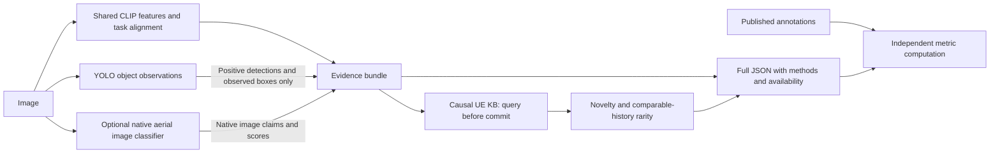

# Active parameter decisions — 27 October 2026

Canonical design and status: `PLAN.md`, first section. Finalized for the next
build: five groups, seven predicted/measured values plus two temporal fields.
Selection does not imply demonstrated descriptive sufficiency or policy benefit.

| Group | Fields | Decision and boundary |
|---|---|---|
| SPI | Low/Medium/High/Critical | Both V2 text-control attempts returned Medium0/3. Existing three-class head is fallback with Medium unsupported |
| Relevance | Mission/image CLIP cosine | Retain; alignment is not urgency or probability |
| Novelty | Causal sender-history appearance distance | Retain with cold-start flag; not verified new facts |
| Capture metadata | Trusted capture timestamp; operator allowed delay | Retain raw metadata; age/slack derived at receiver |
| Scene measurements | Instance count; distinct-category count; largest-box fraction; union-box coverage | One YOLO-World processed300 images;202 had no retained boxes. Geometry is tested; detector accuracy remains unverified |

Exclude rarity, hidden task-importance weights, a separate scene-complexity score,
exclusive scene routing and mandatory condition classifiers. Reliability is
availability/provenance, not a new importance scalar. Trusted geography stays
optional audit metadata rather than a required selected field. Category names,
boxes and per-category counts remain audit evidence initially; transmit only the
selected scalar measurements. A category-summary extension is conditional on
measured information loss. No fixed category-to-importance table.

Historical SPI candidate c: all180 pseudo-label responses valid;82Low,0Medium,73High,
25Critical. The original four-class training correctly halted for absent Medium
support. A subsequent explicit three-class CPU head is now trained/exported.
All180 raw responses match parsed labels. User authorized explicit three-class
training with original labels unchanged. Results: `results/spi_three_class_20261027/`.
The diagnostic does not prove whether cohort support or teacher discrimination
caused the missing class; see `docs/SPI_MEDIUM_DIAGNOSIS.md`.
Development teacher agreement62.86% versus47.14% prior baseline; Critical
recall2/10, so urgency reliability is not established. Do not hide this failure.
The existing core header is28bytes; the implemented v2 scene extension makes
35bytes. The existing decoder queue is not yet connected to this format.

Historical parameter repair decisions, superseded where conflicting

# Parameter repair decisions — provisional, 25 October 2026

**26 October decision:** the user excluded rarity from the next system. SPI is
being assessed as a four-level UE priority prediction, not an implemented or
validated predictor. Spatial coverage and category entropy remain diagnostics;
their use in ranking requires evidence. See the latest decision in PLAN.md.
Historical outputs and code retain their original fields until an explicit
implementation migration; the updated design must not be confused with those
historical exports.

The pilot diagnoses weak vision producers and unsafe conversions. It does not
establish that the parameter categories themselves are useless or optimal. No
scheduling policy is trained in this repair increment. Actual numerical results
and provenance belong in JOURNAL.md; the canonical route remains PLAN.md.

Configuration audit update: first fix confidence propagation, preprocessing
identity and assessment scope. Then compare required claims, claims+scores,
mission/context/history and full structured profiles using identical predictions.
Candidate extra descriptors are claim margin, producer disagreement and explicit
availability; their scheduling utility is unproven. Do not replace semantic
evidence with a new arbitrary importance formula. Details and runnable grid:
[MODEL_CONFIGURATION_AUDIT.md](docs/MODEL_CONFIGURATION_AUDIT.md).

| Candidate | Decision now | Meaning and extraction boundary |
|---|---|---|
| Context relevance | Retain as an alignment candidate | Full operator-paragraph CLIP cosine; retain condition scores for comparisons. Uncalibrated and affected by instruction/negation. Not urgency. |
| Novelty | Retain, with causal source-aware comparisons | Appearance distance plus predicted-concept change under a comparable sender KB. Not evidence that a new real-world event or asset exists. |
| Scarcity | Excluded from the next system by user decision | Historical extraction remains preserved; do not include rarity in the proposed SPI scheduler. |
| Scene/entity and condition evidence | Repair producer first | Positive detections may support presence. Non-detection does not establish absence. Compare an optional native aerial multilabel classifier with the failed zero-shot methods. Keep scores, methods, applicability and availability. |
| Spatial prominence | Conditional localization descriptor | Observed target-box size and union coverage. Requires an adequate detector; no physical distance or severity follows from image area. A zero observed extent is not absence. |
| Scene complexity | Diagnostic; not justified as independent rank input yet | Existing target count and coverage duplicate spatial outputs exactly. Detected-class diversity is distinct but inherits detector failures. No claim that these measure semantic depth. Preserve raw diagnostics until grouped selection justifies use. |
| Reliability | Retain per claim and producer | Raw model scores, calibration status, producer failures and availability. Do not average into image importance or claim that sigmoid scores are empirically calibrated. |
| Age/deadline | Retain trusted metadata only | Capture timestamp, operator delay, age and slack. Missing real timestamps stay unavailable; no synthetic decay is introduced. |
| Geographic context | Conditional metadata | Trusted location and explicit mission region; infer neither location nor proximity from bounding boxes. |
| Task-importance scalar | Do not add | User rejected hidden task weights. Priority is a later decision using mission-relative evidence and validated outcomes. |

Measured update: fixed0.5threshold on20ordered official-test-source images gave
building presence15TP/5TN; road presence16TP/2TN/2FN; affected buildings7TP/6TN/7FN.
Road damage has no positive support. Presence is a promising scoped replacement;
conditions remain experimental. Affected-score AUC0.9286does not validate binary
decisions or justify tuning on these images. Detailed baselines/limits are in
JOURNAL.md; no paired gain over the older YOLO cohort is claimed.

## Immediate repaired extraction boundary

The classifier is a domain-specific experiment. It is opt-in, not the universal
default for household/phone imagery. Its native labels do not include road
blockage, individual distress, universal urgency, localization or natural
cross-view asset identity. Those stay unsupported until separate evidence exists.

## Alternatives and why this first check

Use `MITLL/LADI-v2-classifier-small-reference`, a 23.5M-parameter BiT-50 with
approximately94MB weights. The official model directly predicts the existing12
native labels using independent sigmoid outputs. Freeze its published0.5 decision
threshold for a20-image feasibility check; compare always-positive and
always-negative policies and report class supports. Do not fit on those images.

Use the **reference** checkpoint: deployment checkpoints include all LADI splits.
Reference weights also saw LADI train, so the previous training-source pilot is
development evidence. The new small official-test-source sample is ordered and
not representative; it is not a journal superiority test. Model/data version
differences and possible undiscovered duplicates remain limitations.

The official large-model paper reports much stronger presence performance than
damage performance under test-domain shift. The small checkpoint is therefore a
repair candidate, not a guarantee that damage classification is solved. Preserve
its released preprocessing, including the small model's center crop, and record
that crop may exclude image-edge evidence. No damage localization follows from it.

If the native model fails, the next bounded alternative is regularized native-label
heads on the existing frozen CLIP features with grouped train/calibration roles.
RemoteCLIP is a later domain-adapted encoder candidate. Neither a larger model nor
more parameters is selected solely to improve Qwen approval.

Primary sources:

- [Official LADI dataset and definitions](https://github.com/LADI-Dataset/ladi-overview)
- [Small reference classifier](https://huggingface.co/MITLL/LADI-v2-classifier-small-reference)
- [LADI paper](https://arxiv.org/abs/2406.02780)
- [Official CLIP linear-probe example](https://github.com/openai/CLIP#linear-probe-evaluation)
- [RemoteCLIP implementation](https://github.com/ChenDelong1999/RemoteCLIP)

