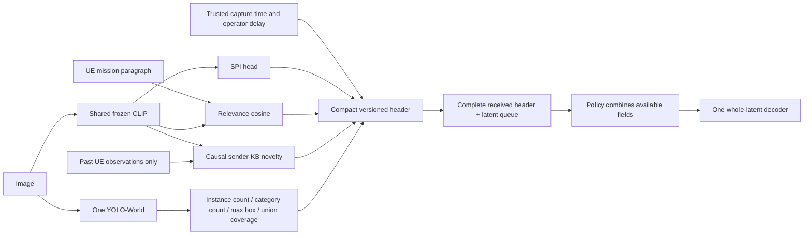

# Parameters: canonical plan and decision record

## ACTIVE IMPLEMENTATION PLAN — four-class SPI, 27 October 2026

Status: implementation and execution authorized by the subsequent user request.
SPI v3 source is implemented; 61 focused tests passed on a stable snapshot.
Kaggle notebook numeric identity141089219 is on version2, submitted with a
7200-second cap. Kaggle renamed its title-derived URL slug; KAGGLE_RUNS.md records
the exact alias/status and retrieval receipts. Teacher/model results are pending.
No completed classifier or urgency-performance claim follows from submission.
The previous no-tests request applied to the filesystem reorganization; the
following checks are proposed for the subsequent SPI implementation task.

### Outcome and scope

Deliver an image-input SPI classifier with exactly four trained outputs, ordered
`Low, Medium, High, Critical`, with explicit assessment availability. Preserve
relevance, causal UE novelty, capture metadata and the finalized optional scene
contract. Work is in SemanticSchedulerEnd2End; production code in parameters/,
new experiment/notebook/run artifacts in experiments/spi_four_class/. Do not
reorganize the repository again or train scheduling policies in this stage.

A four-output model, agreement with its teacher, and independently validated
urgency are separate completion claims. Only the first two are possible from
pseudo-labels alone. No class is silently removed to obtain a successful run.

### Target decision before data generation

Use the existing image-only intervention-need rubric as the primary baseline.
SPI describes the depicted issue; relevance separately compares the image with
the UE mission, and trusted timing determines currentness. It does not claim to
verify a live emergency from an undated image. Retain the four boundaries:
Low=no supported intervention; Medium=concrete nonurgent corrective action;
High=substantial consequence requiring prompt attention; Critical=direct evidence
of immediate serious harm/critical failure. Examples and exclusions must be frozen.

The preceding research suggested mission-conditioned SPI. Keep it as a separate
bounded comparison on image/mission pairs whose differing interpretations are
supported. Do not mix those labels into an image-only training target. It is a
conditional follow-on if image-only SPI fails to cover intended applications;
then add mission text features to the student, change the target version, and
reassess redundancy with relevance. The primary first campaign uses image-only
SPI to preserve the present extraction contract and avoid an unapproved expansion.

Ambiguous/unreadable/unsupported cases receive an assessment status. This is not
a fifth priority or a reason to turn them into Low. Operational severity, damage
and generic informativeness are not automatically interchangeable with SPI.

### Stage 1 — repair and pin the execution path

Reuse existing source; inspect before edits:

| Responsibility | Existing source to extend |
|---|---|
| Rubric, teacher prompts, strict label parsing | parameters/spi_labels.py; config/spi_rubric_v2.json |
| VLM loading/generation | parameters/qwen35_reviewer.py; qwen_reviewer.py; model_settings.py |
| Campaign orchestration | parameters/spi_final_campaign.py |
| Student fit/export and selection | parameters/spi.py; spi_model_selection.py |
| Image features and inference | parameters/minimal_vision.py; spi_infer.py |
| Runtime parameter composition | parameters/minimal_parameters.py; parameter_cli.py |
| Notebook orchestration | Existing builder logic, reused by the canonical experiment notebook |

Before GPU work, fix stale imports/build paths from the recent untested layout.
Trace image -> processor -> rendered request -> raw reply -> parser -> evidence
mapper -> saved label -> student feature row -> exported inference. Do not reuse
historical green tests as evidence for the relocated code.

Implement two teacher protocols under one versioned rubric:
1. Concise direct four-class label.
2. Evidence-first action/substantial-consequence/immediate-threat judgments with
   a deterministic documented mapping to the four classes.

Persist raw responses and actual rendered system/user messages. Contradictory
claims, malformed replies, inference failures and valid abstentions have separate
statuses. No silent label repair or class quota is permitted. A single bounded
format-only retry may be logged; it cannot alter the underlying evidence.

Required local checks: class mapping including unknowns/contradictions; valid
and malformed JSON; duplicated/missing IDs; finite outputs; all four class slots;
old-checkpoint rejection as a four-class release; image-bearing request actually
contains the image; text-only fixtures do not require absent images; and thinking
OFF is represented by the actual template. Keep heavyweight imports lazy.

Exit: one deterministic source snapshot/configuration that passes focused
engineering checks. No vision-quality claim from these checks.

### Stage 2 — freeze cohorts and independent references

Reuse accessible cached LADI/MEDIC images first. Preflight metadata/schema and
20 source records before any new source download. Supplement normal photographs,
maintenance defects and screenshots from accessible licensed material only when
needed. Begin with roughly 80-120 real parent images for feasibility; expand
accepted labeling to at most 1,200 parents within the run budget, not by default.
No full dataset download. FloodNet structural flooding stays excluded from
producer/scheduler selection under its existing transfer-study boundary.

Group exact/near duplicates, parent derivatives and available event/site records
before selecting splits. Previously exposed 300-image material is development
only. Reserve new groups for a later locked evaluation before tuning, if such
groups actually exist. Otherwise label all results development and do not claim
a fresh final test. Random queue seeds do not create independent image groups.

Prepare these separate reference layers:
- Published native facts: damage/object/informativeness labels only in their
  documented scope; preserve unknown annotations.
- Authored controls: frozen policy-conformance references with known expected
  outcomes. They test our definition, not human operational urgency.
- VLM pseudo-labels: teacher, prompt/rubric, model revision and evidence attached.

TREC-IS text priorities do not become image labels. Spatial detections, filename,
dataset origin, expected balance and another SPI model's answer do not enter the
teacher prompt. Source facts used for evaluation are not runtime features.

### Stage 3 — select the teacher and prompt on a bounded pilot

Candidate order:
- Qwen/Qwen3.5-9B: reuse current adapter, thinking OFF; previous direct prompt is
  a failed baseline, not a model upgrade.
- Qwen/Qwen3-VL-8B-Instruct: nearest explicit non-thinking challenger.
- google/gemma-4-E4B-it: different-family challenger after memory/runtime preflight.

Use model revisions, processor hashes and actual generation settings. One
quantized teacher loaded at a time on GPU1; GPU0 can extract cached image features
only when that work is useful. Verify two GPUs if using the existing two-T4
notebook contract. FP16-compatible compute on T4; bounded image tokens; no silent
CPU spill or speculative optional-kernel installation. Compare models at similar
visual/input/output budgets and report quantization effects as unknown unless
measured. No assumption that publisher benchmarks describe our non-thinking run.

Pilot sequence:
1. Run a 10-case multimodal transport/runtime preflight, independent of rubric
   performance. Log image hashes/dimensions, tensor/image-token receipts, finite
   generation, actual device memory and elapsed time.
2. Test 48 authored text controls, 12 per class, with unseen boundary cases.
   Examples used in prompts cannot also be scored fixtures.
3. Test the real-image panel with the direct and evidence-first protocols.
4. Run Qwen3.5 first; include challengers if it fails or a comparison is needed.
   At most 3 models x 2 prompts; no open-ended prompt/threshold sweep.
5. Check selected cases for paraphrase sensitivity, tutorial versus live-looking
   warnings, minor defects versus intact scenes, and small critical evidence.

Proposed development screening: >=98% parseable outputs, all four classes used
where controls support them, >=0.70 recall per class and <=0.10 Critical-to-
Low/Medium undercalls on supported controls. Report small support and uncertainty;
these thresholds are engineering gates, not deployment safety certification.
Invalid and abstained cases remain in denominators or explicitly report coverage.

Teacher selection uses controlled-reference macro F1 plus a separate Critical
undercall constraint, then observed visual-evidence failures and measured cost.
Do not merge unrelated metrics into invented weighted quality. If two candidates
are indistinguishable on the available evidence, choose the cheaper adequate
one and report the uncertainty. A VLM's approval of its own labels is not the
selection objective. If no candidate passes, stop before bulk labeling and
report which predicate/boundary or runtime component failed.

Exit: selected protocol/model artifact manifest and pilot report. No final
holdout groups used for selection. Natural visual cases without SPI reference
cannot be used to report urgency accuracy.

### Stage 4 — generate and audit all four training classes

Freeze the teacher configuration and apply it once to development images.
Incrementally persist image_id, group, split, label, assessment status, evidence,
label-source type, prompt/rubric/model hashes, raw response location and cost.
Never use future KB history or a target class quota in the labeling prompt.

Inspect predicted class support and source/domain composition. Targeted collection
of additional plausible Medium/Critical cases is permitted on training groups
only; predicted labels still come from the frozen method. Do not hand-relabel
an output to fill a quota. Correct a genuinely broken rubric only through a new
version and regenerate all affected labels; keep the failed version.

At minimum reuse the existing feasibility gate: each class has >=12 training
rows from >=6 groups and >=5 validation rows from >=3 groups. These are smoke-
scale minima, not sufficient sample size for a journal result. Every fitting fold
must contain all classes and adequate independent groups. Fewer folds or a
single grouped selection split is preferable to pretending repeated samples
supply independent support. Missing Medium or Critical support stops fitting.

Audit teacher failures separately from student errors. Published object/damage
labels can verify constituent evidence but not automatically the final urgency.
No new human reviewers are assumed; remaining ambiguity is an explicit limitation.

### Stage 5 — train small four-class student candidates

Cache one normalized image embedding per parent using the existing CLIP
checkpoint/signature. No VLM evidence text or predicted scene labels are required
as student inputs in the primary image-only experiment.

Candidates, with equal grouped selection boundaries:
- Four-class multinomial logistic regression: C in {0.1, 1, 10}, with/without
  training-only class balancing (six configurations).
- Existing D -> 128 -> 4 GELU MLP: ordinary or class-balanced cross entropy
  (two configurations), fixed optimizer recipe, <=50 epochs, early stopping.

No loss-function/model zoo. Cross entropy is the starting loss; assess ordinal
error and ranked probability score rather than claiming those are optimized by
CE. Select regularization/model on development groups. Early-stopping examples
come only from the training role of each selection fold; outer/final validation
cannot set the epoch count. Use existing model-selection code after auditing
its actual fold and early-stopping boundaries.

Prefer the simpler candidate when development estimates are indistinguishable
within one standard error and its Critical error is acceptable. Record support
per class per fold; never drop a missing class. After model selection, compare
repeat-fit variability only if it affects the decision and budget allows it.
Temperature calibration needs a distinct grouped calibration role or strictly
out-of-fold predictions. If unavailable, export scores explicitly uncalibrated;
do not pretend that softmax confidence is verified probability accuracy.

Exit: model with exactly four meaningful outputs and immutable training/preprocess
manifest, together with all candidate metrics, failures and selected rationale.
No backbone fine-tuning unless frozen-feature evidence establishes a specific
failure and a separate resource decision is made.

### Stage 6 — evaluate and test exported inference

Classifier evidence:
- Four-by-four confusion matrix; per-class support, precision, recall and F1.
- Macro F1 and balanced accuracy; overall accuracy secondary.
- Critical -> Low/Medium undercalls and High/Critical recall.
- Ordinal MAE and ranked probability score; log loss/Brier on genuine labels.
- Abstention/invalid coverage and error among accepted cases; confidence reliability
  diagrams/calibration error only with stated binning and sufficient data.
- Results by domain/event, tiny versus dominant important content, screenshots,
  normal scenes and Medium boundary cases.

Label provenance is printed beside each table: published fact, authored/policy-
derived reference, or VLM pseudo-label. Teacher agreement is not independently
validated urgency accuracy. An independent native-fact test cannot be relabeled
as a universal urgency test. Group uncertainty by available event/site/duplicate
component; account for whether the frozen vision encoder saw the data.

Engineering acceptance: training-framework versus exported NumPy predictions;
single/batch equivalence; save/load and checksum; dimension/signature mismatch;
NaN/corrupt artifact handling; low confidence/unreadable input; explicit four-class
order and encoder/preprocessing identity. Root schema still uses wire order
Critical=0,High=1,Medium=2,Low=3; map from student order by class name, never assume
the two integer orders match. Engineering failures block release.

Test true class examples and false positives; producing at least one output of
every class is necessary but insufficient. Keep the old three-class artifact
available as historical evidence, not as successful completion of this plan.

### Stage 7 — integrate SPI into parameter extraction and release handoff

Update the selected SPI model pointer only after acceptance. ParameterBundle
exposes class, four scores, score-calibration state, validity/status and model/
rubric identity for local audit. Keep novelty query-before-commit and relevant
spatial measurements independent. Do not infer SPI from object area/count.

The current compact header carries a class, not four posterior values. Preserve
its exact parser/version. Give the policy owner a class-only contract initially;
if they need posteriors, design and measure a new versioned field rather than
silently supplying audit-only information to the ranker. Do not claim a header
extension or receiver queue integration from classifier training alone.

Run a five-image and a short multi-UE parameter integration check: all output
fields/statuses, class mapping, repeated-image novelty, missing scene producer,
serialization and failure behavior. No scheduling-policy retraining here.

Release artifacts: selected model, preprocessing/calibration specification,
label/split/source manifests, teacher pilot report, four-class report, executed
notebook, raw teacher traces, final parameter contract and policy handoff. Append
actual checks/results and failures to parameters/JOURNAL.md. Update release
manifest only when the corresponding artifact exists and is verified.

### Notebook versions, resource limits and artifact ownership

Canonical new experiment notebook:
`experiments/spi_four_class/notebooks/spi_pipeline.ipynb`, importing shared source.
Use the existing private notebook purpose recorded as
`satyapaladugu/betterscheduler-spi-20261027finalc`; verify current access, status
and latest version before submitting a new version to that same identity. It is
not a new notebook slug. If inaccessible, stop before inventing a replacement.
Do not interrupt a healthy active run to upload a revision.

Use the correct project environment for local checks; Kaggle has its own managed
runtime. Pin each compatible teacher environment independently; a package upgrade
for one adapter cannot silently invalidate another. Print actual interpreter,
Python/package versions, source snapshot, GPU names/device placement, model/
processor hashes and image settings. Run from a fresh kernel. Every computation
cell logs start, purpose, progress, elapsed time, outputs and errors; persist
cell logs and partial labels before long operations. No silent large main cell.

Local artifact tree:
`experiments/spi_four_class/runs/<run-id>/{data,logs,models,metrics,figures}`
plus manifest.json, config.json, validation.json, REPORT.md and executed notebook.
Kaggle writes the corresponding tree under /kaggle/working/experiments/. Retrieve
to the same local run hierarchy and verify checksums. Record owner/slug, actual
notebook version/run ID, status, inputs, dependencies and retrieved files in
parameters/KAGGLE_RUNS.md. An exit code or notebook COMPLETE is not scientific
acceptance; inspect the gate/outcome and actual artifacts.

Planning caps inherited from the previous campaign, subject to verified remaining
quota: <=8 aggregate GPU-hours, <=1,200 parent images for this campaign and <=1 GB
new local image downloads. Two allocated GPUs consume two GPU-hours per wall
hour even if one is idle. Run pilot stages first, calculate projected label cost
from measured seconds per image, and trim cohort/challengers before exceeding the
cap. Never silently buy compute or assume these are newly launched resources.

Estimate after preflight:
`label wall time = remaining label calls * measured median seconds/call`, with
setup, tail latency and retries reported separately. Training on cached small
features should be measured rather than promised a finish time. Stop at budget,
preserve outputs and report the supported completion state. Do not expand the
campaign just to achieve desired class counts or prettier metrics.

### Acceptance checkpoints

| Checkpoint | Required evidence |
|---|---|
| C1 execution | New-layout imports, request/image/template correctness, parser and mapper checks pass. |
| C2 teacher | Bounded pilot distinguishes all four classes under frozen references; model/prompt chosen on development only. |
| C3 labels | All four classes have usable grouped support; reference/pseudo-label provenance separated. |
| C4 student | Four-class candidate selection with isolated folds and complete per-class errors. |
| C5 export | Export/inference parity, explicit class ordering, calibration state and failure behavior verified. |
| C6 parameters | Selected model integrated, actual header contract documented, multi-UE parameter checks and retrieved artifacts verified. |

Main Sol owns source edits and integration. Luna High may run the agreed focused
checks and Kaggle operations when implementation/execution is authorized; a
bounded Sol Medium assessment checks the completed interface/selection boundary,
without production edits. No automatic multi-agent review pipeline is required.

Immediate implementation increment: C1 plus the frozen control/cohort manifest.
Only after that passes should the existing Kaggle notebook receive its next
version. This plan does not claim that any checkpoint has already passed.

---

## EARLIER DECISIONS AND RESEARCH

# Parameters: canonical plan and decision record

## FINAL SPATIAL DECISION — 27 October 2026

Latest clarification: retain core SPI/relevance/novelty and capture metadata.
Retain **Spatial Prominence** as largest relevant-box fraction and **Scene
Complexity (detected entity load)** as raw relevant instance count; include union
coverage as collective extent. The labels do not imply distance, urgency,
entropy, payload cost or a scene-graph model. The concrete policy contract and
handoff checklist are in the linked decision document.

[Authoritative spatial contract and policy handoff](docs/SPATIAL_PARAMETER_DECISION.md).
This supersedes the spatial candidate menu below. Keep optional task-relevant
instance count, largest relevant-box fraction and relevant-box union fraction,
with availability/status/saturation. Use one supported YOLO-World target registry.
No universal graph-complexity or area-to-urgency formula. Distinct categories are
audit-only; crop grids, depth, tracking, REBEL and GNNs are deferred. Core four-class
SPI/relevance/novelty/capture requirements remain. The three fields are a finalized
implementation design whose benefit must survive independent ablation; they are
not newly implemented. No tests or model runs were performed. See JOURNAL.md's
latest entry for rationale, evidence, limitations and retention criteria.

## CURRENT RESEARCH REPLAN — 27 October 2026

The current research/design proposal is documented in
[Four-class SPI and spatial evidence](../experiments/spi_scene_research/RESEARCH_AND_REPLAN_20261027.md).
This supersedes the earlier immediate training/run instructions below. No new
inference, tests, dataset download, training or Kaggle execution occurred.

- Four classes remain mandatory: Low, Medium, High, Critical. The prior
  three-class checkpoint is historical; it cannot satisfy this requirement.
- Compare a direct-label teacher with evidence-first judgments plus explicit
  four-class mapping. Missing/ambiguous evidence is not assigned Low.
- Qwen3.5-9B is the primary teacher candidate; Qwen3-VL-8B-Instruct and Gemma 4
  E4B are bounded challengers. Keep thinking disabled. No task-specific winner
  is established by publisher benchmarks.
- The proposed SPI estimates intervention need under the declared mission;
  compare against image-only SPI before freezing labels. Mission-conditioned
  labels require mission inputs to the student. Relevance and novelty stay
  separate features and their overlap is measured.
- Spatial candidates are task-linked YOLO geometry and detector-free crop
  alignment grids. Counts/area do not define urgency, and map shape cannot
  establish cross-view identity or physical proximity.
- Evaluate content-only summaries versus positional grids. Retain spatial
  features only if they add useful evidence/ordering value at acceptable cost.
- Public text priority models, damage classifiers and a heuristic satellite
  triage checkpoint are useful comparisons, not universal urgency truth.
- With no new reviewers, urgency conformance on policy-derived labels and
  agreement with a VLM must remain distinct from independently verified urgency.
- Reuse the four active owners (Codec, Scheduler, parameters, Evaluation) and
  existing Kaggle notebook identities with versions. Implementation/execution
  follows review of this proposal; no new model or header is claimed complete.

## HISTORICAL PLANS AND RESULTS

# BetterScheduler: canonical plan and decision record

## ACTIVE THREE-HOUR PARAMETER IMPLEMENTATION (27 October 2026)

The user-approved scope is parameter extraction/validation only. Runtime fields:
four-class SPI, mission relevance, causal UE appearance novelty, capture time,
allowed delay, detected instances, detected categories, largest box fraction,
and union box coverage. Rarity is excluded. The SPI schema retains Low/Medium/
High/Critical; the existing three-class checkpoint is a separately labelled
fallback if four-class support is insufficient. No unsupported class is invented.

Implemented: v2 SPI rubric/prompt and teacher-control campaign; grouped four-class
candidate selection; YOLO-only scene provider and exact geometry; six UE profiles;
`FinalParameterExtractor` and CLI; v2 35-byte header with v1 compatibility;
causal batch extraction and persisted per-UE KB; parameter sequence diagnostics.
`SemanticSchedulerEnd2End` is the single working repository. `BetterScheduler`
contains the parameter package and `run_parameters.ps1` entry point; the Python
environment, CLIP checkpoint and cached LADI assets already exist inside this
same repository. Kaggle is an external execution environment; retrieved results
are under `BetterScheduler/results/`. Original sibling checkouts were preserved
during consolidation; see `docs/CONSOLIDATION_20261027.md` at the repository root.
The private Kaggle v2 teacher/scene run ended incomplete: text rubric controls
passed9/12 overall, but Medium0/3. No images were labelled and YOLO did not
start. The text-only control itself mixed image-only and candidate/reference
instructions; local code now removes that contradiction. A user-authorized retry
`20261027finalc` ended with Medium0/3 on the text control and no image labelling.
Its independent YOLO worker returned300 records, including202 with no retained
detections. Four-class support and urgency remain unverified.

The 300-image source package contains180 previous images plus120 cached LADI
parents; all are development-exposed, with no verified event independence.
Before labelling, new-only groups are deterministically assigned to a sealed
development check. Source flags guided sampling and are not SPI ground truth.

Local verification: 29 targeted tests; actual CLIP plus three-class fallback on
two identical observations yields cold-start novelty1 and repeat novelty0;
each v2 header is35 bytes. Missing local YOLO checkpoint is explicitly unavailable.
The six-UE/72-observation fallback run passed12/12 exact-repeat controls. Its
building-affected-versus-broad-mission cosine AUC0.689 is a descriptive partial
proxy on previously exposed LADI images, not an urgency or final-test metric.

Current source snapshot, executed run, diagnostics, parameter decision and
limitations are recorded in `KAGGLE_RUNS.md`, `JOURNAL.md` and the final report.
Historical real YOLO outputs were replayed for scene geometry; this is not a new
detector inference or an accuracy benchmark. Current300-image fallback records
have unavailable scene fields. Do not claim a full validated parameter release.

## Previous active design — superseded where conflicting

This section preserves the earlier three-class decision and is historical wherever
it conflicts with the active three-hour implementation above.

Final design: **five groups containing seven predicted/measured fields and two
capture-metadata fields**. This finalizes what to build and test; it does not
claim every field has already demonstrated scheduling value.

| Output | Meaning | Fixed extraction method |
|---|---|---|
| SPI | Visible response-attention level: Low, High, Critical | Frozen CLIP ViT-B/32 image embedding ->128-unit GELU/dropout head ->three logits; explicit output profile |
| Relevance | Relation to the UE's operator-written mission paragraph | CLIP image/text cosine; explicit token chunks for long paragraphs |
| Novelty | Appearance difference from this UE's causally available image history | `(1 - maximum comparable past cosine)/2`; query before commit; cold start flagged |
| Capture timestamp | When the image was captured, where trusted | UTC milliseconds; otherwise unavailable |
| Allowed delay | Operator-specified processing allowance | Milliseconds; never inferred from box size or SPI |
| Detected instance count | Number of retained object detections | One shared YOLO-World; count after declared filtering and NMS |
| Distinct detected category count | Number of different predicted categories | Count canonical categories among retained detections; not unique real-world assets |
| Largest box fraction | Visual extent of the largest detected box | `max(box area)/(image width * image height)` |
| Union box coverage | Portion of the image covered by detected boxes | Exact union area divided by image area; overlap counted once |

Rarity is excluded. No separate hand-weighted task-importance scalar, category
importance table, exclusive scene classifier or detector fleet. The four scene
measurements replace a vague standalone scene-complexity score. Box fraction
does not establish physical proximity, severity or urgency. Novelty does not
claim verified new facts, new assets or cross-sender duplicate knowledge.

### Scene implementation boundary

Detailed definitions and checks: `docs/SCENE_EVIDENCE_PLAN.md`. Reuse one existing
YOLO-World detector. Category names, per-category counts, boxes, scores, model
identity and settings remain in local audit records. The initial compact scene
extension carries the four measurements and availability, not the full record.
Its limitation is explicit: identical aggregate measurements can describe very
different contents. A category-summary extension is a separately tested option
if that missing information prevents useful decisions; no category implies a
fixed importance weight.

A successful detector with zero retained boxes gives counts and union coverage
of zero, but largest-box fraction is unavailable. Detector failure or unsupported
applicability makes all four unavailable. Zero detections never certifies an
empty or unimportant image. Reliability is recorded per producer and through
availability; it is not another scalar priority parameter. Geographic metadata
may be preserved when trusted, but is not a required selected model field.

The core extractor/header exists. The new scene aggregation and versioned wire
extension are **planned**, not yet integrated. The previous 16-claim/4-byte mask
proposal is superseded. This update launches no job or download.

SPI is a policy input, not a mandatory hard gate. Independent evaluator labels
remain outside every runtime observation. No scheduler training is introduced
by this parameter-finalization step.

### SPI diagnosis and explicit three-class repair — 27 October

Kaggle `betterscheduler-spi-20261026c` ended ERROR; its own status is incomplete.
All 180 teacher responses parsed: Low82, Medium0, High73, Critical25. Train
support is49/0/46/15; validation33/0/27/10 in that order. The all-class-support
check correctly stopped fitting before optimization. No trained/exported SPI
artifact was produced by that campaign. Teacher inference completed in1034.366seconds. Labels are
model-generated development evidence, not independently validated urgency.

Follow-up audit checked all180 raw response levels against saved labels: zero
mapping disagreements. Medium was supplied in the prompt and supported by the
parser; it was never emitted. Weak Low/Medium rubric separation and cohort/teacher
polarization are plausible explanations, not established causal findings.
`docs/SPI_MEDIUM_DIAGNOSIS.md` records evidence and uncertainty, including possible
Critical overstatement from severe aftermath alone.

User authorized dropping a class and training. Select explicit output classes
Low/High/Critical with original labels unchanged. Medium is unsupported, not
fabricated or silently merged. Keep the original teacher rubric hash. Default
four-class training still rejects missing support; the explicit three-class
configuration requires support for each selected class and rejects available
labels outside its output space. No extra GPU run or download is required.
Training/export results belong to `results/spi_three_class_20261027/` and the
journal. This development model does not establish independently valid urgency.

**Executed repair:** the explicit three-class head trained50epochs and exported
`models/spi.json`. Engineering suite13tests passed. Grouped development validation
teacher agreement44/70=62.86%, versus33/70=47.14% majority/prior baseline.
Critical recall2/10; training accuracy99/110=90%. This generalization gap prevents
a reliable urgency claim. Keep the artifact usable for integration/research,
not as a validated emergency decision system. NumPy export max difference from
torch is1.63e-7. No final test or human urgency evaluation was performed.

### Fixed SPI target and training

Use `config/spi_rubric_v1.json`: ONE fixed general response-attention context.
The image-only SPI head never receives varying mission paragraphs, timestamps,
source IDs, native annotations or other parameter predictions. Relevance and
capture metadata allow the later scheduler to adjust contextual treatment.
SPI is an estimate from visible evidence, not a measured action deadline or a
universal certification of current danger.

Train from explicitly recorded offline Qwen3.5-9B pseudo-labels, thinking OFF.
A dedicated SPI prompt/parser uses `review_structured`, not the previous
candidate/reference parameter-review input. Native damage, relevance and TREC
message labels are not converted to SPI truth. Human image labels can be used
only with a documented compatible target in a separate experiment.

Architecture: existing frozen CLIP, normalized512features, Linear(512,128),
GELU(tanh),dropout0.1,Linear(128,3) for the explicit current output space. CPU AdamW,unweighted cross-entropy,seed17,
learning_rate0.001,weight_decay0.0001,batch64,max50epochs,patience8. Validation
selects the checkpoint; RPS,confusion,per-class support/misses and a training-prior
comparator are reported. No architecture/grid expansion. Probabilities are model
scores; pseudo-label agreement is not human urgency calibration.

The input policy is EXIF orientation ->RGB ->aspect-preserving max512 pixels ->
CLIP aspect padding. Features are regenerated from these exact lossless PNG views
because older caches lack complete weights/processor identity. No local model
or full dataset download. Whole paragraphs are encoded in token chunks and their
normalized embeddings combined by token-count-weighted mean; cosine is not a
probability. A16-chunk bound fails explicitly rather than silently truncating.

### Build and execution

Implemented source: `spi.py`, `spi_labels.py`, `minimal_vision.py`,
`minimal_parameters.py`, `spi_campaign.py`, `spi_infer.py`,
`build_spi_notebook.py`. This is an additive BetterScheduler path; historical
headers/extractors/queues remain reproducible.

1. Check engineering invariants and actual cached checkpoint correspondence.
2. Package the existing180image development cohort as bounded512PNG views;
   preserve grouped train/validation roles and mark development exposure.
3. The private Kaggle Qwen9B campaign supplied the saved pseudo-labels. Fit/export
   the three-class CPU head from those cached labels/features locally.
   Two T4s are allocated;cached features mean only GPU1 runs teacher inference.
   Both devices count:3600server seconds <=2 aggregateGPUhours. No auto-retry.
4. Retrieve/checksum labels,raw answers,model,metrics and cell logs. Do not call a
   platform COMPLETE status scientific acceptance. Every configured class needs actual
   training support; do not fabricate absent labels or change the rubric to fill
   classes. Technical parse failure in early responses stops the campaign.
5. Demonstrate single-image CLI and four-output extraction using the exported
   model; then perform parameter experiments. Published human annotations such
   as SA-OOSC and VERI support compatible domain diagnostics; four-way human
   urgency accuracy remains unknown until matching independent labels exist.

A28-byte experimental header is implemented:version/availability+SPI bits,
source/session/message identity,profile ID,capture time,allowed delay,relevance
and novelty. This is224bits for the header. Encoded image payload bytes and radio
channel uses are separate. Deployment assumes a shared profile/model registry;
the large audit JSON/provenance is not transmitted in this header. The28-byte
figure applies to the existing core only. Scene fields need a new format version,
range/overflow rules and quantization checks before a combined size is claimed.

### Status and acceptance record

Do not infer a trained artifact from completed engineering tests. Current run
IDs,actual outcomes and checks belong in JOURNAL.md and KAGGLE_RUNS.md. The final
route is fixed; failures change extraction/data/code based on evidence rather
than quietly redefining labels or restarting the architecture.

Historical plans and decisions — superseded where they conflict above

## Active phased route — 26 October 2026

### Phase 0 audit decision checkpoint

**Literature correction, 26 October:** Direct human-labelled image urgency exists
(DisasterNet 2020 and related 2019/2023 work). SA-OOSC 2025 supplies a concrete
VLM-assisted semantic-importance precedent with released human verification.
Read `docs/phase0/SPI_LABEL_LITERATURE_REVIEW.md` before interpreting the earlier
TREC-first recommendation. SPI is retained; TREC message labels are a reference
and weak comparison, not the preferred default for image urgency. The next data
check is access to direct visual urgency labels, plus target-compatible published
human annotations. Do not launch a TREC image-classifier training run merely from
the earlier recommendation. No universal four-level image dataset has been
verified. Existing four-output/runtime contracts remain the proposed scope.

The complete downloaded annotation metadata has been traversed: 135,052 unique
post IDs, 136,263 event/post pairs, 164,163 top-level records. All 122 topic blocks
parse; four reference tests and source/count consistency checks pass. No image
archive or model checkpoint was downloaded in this audit and no training ran.

Read `docs/phase0/TRECIS_AUDIT_STATUS.md`, `docs/phase0/AUDIT_SUMMARY.json` and
`docs/phase0/SPI_DESIGN_DECISION.md`. The latter owns the detailed design rationale.
TREC-IS provides message response-information priority; it does not independently
label image-only operator-action urgency. Preserve that target gap explicitly.
Final architecture route: one visual encoder and one calibrated four-class head,
with CE versus ordinal probability-loss comparison on grouped development data.
The next data action is a bounded remote media-match manifest, not a local archive
download or unqualified universal SPI training. Media matching, group reconciliation
and target validity remain required before training. No remote run was launched.

**Storage constraint (user, 26 October): do not download the full dataset or image archive locally.** Phase 0 uses compressed annotation metadata and remote archive inventories. Any later image access must remain bounded or execute remotely. The initial local raw snapshot occupies 19,343,449 bytes (18.45 MiB), including a downloaded but unexecuted 4.7 MB dataset client. No media archive has been downloaded.

Phase 0 is an audit and final-design decision, not a placeholder-model training run. Current audit: `results/phase0_trecis/20261026T134634Z/AUDIT.json`; reproducible with `audit_trecis.py --run <run-directory>`.

This is the current user-requested sequence. Older sections preserve previous
designs and evidence. Planning does not launch training or a cloud experiment.

Level 1 contains SPI, context relevance, UE-local novelty and capture metadata.
Rarity is excluded. Scene/spatial/complexity outputs are deferred to Phase 3;
geography is a conditional later addition. The runtime unit remains one complete
received latent message, selected for a single decoder without resource grants.

| Phase | Objective | Exit evidence |
|---|---|---|
| 0: SPI | Audit full annotation metadata, then select one defensible final SPI architecture | Matched data/splits, frozen predictor, per-class errors, costs and reference-modality limitations |
| 1: no VLM | Check the four outputs, their incremental information and compact encoding | Independent-reference/numerical checks, four matched feature comparisons, serialization/quantization results |
| 2: optional VLM | Diagnose specific omissions/contradictions in the same representation | Reviewer controls, raw responses and reference-based disagreement analysis |
| 3: deferred | Discuss a scene/spatial extension only for a demonstrated gap | Concrete failed cases and one justified, measurable addition |

Proceed one phase at a time. The immediate increment is Phase 0A. The earlier
44-call v2 review is deferred to Phase 2; preserve its source and past results.

### Phase 0 — SPI definition, supervision and classifier

**Target:** TREC-IS priority measures how urgently a response officer should see
a message. This is an attention-priority reference, not an independently verified
operator-action deadline. The first classifier is scoped to that response role;
it does not establish general image/screenshot or arbitrary-mission urgency.

There are two distinct label axes: one priority and one or more of 25 information
types. Information types cover requests, calls to action, reports and contextual
content. They must not be manually converted into SPI truth.

| Internal code | Native level | Source meaning |
|---|---|---|
| 0 | Critical | Notify immediately |
| 1 | High | Officer should see the information |
| 2 | Medium | Can be reviewed later |
| 3 | Low | Can be ignored in the source's response context |

Keep original labels and editions. Later guidelines also mention Irrelevant;
an extra/unmapped value needs an explicit mapping or recorded exclusion, never
a silent conversion to Low. Unknown prediction is an availability state, not
another urgency class. The four classes are ordered, not equal units of harm
and not fixed response-time windows.

**0A — access/annotation/image-pairing audit, before training**

1. Use official accessible metadata and annotations; record source versions and
   hashes. Audit 20 records for schema/access, then at most 200 matched images
   for feasibility. These caps do not define adequate training/test sample sizes.
2. Join assessed messages to media. Count class support by event, image access,
   multi-image messages, duplicates, annotation conflicts and all exclusions.
   Archive size is not the number of usable labeled image examples.
3. Preserve reference modality. Message priority does not automatically establish
   the priority of each attached image. Keep associated text for diagnosis only;
   it is excluded from the primary image-only predictor, along with evaluator
   labels, event names and routing/file identifiers.
4. Image-type/informativeness labels can describe the cohort but cannot prove
   visual priority. Without independent image-priority supervision, report the
   model as predicting message priority from image inputs under weak supervision.
   If this mismatch prevents the intended claim, record the missing supervision
   rather than manufacture urgency labels or fit a misleading experiment.
5. Group duplicates, all images of one message, repeated event appearances and
   known event/site links before splitting. Preserve train/validation/final roles
   and any previous exposure. No random image split through duplicate/event groups.

The final NIST overview reports 136,263 annotated tweets over 98 events,
312,546 archived images over 122 events, and 7,297 tweets with image annotations.
The archive includes unassessed records. Counts do not prove current accessibility
or a usable image-priority join.

**0B — one small first model**

- Reuse pinned frozen CLIP image features and fit a regularized four-class
  logistic classifier on CPU. Cache visual features by image/preprocessing hash.
  This is a cheap baseline, not a claim that CLIP is best for urgency or OCR.
- Train with cross-entropy. Choose regularization and any imbalance treatment
  inside development data. Probability calibration, if supported, also uses
  development roles and is assessed explicitly; otherwise mark it uncalibrated.
- Save probabilities for all four classes and select one SPI class. The vector
  expresses uncertainty; it is not four simultaneous priorities. Keep it in
  research artifacts initially; the header need not carry the whole vector.
- Compare with majority/class-prior baselines. The only optional additional head
  is an ordinal classifier with three ordered thresholds and valid monotone
  probabilities. Choose using grouped validation, without a broad model sweep.
- A small text-only classifier on the same matched records may diagnose the
  reference-modality issue. It cannot supply missing runtime input or certify
  image-only labels. Predictive text alone does not prove images are useless.
- Fix the initial SPI response context to TREC-IS's published role. A separate
  UE paragraph drives relevance. A constant task embedding does not establish
  mission-conditioned priority learning. No Qwen pseudo-labels or damage-to-SPI
  mapping is allowed in this phase.

**0C — evaluation/checkpoint**

Report macro-F1, per-class precision/recall/support, a full confusion matrix,
High-or-Critical precision/recall, major ordering errors, log loss/calibration,
availability and inference cost. Select on grouped validation; retain an untouched
group test. Insufficient independent support yields descriptive feasibility,
not a superiority claim. Weak data or performance triggers diagnosis before
model escalation. No trained SPI result currently exists.

Deliver cohort/exclusion and group manifests, feature identity, model/label
mapping, per-image predictions, validation metrics and a Phase 0 report. Later
header comparisons use predicted SPI, never reference priority as a runtime field.

### Phase 1 — parameter experiments without a VLM

Configure one short operator-written paragraph per UE mission and cache its text
embedding. Do not generate missions from individual images or reference labels.

| Output | Method | Independent check |
|---|---|---|
| SPI | Frozen Phase 0 predictor | Held-out native priority judgments; retain the modality limitation |
| Relevance | Normalized CLIP image/mission cosine | Native visual positives and supported negatives for label-expressible missions |
| Novelty | Causal UE-KB appearance distance, with availability | Exact repeats, empty history, independent UEs, query-before-commit and controlled new annotated evidence |
| Capture metadata | Trusted capture time and operator delay | Hand-calculated age/deadline/slack plus missing, future, untrusted and invalid-clock cases |

Concept novelty is a separately named optional method comparison, not an
unexplained mixture with appearance distance. Image transforms are sensitivity
checks, not evidence of a new real-world event or asset. A sender's KB cannot
reveal another sender's history; report cross-sender redundancy as a possible
information limit of scalar headers.

Relevance uses visual tasks supported by source annotations: explicit Incidents1M
category positives/negatives if accessible, or MEDIC's documented task labels.
Missing labels stay unknown. ScreenAI supports screenshot-fact checks, not SPI
truth. Do not pool sources into an invented universal priority scale.

For time, image age is t-capture_time and deadline is capture_time+allowed_delay.
Classical source-level AoI instead uses the generation time of the latest delivered
update. Tweet posting time is not automatically image capture time. Synthetic
timestamps/deadlines are labeled engineering experiments; real capture times
may remain unavailable.

After individual checks, compare four representations on identical development
workloads: SPI; SPI+relevance; SPI+novelty; SPI+relevance+novelty. Routing,
availability and temporal metadata are shared. Use the same ranking procedure
or identically budgeted fitted scorers and report tuning. This is a parameter
diagnostic, not a new RL/policy campaign.

Use native TREC-IS labels for priority ordering. For controlled exact copies,
separately measure distinct annotated-observation coverage from known parent
identity. Do not claim natural cross-view correspondence. A downstream trained
scorer receives out-of-fold SPI predictions for training and a frozen train-only
producer on validation/test; any ground-truth oracle is separately labeled.

Measure availability, extraction cost, actual header bytes, and changes in
ordering/metrics after 8-bit relevance/novelty quantization. Include routing,
versions, masks, time and integrity overhead in total bytes. Model settings,
explanations and full probability vectors remain in research artifacts. The old
32-byte header and rich scene JSON do not define the new format automatically.

Exit: per-field retain/revise/insufficient-evidence decisions, four matched
comparisons, and a serialization/quantization report. No field is mandatory
merely because an extractor can calculate it.

### Phase 2 — optional VLM audit of the same four outputs

Use a frozen Phase 1 representation on development examples. Provide image,
mission, compact header and native references relevant to the endpoint. History
review needs prior evidence. A VLM cannot certify exact cosines or KB/time arithmetic.

Begin with bounded correct, flipped, omitted and swapped-image/mission controls.
Expected verdicts and case-arm names stay hidden. Report acceptance of correct
records, rejection of incorrect ones, invalid outputs and raw responses. Approval
rate alone is not reviewer quality; stop using verdicts as a metric if controls fail.

Inspect disagreements as extractor error, representation loss, reviewer error
or missing reference truth. Revisions use development data and are checked by
Phase 1 references. No VLM relabels the final test, enters runtime scheduling
or replaces independent annotations. Reuse existing Qwen code after adapting
its input contract; this plan adds no paid API or broad model/prompt grid.
Phase 2 is optional and cannot block otherwise valid numerical evidence.

### Phase 3 — later discussion

Review concrete failures of the selected compact representation before adding
one scene/spatial field. Its meaning, producer capability, independent validation
and incremental cost must be established. YOLO count, area and entropy are not
assumed to be importance. No Phase 3 implementation is part of the current work.

### Sources for the active route

- [NIST assessor-scale presentation](https://tsapps.nist.gov/publication/get_pdf.cfm?pub_id=931273), page 11: four attention-priority meanings.
- [2021 guidelines](https://www.dcs.gla.ac.uk/~richardm/TREC_IS/2021/2021A/TREC%202021-A%20Incident%20Streams%20Track.pdf): label, edition and evaluation details.
- [Official information types and assessor profiles](https://www.dcs.gla.ac.uk/~richardm/TREC_IS/2020/participate.html): separate information-type axis.
- [NIST final overview](https://www.nist.gov/publications/incident-streams-2021-deep-end-deeper-annotations-and-evaluations-twitter): archive and annotation counts.
- [Official data access](https://www.dcs.gla.ac.uk/~richardm/TREC_IS/2020/data.html): access and assessed/unassessed distinctions.
- [CLIP linear-probe example](https://github.com/openai/CLIP#linear-probe-evaluation): small initial classifier mechanism.

## Latest user decision: exclude rarity; assess a small SPI design — 26 October 2026

Rarity is excluded from the next system. The user requested an explanation of
existing functions and outputs before further implementation. A proposed UE-side
SPI has four levels (Critical, High, Medium, Low), with receiver ordering within
a level; no SPI predictor or training result currently exists in BetterScheduler.
Its labels require explicit mission/action criteria. The working recommendation
is relevance, causal novelty and trusted temporal metadata alongside SPI;
geography is applicable only when supplied and meaningful to the mission.
Scene claims may support the SPI prediction; per-claim reliability stays attached
to evidence. Spatial box coverage and category entropy have no demonstrated
incremental scheduling benefit and are not proposed mandatory ranking inputs.
Historical v2 exports and extraction code still contain rarity; this decision
does not claim a completed runtime migration. No new GPU run or model training
is authorized by this explanation. Actual-function demonstration outputs are in
results/local/parameter_explanation_20261026/FUNCTION_OUTPUTS.json.

## Teammate transfer checkpoint — 26 October 2026

User requested a detailed Codex-ready handoff and Git publication. The immediate
next work transfers to the teammate's offline-validation branch; no v2 GPU job
has been submitted. HANDOFF.md records actual architecture, results, boundaries,
remaining issues, setup/fixture recovery and milestone acceptance. CODEX_START_HERE.md
is the pasteable assignment. A bounded evidence subset is versioned under
handoff/evidence; full datasets/weights/staging/credentials remain excluded.

During handoff, package budgets were set explicitly in the scene builder and
policy-following was separated from reference-based urgency correctness. A new
regression covers a wrong extracted presence decision followed faithfully by the
model. The final local test outcome and source hashes are in handoff/VALIDATION.json.
Existing historical result scores were not changed. The owner should approve
the concrete teammate package/local evidence before the proposed remote pilot.

## Current objective: scene representation and operator action urgency

User clarified that urgency means operator action urgency; decoder priority is
derived afterward. Redesign the offline validation around factual scene fidelity,
JSON-only task answerability and separately justified urgency support. Qwen is
an offline reviewer under test, never runtime scheduling or reference truth.
Full revised design:docs/OFFLINE_VALIDATION_REDESIGN.md. No new experiment is
running. The current evidence-only profiles explicitly prohibit urgency inference;
retain them and introduce a versioned action contract before urgency experiments.
Current two-building-fact labels do not establish whole-scene or urgency validity.

## Current increment: domain-independent evidence JSON and settings audit

User requested JSON redesign and all YOLO/CLIP settings. Implement an additive
`semantic_scene_evidence_v2` export from typed runtime evidence, keeping old
representations and scientific results unchanged. Separate claims/detection
summaries/measurements/provenance from the raw audit sidecar. Explicit false is
available; missing evidence and cold start are null with different statuses.
Integer accepted-box counts replace ambiguous scaled counts. Conflicts are retained;
no hidden importance weights or prediction repair. Optional ontology rules are
caller-supplied domain assumptions, not a universal truth model.

Universal applies to the schema. Producer vocabulary and supported predicates
remain explicit. YOLO accepts a configurable vocabulary, with canonical aliases
and full effective prediction-setting telemetry; default16categories are retained.
CLIP now records processor/model/text settings. No thresholds, crops or model
weights were silently changed. Audit all pinned defaults and current overrides.

Completed local evidence:92tests passed13.38s;19focused checks passed8.22s;
cache replay15observations/12images preserves180native predicted claim values.
Three cold starts become null comparisons. Five consistency warnings appear only
with the optional LADI ontology; no rules means no ontology warnings. No inference,
cloud/API run or new model-accuracy claim. Current old reviewer input is not
compatible with v2 without an explicitly versioned adapter, which is deferred.

Design/settings:docs/SCENE_JSON_V2_AND_MODEL_SETTINGS.md.
Concrete converted documents:results/local/json_v2_20261026/converted_summary/.
Audit receipts:results/local/json_v2_20261026/settings/ and validation/.

## User-authorized review-only rerun — 20261026i

Terminal outcome:complete,30/30valid reviews,thinkingOFF,noOOM. Controls:16/24joint
correct,consistencyBA0.7083,sufficiencyBA0.75; gatefailed. ActualJSONs:4/6accepted;
the two rejections incorrectly treat explicit available false claims as missing.
Independent two-building-fact checks match all6actual representations. No parameter
change or VLMpromotion follows. Full evidence:docs/SEMANTIC_VALIDATION_I_RESULTS.md.

The user explicitly requested another review after the partial h3 result. Run
Qwen3.5-9B NF4 only, with thinking OFF, on the same 24 controls and six actual
parameter JSONs. Attach h3 outputs and verify pinned upstream manifest/checksum
identities and every reused artifact/image. Only local filesystem routing changes;
candidate parameters and annotations are unchanged. No image extraction or 4B run.

Test the largest real candidate first, then three existing technical controls,
then every remaining case once. Retain the existing v5 prompt, pixel/token limits,
independent labels and reviewer-quality gate. Explicitly keep only last-position
generation logits and record input tokens before generation failures. The prior
OOM cause is not established by this change alone; actual memory is remeasured.

Use the managed Torch/CUDA runtime with pinned Transformers5.3/bitsandbytes0.49.2
in this 9B-only notebook. Two T4 GPUs remain assigned, but GPU0 performs no inference;
the 1800s server/1650s internal cap accounts for both GPUs (at most1aggregatehour).
Source/tests/Medium launch assessment precede one submission. No automatic retry.
KAGGLE_RUNS records actual status and verified retrieval. No favorable verdict or
successful review is assumed in advance.

## Current increment: balanced semantic validation and non-thinking 9B challenger

Verified h3 outcome: extraction completed (12 images, 15 observations, 24/24
primary facts); reviewer comparison partial. 4B approved all 24 controls and then
OOMed on its first actual JSON. 9B successfully ran NF4/thinking OFF, but stopped
after three controls at the unchanged runtime gate. Neither VLM is promoted.
No additional GPU retry. Complete results and next discriminating checks:
docs/SEMANTIC_VALIDATION_H3_RESULTS.md. Earlier launch notes below are history.

Latest h3 correction: h2a completed 12-image/15-observation extraction (24/24
primary native facts), but only 3 baseline controls were reviewed. No actual JSON
was reviewed and 9B never loaded: ensurepip failed during environment creation.
Use venv --without-pip plus the existing pip --python target interpreter instead,
verified locally and supported by pip documentation. Provision/import-check the
9B runtime before spending on either reviewer. Preserve all failed evidence.

Keep all 12 extraction parents, but select 6 balanced review parents (first 2
source rows per state), giving 24 controls + 6 actual JSONs per model. Full cases
remain saved separately; selection is a compute decision before 9B outcomes.
Freeze both models on the identical selected cases. Final h3 caps: 1200 server /
1050 internal seconds. Conservative prior bounds: h146.484s + h2a258.5s;
combined upper bound with h3 is <=1605s across two GPUs, or 0.892 GPU-hours.
No further automatic retry. Current suite: 80 tests passed in12.07s.

Operational correction:h failed before extraction on a Run/data empty-directory
integration mismatch. Fixed and tested against realRun;nonempty outputs still
refused. Correctiveh2a uses1600sservercap(1450sinternal),with first-attempt
146.484sconservativebound giving<=0.9703combinedGPUhours. h and unlaunchedh2
artifacts remain preserved. Summary now reports actual artifact availability;
notebook success does not imply experiment success. KAGGLE_RUNS tracks launch.

User approved the revised validation experiment and requested Qwen thinking OFF.
Keep all f/gstrict-key outcomes intact. New protocolv5 separates explicit available
fields, logical recovery under ladi_building_logic_v1,and factual correctness.
Available false differs from missing/null/masked values. Rules never generate
annotation truth and cannot certify a predicted absence. Conflicts stay visible.

Use12new official LADI test-source images(4absent,4present-unaffected,4affected),
excluding known source hashes and dHash-near matches. Dataset revision and all
selected pixel hashes are pinned. This corrects use of the prepared train-source
cohort for evaluating a classifier trained official train. Test-source provenance
does not establish event independence or certify all pretraining exposure.

Build48controls:complete,unavailable condition,wrong presence,wrong condition.
Half of unavailable-condition cases omit the key;half mask a stale opposite value.
Separate genuinely missing conditions from recoverable absence. Extract real
parameters on the12images,construct15causal observations across3UEKBs,and review
12unique actual JSONs. Native labels remain outside extraction. Partial-reference
and unknown logic are software-tested;current image cohort has both labels known.

KeepQwen3-VL-4BFP16/Transformers4.57.6 as baseline. CompareQwen3.5-9BNF4 onGPU1
in isolatedTransformers5.3.0/Accelerate1.12.0/bitsandbytes0.49.2/Hub1.5.0 runtime.
Both use protocolv5,192tokens,512-side images,262144pixels,greedydecoding and
explicit enable_thinking=False with rendered-template and generated-output checks.
This is a practical systems comparison,not isolated model-size scaling.

Cloud cap:twoT4s,server1800s/internal1450s,at most1aggregateGPUhour. Each model
attempts48controls+12actualcases. Three shared cases first verify format,memory,
finite logits and measured runtime;unsupported9Bkernels,OOM,nonfinite output,
thinking leakage or projected over-budget execution stop/preserve the attempt.
No global optional-kernel uninstall,private backend monkeypatch,automatic retry
or scheduler-policy training. Record complete/partial/failed independently.

Local evidence:79tests passed11.96s;actual4Bprocessor thinking-off check passed.
Pixel-only CLIP+native classifier CPU pilot:12images,15observations,24/24two-native-
fact comparisons correct,exact-repeat/cold-start checks passed,16.09s. Detector
was off in this CPU preflight,so spatial/complexity remain unavailable there.
Current masked-control replay and reference-label poisoning check passed with
all15runtime bundles unchanged. These small development results do not validate
all parameter meanings. GPU/full-detector and9Bresults remain pending.

Methods,limitations and diagram:docs/SEMANTIC_VALIDATION_V1.md.
Config:config/semantic_validation_v1.json. Run map:KAGGLE_RUNS.md.

## Current corrective experiment: reviewer settings — 20261025g

Completed:72calls,109artifact checksums verified,all6metric rows independently
recomputed. Preferred diagnostic candidate is v4/192/512-side/262144pixels,with
20/24fresh joint-correct versus19/24v2. Full qualification remains failed:
4/8omissions rejected. All4remaining errors concern absent-building images with
a missing damage key. Preserve strict scores; next clarify literal completeness
versus declared semantic inference and fact correctness, with intact-present/
condition-missing and unknown/error controls before more GPU tuning. Loadable
candidate config:config/reviewer_pilot_recommendation.json; full findings in
docs/REVIEWER_SETTINGS_DECISION.md. Global defaults remain unpromoted.

User requested finding the best settings after grid f completed with no qualified
Qwen configuration. Retain v2/192 tokens/512-side/262144 pixels as the diagnostic
reference:18/24 joint-correct versus17/24 at higher resolution, with lower measured
case inference time. No setting is qualified for parameter finalization.

Compare that reference with versioned explicit v4, which prescribes a nonempty
success explanation and reiterates that another false claim cannot create a
missing required key. Keep parser, expected controls and qualification thresholds.
Six exposed cases are reviewed with and without images for both prompts (24calls)
to isolate source-attribution/modality effects. Twenty-four controls from eight
fresh groups excluding56prior groups are reviewed with images for both prompts
(48calls). No model replacement, extraction or scheduler training.

One private two-T4 notebook, reviewer onGPU1 andGPU0idle; account for both devices.
Server1200s, internal900s, at most0.667aggregateGPUhours. Run small processor-only
and full local contract checks before upload. Persist raw responses, all failures,
source hashes, executed notebook, cell logs and run-relative checksums. No automatic
retry or further grid. Qualification remains limited to the annotation-assisted
exact-claim protocol; these controls cannot establish general scene sufficiency.

Code:`reviewer_followup.py`, `build_reviewer_followup_notebook.py`.
Evidence/decision:docs/REVIEWER_SETTINGS_DECISION.md. Run identity and retrieval
remain in KAGGLE_RUNS.md. Results determine whether to retain v4 or diagnose/reject
this reviewer protocol; greater approval alone is not improvement.

## Authorized execution of pending grids — 20261025f

User explicitly requested running the pending grids. One private two-T4 notebook
executes YOLO12settings,CLIP8settings and Qwen8settings×24constructed controls.
Prepared20261025b is reused;20fixed LADI images serve the diagnostic detector/CLIP
cohort. Eight new reviewer image groups exclude all48prior c/e control groups.
No scheduler fitting, new image-dataset download or automatic downstream run.

Limits: explicit Kaggle push timeout3600seconds, internal campaign3000seconds,
maximum2aggregateGPUhours. Current account preflight reports4.524GPUhours
available; runtime availability and actual device count remain launch gates.
Raw detector/CLIP outputs, parity checks, all controls, model/processor settings,
failures and timing are saved incrementally. Failures in independent detector or
CLIP stages are preserved and mark the final status partial. No winner is selected.

Code:`cloud_model_grid.py`, `build_grid_notebook.py` and the existing reviewer grid.
Run identity/status/retrieval are maintained in KAGGLE_RUNS.md; journal results
are added only after verified artifacts. The prior CPU grid remains diagnostic.

## Current increment: audited model settings and staged approach search

User authorized rechecking all active YOLO/CLIP/native/Qwen configuration paths,
fixing code faults and constructing an empirical approach/parameter/prompt grid.
Detailed audit, coverage/omissions, grid and measured diagnostics:
[MODEL_CONFIGURATION_AUDIT.md](docs/MODEL_CONFIGURATION_AUDIT.md).
Executable definition:`config/approach_search_grid.json`.

- Correct configuration flow before scoring variants: downstream confidence,
  preprocessing-aware KB identity, explicit reviewer image/token budgets and
  failed-generation receipts. Keep baseline artifacts intact.
- Actual processor regression also identified a misleading Qwen `max_pixels`
  alias. Explicit effective `size` bounds and actual image-grid validation now
  enforce the configured pixel budget before generation.
- Native grid12settings,CLIP8,YOLO12,representation4,reviewer8 are separate cached
  stages, not one huge model Cartesian product. Native×representation gives48
  profiles without48model inference passes.
- Actual initial diagnostic: two native preprocessing passes on the already
  exposed20images,12score/abstention rows, plus4image CLIP crop/pad comparison.
  No winner or threshold is selected from this sample. Road-damage sensitivity
  remains unscorable because positive support is zero.
- Reviewer prompts are selected for detecting known omissions/conflicts and
  matching independent labels, not increasing approvals. Explicit scope and raw
  model provenance are required. New controls must exclude prior review groups.
- New parameter candidates are claim scores/margins, producer disagreement and
  availability; do not call them validated urgency or semantic-depth scalars.
- YOLO/Qwen GPU grids are implemented/planned but not launched in this increment.
  CPU diagnostic replay does not authorize an unbounded cloud campaign.

Current check result:59tests and8real processor-only cases passed with an unchanged
115file snapshot;12cached grid configurations reproduced;16representation
projections preserve required claims. The native/CLIP diagnostics do not justify
a new default or a final gain claim. Keep published/native baselines until new
grouped data with positive/negative support permits selection. Actual YOLO
forward-grid and Qwen prompt-quality experiments remain pending.

After meaningful implementation checks, reserve grouped development/confirmation
data with class support before selecting producer settings. Current choices remain
provisional. All evidence and executed-check identities belong in JOURNAL.md.

Revised25October2026 after the user's clarification and pasted design note.
This is the active plan. Detailed experiments, metrics, contracts and source
rationale are specified in [EMPIRICAL_PROTOCOL.md](docs/EMPIRICAL_PROTOCOL.md).
The previous complete plan is preserved in
[history](docs/history/PLAN_before_scene_representation_20261025.md); its future
launch sequence is superseded. Existing source/results are not rewritten.

The immediate parameter-first increment is specified in
[JSON_PARAMETER_VALIDATION.md](docs/JSON_PARAMETER_VALIDATION.md): single-image
and declared image-series extraction,JSON evidence/parameter records,CLIP alignment,
blind Qwen-VL claim review and Luna High numerical/trace analysis. Scheduling
policy comparisons are deferred until this parameter checkpoint is complete.
Draft schemas and illustrative examples are included; new vision inference has
not been executed by writing this revision.

Latest user-scoped operational proposal:
[VLM_PILOT_PROPOSAL.md](docs/VLM_PILOT_PROPOSAL.md). Explain extraction methods
before implementation; no replacement notebook launched yet. Provisional reviewer
is Qwen3-VL-4B-Instruct,Gemma3 4B comparison/fallback if legitimately accessible.
The user now requests GPU0for extraction and GPU1for the reviewer. This role
partition supersedes the earlier DataParallel layout; verify explicit device
ownership rather than scatter every model across both GPUs.

Treat this as exploratory experimentation. Preserve failed/no results and use
them to distinguish reviewer defects,producer defects,representation gaps and
missing references. Revise parameters or extraction methods from that evidence;
do not optimize a Qwen yes rate or declare a universal best set.

UE-task refinement: six simulatedUEs are explicitly bound to five fixed operator
missions in `config/ue_task_profiles.json`. Luna drafted the task panel; main
reviewed/refined it. `ue_profiles.py` loads bindings and constructs independent
KBs keyed byUE+missionversion. Two drones share identical building-damage task
text to isolate history effects. Normal household and field-report phones provide
different contexts without assigning device-based priority. The VLM proposal
defines rawCLIP image/task cosine,per-task controls and reference support.

Profile checkpoint:28BetterScheduler tests passed,including independent sender
KBs,same-task relevance invariance and registry error cases. Local CLIP tokenizer
accepted all five task clauses (9–12tokens including special tokens;77maximum).
Report:`results/planning_validation/20261025_ue_profiles/validation.json`.
These are contract/tokenizer checks,not real image relevance or VLM accuracy.

Readiness review:proceed to implementation/preflight only,not a full launch.
The proposedYOLO-World adapter,Qwen reviewer and replacementGPU0/GPU1notebook are
not yet implemented/wired. Current rarity still uses condition-head probabilities,
whereas the proposed pilot needs detected-concept history counts;this is an
explicit next implementation item,not a measured method. Completed review JSON
now requires both binary endpoints and a sufficiency-rubric ID. Reviewer controls
are72cases:24complete-compatible,24incomplete-compatible,24contradicted. Exact
scores/geometry/history/calibration are validated in code,not certified by Qwen
from one image. Per-case required facts are frozen separately from judge inputs.

## Objective

Empirically determine what scene information our parameters preserve, what they
miss, whether they are sufficient for declared mission decisions, and which
extraction methods/structured extensions earn their cost. Then test scheduling.
The study has three separate layers: extraction validity, representation fidelity,
and decision usefulness. A10 alone cannot establish scene understanding.

Receiver boundary stays complete `[header][latent]` messages,one decoder,no radio
grants or encoder redesign. Transmitter causal KB stays. Historical weighted I
and exponential F are baselines; no hidden importance weights replace operator
context. Unsupported urgency/distress/asset correspondence remains unavailable.

## Decisions

1. YOLO-World is the primary localized-producer candidate. Compare Grounding DINO
   on identical annotated development images; do not assume either works equally
   across ordinary,aerial and satellite imagery.
2. CLIP supplies initial global image/text evidence and KB embeddings; SigLIP is
   an alternative. A detector plus global encoder are separate models,not an
   ensemble vote or automatically shared visual computation.
3. Place/entity/event/condition outputs overlap. No exclusive scene classifier
   gate and no resident detector fleet per scene.
4. Retain every discussed candidate in the investigation: relevance,novelty,
   rarity,task importance's evidential basis,timestamps/deadlines,prominence,
   complexity,reliability,scene/condition evidence,trusted geography/source,
   complementary facts and relations. Presence in this ledger is not finalization.
5. Cache producer evidence once. Compute mission/history-specific parameters with
   matching cache identities. Novelty/rarity are not permanent per-image values.
6. Compare compact parameters,small sparse evidence additions and richer predicted
   embeddings/object descriptors against the same independent annotations.
   Richer model predictions and Qwen judgments are not ground truth.
7. Stage experiments before a full Cartesian search. Unknown labels/access leave
   cells incomplete. More images alone do not validate a parameter's interpretation.

## Next build-test-integrate sequence

Immediate order: audit data/support ->10-image producer/reviewer preflight ->
at most200development parent images ->at most24six-step observation series ->
independent parameter metrics and compact/richer fact recovery ->blinded CLIP/
Qwen diagnostics ->Luna trace audit ->parameter decisions. Expensive Qwen review
is capped and measured; full details,claim-source separation and independent
reference versus model-assessed status are in the JSON workflow specification.
An image-series observation order is not a trained scheduler order. Novelty and
scarcity are recomputed for each causal history,not fixed once per photo.

| Checkpoint | Build / experiment | Acceptance evidence |
|---|---|---|
| C0 Data | Retrieve preparation receipts; audit20 records/new adapter; protect exposure/final roles | Supported labels,spatial truth,groups,actual bytes and accessible source manifests |
| C1 Producers | YOLO-World adapter + existing global/DINO paths;10 real image preflight | Correct classes/boxes/transforms,versioned cache,measured cost; no invented conditions |
| C2 Validity |100–200 annotated development parents; direct relevance/condition/extent/count/history tests | Per-target independent metrics,error examples,uncertainty and unsupported cells |
| C3 Sufficiency | Matched fact-readout probes,header collisions and mission/history contrasts | Compact versus richer information gaps on identical groups,not self-similarity scores |
| C4 Design | Conditional sparse extension,ablation,quantization and robustness | Fidelity/utility/bytes/cost frontier; justified retain/reject/unresolved decisions |
| C5 Scheduling | Same queues,strong simple baselines,validated compact/descriptor alternatives | Distinct-evidence A10 and failures,explicit information budgets and scope |
| C6 Confirmation | Grouped selection then locked representation/policy evaluation | Frozen specs,independent groups,paired uncertainty,bounded claims |

Full experiment registry E00–E14 and parameter-by-parameter tests are in the
protocol. Missing spatial/relational truth cannot be repaired by detector prompts.
If raw evidence is wrong,fix extraction; if headers lose correct evidence,fix
representation; if adequate headers produce bad orders,inspect policy/objective.

## Data route and resource gates

Reuse LADI/MEDIC. Add a legitimately accessible ordinary object-annotated cohort
(COCO candidate) and a disaster mask cohort (RescueNet candidate). Incidents1M
supplies incident/place negatives only if accessible; xBD correspondence and
Visual Genome relations remain bounded conditional studies. FloodNet/structural
flooding remains protected from scheduler/representation selection. Ordinary-image
object labels do not certify safe/no-disaster; use within-source controls.

Existing caps remain10,000parents,20GB source downloads,8aggregateGPUhours across
stages. Reconcile actual consumed bytes before new data. Begin10images then100–200;
expand provisionally<=2,000 supported development parents only after validity/cost
gates. No automatic10k detector pass. Large frozen producers first; small heads
and readouts train only within development folds. No RL/MoE without measured need.

No new job is launched by writing this plan. DualGPU producer execution needs its
own tested tensor-only wrapper,ownership and parity proof; CLIP proof does not
establish YOLO-World/DINO support. Complete cell logs,executed notebooks,source
hashes,incremental shards and verified saved-output retrieval remain required.

## Actual current evidence and operations

- Latest stop audit found prepareCOMPLETE,no confirmed running BetterScheduler
  job,and no automatic local launcher. Extract/select statuses denied and absent
  from account search; no cancellation was sent or claimed. Receipts:
  `results/ops/20261025T105121Z/stop_check/`. No new VLM pilot launched.

- Referenced chat `01a171eb-4a83-70e0-8d14-23cdee70ef80`: live read_thread is not
  exposed. A saved local transcript was inspected as a limited snapshot. Its
  JSON/CLIP/Qwen/Luna proposal is incorporated; latest unsaved changes unverified.
- New planning artifacts:docs/JSON_PARAMETER_VALIDATION.md,schemas/ and examples/.
  The examples are illustrative fixtures,not model outputs. Schema checks are
  distinct from producer,reviewer and representation-validation experiments.
-12 planning-contract checks passed/rejected invalid fixtures as expected:
  examples,missing evidence,reference leakage,review image/blinding declarations,
  strict finite JSON,history identity and relative documentation links. Report:
  `results/planning_validation/20261025_json_parameter_plan/validation.json`.
  No new model inference,policy training or remote launch occurred for these checks.
- Saved-chat assessment:
  `docs/evidence/THREAD_SNAPSHOT_REVIEW_20261025.md` records adopted/refined/deferred
  mechanisms and snapshot identity; it is not a verified live-chat read.

-180-parent laptop pilot and corrected numerical-header replay completed.24tests
  passed in the later independent audit and six selected development A10s were
  reproduced. These are narrow development results,not a fresh final evaluation.
- YOLO-World was absent from the launched cloud snapshot. Optional local DINO
  was not called by cloud extraction. No new spatial producer has been validated.
- Kaggle preparation API now reports COMPLETE. Retrieved cell_status.json shows
  all four cells complete; LADI20-record label preflight and exposure audit were
  retrieved. Download then hit API429. Full run counts/download bytes/source
  availability and complete output persistence are not yet verified locally.
- Receipts:`results/cloud_prepare_receipts/20261025b/`. Preserve them and retry
  targeted retrieval after the rate limit; do not rerun preparation to get metadata.
- Automatic local downstream watcher was verified and stopped; receipt
  `staging/20261025b/operations/HOLD.json`. Do not restart the old chain. Current
  data output is preserved; no new extract/select launch is authorized by this plan.
- Existing independent audit:
  `results/validation/20261025T093313Z/VALIDATION_REPORT.md` and validation.json.
- User's pasted note preserved in
  `docs/evidence/user_parameter_reconsideration_20261025.txt`.

## Ownership and deliverable

### Implementation checkpoint — annotation-assisted pilot, 2026-10-25

This checkpoint supersedes earlier pending implementation/access status, while
preserving it above as history. Prepared-run metadata is now verified: 7,555
records (4,793 LADI / 2,762 MEDIC), 14,392,072,243 downloaded bytes. MEDIC is partial;
unknown events and native-label limits remain. Detailed receipt: KAGGLE_RUNS.md.

Implemented modular pilot extraction, strict binary review, independent native
references, causal per-UE histories, reviewer-control gates and private notebook
packaging. Current workflow is image + annotation + mission + parameter JSON to
the offline reviewer; annotations never enter extraction. Runtime review schema:
schemas/annotation_assisted_review.schema.json. See JOURNAL.md for methods/tests.

The user authorized a new bounded two-T4 pilot: server timeout 3,600 seconds,
internal work limit 3,000 seconds, at most two allocated GPU-hours. No automatic
downstream campaign, scheduler fitting or codec training. Old watcher stays held.
Local tests do not establish real GPU/model success; actual outcomes are recorded
only after source-pinned execution and artifact retrieval.

#### Outcome and decision

Pilot20261025c completed with2TeslaT4s and retrieved artifacts. Qwen passed
technical loading/generation/parsing:72/72 valid responses. It failed semantic
review controls: omission rejection0/24, sufficiency balanced accuracy0.6354,
consistency balanced accuracy0.6771. Thus producer models never loaded and this
run yields no evidence about parameter extraction quality. Preserve this failure.
For directly annotated claims, make deterministic field/value agreement the
primary metric; restrict Qwen to explanations or ambiguous mappings unless a new
held-out control protocol proves it can detect omissions and contradictions.
Details:BetterScheduler/JOURNAL.md and KAGGLE_RUNS.md.

User subsequently authorized fixing incomplete-case handling and rerunning.
Protocol `candidate_provenance_v2` adds a system-level candidate-only audit order,
explicit missing-versus-false rules and generic examples. Responses stay binary;
the code never repairs a candidate or replaces a model verdict with a target.
A self-contradictory response listing discrepancies while declaring sufficient is
invalid and stays in gate denominators. Gates/thresholds remain unchanged. New
controls exclude all24 previously exposed groups via the versioned exclusion
manifest. This is prompt revision testing, not an unbiased same-cohort improvement
estimate. One new two-T4 run20261025d is authorized, capped3600serverseconds.

Run d failed technical preflight before the control set: the multimodal processor
required typed system-content blocks, but the added system instruction was a
string. Main reproduced the exact error with the real Qwen processor on CPU and
verified the corrected typed-content form. This CPU regression now runs before
cloud weight loading. Corrected run20261025e retains the same v2 prompt, fresh
groups and thresholds; it is a bounded correction under the user's fix/rerun
instruction. Receipts and actual outcomes remain in JOURNAL.md/KAGGLE_RUNS.md.

Latest user clarification prioritizes actual extraction over synthetic omission
controls. Main fixed the public producer API and operator-paragraph relevance,
made structured export the default, and added explicit required-claim availability.
No extraction result is inferred from deliberate control omissions. Running e is
an immutable earlier snapshot; local fixes do not change it or justify another
GPU launch. Validate actual image outputs and independent-label coverage next;
see the corresponding JOURNAL.md section for tested scope and limitations.

## Repair increment: entity presence and native condition evidence

The user authorized diagnosis, rectification and reconsideration of parameters.
Actual e failures collapse to14distinct LADI observation groups; non-detection
was converted to false image absence, and raw CLIP text contrasts were converted
to native-label damage claims. Main now preserves detection-only observations
and continuous contrast evidence, while an optional native aerial image-claim
producer supplies explicit classifier scores/decisions. Unknowns stay visible;
coverage and all-reference correctness prevent gains from hiding errors.

First repair check: fixed official small-reference LADI classifier, published0.5
threshold,20ordered official-test-source images,CPUonly. No fitting, Qwen rerun,
Kaggle launch or large model. Reference-model training exposure and source-sample
limitations are mandatory. Compare positive/negative constants and preserve raw
scores. Full test/validation and findings are recorded in JOURNAL.md. Parameter
decisions are provisional in PARAMETER_DECISIONS.md; spatial/complexity duplication
is a reason for later grouped field selection, not an unmeasured new importance
formula. Runtime annotations remain excluded.

Repair outcome: reference-classifier CPU20check completed with promising presence
but incomplete damage evidence. Final51tests and actual four-call shared-encoder/
native-classifier extraction, serialization and independent UE KB integration
passed. Current fixes are tested software plus a domain-scoped presence candidate,
not a validated universal semantic representation. Keep continuous condition
scores; calibrate later on separate development groups, never the inspected20.
Road-damage positive support and cross-domain applicability remain unresolved.
No new Kaggle, Qwen or scheduler run was launched for this repair. Artifacts and
measured results are recorded in JOURNAL.md and PARAMETER_DECISIONS.md.

Main Sol owns implementation/integration. Medium assesses consequential completed
interfaces/methodology without editing. Luna High runs bounded tests/operations
when available. AI audits verify code/evidence; they do not create human truth.

Deliver a parameter decision for every candidate,an extraction specification,
executed validity/sufficiency experiments,error/contrast gallery,rate-cost-fidelity
frontier,and separate scheduling/transfer/codec tables. Conclusions may reject
the original scalar design. Claims remain tied to actual labels/domains/evidence.

## Current execution checkpoint — 28 October 2026

SPI v3 finished with `four_class_support_failed`: Medium 4 train/1 validation,
High 8/6; no student or promotion. A visible bridge was incorrectly described
as submerged, so class balance alone cannot justify the labels. Preserve the
recovered run and recomputed analysis. Current blocker is visual grounding plus
valid class support, not scheduler policy selection.

Proceed with the 24-image frozen development diagnostic implemented in
`experiments/spi_four_class/visual_reliability.py`: baseline v3 responses versus
both Qwen3.5 and Qwen3-VL with a single tightened evidence prompt; 48 authored
text controls/model. Reuse existing notebook identity via a new version, cap
3600 seconds/2 aggregate GPU-hours. No training, bulk labeling, label quotas or
promotion. Test input/truth isolation, exact panel groups, both-model execution,
partial-failure recovery and source/notebook packaging before submission.

Then review actual visible claims and abstentions. Repeated decisive visual
hallucinations reject that candidate. Any promising outcome needs an additional
confirmation panel before bulk labeling. If class support remains insufficient,
obtain legitimately distinct examples with documented source/labels rather
than manufacturing Medium or collapsing four classes. Existing released
three-class checkpoint remains historical only; the normal launcher rejects it.

## Approved execution checkpoint —28October2026

Execute user's “Finalize parameters, validate300images, then scale” plan.
All work stays in canonical parameters/ and experiments/parameter_finalization/.
V5 failed visual reliability. Currentphase is Gemma4E4B diagnostic on frozenv5
panel/prompt, followed by LunaHigh claim audit and SolHigh assessment. No bulk
labeling/student fitting until teacher is accepted; no full parameter cache
until four-class support/recall/export/diagnostic readiness gates pass. Unknown
displays Normal with availability false; do not relabel unknown for training.
LunaMedium handles Kaggle only. FullLADI/MEDIC/CrisisMMD/TRECIS campaign remains
gated by successful300review and resource inventory; associated post text is
an offline message-priority audit, not image-only SPI supervision.

## Notebook9 implementation checkpoint —28October2026

Shared functions are in parameters/dataset_pipeline.py: validate_records,
load_selected_teacher,label_dataset,export_spi_training,cache_parameters.
Use existing FinalParameterExtractor/readiness; detector is exactlyoneof
YOLOWorldSceneProvider/GroundingDINOSceneProvider. No extra spatial/headerfields.
Notebook source: experiments/parameter_finalization/notebooks/Full_dataset_Labeling_and_parameter_caching.ipynb.
Executed fresh local dummykernel preserved; realRUN_REAL=False until8teacher
review then fourclassSPIready. Modelselection isnotautomated fromlabelbalance.
Data contracts/design: experiments/parameter_finalization/NOTEBOOK9_DESIGN.md.
Current31focusedtests pass; fourMediumfindingsfixed inclsyntheticreceiptsblocked,
immutableteacherload, maskedinvalidcontext and persistedshardcompletioncounts.
Pending: real300VLMlabels/readiness, verifiedfullsourceadapters, warmedprofiling,
fullFLOPs and automaticresume. Existingoutputrefused; partialchecksumssaved.
Notebook8Kaggleops delegatedLunaMedium; Highassessesretrievedcandidateevidence.
No notebook9/cloudfullcorpus launched.8completion isnot aqualityverdict.

## Active increment — 2026-10-29 minority failure and label audit

User authorized follow-on after v20 rejected readiness. Preserve v20 as completed negative evidence. Work remains under experiments/spi_classifier_repair/runs/minority_recovery_20261029; shared diagnostic modules import existing production code. No scheduler/codec changes, new dataset download, relabeled test or blind architecture grid.

1. Freeze source/input hashes. Review48 training-only images blinded to teacher/native labels (12per teacherclass); retain ambiguous judgments and AI-only scope. Join labels afterward; no automatic relabeling.
2. Diagnose class collapse using the existing exact CLIP features, train180 only. Compare balanced logistic, RF control, and RF prior-adjustment hypothesis in nested grouped3x3 folds. Fit priors/preprocessing/selection only on corresponding training roles. Restrict configurations; reject selection procedures that silently accept a zero-recall class. Report the zero-recall cases, not fabricated success.
3. Save fold predictions/curves/config/provenance and train-only selected research heads. Use original validation60 only descriptively after selection; never read former test60 targets for this increment. Existing validation Critical2 remains insufficient; do not rebalance it posthoc and call it fresh.
4. Write label/support decision, tested fixes and executed notebook. Promotion remains false without independently accepted labels and adequate reserved groups. New data/labels would require a follow-on evaluation design, not test reuse.
