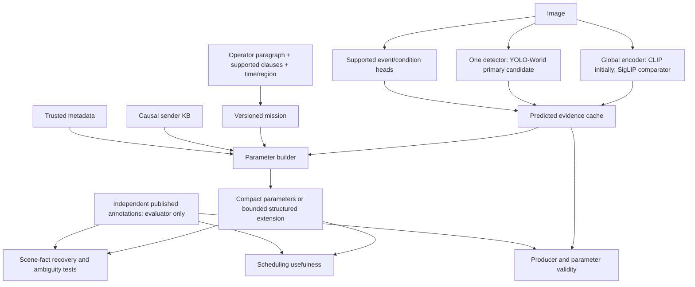

# Empirical protocol: do compact parameters preserve the scene information we need?

Design revision:25 October2026. Status: proposed experiments, not executed results.
PLAN.md remains the canonical action/decision record; this document specifies its
new parameter-representation study. The prior scheduler-only pilot remains valid
only within its reported scope. No new remote experiment is launched by this plan.

The next increment is [JSON_PARAMETER_VALIDATION.md](JSON_PARAMETER_VALIDATION.md):
single-image and image-series records,CLIP alignment,blind Qwen-VL claim review,
independent reference metrics and Luna trace analysis. It operationalizes the
parameter-first part of this protocol; policy experiments stay deferred.

Latest layout/model pilot is specified in VLM_PILOT_PROPOSAL.md. User now requests
GPU0extraction/GPU1reviewer;this supersedes the earlier DataParallel requirement
in historical operational text below. This is an exploratory parameter study,
including negative results and evidence-led method/field revisions,not an attempt
to make a model approve a predetermined final parameter set.

## 1. Objective and meaning of scene representation

Study whether a compact, interpretable, mission-conditioned parameter bundle can
preserve the scene distinctions needed for receiver decisions. Discover what it
represents accurately, what it discards, where it fails, and whether a bounded
structured extension is justified. Scheduling is a downstream test, not the sole
definition of parameter correctness.

"Nature of a scene" is operationalized as independently annotated facts:

1. Environment/place: road, residential, forest, indoor, etc.
2. Entities: people, vehicles, buildings, bridges, etc.
3. Events/conditions: flooding, fire, building damage, blocked road, etc.
4. Attributes/relations: supported damage class, object extent, explicitly annotated
   subject-predicate-object relations where available.
5. Mission relevance: which facts answer the operator's request.
6. Incremental/temporal information: what is new relative to a declared history,
   and trusted capture time/deadline where supplied.
7. Evidence uncertainty: which claims may be wrong or unavailable.

Do not claim a fixed handful of scalars represents every fact in every image.
Sufficiency is assessed relative to declared targets, domains and missions. A
finding that the original scalars are insufficient is a legitimate research result.

Research questions:

- RQ1: Do the producers correctly measure the intended facts?
- RQ2: Which facts can be recovered from the parameter bundle; which collapse?
- RQ3: What does each parameter add beyond relevance and simple scene labels?
- RQ4: Do mission/history changes affect values correctly, distinguishing rarity,
  visual difference and additional task evidence?
- RQ5: Which findings transfer to new groups/domains and a withheld mission?
- RQ6: Does the representation improve early useful evidence under decoder backlog,
  at defensible extraction cost and header size?

These are separate endpoints. High A10 does not alone establish RQ1 or RQ2.

## 2. System boundary and architecture

Runtime stays `[ParameterHeader][complete LatentPayload] -> receiver queue ->
select one whole job -> one existing decoder`. No resource grants, encoder
redesign, automatic retransmission or bandwidth-saving claim from ordering
already-received messages. Causal transmitter-side KB is retained. Receiver
selection has no pixels, latent contents, hidden fact IDs or future observations.

These producers have different responsibilities; this is not ensemble voting.
CLIP and a detector are separate visual networks unless actual weight sharing is
implemented. Reusing CLIP features for relevance/KB/heads does not share all
detector computation.

### YOLO-World's role

Use a pinned pretrained YOLO-World checkpoint and explicit versioned vocabulary
for object categories, boxes and scores. Its offline vocabulary mechanism permits
configurable text categories without a resident detector per scene. It is not
evidence of equal accuracy across ordinary, drone and satellite domains. Compare
against the existing Grounding DINO candidate on identical annotated development
images; retain the justified accuracy/cost choice. [S1,S2]

YOLO-World is not the complete scene classifier. Objects do not certify damage,
distress, accessibility or causal relations. Global features and fold-local
multilabel heads supply supported place/event/condition evidence. Scene labels
overlap; use soft applicability, not an exclusive scene gate that hides other facts.
Prompting "person in distress" is not a validation of distress recognition.

Canonicalize synonyms; retain vocabulary/model hashes; validate class-aware
duplicate suppression, coordinate transforms, clipping and available-zero states.
Use damage/blocked-road heads only where independent annotations support them.

## 3. All parameter candidates and their validation

| Candidate | Meaning / producers / alternatives | Independent reference and limitation |
|---|---|---|
| Context relevance R | Operator mission; global image-text similarity versus supported entity/condition matching or small trained head | Published compatible mission labels; hard confusions; same-image mission changes. Similarity is a prediction, not truth |
| Transmitter novelty N | Appearance difference versus additional predicted conditions/facts after KB retrieval | Repeats, controlled invariant transforms and annotated new facts where correspondence exists. Retrieval does not certify asset identity |
| Scarcity S | Smoothed concept rarity in a declared history/population | Hand-counted histories, support/window effects and usefulness ablation. Rare is not automatically important |
| Task importance I | Historical weighted formula as baseline only; retain supported condition/severity evidence without arbitrary importance weights | Damage class validates damage, not rescue urgency. Outcome/criticality must be declared or independently annotated |
| Temporal F/AoI | Trusted timestamp, operator allowed delay; age/deadline/slack | Clock/trust arithmetic tests; synthetic schedules explicitly engineering-only. No unexplained exponential decay |
| Spatial prominence P | Relevant-object visibility, box extent/position; mask extent when available | YOLO-World/DINO against boxes/masks. Box size is not visible mask area, physical distance or emergency severity |
| Scene complexity C | Relevant entity count/coverage/diversity; raw all-object count/entropy baseline | Annotated counts/coverage and distractor controls. Semantic masks alone do not identify instance counts |
| Reliability Q | Claim-specific score, calibration, availability/support | Per-claim Brier/log loss, reliability bins, risk-coverage. Detector score is not mission probability; confidence is not importance |
| Scene/event evidence | Overlapping place/entity/event/condition description, structured if needed | Native masked multilabel annotations; compare structured output against scalar reduction |
| Geographic/source context | Trusted mission-region match and declared sensor properties | Metadata provenance and geometric tests. Source or dataset ID is a shortcut control, not intrinsic importance |
| Complementarity/relations | New useful attribute/fact and supported entity relationships | Actual correspondence/relations. Distinct from rarity; a changed angle need not add information |

Task importance has not disappeared as a question; its old weighted scalar is not
a defensible answer. Operator mission and independently supported consequences
determine utility. Operational urgency and individual distress remain unsupported
where labels cannot establish them.

### Numerical definitions to compare

- Unit embedding `e=z/||z||`; appearance novelty baseline
  `N_visual=(1-max cosine(e,e_history))/2`. Cold start is explicit, not a learned
  declaration that a new disaster occurred.
- Retrieve prior observations and compare supported predicted entities/conditions.
  Gold new-fact sets validate this only on correspondence-supported arms. Preserve
  changed conditions separately from repeated same-condition facts.
- Exclusive concept-frequency rarity: `p(c)=(n_c+alpha)/(N+alpha*V)` and
  `S(c)=-log p(c)`. For multilabel image-presence use per-concept smoothed Bernoulli
  frequency instead. Never mix object counts with image denominators. Report
  support, smoothing, reference population and units.
- Clipped normalized box extent: `(x2-x1)*(y2-y1)/(W*H)`. Aggregate union area to
  avoid overlapping-box inflation. Explicitly distinguish box from mask extent.
- Complexity is an explicit vector of relevant count/coverage/diversity. Its
  sensitivity to ontology, image resolution, detector threshold and false boxes
  is measured, not hidden in a single "semantic richness" label.
- With capture c, receiver time t, allowed age D: `age=t-c`, `deadline=c+D`,
  `slack=c+D-t-E[T_decode]`. D comes from operator/application. Clock inconsistency
  is reported, not silently clamped into apparent freshness.

KB query occurs before commit. Batch visual inference must not change serial
sender history. Start with memory64/top3 retrieval. Develop sensitivity with
memory16/64/256 at top3, then top1/3/5 for the selected memory; avoid multiplying
every model setting by every KB setting. Sender novelty cannot infer what other
senders already delivered. Test cross-sender redundancy at the receiver separately.

## 4. Data and annotation-support matrix

| Source | What it can support | Study role / access limitation |
|---|---|---|
| LADI | Image-level infrastructure/road/flood observations | Existing development/control and prepared cohort; no asset correspondence in current adapter |
| MEDIC | Incident, informativeness, humanitarian category, general severity | Diverse social images and compatible mission labels; no inferred building-specific damage; contains CrisisMMD [S3] |
| COCO | Covered ordinary objects, boxes and masks | Ordinary entity/localization reference; does not certify absence of disasters or safe scenes [S4] |
| RescueNet | UAV semantic masks including building/road conditions | Preferred disaster spatial/condition reference after access/schema pilot; no assumed instances/cross-view IDs [S5] |
| Incidents1M | Overlapping incidents/places and explicit category negatives | Preferred matched event/place confusions if accessible; missing categories remain unknown [S6] |
| xBD/xView2 | Building polygons, conditions, pre/post correspondence | Conditional object-condition and controlled crop experiment; access gate, temporal changes distinct from repeated views [S7] |
| Visual Genome | Objects, attributes, explicit relations | Small relational stress study with incomplete-label caveats and cross-source duplicate audit [S8] |
| FloodNet | Structural flooding/scene annotations | Protected scheduler-unseen mission; never select producer/header using target flooding labels [S9] |

Core feasible route: reuse LADI/MEDIC, add one accessible object-annotated ordinary
cohort and one disaster-mask cohort. Do not require every dataset before progress.
Audit20 records per new source first. Access failure leaves a cell incomplete;
do not manufacture labels with a VLM as a substitute.

Each source/mission cell declares positive, explicit-negative, unknown, independent
group counts, boxes/masks, conditions, relations, timestamps and geolocation. Keep
source-specific damage meanings. Binary harmonization is allowed only where a
documented mapping is defensible. An image-level label does not propagate into an
arbitrary crop. Semantic connected components are not automatically real instances.

Separate evaluation regimes:

1. Ordinary/incident discrimination with supported positive/negative annotations.
2. Same place/entities but different event/condition: hard confusions.
3. Equally relevant observations with different supported contents.
4. Same image under different supported missions; retain the original paragraph.
5. Exact repeats, controlled overlap, changed conditions and complementary facts.
6. Mixed scenes, camera/domain changes, small/occluded objects and low visibility.

Use within-source positives/negatives wherever available. COCO versus disaster
style is a confound, not a semantic result. Add source-balanced comparisons and
a dataset-ID probe to reveal shortcut information. Balanced stress panels and
natural-prevalence estimates remain separate. Ordinary scenes may still be
important under another mission.

Group before fitting/cropping: parents, exact/near duplicates, video/site/event
where known and cross-source overlap. Preserve official split lineage and old
development exposure. Final groups cannot be reused for producer selection.
Frozen producer pretraining exposure remains disclosed; scheduler-unseen does
not mean unseen by all pretrained components.

## 5. Representation sufficiency: compared with what?

Let predicted evidence be E, mission q, causal history H, metadata M and parameter
bundle `h=P(E,q,H,M)`. Independent targets Y are annotated scene facts.

| ID | Representation | Question |
|---|---|---|
| B0 | Majority/prevalence, mission-only, metadata/masks-only controls | Are shortcuts enough? |
| B1 | Relevance, then relevance+causal novelty | What does a strong minimal representation retain? |
| P0 | Historical eight fields and availability | How does the preserved old design behave? |
| P1 | Candidate global parameters plus scene-applicable evidence | What do our proposed parameters retain? |
| P2 | P1 plus bounded sparse evidence items | Can a few explicit categories/conditions/extent items repair ambiguity? |
| D1 | Cached global embedding | Stronger dense comparator, not ground truth |
| D2 | Predicted objects/conditions/geometry/relations where supported | Richer structured comparator, not ground truth |
| O | Evaluator-only annotated fact/reference policy | Privileged diagnostic, not deployable baseline |

All compare against the same independent Y on identical groups and target-support
cells. Give readouts the same declared mission/context. P1/D2 should use the same
producer cache when isolating information loss. A descriptor requiring extra
producers is a separate whole-pipeline comparison with extra cost disclosed.

Fit cheap, matched readouts: regularized linear/multilabel models first; a small
tree readout checks nonlinear interactions when decision-relevant. Fit/tune only
inside development roles. Equalize search budgets rather than require identical
input dimensions. Failed probes alone do not prove information-theoretic absence;
consistent independent-target deficits and concrete header collisions are stronger
evidence. Do not use cosine distance from the producing model as the only truth.

Concrete E06 test (illustrative labels,not a measured example): one annotated
image supports `building_present=1`, `building_damaged=1`, `road_blocked=0`;
`person_trapped` is unknown and omitted. ReadoutA receives P1 parameters,readoutB
receives D2 predicted evidence,readoutC receives D1 embedding. They are trained
on training groups to predict the same supported labels and tested on the same
held-out groups. If B predicts damage well but A cannot,inspect whether scalar
aggregation discarded the condition. If neither succeeds,inspect producer/domain
accuracy. Do not insert the annotated labels into A or B. Per-label source coverage
and mission distribution are held comparable,so dataset style cannot masquerade
as recoverable semantic information. Readout weights are experimental probes,
not additional transmitter-side importance weights.

Metrics by supported fact family:

- Entity/place/event/condition: macroAP, per-classAP, macroF1 with development
  thresholds, balanced error and known-label counts. Classes without support are
  unavailable, not assigned zero or silently removed from different comparators.
- Relations: classification/F1 on observed annotated candidates; unannotated
  relationships are not reliable negatives. No complete-recall claim on partial data.
- Extent/count: MAE/signed error by scale and occlusion; detection AP/precision/
  recall on compatible boxes. Compare masks with masks, boxes with boxes.
- Probability quality: Brier/log loss, reliability bins, risk-coverage and class support.
- Contrasts: independently supported change-detection and controlled invariance
  errors. Parents/events, not transformed copies, are the independent units.

### Separating producer error from header information loss

First compare raw predicted E with Y. Then compare compact h and richer predicted
descriptors using Y again. Optionally aggregate gold annotations with the same
parameter formulas as an explicit privileged diagnostic of aggregation loss.
Feeding true target relevance directly into an oracle header is leakage for a
deployable method; never present it as an ordinary competing pipeline.

If E is wrong and h is wrong, fix extraction. If E captures the fact but h collapses
it, investigate representation. If h preserves facts but ordering is poor, inspect
the decision objective/policy. This diagnosis precedes model escalation.

### Collision/ambiguity analysis

Find exact quantized-header matches and training-defined near neighbors with
different known facts, under the same mission/comparable histories. Report
disagreement relative to prevalence/source controls and preserve concrete pairs.
Examples of questions, not assumed labels: intact/damaged building; damaged empty
scene/person visible; road with/without a supported blockage; same fact/new fact.
Relations such as "person trapped" require actual corresponding annotations.
Do not choose collision thresholds with final labels. No silent asset-ID matching.

Output a fidelity/utility-versus-bytes curve. P2 extensions start with top4/top8
supported evidence items, not an unrestricted paragraph. D1 can be compared at
training-fitted16/32-dimensional quantized projections and full cached dimension;
include identical metadata/registry overhead. These are bounded candidate sizes,
not a claim that one has the necessary capacity. No codebook redesign is required.

## 6. Experiment registry

| ID | Experiment | Deliverable / decision |
|---|---|---|
| E00 | Existing evidence, prepared outputs, source support/exposure audit | Source/group/annotation manifests; usable/inaccessible cells |
| E01 |10-image real producer preflight | Version/shape/box/preprocessing correctness, latency/memory, explicit failures |
| E02 | YOLO-World versus DINO, same100–200 annotated development parents | Per-class/scale/domain detection metrics and measured cost; justified producer choice |
| E03 | Relevance, condition, prominence and complexity validity | Independent target metrics; same-background confusions and distractor controls |
| E04 | Novelty/rarity/history mechanism | Repeat/invariant/new-fact cases; cold start, windows, frequency references and cross-sender limitations |
| E05 | Context controls | Same-image supported mission changes, paraphrases, unsupported clauses/negation, ignored/shuffled mission controls |
| E06 | Scene-fact recovery from B0/B1/P0/P1/D1/D2 | Matched target/readout/fold comparison; per-fact/domain information gaps |
| E07 | Header collisions and counterexamples | Annotated pair gallery, aliasing rates, invariant-change failures |
| E08 | Conditional bounded P2 extension | Missing-distinction recovery versus extra bytes/compute; retain or reject |
| E09 | Group ablation and method sensitivity | Add/remove/shuffle/matched-missingness controls; producer versus output ablation |
| E10 | Reliability, time and geography | Claim calibration/abstention; trust/clock/region numerical cases; natural/synthetic separation |
| E11 | Robustness/transfer | Held groups/domains, mixed scenes, missing producer, low visibility, protected mission |
| E12 | Precision, size and compute frontier | Actual8/16-bit replay, sparse/dense alternatives, online producer/policy cost |
| E13 | Scheduling usefulness | Strong baselines and same queues; A10/coverage/redundancy; ideal versus codec separate |
| E14 | Locked confirmation | Frozen specification/comparators, fresh groups and paired uncertainty |

E00/E01 precede expansion. E02–E07 establish the core representation evidence;
E08 requires an observed gap. E09 is development only. E13 cannot substitute for
direct validity. E14 is opened once after freeze and never used to repair tuning.

Training specifics:

- Initially freeze large pretrained producers. Train small supported claim heads
  within the training fold; masked BCE for known multilabel targets, categorical
  CE for a compatible exclusive target. Unknown labels contribute no supervised loss.
- Calibration belongs to a separate training-side group subset. Temperature scaling
  is a candidate, not a domain-shift guarantee. [S10]
- All transforms/PCA/readouts/field selection are training-fitted. Zero-shot source
  transfer, target calibration/adaptation and task transfer are different results.
- Existing normalized marginal-gain MSE remains the first scheduler training loss;
  no need to replace it before validating the representation. Add pairwise/neural/RL
  only for a specific remaining limitation under equal information.

## 7. Search, uncertainty and evidence gates

Avoid the full Cartesian product of models, prompts, KB settings, fields and
policies. Heavy experimentation means discriminating tests, not unchecked sweeps.

1. Compare global-only/detector-only/global+detector on supported development cells.
   YOLO-World primary; DINO bounded comparator; CLIP global first, SigLIP alternative.
2. Tune supported vocabulary/threshold/postprocessing within development groups;
   keep equal prompts/label mapping for meaningful producer comparisons.
3. Test individual groups, minimal core and full supported representation. Add or
   remove one group and identify interactions before exhaustive selection.
4. For p available groups, inclusion search is `2^p-1`, not p^p. Reliability/time
   metadata and structured arrays are not automatically one scalar each.
5. Ridge alpha0.1/1/10. Small trees only on core/full/top3 distinct subsets initially.
   Compare calibrated/raw evidence, task/all-object complexity and appearance/
   evidence novelty with fixed budgets. Experts/MoE only if a shared-system failure
   warrants their operating cost; no detector fleet as a default.
6. Grouped3outer/3inner selection when label and independent-group support permit.
   Otherwise descriptive results and more groups, not more queue seeds.
7. Select using per-target fidelity, robustness, utility and measured cost/bytes.
   Show Pareto alternatives; do not combine F1,seconds and bytes into arbitrary weights.
8. Set practical equivalence margins from development variability and operating
   needs before final confirmation. Historical A10 one-SE selection is not a
   universal scene-representation validity threshold.

Bootstrap paired independent event/site/sequence/duplicate groups where known.
Queue repetitions/crops are repeated measures. Fixed-queue parent reweighting is
a conditional sensitivity analysis, not event generalization. Report effect sizes,
intervals, independent counts and all missing cells. Broad exploratory screens do
not become multiple confirmatory discoveries. Use the pilot to estimate sample
needs;100–200/2,000/10,000 are workload bounds, not power calculations.

No universal accuracy threshold for "enough" is invented after seeing results.
Conclude adequacy only for specified fact families, tolerances, domains and decisions.
Missing relation/correspondence truth means an unresolved conclusion for that family.

Before E14,register practical fidelity tolerances and the exact supported target
set per domain. If the compact-minus-richer paired effect interval falls below
the registered tolerance for a required fact family,declare it inadequate there.
If evidence is too uncertain,declare inconclusive rather than adequate. Information
retention and operational adequacy are distinct: two equally inaccurate producers
cannot establish adequacy merely by matching each other. Probability of correctness,
calibration and failure costs must accompany any critical-use interpretation.

## 8. Scheduling arm after representation validation

Primary static queue32 ready jobs,four logical senders,one decoder,K=10. Compare
mixed relevance, all-relevant diverse evidence, exact repeats and supported
multi-fact overlap separately. Actual natural camera-view correspondence is a
separate available/unavailable arm, not inferred from crops or cosine similarity.

`C_k = distinct exposed supported fact weight / total offered weight`;
`A_K = mean(C_1,...,C_K)`. Failures consume opportunities and add no facts.
Zero-utility queues are undefined and counted. Native image atoms measure distinct
annotated observations, not necessarily distinct buildings. Model-assessed
reconstruction facts must be labeled separately from source annotations.

Policies: FIFO,RR,random,relevance,novelty,incident filter,relevance+repeat/overlap
deferral,linear and small tree contextual scorers. Same-header policies use actual
decoded headers. Descriptor policies are a separate information/cost comparison.
Oracle facts stay evaluator-only. No-backlog control tests when order cannot help.
RL requires valid multi-fact planning headroom after simple greedy/lookahead; it
does not repair an insufficient representation or invalid labels.

## 9. Contracts, caches and next build/test/integrate slice

Preserve existing extraction API and historical baselines. Proposed new modules
under BetterScheduler (not yet implemented by this document):

- `producers/yolo_world.py`: pinned model/vocabulary, canonical objects/coordinates,
  postprocessing, provenance and failures.
- `evidence_cache.py`: immutable prediction shards and complete cache identities.
- `annotation_adapters.py`: native support masks/ontology/provenance, evaluator side.
- `parameter_validation.py`: independent metrics and contrast/history fixtures.
- `representation_study.py`: fact readouts, aliasing and richer comparisons.
- Existing study modules reused after the corrected validated inputs are ready.

Separate records and APIs:

1. EvidenceRecord: content hash,dims,coordinate transforms,embeddings,predicted
   scene/condition scores,detections,model/prompt/ontology hashes,timing and failures.
2. ParameterBundle: mission/history-specific runtime values,availability/methods,
   dependency identity and permitted metadata. Receiver fields explicitly serialized.
3. AnnotationRecord: native facts,boxes/masks/relations/correspondence,support,
   groups and split provenance. No extractor/runtime access.

Visual-cache key includes content/preprocessing/model/vocabulary/code/schema.
Parameter-cache key adds mission and causal history/reference-population digest.
Fixed per-image novelty is invalid across different histories. Label poisoning
cannot affect frozen extraction outputs. Do not transmit filenames/dataset/event
IDs as shortcut features. Count masks,metadata and shared-registry identifiers in
header size. Intermediate cache bytes are not transmitted payload bits.

First complete increment:

1. Verify current prepared receipts and preserve untouched final roles; no old
   watcher restart or duplicate downloads.
2. Audit20 records/new adapter; choose100–200 supported development parents with
   ordinary scenes, incidents and annotated hard contrasts.
3. Implement/test YOLO-World adapter and run10-image real preflight.
4. Cache global and localized evidence; DINO comparison on identical images.
5. Execute direct E02/E03/E04 and an E06 fact-readout comparison. Deliver errors,
   overlays,counts,cost and unsupported cells before another model is added.
6. Integrate extractor/header compatibility tests. Select provisional candidates;
   only then define the larger experiment configuration within existing budgets.

## 10. Resource and operational boundaries

- Reuse prepared/cached data. No new remote job is launched while writing this plan.
- Preserve caps10,000parents,20GB curated-source downloads,8aggregateGPUhours.
  Reconcile prior actual bytes/device time first. Downloaded shards count even if
  deleted; do not reset the counter between stages.20GB is a cap,not a target.
- If new mask/relation sources do not fit remaining budget, narrow the study or
  obtain a material resource-change decision before exceeding it.
-10-image preflight,then100–200 annotated development parents. Expand provisionally
  to<=2,000 supported development parents only when measured cost/label support
  justify it.10k is a ceiling,not mandatory for every producer or experiment.
- CPU for integration/cache metrics/probes. For dualGPU extraction verify assigned
  devices,tensor-only batching,both-device ownership,single/parallel parity for each
  actual producer. CLIP's parallel wrapper does not prove detector parallel support.
- Keep managed Kaggle torch/CUDA; pin detector dependencies in isolated source.
  No global installation, unbounded retry or silent CPU/singleGPU fallback.
- Each GPU job has internal cap and server timeout, counting assigned devices.
  Preserve incremental shards/configuration/cell logs/executed notebook; maintain
  KAGGLE_RUNS.md and verify saved-version retrieval/checksums.
- Source,datasets,caches and persistent results stay separate. Never overwrite old
  results or mutate healthy runs merely to retrofit this new plan.

## 11. Deliverables and completion

For each parameter report: intended construct,source/proxy,units,availability,
validity metrics,incremental fact recovery/ordering value,domain stability,cost,
counterexamples and a decision. Distinguish: supported,decision-useful-only,
redundant,unreliable,representation-insufficient,insufficient evidence.

Deliver:

- Annotation/support/exposure/group audit and protected role manifest.
- Executed producer/parameter notebooks, overlays and numerical reference cases.
- Scene-fact recovery and collision/contrast reports for compact/richer versions.
- Revised PARAMETER_DECISIONS.md based on experiments,not model consensus.
- Cost/fidelity/utility/bytes frontier and exact quantization replay.
- Frozen ontology,producer,method,calibration,dependency and serialization specification.
- Separate representation,scheduling,transfer and actual-codec results.
- Negative/incomplete results and bounded claims.

Main Sol owns design/implementation/integration; Medium assesses milestones without
editing; Luna High runs bounded validation/operations when available. No model
audit is human ground truth. Unavailable delegate/access/usage is reported honestly.

The contribution would be an empirical characterization/design of compact
mission-aware semantic headers and their decision consequences. Novelty/SOTA is
not established by assembling YOLO-World,CLIP and a ranker. Journal claims require
completed independent experiments and inspected closest work. No saved-lives
claim follows from benchmark image ordering.

## 12. Provenance and primary sources

Existing pilot: `../results/local/20261025T082051Z`; wire replay:
`../results/replay/20261025T084941Z`; independent audit:
`../results/validation/20261025T093313Z/VALIDATION_REPORT.md` and validation.json.
These do not validate the new study or YOLO-World. Source hashes remain tied to
actual snapshots. User note preserved in evidence/; old plan preserved in history/.

Sources inspected25October2026; external results are not transferred to our data:

- S1 [YOLO-World paper](https://arxiv.org/html/2401.17270v3),offline-vocabulary
  inference and detection experiments; [official code](https://github.com/AILab-CVC/YOLO-World).
- S2 [Grounding DINO paper](https://arxiv.org/html/2303.05499v4) and
  [official code](https://github.com/IDEA-Research/GroundingDINO).
- S3 [MEDIC native schema](https://crisisnlp.qcri.org/medic/).
- S4 [COCO tasks/data](https://cocodataset.org/).
- S5 [RescueNet official dataset](https://github.com/BinaLab/RescueNet-A-High-Resolution-Post-Disaster-UAV-Dataset-for-Semantic-Segmentation).
- S6 [Incidents1M paper](https://arxiv.org/html/2201.04236v1).
- S7 [xBD paper](https://arxiv.org/abs/1911.09296) and
  [xView2 official baseline](https://github.com/DIUx-xView/xView2_baseline).
- S8 [Visual Genome project](https://homes.cs.washington.edu/~ranjay/visualgenome/).
- S9 [FloodNet official project](https://github.com/BinaLab/FloodNet-Supervised_v1.0).
- S10 [Guo et al.,calibration](https://proceedings.mlr.press/v70/guo17a.html).
