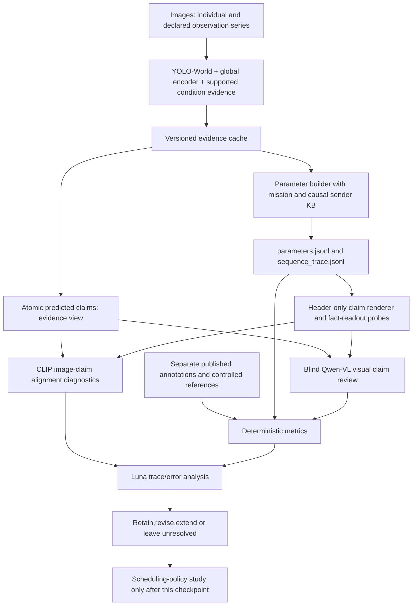

# Parameter-first JSON experiment: single images, image series and independent review

Design dated25October2026. This is the next-increment specification under
PLAN.md and EMPIRICAL_PROTOCOL.md. Status: plan and example contracts,not executed
vision-model results. Do not restart the previous scheduler-sweep notebook chain.
All new artifacts and future implementation belong in BetterScheduler.

Operational refinement:[VLM_PILOT_PROPOSAL.md](VLM_PILOT_PROPOSAL.md) records model
benchmarks,exact proposed extraction methods and reviewer-discrimination gates.
Latest user instruction partitions GPU0for producers/GPU1for VLM review rather
than requiring DataParallel. The pilot is exploratory; failures guide parameter
revisions and are not erased to improve model approval.

## 1. Decision and relationship to the referenced chat

Use JSON to preserve evidence,parameter values,claims,history and reviews. Use
CLIP for alignment diagnostics,Qwen-VL for visual claim-level assessment,and
Luna High for code-based trace analysis and bounded failure review. This does
not combine three votes into ground truth. Published annotations and controlled
constructions remain separately identified reference evidence.

The requested live read_thread interface is not exposed. A saved local transcript
for `01a171eb-4a83-70e0-8d14-23cdee70ef80` was inspected as a snapshot; latest live
changes cannot be verified. The useful proposal there is to separate parameter,
reference,decision and review JSON. We adopt that information separation,add
explicit claim provenance and evaluate parameters before scheduling policies.
External/chat content is context,not authority to launch jobs or redefine truth.

The immediate question is:

> For a declared mission and available observation history,which scene facts and
> useful distinctions do our parameter values preserve,which do they lose,and why?

Importance has no universal image-only ground truth. During this phase,report
mission relevance,supported condition/severity,additional evidence,uncertainty and
timing separately. Do not hide them in a newly weighted scalar. Later scheduling
will choose an explicit mission outcome using this representation.

## 2. The experiment in one diagram

The evidence cache is richer than the header. Both are evaluated,but must not be
confused. A rich image description generated from full detections cannot prove
the compact header retained those detections.

## 3. Components and permissions

| Component | Receives | Produces | Does not establish |
|---|---|---|---|
| YOLO-World | Pixels + versioned entity vocabulary | Objects,boxes,scores | Universal scene understanding,verified damage or distress [L1] |
| CLIP/global producer | Pixels + supported text clauses | Global features,similarities,small-head input | Per-claim truth or universal importance [L2] |
| Parameter code | Predicted evidence,mission,causal KB,trusted metadata | Values,masks,dependencies,raw/support units | Missing labels/asset identity |
| CLIP diagnostic | Pixels + fixed plain-language claim/contrast | Raw cosine and contrast margin | Calibrated correctness; scheduling quality [L3,L4] |
| Qwen-VL | Actual pixels + blinded atomic claims; bounded history for comparisons | Supported/contradicted/unclear judgments with visible evidence | Ground truth by declaration; calibrated confidence [L5,L6] |
| Deterministic evaluator | References + frozen predictions/reviews | Numerical metrics and support counts | Facts never annotated or correspondence never supplied |
| Luna High | Saved JSON,code,manifests,metrics; explicitly supplied images if available | Recomputed metrics,trace invariants,failure report | Independent visual evidence without image access; final truth by model agreement |

Use YOLO-World as primary detector candidate,DINO as the bounded comparison.
CLIP is the initial global encoder,SigLIP an alternative rather than another
mandatory whole-data pass. No fleet of scene-specific YOLO models. Place/event
labels overlap; conditions/relations need supported extraction and evaluation.
Primary producer arm does not use Qwen to generate conditions and then let the
same Qwen certify them. A Qwen-producer arm,if added,is labeled separately and
cannot use its own judge scores as independent final evidence.

## 4. Data/cohort and split roles

Reuse current development images/caches and prepared LADI/MEDIC outputs after
retrieval verification. Add bounded accessible annotation cohorts as needed:
ordinary objects/boxes from COCO; disaster masks/conditions from RescueNet;
Incidents1M hard event/place negatives if accessible. Relations and natural
cross-view complementarity remain conditional on actual annotations.

First mechanism cohort:at most200 parent images,provisionally60LADI,60MEDIC,
40ordinary object-annotated and40disaster mask-annotated images. These are workload
targets,not power calculations or permission to invent unavailable source cells.
The first200 are development; do not call them a fresh final after examining them.
Preserve parent/duplicate/site/event/sequence groups and protected final roles.

Start with supported missions:building damage,road damage/blockage,and separately
MEDIC informativeness/humanitarian evidence. General MEDIC damage is not a building
label. People visible does not imply injury. Keep flooding mission references out
of producer/representation selection if claiming scheduler-unseen flooding later.

Within-source positives/explicit negatives and matched backgrounds are essential.
Ordinary COCO images are not automatic no-disaster negatives. Missing labels and
unannotated relationships remain unknown. Audit20records/new adapter before
expansion and record per-target independent-group support.

## 5. Single-image experiments

For every image save original content identity,mission,predicted evidence,parameter
bundle and supported claims. Geometry/count/time/rarity calculations are performed
by code; do not ask a language model to invent them.

Compare:

- R: global similarity versus supported event/entity/condition evidence.
- P: normalized target-box extent versus appropriate box/mask reference; record
  union overlap and coordinates,not physical distance.
- C: task-relevant count/coverage/diversity versus raw all-object count; add
  annotation-preserving irrelevant-content controls only where defensible.
- Q: claim correctness/calibration and missingness; confidence is not importance.
- Scene/event descriptions: supported overlapping classes/conditions and relations.
- I: old formula as historical comparison; no replacement arbitrary importance weight.
- Temporal/geography: trusted metadata tests; static missing values stay unavailable.

Use the same image under two missions only where references support both. Retain
the original paragraph; short clauses,negation,unsupported requests and paraphrase
handling have explicit versions. Do not silently truncate long paragraphs.

### Two claim views prevent a false sufficiency result

1. Evidence claims derive from full predicted object/condition evidence. They test
   extraction correctness. Example:"a building has visible damage".
2. Header-only claims derive solely from transmitted parameter fields and a frozen
   shared registry. They test what the header itself expresses. If class/condition
   identity was discarded,the renderer cannot quietly recover it from image cache.

A generic field like "relevance=.8" is not a visual factual sentence. Its CLIP
claim score is unavailable/not-applicable. Assess it against independent mission
labels. Do not generate a rich caption from a few numbers and score that caption
as proof the numbers contain the scene. Header fact-readout probes are separate
trained experimental consumers,with training-group-only supervision.

Record every claim's renderer version,input-view and exact source fields. Fixed
language templates avoid a different caption generator becoming a confound.

## 6. Series experiments: parameters change with history

Construct at most24 observation series of6messages from the bounded parent pool,
with declared sender order. This is not yet a policy-selected decoding order.
Use up to3series/family; unavailable correspondence leaves fewer series and a
missing-cell report. Derivatives and repeated images are not new independent parents.

| Family | Expected behaviour / falsification |
|---|---|
| Exact repeated image | Relevance stable; appearance novelty falls after commit; no new fact |
| Appearance-only change | Mild annotation-preserving perturbation should not produce new semantic facts; visual distance may change |
| Newly revealed annotated fact | Additional evidence increases where correspondence/masks establish it |
| Known entity,changed condition | Preserve a supported condition change rather than dismiss it as repetition |
| Same scene type,different condition | Distinguish intact/damaged or clear/blocked where references support it |
| Rare but mission-irrelevant content | Rarity may rise without claiming importance; relevance should remain separately low |
| Cross-sender repeat | Sender-local novelty may stay high; flag the receiver information limitation explicitly |
| Same images,different mission | Mission-sensitive outputs change appropriately; unrelated raw appearance features need not |

Most constructed series have synthetic observation order,not natural capture time.
Do not label them real temporal disaster evolution. Crops require spatially
supported fact inclusion; image-level positives cannot label every crop. Only
annotation-preserving transforms count as invariance controls; a crop can remove
an object,and a horizontal flip changes left/right relations.

At each step:

1. Log sender/mission,position,history-before IDs/hash and KB version.
2. Query history and calculate N,S,other fields without adding the current image.
3. Serialize/validate the bundle; commit only after that succeeds.
4. Log history-after and the reason a field changed.
5. Evaluator calculates known new facts separately. Qwen pair/history review is
   secondary and must record which prior images were actually supplied.

Test the same current image after empty history,an identical prior observation,
and a different supported evidence history. Its cached pixels/features are the
same; its N/S values need not be. Do not cache one universal novelty per image.
The sender KB is distinct from receiver successful-decode history; no false
assumption that all senders share knowledge.

## 7. JSON files and joins

| File | Purpose | Runtime access |
|---|---|---|
| manifest.json | Source/config/model/prompt/ontology/hardware/budget identity | Provenance only |
| images.jsonl | Content identities,source groups,image locators and preprocessing | Extractor; permitted identities not learned semantic inputs |
| evidence.jsonl | Predictions,boxes,embeddings/sidecar hashes,producer failures | Extractor only; richer comparator arm explicitly declared |
| parameters.jsonl | ParameterBundle,mission and history identity | Future runtime/header input |
| claims.jsonl | Atomic claims with evidence/header-only source-field provenance | Offline validation |
| references.jsonl | Published/controlled labels,known masks,correspondence and provenance | Evaluator only |
| sequence_trace.jsonl | Before/after KB identities,step,parameter record link | Reproducibility; restricted runtime views separately defined |
| clip_alignment.jsonl | Claim/template/contrast/model identities,raw scores,applicability | Diagnostic only |
| qwen_reviews.jsonl | Image-input receipt,blinded claim verdicts,raw-response path,failures | Secondary model assessment |
| metrics/*.json | Direct validity,judge reliability,readouts,series checks,support | Evaluation |
| audit/luna_report.json and .md | Recomputations,contradictions,evidence gaps | Audit only |

Join by run_id,image_id,mission_version,parameter_record_id,claim_id and history
digest as applicable. Never join only by filename or image identity when mission
or history differs. Pixels/embeddings/large responses can be sidecars with hashes;
JSON is an inspectable interchange representation,not a requirement to transmit
all audit data. JSON bytes do not equal final header size or latent payload size.

Use real JSON null plus availability/reason,not NaN,zero substitutes or fabricated
confidence. Preserve native labels and AI review provenance. Invalid model JSON
is a parse failure with raw response retained; at most one documented repair,
never unlimited retries until a desired answer appears.

Draft schema artifacts under schemas/ describe these planning contracts. They do
not retroactively validate existing runtime JSON or require a migration this turn.

## 8. CLIP alignment check

Render an eligible atomic claim as plain language using a fixed template; do not
feed raw JSON syntax into CLIP as a semantic description. Record:

`a = cosine(E_image(I),E_text(claim))`.

For a matched condition/entity contrast with independently supported applicability,
also record `margin = a(candidate_claim)-a(contrast_claim)`. Construct contrasting
claims from a frozen vocabulary/reference rule,not by searching final images for
high margins. Attribute/relationship/negation contrasts are useful failure probes,
not guaranteed CLIP capabilities. [L2-L4]

Optional annotation-derived descriptions are evaluator-only reference diagnostics,
not fed to the producer. A score against them is not semantic completeness.
No arbitrary universal cosine threshold or conversion to probability. Where CLIP
also produces relevance,the check is correlated/self-consistency evidence. A
SigLIP diagnostic can test model dependence,not make the result independent truth.

## 9. Qwen-VL claim review and reviewer validation

Use a real vision-language checkpoint with actual image tensors/receipts. A text-only
LLM reviewing JSON cannot independently inspect pixels. Choose one available pinned
Qwen-VL checkpoint after10-case latency/memory/format preflight. Existing source
mentions do not establish weights are locally available. No automatic paid API.
Record image resolution/crops/pixel limits,weights/prompt hashes,generation settings
and parsing status. Prefer deterministic generation for the primary review.

Primary prompt pattern:

> Inspect the supplied image. For each atomic claim,return supported,contradicted
> or unclear; cite the visible evidence and any visibility limitation. Do not infer
> injury,physical identity,urgency or cause from appearance alone. Do not provide
> an overall image-importance score. Use the requested JSON schema.

For the primary visible_parameter_json review,show the actual candidate parameter
JSON and definitions as requested,while hiding CLIP diagnostic scores,expected
verdicts,reference annotations,control identities and policy names. An optional
blinded_atomic_claims diagnostic additionally hides numeric parameter values and
producer confidences;it is separately tagged and is not pooled with the primary
review. Randomize claim order. Include a balanced set of
reference-supported positives and matched known-negative controls,not only model
assertions. Ask narrower claim questions instead of "is our system correct?".
Regions proposed by the reviewer are predictions,not certified grounding.

First evaluate Qwen on a fixed annotation-supported subset: confusion matrix,
false supports,misses,unclear/abstention,per-domain performance. Report coverage
alongside accuracy; dropping every difficult case is not success. The subset and
prompt-selection roles are declared before a locked reviewer check. Repeated
reviews measure stability,not correctness or independent votes. [L5,L6]

For sequences supply the current image and identified earlier images. Ask which
visible claims are repeated,new,changed or uncertain. Record full-history versus
retrieved-history scope; a top3 comparison cannot certify novelty against unseen
history. On a fixed subset swap display positions while preserving observation
time/identity labels,and translate judgments back to the same target direction.
Do not confuse reversed presentation with a changed chronological question.

Where only Qwen judges a relation/new view,mark model_assessed. It cannot convert
unknown published labels into native truth. Freeze the review catalogue before
later comparing scheduler outputs. Disagreement triggers diagnosis,not automatic
parameter alteration or majority-vote acceptance.

## 10. Luna trace analysis and deterministic metrics

Luna High receives the exact run snapshot/schema/config,data-role manifest,parameter
and sequence JSON,references and raw metric outputs. Reusable code recomputes
numbers; Luna analyses discrepancies and a bounded example panel. If pixels were
not supplied,its report says numerical/text trace analysis only.

Required checks:

- Schema/finite/range/units; available-zero versus unavailable; field applicability.
- Image/model/mission/history/sidecar hashes and complete record joins.
- Causal KB updates,no self-match before first commit,no future observation access.
- N versus S behaviour and independent sender histories; controlled transform rules.
- Prediction/reference isolation,group isolation,exposure and held-label poisoning.
- Recompute geometry/count/frequency/time cases and representative saved metrics.
- Identify unchanged headers with different supported facts and unexplained value changes.
- Audit CLIP self-consistency limitations,Qwen failures,unreviewed/unclear counts.
- Separate confirmed defects,suspected causes,unsupported semantics and optional improvements.

No automatic source edits,job retries or rewriting labels. Findings include exact
record IDs/source locations,reproduction and confidence/evidence. Model agreement
is not a test pass. Main owns fixes and affected reruns.

## 11. Metrics and how we decide whether parameters are enough

Maintain three evidence levels:

1. Independently annotation-backed/directly controlled numerical tests.
2. Qwen/model-assessed visual claim results,meta-evaluated where possible.
3. Unverified hypotheses/unsupported cells.

Primary parameter metrics:per-target AP/F1 on known labels,extent/count MAE,
calibration/risk-coverage,repeat/new-fact discrimination and invariance errors.
Supplementary metrics:CLIP margins,Qwen support/contradiction/unclear rates,
cross-model disagreement,record/producer failures,cost and exact bytes.

Scene sufficiency:train matched small readouts from compact parameters,parameters
plus bounded sparse evidence,and richer predicted evidence to recover the same
independent scene facts on held-out groups. Fit all transformations/readouts only
on training groups; treat first200 as development. Also inspect header collisions
and supported contrasting pairs. Failure of a small readout alone does not prove
information-theoretic absence; correlate with concrete lost distinctions.

If extraction is incorrect,fix producer. If richer evidence preserves a distinction
but parameters collapse it,revise aggregation or test a small structured extension.
If no independent reference exists,leave that dimension unresolved. Qwen support
and high CLIP alignment alone cannot establish adequacy.

Within the initial cohort,do individual/add-one/remove-one group tests before full
subset grids. Compare appearance versus semantic novelty,rarity windows,task-relevant
versus all-object complexity,raw versus calibrated claims,and scalar versus
structured scene evidence. Include masks-only and shuffled semantics controls.

Use independent event/site/sequence-parent/duplicate groups for uncertainty.
Repeated image-series permutations are not additional independent scenes. Freeze
per-target practical margins before final confirmation; no global "80% means enough"
rule. Retain negative/inconclusive results and source-specific effects.

## 12. Immediate build-test-integrate order and resource cap

1. Verify prepared output receipts and remaining20GB/8aggregateGPU-hour budget;
   preserve existing caches,source and held final roles.
2. Implement JSON writers/schema joins and deterministic references first. Use
   small synthetic fixtures labeled illustrative,not vision performance evidence.
3. Add/pin YOLO-World and compatible global/condition evidence;10-image real preflight.
4. Extract/cache the supported<=200-parent development cohort and generate both
   claim views without invented information.
5. Replay<=24declared6-step series with causal KB logging and independent controls.
6. Run CLIP diagnostics from fixed templates. Validate Qwen on reference claims,
   then bounded blind review. Save raw responses before repairs.
7. Luna executes the named numerical/trace checks and reports errors; main fixes
   consequential defects and reruns affected results.
8. Deliver examples and per-parameter decisions before expanding the cohort.

Provisional Qwen workload cap:200single-image calls,60bounded sequence-comparison
calls and20repeat/control calls,with<=6claims per image call. Not every transition
needs an expensive review. Choose a prespecified random panel for estimates and
a separate flagged-error panel for diagnosis; report selection probabilities and
do not pool them as an unbiased error rate. At most12sequence reviews are reverse-
presentation checks within the60call allowance. This is a maximum,not a target.

Ten-case timing and remaining GPU accounting gate those calls; shrink review scope
if necessary,never silently exceed the standing8aggregateGPU-hours. Count assigned
devices including setup/idle. Latest layout binds producers toGPU0and reviewer
toGPU1. Verify actual device maps and work/memory on both; do not wrap generic
generation in DataParallel or imply a pooled32GB reviewer device. A future
DataParallel arm,if needed,is a separate configuration and test.

No policy training,RL,codec run,new remote job or large model download is performed
by writing this plan. The next deliverable is a parameter-validation notebook and
report,not a policy leaderboard. Completion of this checkpoint means reusable
JSON artifacts,demonstrated producer/reviewer limitations,scene-fact recovery
results and evidence-supported retain/revise/unresolved parameter decisions.

## 13. Primary literature and specific design implications

| Source | Mechanism adopted | Limit on our inference |
|---|---|---|
| L1 YOLO-World [paper](https://arxiv.org/html/2401.17270v3) | Configurable object vocabulary and localized evidence | Not a universal emergency/condition judge |
| L2 CLIP [paper](https://proceedings.mlr.press/v139/radford21a.html) | Shared image/text features and normalized alignment | Similarity is not per-claim probability |
| L3 CLIPScore [paper](https://aclanthology.org/2021.emnlp-main.595/) | Reference-free image-description diagnostic | Caption alignment does not validate every relation or image-series utility |
| L4 Winoground [paper](https://openaccess.thecvf.com/content/CVPR2022/html/Thrush_Winoground_Probing_Vision_and_Language_Models_for_Visio-Linguistic_Compositionality_CVPR_2022_paper.html),ARO [paper](https://arxiv.org/abs/2210.01936) | Attribute/relation/word-order contrast controls | Presence of the right nouns is insufficient |
| L5 FaithScore [paper](https://aclanthology.org/2024.findings-emnlp.290/) | Atomic claim decomposition and claim-image consistency review | Model verification remains model-dependent; not a claim we reproduce FaithScore |
| L6 POPE [paper](https://aclanthology.org/2023.emnlp-main.20/) | Supported/absent-object control questions and hallucination checks | Reviewer prompt biases and hallucinations require meta-evaluation |
| L7 Qwen3-VL [official repository](https://github.com/QwenLM/Qwen3-VL) | Real image/multi-image input and versioned generation interface | Capability descriptions do not establish correctness on our scenes |

This adapts established evaluation mechanisms to our parameter/series experiment.
It is not an empirical result or a novelty claim. Dataset evidence and broad
representation metrics remain specified in EMPIRICAL_PROTOCOL.md.
