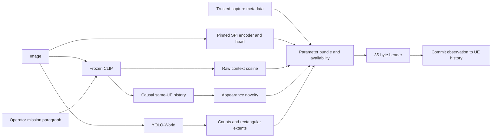

# MEDIC parameter extractor: implementation and handoff

The current bounded study uses exactly 300 MEDIC images from the verified version18 detector cohort. The private input is `satyapaladugu/semanticscheduler-medic300-v18`. Original records SHA-256: `1b0feb7ec30c3d9fb033d9df8456daf37e56b5941f35e40aeb684d02e98845ae`. The numeric current dataset version is not exposed by the checked listing API; the flattened 300-image layout and every image hash were verified.

## Flow and information boundary



Qwen3.5-9B is an **offline teacher**, with thinking disabled. It never runs in the deployed image parameter path. Student labels use images alone; associated post text, if present, creates a separately identified message-priority target. The selected MEDIC release does not guarantee associated text, and the mission paragraph is never substituted for it.

Native MEDIC annotations support only their documented tasks. They are not four-class urgency truth. The current model claim is teacher agreement about depicted intervention need, not independently verified operational urgency or universal image understanding.

## Runtime interface

`FinalParameterExtractor` accepts either the existing vector SPI classifier or an image SPI provider, not both. The image provider implements `predict_image(PIL_image_or_path)`. Its result includes `level`, `scheduling_class`, `available`, scores and `runtime_promotion_allowed`.

Training class order is **Low=0, Medium=1, High=2, Critical=3**. The existing wire order is reversed: **Critical=0, High=1, Medium=2, Low=3**. Availability is independent of the numerical class bits; zero is a valid available Critical value.

An unpromoted image provider may produce research audit scores, but its SPI wire availability remains clear. Unknown is not a Low training label. Legacy display text “Normal” must be interpreted alongside `spi_available`; a missing SPI is not an observed benign scene.

Use `transmit_batch` for the serial query → successful serialization → history-commit lifecycle. `extract` and `extract_batch` are read-only. Every UE/mission/split has a separate FIFO128 history in the new experiment; older CLI/history defaults remain historical compatibility settings.

The fields are SPI, relevance, novelty, capture timestamp/allowed delay, detection count, distinct detected category count, largest box fraction and exact union box fraction. Scene measurements do not prove distance, scene completeness or urgency. Relevance is cosine, not probability. Novelty is relative to retained same-UE embeddings, not verified new facts.

## Running a bundle

From the canonical project and its matching Python environment:

```powershell
.venv/Scripts/python.exe -m experiments.spi_classifier_repair.medic_cli --bundle '<bundle>' --images '<image>' --mission 'Inspect visible road damage.' --clip-checkpoint '<pinned CLIP snapshot>' --yolo-checkpoint '<YOLO weights>' --output '<new output.json>'
```

Production extraction rejects an unready bundle. `--research` explicitly permits audit inference while keeping unready SPI unavailable in headers. Batch inputs use the same `--images` option. Optional per-image trusted metadata is keyed by image SHA-256. Do not use post publication time as capture time.

## Training and recovery

Canonical notebook: `experiments/spi_classifier_repair/notebooks/notebook9_medic_spi_training.ipynb`. Builder: `build_medic_training.py`. Shared implementation: `medic_campaign.py`, `medic_deployment.py`, `medic_release.py`, `medic_parameters.py` and `resume_store.py`.

Completed image labels, feature shards, full features, classifier candidates, token folds, calibration and profiling have hash-verified receipts. A receipt is written only after artifacts exist. Missing/incompatible stages run again; altered/corrupt artifacts are rejected. Source, prompt, model, data and dependency changes invalidate affected work. Hardware changes invalidate resource profiles. Completed earlier work is not reused merely because a filename exists.

Across Kaggle runtimes, checkpoints must be recovered and attached as a matching managed resume input. Ephemeral `/kaggle/working` alone is not durable recovery. The notebook accepts an explicitly identified checkpoint archive with matching cohort hash; it does not silently resample images. Progress/outputs survive completed stages even if later stages fail. Recovery cannot promise a killed kernel's final unflushed buffer.

## Measurement and claims

CPU and GPU latency are separate. Tensor-only encoder timing is not full extraction latency. The selected pipeline profile includes actual image SPI, CLIP relevance, YOLO measurements, a declared 128-entry engineering history and serialization. Warmup, observed memory scope and hardware are recorded. Preview wire checks are controlled local integration probes, not radio transmissions.

FLOPs use two operations per multiply–accumulate. Supported-operator counts remain partial where the profiler omits operations. Neural training counts are extrapolated from measured step shapes and actual executed counts; sklearn solver FLOPs remain unavailable with reasons. Unknown cost is never reported as zero.

No scheduler ranking, throughput, radio resource, codec quality or downstream emergency outcome is established by this study. Diagnostic review, class support, export parity, runtime integration and per-class quality gates remain mandatory. Model selection does not imply readiness. Optional upper-block fine-tuning/CORN are not executed by the current frozen-representation notebook.
