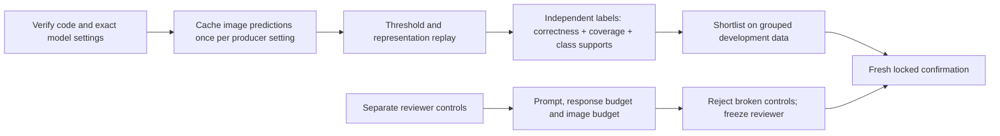
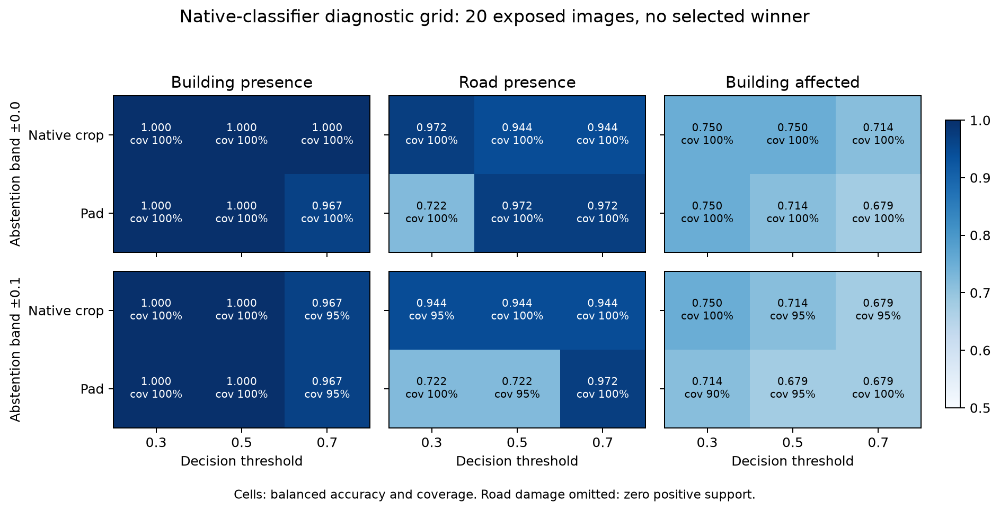

# Model configuration and search audit — 25 October 2026

This audit covers the active parameter-extraction and annotation-assisted review
paths in BetterScheduler on `new-scheduler`, HEAD8947b399 plus preserved dirty
sources. It does not certify every model in the wider encoder/decoder workspace.
The objective is faithful, useful task evidence. More positive Qwen verdicts is
not an optimization target.

## Coverage and actual configuration

| Path | Inspected configuration and calculation | Conclusion |
|---|---|---|
| `PilotVisionProducer` / YOLO | `yolov8s-worldv2.pt`,16explicit class prompts,640px,.25confidence,.5IoU,classwise NMS, pixel-coordinate boxes | Valid API and RGB handling; no demonstrated aerial coverage guarantee. Config was hard-coded and downstream filtering prevented meaningful confidence search. |
| `FrozenVisionProvider` / CLIP | OpenAI ViT-B/32,224px,RGB, CLIP normalization,L2features, image/text cosine,77text positions | Cosine math is correct. Gray letterboxing differs from released center-crop preprocessing and changes effective object scale. Now both policies are explicit. |
| `NativeAerialClaimProvider` | Official small-reference BiT-50,448px native crop,12independent sigmoids,.5threshold | Matches reference interface. Scores/threshold are not calibrated. Alternate padding is an experiment, not a silent correction. |
| Qwen reviewer | Qwen3-VL-4B-Instruct,FP16 onT4 GPU1,SDPA,typed content,greedy generation,192token historical budget,512px pre-resize | API/type fixes are valid. Some outputs fail schema. No evidence that its prompt alone caused the image-classifier errors. |
| Parameter calculation | Confidence filtering, clipping/union area, count scaling, appearance distance, causal concept rarity, calibration flags | Configuration changes must propagate to filters and KB comparability. Geometry is not distance/severity; detector miss is not absence. |
| `representation` / reviewer input | Full structured evidence, compact diagnostic, required fact inventory, all-claim consistency | All-claim review can fail a building mission for unrelated road predictions. Mission-scoped assessment must be labeled and compared separately. |
| Metrics | Native annotations remain evaluator-only; invalid model answers stay in denominators; constants reported | Required-only and all-fact metrics are both needed. Removing difficult claims is not a gain in correctness. |
| Notebook packaging | Source archive, input/output hashes, managed Kaggle runtime, explicit devices | The running e snapshot cannot inherit later local fixes. CPU checks cannot certify a new GPU runtime. |

Supporting operational audit:
`results/ops/20261025T151126Z/model_config_audit/REPORT.md`, `audit.json`,
`FINAL_AUDIT.json`. This includes local-vs-cloud package versions, actual model
identities, hashes, input/output lengths, and dataset/group availability.

### Findings and corrections

| Classification | Finding / impact | Action |
|---|---|---|
| Confirmed fault | YOLO acceptance was independently fixed at.25in `detections()`. Changing only prediction confidence did not change semantic outputs below.25. | `DetectorSettings` flows through prediction and provenance; the downstream filter consumes its recorded threshold. |
| Confirmed identity gap | Same-dimensional embeddings from another crop/checkpoint could enter nearest-neighbor history. | KB embedding identity includes backbone/config/weights/preprocessing/processor hashes. Mixed spaces are unavailable comparisons. |
| Confirmed identity gap | Concept KB signature did not include detector confidence/size/NMS or native preprocessing. | Include detector settings digest and native preprocessing digest. An unavailable/mismatched producer is not a historical negative. |
| Confirmed search trap | Qwen images were first shrunk to512px; increasing processor pixels alone could not restore information. | Explicit pre-resize and processor-pixel settings, with actual input tensor hash/shape. |
| Confirmed fast-processor override bug | In Transformers4.57.6, passing `max_pixels=262144` to AutoProcessor left effective `image_processor.size.longest_edge=16777216`, despite the alias attribute reading262144. | Use explicit `size` with shortest/longest pixel-area bounds, assert effective size, and validate each processed image grid before generation. |
| Evidence gap | Failed Qwen outputs did not record generated-token counts or token-cap state. | Persist generation lengths and cap state before JSON parsing, including failed parses. No claim that all earlier failures were truncated. |
| Valid but unproven choice | CLIP padded224versus checkpoint-native crop; native classifier center crop versus padding | Expose both in a bounded diagnostic; retain source identity for each. |
| Metric/scope mismatch | All-claim VLM consistency can mix relevant and unrelated conditions. | Explicit `claim_scope=mission` option and paired scope reporting. Keep all-fact errors visible. |
| Fusion ambiguity | Native image negatives overwrite positive detector evidence in merged presence. | Preserve producer-conflict records and native-priority policy. Evaluate raw YOLO output before any fusion experiment. |
| Design limitation | Unrestricted long paragraphs exceed CLIP's77positions. | Existing code rejects them; do not silently truncate or claim arbitrary-paragraph support. Search observable clauses versus paragraphs only when both fit. |
| Not a confirmed bug | YOLO PIL channel order, `set_classes`, normalized CLIP dot products, native sigmoid, Qwen SDPA/FP16 | Reference inspection supports these uses. Accuracy/domain suitability still need measurements. |

Native model decisions still need per-domain applicability. Its12native labels do
not cover household inventory, person distress, road blockage or natural cross-view
identity. Current selection is an opt-in aerial experiment. Historical/deploy
LADI checkpoints cached elsewhere are not silently promoted to held-out candidates.

## Staged search, with cache reuse

Machine-readable definition: `config/approach_search_grid.json`.
Implementation: `approach_grid.py`, `grid_inference.py`, `reviewer_grid.py`.

| Stage | Factors | Rows | What decides usefulness |
|---|---|---:|---|
| Native image claims | native crop/pad × threshold{.3,.5,.7} × abstention band{0,.1} |12| Independent native-label correctness, balanced accuracy, positive/negative support and coverage |
| CLIP alignment | native crop/pad × paragraph/observable clause × historical/balanced-aerial contrast wording |8| Mission-alignment tests and sensitivity; no cosine-to-native-label conversion |
| YOLO | size{640,1024} × confidence{.05,.15,.25} × IoU{.5,.7} |12| Raw presence proxy against image labels; valid box accuracy additionally needs localized truth |
| Representation | required claims; claims+scores; mission/context/history; full structured |4| Same predictions, fixed required fact set, missingness, bytes and downstream information usefulness |
| Reviewer | v2/concise-v3 ×192/384tokens ×512²/768²pixel budget |8| Omission/contradiction controls, exact reference agreement, invalid rate; not approval fraction |

The12native rows crossed with4representations define48information profiles but
do not require48image forwards. Thresholds and information projections reuse
scores. The YOLO plan needs4low-threshold raw inference caches per image (size×IoU),
then3confidence projections each. Confirm retained detection limits and parity
before treating post-filtering as exact. The reviewer runner caps a first search
at24cases from8image groups per configuration (192calls), reuses weights, and
does not allocate/launch a cloud instance. That first screen is exploratory;
passing a small control set does not replace the larger qualification/confirmation.

Search dimensions are hypotheses, not promises. Higher size increases small-object
pixels and cost; lower confidence trades misses for false detections. More
resolution/tokens may improve detail/JSON completion but cannot repair a missing
semantic prediction. Adding scalar parameters cannot recreate facts discarded by
the producer. Confidence margin/disagreement/availability are useful diagnostics;
they are not newly validated measures of scene importance.

## What actually ran

### Native diagnostic grid

Executed12rows from two actual native image-processing passes on the20previously
inspected test-source images,CPUonly,38.81seconds. This sample is now explicitly
development-exposed diagnostic material. `selected_configuration` is null; no
threshold or preprocessor was promoted from this sample.

- Building-presence balanced accuracy:.967–1.000.
- Road-presence balanced accuracy:.722–.972.
- Affected-building balanced accuracy:.679–.750.
- Road-damage sensitivity/BA:undefined, because there are no positive labels.
- Moving native-crop threshold.5→.3did not recover the seven missed affected
  buildings. Padding at.5recovered one road positive but lost one affected-building
  positive. It is not universally better.
- The abstention rows report unavailable predictions as missed opportunities,
  with coverage beside accuracy; hiding errors cannot earn full credit.

Files: `results/local/model_grid_20261025/`, including raw score caches,
`replay/grid_rows.jsonl`, model/processor identity and measured timings.
`approach_grid.py` changed only by adding an unused representation-projection
function during this run; operational receipts record the hash drift. Native
inference modules and emitted search-plan definition were unchanged. A current-
source cached replay is used for final verification; no repeated image inference
is necessary.

### CLIP preprocessing sensitivity

Actual four-image CPU comparison:40image/text cosines; mean absolute difference
.0123,max.0453. Native-crop versus pad image-embedding cosine was.878–.950; the
highest-scoring mission paragraph changed for2/4images. These are sensitivity
findings, not evidence that either assignment is correct. Use the same policy
within one KB and one selected experiment.

### Qwen saved-output audit

In run e,71/72parameter reviews parsed; successful outputs used40–185tokens from
a192token budget and1,783–3,251input tokens. No successful answer reached the cap.
One malformed output had an incomplete JSON string and no recorded token count;
truncation cannot be confirmed or excluded for that answer. Two control answers
had empty reasons. A longer budget is a testable setting, not a demonstrated cure.
The new concise prompt and mission scope are implemented but have not been
validated by fresh Qwen inference in this audit increment.

An actual processor-only regression then verified that the `max_pixels` alias
was not the effective resize bound. The correction uses an explicit `size`.
On an1800×1200input without preliminary resizing, configured cap262,144produced
252,928processed pixels (grid1×26×38,patch16); cap589,824produced564,224pixels
(grid1×38×58). Both satisfy their limits. Historical e used preliminary512px
contain, so this finding does not imply its images actually used16million pixels.
The new guard makes that fact observable rather than relying on the option name.

YOLO's12configuration model forwards and Qwen's8prompt configurations have not
been executed in this increment. Local Ultralytics and the YOLO checkpoint were
not installed at the audit checkpoint. Existing e inference and pinned official
source were inspected; this is not a new YOLO accuracy test.

### Final current-source verification

**59tests passed**, with115source/test/config/schema hashes unchanged during the
final validation. All12cached grid rows reproduced exactly under current sources.
All16representation projections preserved both required building claims and their
availability. Their diagnostic JSON mean sizes were1,098bytes(required claims),
1,587.5bytes(claims+scores),4,312.5bytes(mission/context/history) and approximately
9.2KB(full). These are JSON analysis sizes, not selected binary-header sizes or
latent payload bytes. The projection check establishes information preservation
for the declared two facts, not scheduler utility or scene completeness.

Eight actual processor-only cases covered two prompts, two pixel caps and two
pre-resize policies. All respected their effective pixel budgets; no Qwen weights
or generation were used. The old string-content TypeError was reproduced and
the corrected typed-content path passed. Actual Qwen prompt quality remains
untested for the new configurations.

Final report and receipts:
`results/ops/20261025T152519Z/final_source_validation/FINAL_REPORT.md` and
`FINAL_RECEIPT.json`. The saved Kaggle setup log also verifies the historical
Ultralytics version8.3.237; it is not merely an intended dependency declaration.

## Selection boundaries and stop rules

1. Treat all inspected pilot/test20/c/e groups as exposed. New queue seeds or
   prompts do not make them final test material.
2. For selection, prepare grouped development data with real positive and negative
   support for each target, including road damage. Keep source annotation meanings
   intact. Fit thresholds/calibration/heads only in the relevant training roles.
3. Compare per-task and per-domain results first. A mean that hides unsupported
   household/blockage tasks is not general semantic validity.
4. Freeze the shortlist and a control-qualified reviewer, then evaluate on new
   independent groups. With inadequate group support, report descriptive results.
5. Reject a richer representation if its added producer has no independently
   measured information benefit. Do not select by Qwen approval or raw accuracy
   on an all-negative target.
6. Keep raw scores/outputs/errors, cost and all grid rows. Stop expensive expansion
   when missing labels or missing semantic information explains failure.

Primary sources inspected:

- [Pinned YOLO-World documentation](https://github.com/ultralytics/ultralytics/blob/v8.3.237/docs/en/models/yolo-world.md)
- [Pinned Ultralytics implementation](https://github.com/ultralytics/ultralytics/tree/v8.3.237/ultralytics)
- [CLIP checkpoint processor](https://huggingface.co/openai/clip-vit-base-patch32/blob/main/preprocessor_config.json)
- [OpenAI CLIP transforms](https://github.com/openai/CLIP/blob/main/clip/clip.py)
- [Official native classifier](https://huggingface.co/MITLL/LADI-v2-classifier-small-reference)
- [Qwen model card](https://huggingface.co/Qwen/Qwen3-VL-4B-Instruct)
- [Pinned Qwen implementation](https://github.com/huggingface/transformers/blob/v4.57.6/src/transformers/models/qwen3_vl/modeling_qwen3_vl.py)
