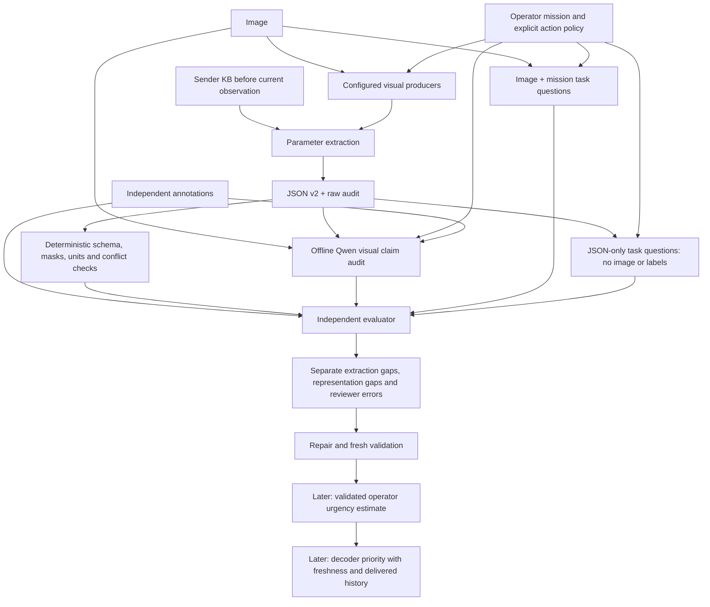

# Offline validation of scene evidence and operator action urgency

## Objective and current status

Determine whether JSON v2 preserves the observable scene evidence required for
an operator's mission and whether it contains enough evidence to support an
operator action-urgency decision. Decoder priority is derived later; it is not
the definition of urgency. This boundary was explicitly confirmed by the user.

This is the redesigned experiment, not an executed result. The previous 30-case
Qwen run used the legacy JSON and checked two building facts. V2 conversion tests
do not establish visual completeness, urgency correctness or Qwen competence on v2.
No new Kaggle/API job is launched by this document. Use existing local/free-tier
resources; no paid API substitution or model training is part of this increment.

## Define what can be tested

"Scene depth" here means semantic detail, not measured physical depth:

1. Entities present and their visible attributes/conditions.
2. Spatial or interaction relations supported by the image.
3. Visible events and evidence of effects on mission targets.
4. What is observable, uncertain, occluded or outside producer capability.
5. Mission relevance and changes against declared causal sender history.
6. Time/location/context needed for an operator's possible action.

Do not claim that a fixed set of scalars describes every detail of an arbitrary
image. Measure supported dimensions separately. JSON v2 currently has no enabled
relationship producer; it cannot yet represent interactions simply by naming the
relation section. Relevance, rarity and appearance novelty are not urgency labels.

## System boundary

Qwen is only an offline experimental reviewer. It is not inserted into decoder
scheduling. Predicted or reviewed urgency is never substituted for reference truth.

## Three assessments, not one approval rate

**A. Factual representation.** For each annotated fact, report whether the JSON
encodes it correctly, incorrectly or not at all. Compute supported-fact precision,
recall/coverage and incorrect-claim rate. Break down entities, conditions and
relations where compatible annotations exist. Use independent annotation values;
unknown annotations do not become negatives. Keep per-domain/source results.

**B. Information sufficiency.** Ask a fixed mission question set separately from
the image and from JSON alone. The JSON-only call must not see pixels, reference
annotations or the other call's answers. Score both against independent supported
answers. Agreement alone is not correctness. Report JSON answerability and the
performance gap relative to the image route. This detects useful omissions that
an image-visible reviewer could silently fill in.

**C. Operator urgency support.** Ask what action is proposed, which visible facts
support it, what context is missing, and whether urgency can be determined. Then
apply a declared operator policy to the supported evidence. No universal hand-made
severity-to-urgency weights are introduced. Missing capture time or action context
may make urgency indeterminate even when visible damage is severe.

The current mission profiles prohibit urgency inference and remain intact as
historical evidence-only tasks. New versioned action profiles must state the
operator's action, relevant observable conditions, available context and explicit
response-time rules. Policy-derived urgency is labeled an operational proxy;
real-world urgency validation requires independently justified urgency labels.
Current LADI building labels alone do not provide them.

## Qwen reviewer qualification

Start with the existing six review parents as development fixtures, not fresh
evaluation. Build a versioned v2 adapter/prompt and test one actual full document
first. Keep Qwen3.5-9B thinking OFF, record all inputs, raw outputs, input lengths,
GPU memory and timing. Do not silently reuse the legacy-v5 prompt or scores.

For each test parent include the actual JSON and these controlled variants:

- Remove an annotated, mission-required claim.
- Flip a supported claim, including explicit negative claims.
- Mask a claim while leaving a stale visible value; mask must dominate.
- Remove a required relationship or temporal/context field only where a valid
  source or declared engineering construction supports that test.

Also include unchanged correct negatives, unavailable relationship evidence,
same image with changed mission, exact repeats with causal history, and cold start.
Do not claim natural cross-view validation from copies or unlabeled viewpoints.
Controls are evaluator constructions, never runtime predictions or future inputs.

Qwen reports per-claim contradictions and omissions before its final binary
fidelity/sufficiency verdicts. It separately reports whether urgency is determinable
and the missing evidence. It must not invent timestamps, people at risk, physical
distance or real-time events. Missing information does not force a false factual
claim; it can make the representation insufficient for the requested decision.

Score against the controlled answer key, hidden from Qwen. Retain the predefined
control gate: at least95% valid outputs,80% balanced accuracy for each endpoint,
75% correctness for each class, and75% for missing-field/recoverable-absence tests.
These are pilot engineering gates, not statistical certification. Keep actual
JSONs separate. If it fails, do not change parameters to increase approvals.
Diagnose prompt ambiguity, interface issues or model reasoning failures first.

## Unknown values and repair ownership

| Cause | Correct handling | Repair if feasible |
|---|---|---|
| Producer crashed or malformed input | Unavailable with failure reason | Fix implementation and rerun affected extraction |
| Unsupported category/condition/relation | Unavailable, explicit capability gap | Evaluate a suitable producer before adding it |
| Empty sender KB | Cold start, no comparison | Build causal history; do not fabricate novelty |
| Missing/untrusted time/location | Unknown metadata | Supply trusted metadata; cannot recover from pixels generally |
| Occlusion/insufficient visual evidence | Unknown | More views or evidence; avoid guessed negatives |
| Detectors disagree | Preserve each observation and conflict | Calibrate/evaluate fusion on independent labels |

The existing unknown relation field is an actual unfinished capability. It is not
evidence that the whole scene has been described. Keep explicit classifier false
values available; a detector miss neither removes them nor establishes absence.

## Producer audit: fixed versus unresolved

Confirmed code fixes include configurable YOLO vocabulary, alias consistency,
threshold propagation, settings/KB signatures, explicit count units and effective
configuration logging. CLIP records preprocessing and text limits and rejects
oversized input instead of silently truncating. V2 marks cold starts and separates
raw cosine from probabilities. These changes passed92local tests and cache replay;
they do not improve weights or demonstrate accuracy on new domains.

Still unresolved: YOLO's default16-category coverage and weak aerial detections,
the permissive0.05experiment threshold, center-crop loss of border evidence,
CLIP's77-token limit, uncalibrated scores, missing relation extraction and lack of
independent urgency labels. Full settings and tested scope remain in
SCENE_JSON_V2_AND_MODEL_SETTINGS.md.

Next producer experiments should be discriminating: check border facts under
native crop versus full-image padding, and detection recall/false positives under
the existing confidence/size grid on compatible box labels. Keep same-image/task
comparisons, report costs and failures, and do not optimize for Qwen approval.
Only add a relation producer if missing relationships demonstrably block a task
question. No fleet of scene classifiers or speculative policy training.

## Next build sequence and acceptance

1. Freeze the task questions and versioned operator-action contract; retain the
   current evidence-only profiles. Resolve what urgency labels/policy can support.
2. Implement the v2 reviewer adapter and independent reference mapper. Add tests
   for explicit false, missing evidence, masks, conflict and task/context changes.
3. Run a one-document memory/schema preflight, then a bounded controlled review.
   No paid API, broad sweep or automatic retry. Record a separate run identity.
4. Evaluate factual fidelity and JSON-only question answerability. Where reference
   labels are absent, mark results model-assessed/ungradable rather than confirmed.
5. Repair the smallest demonstrated producer/representation/reviewer fault.
   Re-test on fresh independent groups before scaling.
6. Only afterward derive decoder priority from supported operator urgency,
   freshness and additional evidence relative to successful receiver history.

Completion of this stage means an auditable test of what v2 retains and what
Qwen can reliably judge. It does not mean a general urgency predictor is validated.

## Relevant methodological foundations

POPE tests visual hallucination using explicit object-presence questions and
negative controls: https://arxiv.org/abs/2305.10355

GQA tests objects, attributes and relations through grounded questions rather than
an undifferentiated scene-quality score: https://cs.stanford.edu/people/dorarad/gqa/

These motivate the proposed checks; neither supplies emergency urgency labels or
validates this project's extraction pipeline.
