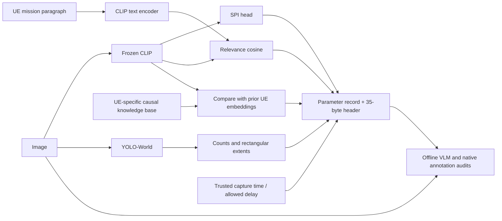

# BetterScheduler: parameter extraction and evidence report

**Status:** implementation and local engineering validation are complete. The
bounded four-class VLM/YOLO experiment stopped at its text-control gate; no new
four-class model was produced. A corrected retry also failed the Medium text
controls; its independent YOLO worker produced300 new-cohort outputs,202 with
no retained detections. This report concerns parameters only.

## Objective and scope

Describe a received image for later semantic ranking using four groups of
predicted evidence plus capture metadata. The parameter extractor does not
assign a final scheduler order. Its outputs are not a complete image caption,
proof of an emergency, or an independent measurement of real-world novelty.



## Parameters and rationale

| Group | Meaning | Method and boundary |
|---|---|---|
| SPI | Low, Medium, High or Critical visible response-attention | CLIP image embedding into trained classification head; Qwen supplies offline pseudo-labels, not verified urgency |
| Relevance | How well image aligns with the UE's supplied mission | Image/text CLIP cosine; long mission text is encoded in weighted chunks, not silently truncated |
| Novelty | Difference from this UE's comparable prior appearances | `(1-max cosine)/2`; first observation defaults to1 with a cold-start flag |
| Temporal | Trusted capture time and operator-specified allowed delay | Raw milliseconds; no invented exponential decay or urgency inference |
| Scene | Detection count; category count; largest box fraction; union box coverage | One YOLO-World with fixed vocabulary/settings; counts and boxes are detector observations |

CLIP was selected for a shared image/text representation; its image-text
pretraining mechanism is described in the [original CLIP paper](https://arxiv.org/abs/2103.00020).
YOLO-World supports text-specified object detection as described in the
[YOLO-World paper](https://arxiv.org/abs/2401.17270). Neither source proves our
priority or scheduling claims. The fixed16-category vocabulary, model
failures, image resize and threshold affect the numbers. A bounding box is not
physical distance, an object mask or a severity measure. Counts are detector
outputs; zero detections does not prove an empty image.

The reference vocabulary includes `road`, `water` and `debris` as well as
countable objects such as people and cars. YOLO may draw large rectangular
boxes around these scene elements; the count fields are counts of detector
outputs and categories, not exact counts of physical objects.

Novelty is a change in visual embedding, not proof of a new disaster, asset or
fact. An alternative camera angle can appear novel while showing the same
scene. Reference/correspondence labels would be needed to measure new facts.
Rarity and category-importance weights are not included.

## SPI definitions and VLM input

The new v2 rubric defines routine content as Low, a concrete minor non-urgent
issue as Medium, a consequential visible hazard/disruption without demonstrated
immediate threat as High, and directly visible imminent/ongoing serious harm as
Critical. Ambiguous input may be unavailable. The full original system prompt is
constructed from `config/spi_rubric_v2.json` by `spi_labels.label_prompt`.

The offline [Qwen3.5-9B](https://huggingface.co/Qwen/Qwen3.5-9B) labeller sees
one image, fixed rubric and output instruction. It does not see the mission,
parameter predictions, source annotation or KB. Thinking is disabled. A
separate offline reviewer sees the image, mission, parameter JSON and a previous
view when supplied. Its judgements are model-assisted; its structural controls
can show whether it discriminates obvious numerical contradictions, not whether
it understands every scene or supplies independent ground truth.

The previous v1 run produced82Low,0Medium,73High,25Critical labels. The fallback
three-class head trained on110 images and agreed with Qwen on44/70 development
validation images. Critical recall was2/10. The cause of zero Medium is not
established; weak class boundaries and sample composition are hypotheses.

## Cohort, privacy and provenance

The bounded input contains300 already-cached parent images:220 LADI and80
MEDIC. The extra120 LADI samples include14 with the published
minor-or-greater flag,43 affected and63 other. Native flags selected candidate
images; they were not transformed into SPI labels. All data is
**development-exposed**. Event-held-out independence is not established.
Twenty-four new-only duplicate groups were sealed before v2 teacher labelling;
they are a sealed development check, not a fresh final test. Repeated queues or
image variations do not create independent events.

The six UE profiles include a screen/software mission, but this cohort has no
verified screenshot-specific test labels. Screen-image recognition and scene
measurement coverage must therefore remain unverified, even though the API
accepts screenshots.

Private Kaggle notebook: [SPI v2 campaign](https://www.kaggle.com/code/satyapaladugu/betterscheduler-spi-20261027finalb).
Its run has a maximum of3,600 seconds on two T4s, at most2 aggregate GPU-hours.
Raw teacher outputs, checksums and partial-failure receipts must be retrieved and
verified. Notebook completion is not a scientific acceptance criterion.

## Implemented interfaces

- `FinalParameterExtractor` in `minimal_parameters.py`: single, batch, causal
  transmit-batch and cached-evidence extraction. `extract_batch` does not mutate
  memories; `transmit_batch` commits only after each serialization in input order.
- `YOLOWorldSceneProvider` and `measure_detections` in `scene_measurements.py`:
  the producer owns detector loading and the pure function computes exact
  rectangular union. Failed producers return an explicit unavailable result.
- `parameter_cli.py`: one or multiple images, model/mission/configuration,
  optional detector and optional persistent, mission-version-bound UE memory.
- `config/parameter_release_v2.json`: the parameter manifest, selected model
  identity and its supported classes. It records the failed cloud gate and
  does not implicitly configure the runtime or replace the shared profile registry.
- `ExtendedParameterHeader`: version2,35bytes. Existing version1 remains28bytes.
  Scene mask/flag is1byte, two counts4bytes and two area fractions2bytes.
  Fraction quantization error is at most0.5/255. Source/session/message/profile
  routing fields remain in the core header. Payload sizes/channel uses are separate.

The35-byte format is an experimental parameter serialization. The existing
decoder queue has not been adapted to parse it, and profile/model identities
need a shared registry before independent sender/receiver deployment. The
example profile IDs are synthetic; no 5G on-air header is claimed.

Compact parameter example (illustrative, not an observed image):

```json
{"schema":"better_minimal_parameters_v2","spi":"Medium","relevance":0.41,
 "novelty":0.63,"novelty_cold_start":false,"capture_time_ms":null,"allowed_delay_ms":30000,
 "scene":{"instances":3,"categories":2,"largest_box_fraction":0.21,
          "union_box_coverage":0.36}}
```

`null` is unavailable; a valid zero is different. The audit sidecar retains
producer identity, reasons and optional detected labels/boxes. The parameter
record does not contain evaluator labels or future history. A future ranker may
use only information actually transmitted to it. For example, two images can
have identical counts and box areas while depicting different objects.

## Local verification completed

- 29 focused engineering tests passed, including known box-union values,
  clipping/invalid boxes, zero-versus-unavailable, 28/35-byte round trips,
  class-order mapping, group isolation, model export, causal commits and the
  visual finite-preflight reset after text-only controls. A legacy four-class
  v1 artifact fixture was also loaded and exercised.
- 21 additional existing extraction/public-path/semantic-contract regressions
  passed, checking that the additive parameter path did not break those APIs.
- Actual CLIP and the existing fallback head processed two copies of one image.
  SPI was High for both, relevance0.2663, novelty1.0 then0.0, and both headers
  were35bytes. YOLO was unavailable locally because no checkpoint was supplied.
- In a separate six-UE,72-observation development run, all12 exact-repeat
  novelty controls passed. Brightness/crop changes are appearance controls,
  not verified semantic novelty.
- Broad building/road mission cosine versus LADI's native
  buildings-affected-or-greater flag gave AUC0.689 on196 development images.
  The mission is broader than this label, so this is a partial descriptive
  proxy, not a probability calibration or a generalization claim.

Results/receipts: `results/ops/spi_final_20261027b/` and the corrected retry
`results/ops/spi_final_20261027c/`. Both teacher attempts failed the text gate;
the retry's independent YOLO worker completed300 records. Four-class SPI and
detector accuracy remain unestablished.

## Reproduce local inference

```powershell
& '.\.venv\Scripts\python.exe' -m BetterScheduler.parameter_cli `
  --images IMAGE1.png IMAGE2.png --mission 'Inspect roads and buildings.' `
  --clip-checkpoint models/priority_classifiers/clip `
  --model BetterScheduler/results/spi_three_class_20261027/models/spi.json `
  --yolo-checkpoint PATH_TO_YOLO_WEIGHTS --kb results/ue01-kb.json `
  --output results/ue01-parameters.json
```

Omit `--yolo-checkpoint` to produce explicit unavailable scene fields; this is
useful for a local CPU integration check. A detector run needs its installed
Ultralytics/CLIP dependencies and actual weights. The CLI stores only compact
headers in `header_hex`; JSON and KB storage are local audit/state artifacts,
not transmitted payload size.

The base and optional detector dependency specifications are in
`environment/requirements-spi.txt` and
`environment/requirements-parameters-scene.txt`. They were not automatically
installed into the shared local environment. Check the dependency resolver and
model-weight availability before enabling local YOLO.

### Full cached-cohort extraction before GPU results

The current three-class fallback was applied to all300 cached image embeddings.
The resulting `cached_parameters.jsonl` contains300 rows (185 train,91
validation,24 sealed-development), with independent KB state per UE and split.
Every record has a35-byte header. All scene fields in this fallback are
explicitly unavailable because the remote detector results have not yet been
retrieved. This is a reproducible partial extraction, not a claimed full
YOLO-backed result. The six-UE sequence checks still pass12/12 exact repeats.
Two groups of different images shared the same quantized parameter values in
this no-scene run; this is a finite-sample collision diagnostic, not proof of
whether their real-world importance differed.

Artifact: `results/ops/spi_final_20261027b/cached_parameters_fallback/`.

## What the teammate can and cannot infer

Consider two hypothetical inputs with the same SPI, relevance, novelty, timing,
instance count, category count and box-area values. One image could contain a
person and a fire; another could contain a chair and a table. Their transmitted
summaries can be identical. A ranker using only those summaries cannot recover
which categories were present. A stronger network does not restore information
that was never provided. This is an information-boundary example, not a measured
performance result.

The offline scene audit retains predicted category names so this limitation can
be examined. Sending category evidence would require a separately versioned
parameter/header change and evaluation; it was not added without evidence in
this three-hour increment. User equipment IDs, split IDs, image IDs and dataset
names are routing/audit fields, never semantic predictor features. A model profile
must identify whether the SPI head supports four classes or only the fallback
three. SPI score vectors are retained in audit records but are not in the
35-byte header.

The compact JSON includes `novelty_cold_start` so a first-observation default of1
cannot be mistaken for a measured difference. The cloud VLM-review snapshot was
built immediately before this extra JSON flag was added locally; its natural-review
payload separately identifies whether a previous view was supplied. Its review
therefore does not validate that serialized flag itself.

## Header layout and use by the policy teammate

Version2 retains the original little-endian28-byte core and appends seven bytes:

| Bytes | Field |
|---|---|
| 0 | Version = 2 |
| 1 | SPI class bits0–1; availability for SPI, relevance, novelty, time and delay in bits2–6; cold start in bit7 |
| 2–3 | Unsigned source ID |
| 4–7 | Unsigned session ID |
| 8–11 | Unsigned message ID |
| 12–13 | Unsigned profile ID |
| 14–21 | Capture time, UTC milliseconds |
| 22–25 | Allowed delay, milliseconds |
| 26 | Relevance, mapped from [-1,1] to [0,255] |
| 27 | Novelty, mapped from [0,1] to [0,255] |
| 28 | Scene availability bits0–3 and detector-saturation bit4 |
| 29–30 | Retained instance count |
| 31–32 | Detected-category count |
| 33 | Largest-box fraction, mapped to [0,255] |
| 34 | Union-box coverage, mapped to [0,255] |

SPI class values are0 Critical,1 High,2 Medium,3 Low. Mask bits—not zero bytes—
determine availability. A model/profile registry must accompany deployment;
the existing decoder queue does not yet consume this experimental V2 format.

`extract_batch` queries memories without committing. `transmit_batch` computes
visual evidence first, then serializes and commits each observation in sender
order. A commit records a sender observation after successful parameter
serialization; it does not establish network delivery or receiver reconstruction.
The CLI can persist the KB using `--kb`; reuse requires the same UE and mission
version. A failed later item in an in-memory batch does not roll back earlier
successful per-item commits. No user-supplied timestamps are treated as trusted
unless explicitly marked.

### Parameter differences within the same SPI

In the local fallback sequence run, one UE01 image was predicted High with
relevance0.247 and novelty0.194. A different UE04 image was also predicted High
with relevance0.166 and novelty0.249. Both had prior sender history. This shows
that the selected fields can differ within one SPI class; it does not establish
which image should be processed first. The images/missions differ, the numbers
are model outputs, and the sample remains development-exposed.

The same run's local CLIP checkpoint load took1.284 seconds. Measured CPU forward
batches took0.747 seconds for eight views and0.384 seconds for four views; these
exclude checkpoint load and do not represent full per-image transmission cost.
The whole-process OS peak working set was approximately1.04GB, including Python,
models and caches. These are one-machine measurements, not FLOPs or cross-system
benchmarks. Details: `results/ops/spi_final_20261027b/cached_parameters_latest/metrics/runtime.json`.

### Development-only parameter distribution (three-class fallback)

Among the276 non-sealed cached records, the current head predicted170 Low,
89 High and17 Critical. These are predictions, not label counts or prevalence
estimates. Relevance was available for276/276 and ranged0.133–0.277
(median0.221). Novelty was available for276/276 and ranged0.033–1.000
(median0.098); 12 records were cold starts, because each of six UE histories is
separate in each development split. Scene evidence was unavailable locally for
all276 in this run. A raw CLIP cosine of0.2 must not be called a20% probability
or assigned a universal threshold. The final four-class/YOLO outcome is
recorded separately when received.

### One image against six missions

On the first cached aerial image, the local CLIP similarities were:

| UE mission | Cosine |
|---|---:|
| Building/road infrastructure | 0.244 |
| Rescue observation | 0.232 |
| Road traffic | 0.227 |
| Environmental observation | 0.226 |
| Everyday photography | 0.182 |
| Screen/software reporting | 0.216 |

This demonstrates the method and mission dependence. The visible image and
these six scores do not provide six independent relevance annotations; the
ordering is a model output and may be wrong. Values are raw cosines, not
percentages or comparable across arbitrary unseen prompts without validation.

The persisted KB is a single-owner file for one UE and mission version. Parallel
writers to the same KB file are not coordinated; use one owner per UE/mission.
The CLI refuses to overwrite an existing output file. Its default message IDs
continue from the saved KB sequence; callers overriding IDs are responsible for
keeping `(source, session, message)` unique.

### Controlled screenshot check

Two locally generated screenshots were used only as engineering examples: a
routine calendar screen and a screen saying that a backup failed because disk
storage is full. With the current three-class fallback, **both were predicted
Low**. Their screen/software mission cosine scores were0.2699 and0.2878,
respectively. The second was not a cold start and its appearance novelty was
0.1473. Scene fields were unavailable locally. The actionable example would
fit the proposed Medium concept, but this fallback cannot output Medium.

These two synthetic images are not a representative screenshot benchmark and
do not establish the cause of the Low prediction. They do show why we must not
claim the current fallback is generally reliable for screenshots. Files and raw
outputs are under `results/ops/spi_final_20261027b/synthetic_screens/`.

### SPI teacher provenance correction

The original notebook used an immutable source snapshot created before a metadata
correction. Its actual SPI call sends one image and the fixed rubric; its generic
shared-reviewer metadata may nevertheless say `annotation_assisted_visible_json`
and contain the generic reviewer's configured prompt hash. For this run, use the
label's top-level `prompt_sha256` and execution prompt receipt for the actual SPI
prompt/payload, rather than interpreting that generic mode as a supplied reference
annotation. Local `spi_labels.py` now records the actual SPI prompt/mode and
preserves the configured generic value separately for future runs. This correction
does not modify or relabel that historical experiment.

The original GPU snapshot records the explicitly requested YOLO settings,
checkpoint hash, vocabulary and device. It does not separately persist every
resolved Ultralytics default such as `rect`; local `scene_measurements.py` now
captures those effective predictor settings for future runs. Avoid claiming
that every library default was measured in the already-submitted run.

## First V2 Kaggle result — verified failure

The private notebook ended **ERROR** at its text rubric control gate. Qwen
returned valid structured replies for all12 controls and agreed with the
expected labels on9: Low3/3, Medium0/3, High3/3 and Critical3/3. The three
Medium descriptions were all classified Low. The gate correctly stopped the
run before any image labels, four-class model training, YOLO extraction or
parameter-review calls. No four-class artifact was produced.

There was also a control-design defect: the text-only hypothetical description
was presented with a generic request to use an absent candidate/reference and
an image-only rubric. This contradiction could influence the outcome, so 0/3
is not a clean measurement of the VLM's ability to classify Medium images.
The local text-control builder has been corrected and covered by a fixture test,
The corrected retry is documented in the next section; Medium remains unresolved.

The recovery archive's22 declared file hashes all match. See KAGGLE_RUNS.md
for archive location and SHA256. No extra GPU run was launched. The current
release manifest points to the three-class fallback and explicitly reports the
four-class support failure.

### Historical detector replay, not new inference

The original YOLO task never started in the failed notebook. To exercise scene
measurement code against real saved model outputs,15 previously generated
YOLO-World audit records were replayed locally. They used detector confidence
0.05; predictions were post-filtered at0.25 before calculating the new scene
measurements. Eleven of15 records retained at least one detection. The records
can repeat images. This verifies parsing and geometry on historical model output,
not detection accuracy, new-cohort coverage or a fresh run at confidence0.25.
The first record contained five retained detections in one category, largest
box fraction0.000967 and union box coverage0.003101. Raw audit sources, hashes
and outputs: `results/ops/spi_final_20261027b/historical_yolo_replay.json`.

The current300-image output therefore remains a fallback: scene fields are
unavailable and SPI has three supported levels. The 35-byte implementation and
local examples are useful for integration, but a complete four-class/YOLO-backed
parameter result has not been established. The next discriminating test is a
bounded rerun of the corrected text controls followed by image cases, with
fresh resource authorization if required; no conclusion can be drawn by simply
training longer or forcing Medium labels.

## Corrected retry outcome — 27 October 2026

The corrected private VLM preflight still returned9/12 controls correct:
Low3/3, Medium0/3, High3/3, Critical3/3. All three Medium descriptions were
classified Low. No image labels, four-class head or VLM image-review results
were produced. This is a text-only model/rubric result; it does not independently
measure accuracy on real images. Medium remains unsupported by the fallback.

The independent YOLO worker completed300/300 image inputs on GPU0 in41.165s.
All300 returned detector status ok;202/300 had no retained detections under
confidence0.25, IoU0.5, size640. Across300 outputs there were241 retained
boxes, including153 person,38 car,25 truck,1 building and0 road. The low
infrastructure detection coverage is a warning requiring a supervised detector
assessment; non-detection is not evidence of object absence. Grouped, annotated
accuracy figures are computed separately from these raw counts.

The recovery archive and 24 declared member hashes were verified. Run outputs:
`results/ops/spi_final_20261027c/verified/`; run status, raw responses and logs
are preserved. Two Tesla T4s were actually assigned. The previous failed run
remains preserved separately. No additional retry was launched.

## Corrected VLM and independent detector retry

The corrected private retry `20261027finalc` also ended at the VLM text-control
 gate: nine of12 correct and Medium0/3. It produced no image pseudo-labels, no
 four-class model and no VLM image review. These are authored text controls, not
 independent evidence of image urgency.

The independent GPU0 YOLO worker did complete300 image records. Under the
 recorded confidence0.25 settings,202 had no retained detections;241 detections
 were retained across the cohort, including153 person,38 car,25 truck,
 one building and no road. A no-detection output is not an absence label.
 These raw counts expose a coverage concern but are not accuracy against
 annotations. The scene worker took41.165 seconds on its assigned T4.

The finalc recovery archive passed CRC and24 embedded SHA-256 checks. Original
cell logs, executed notebook, scene records and statuses are under
`BetterScheduler/results/ops/spi_final_20261027c/`; `KAGGLE_RUNS.md` records
 the run and immutable source identity. The new 300-image parameter cache was
 generated before those scene results, so it retains unavailable scene fields.
Do not substitute the old three-class fallback for a validated four-class head.
