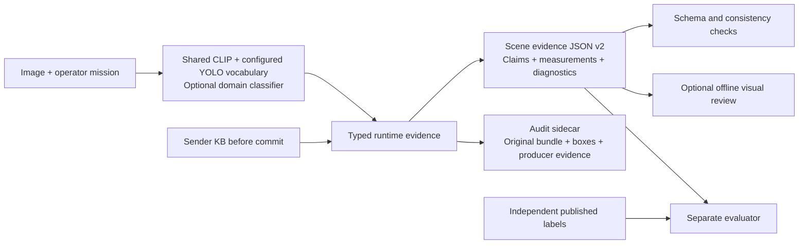

# Universal evidence JSON and audited model settings

This redesign separates image evidence from diagnostic internals. It is an
additive, versioned export under BetterScheduler. Historical JSONs, extraction
predictions, reviewer results and the scheduler header remain unchanged.

**Universal means one domain-independent format, not a model that understands
every scene.** Category/predicate names, mission text, target vocabulary and optional
ontology rules are data. No disaster category or importance weight is required by
the schema. The current claims are boolean assertions; quantities belong to
measurements. Unsupported relationships and metadata remain explicitly unavailable.

## The new structure

| Section | Meaning | Important distinction |
|---|---|---|
| `observation` | Observation/image/source identity and original dimensions | Identity does not assign importance |
| `mission` | Operator context, observable clauses and target categories | The model does not invent the operator's task |
| `scene.claims` | Named positive/negative image-level predictions | Each value has status, producer and score semantics |
| `scene.detections` | Per-category accepted-box counts, extent and detector scores | Missing boxes do not prove absence |
| `scene.relations` | Produced relationships, or unavailable | No invented proximity, distress or causal relation |
| `measurements` | Context alignment, causal novelty/rarity, geometry, diversity, time/geography | These are measurements, not a priority verdict |
| `similarity_signals` | Raw image/text alignment values | Not class probabilities |
| `diagnostics` | Producer disagreements and declared-ontology conflicts | Predictions remain unchanged |
| `provenance` | Producer settings/identities and optional ontology | Raw per-instance outputs live in the audit sidecar |

One inference/extraction pass can produce two artifacts:



The schema does not contain evaluator annotations, expected answers, VLM approvals
or a priority score. A consumer must not resolve an unfamiliar predicate by guessing.
Its producer/task definition establishes the predicate's meaning.

### Explicit negative, missing and cold start

An abbreviated real claim looks like this:

```json
{
  "name": "building.present",
  "subject": {"kind": "category", "name": "building"},
  "predicate": "present",
  "value": false,
  "status": "available",
  "reason": null,
  "method": "ladi_reference_multilabel_sigmoid_v1",
  "producer_ref": "image_classifier",
  "score": {
    "value": 0.1,
    "kind": "positive_class_sigmoid",
    "calibrated": false,
    "threshold": 0.5,
    "decision_operator": ">",
    "positive_class": "building.present"
  },
  "source_label": "buildings_any"
}
```

The score above is illustrative; it is the score for the **positive class**, not
90% confidence in absence. The prediction is explicitly negative because the
producer applies its declared threshold. Missing evidence instead has `value:null`,
`status:"unavailable"` and a reason. Cold-start history has `value:null`,
`status:"cold_start"`: the old default score of one is kept only in the raw audit.
Available zero and an available empty detection list are valid values.

### What changed from the old JSON

- A claim is emitted once. Classifier output is not copied under scene, reliability
  and claims. Reliability is attached to each producer prediction.
- Image-level classifier decisions and localized detector observations remain
  separate. A detector miss does not invalidate a negative classifier field or
  create a negative claim by itself.
- Exact integer detection counts replace the ambiguous `target_count:0.02`.
  They count accepted boxes, not verified physical objects. Area is explicitly
  a fraction of the original image and uses rectangle union.
- Appearance difference, new predicted concepts and concept rarity remain distinct.
  They do not establish a new real-world disaster, asset identity or another view's
  additional evidence.
- Raw boxes, legacy scaled counts, complete supporting calculations and original
  producer outputs remain in an audit sidecar. No prediction is silently repaired.
- Ontology rules are supplied separately. The optional LADI rule file can flag
  `tree.damaged=true` alongside `tree.present=false`. That is a consistency warning,
  not an independent factual judgment. No rules are applied implicitly to new domains.

The representation is deliberately explicit and is **not a compressed wire header**.
Byte counts are measured during conversion; no reduction or channel saving is claimed.

## YOLO-World: actual configuration

The recent h3 extraction used the following values; the i review reused those
predictions and did not run YOLO again.

| Setting | Actual h3 value | Meaning / limitation |
|---|---|---|
| Implementation | Ultralytics 8.3.237, YOLO-Worldv2-small | Frozen object detector, not a universal scene classifier |
| Weights | `yolov8s-worldv2.pt` | SHA-256 `9b2c17ab6124a913e9b3a5c170617920d91b0f01111a8479da69f00e2cf27792` |
| `conf` | **0.05** | Deliberately permissive development threshold; accepts weak boxes |
| `iou` | **0.50** | NMS box-overlap threshold, not image similarity |
| `imgsz` | **640** | Requested inference size; rectangular letterboxing may produce a nonsquare tensor |
| `max_det` | **300** | Caps returned detections; counts cannot establish true object totals |
| `agnostic_nms` | **false** | Class-aware suppression |
| `half` | **false** | No requested FP16 inference |
| `augment` | **false** | No test-time augmentation |
| `verbose` | **false** | Library verbosity only |
| Device | **cuda:0** | Explicit extraction GPU |
| Invocation | One PIL RGB image per `predict` call | Separate from the shared CLIP batch setting |
| Category prompts | **16 explicit strings**, below | Only configured categories are searched |

```text
building, road, person, car, truck, bus, motorcycle, bicycle,
debris, chair, couch, dining table, television, refrigerator, tree, water
```

**The class default `DetectorSettings.confidence` is 0.25.** The recent experiment
explicitly overrode it to **0.05**. These are different configurations; neither is
a generally optimal threshold. Downstream box filtering consumes the recorded
effective threshold, so it no longer silently filters everything again at 0.25.

The pinned Python `Model.predict` supplies method defaults `batch=1`, `rect=true`,
`mode=predict` and `save=false` outside CLI invocation. These are source-derived
inherited defaults; h3 recorded overrides but did not save the complete resolved
predictor namespace. The new code records effective prediction settings after
forward execution. Full pinned defaults are saved in the settings audit, with
training-only settings kept separate from inference settings.

The vocabulary is now a validated constructor argument. Original text prompts
remain in provenance; observation keys use canonical aliases (`cars` -> `car`).
Changing the vocabulary changes the detector signature and KB comparability.
The existing 16 strings remain the default, so old callers retain their behavior.

Do not interpret weak boxes as urgency or verified scene depth. Aerial images,
tiny objects and broad categories such as roads/water need domain-specific
localization evaluation. We are exposing settings, not tuning thresholds for VLM
approval. YOLO-World's internal text encoder is distinct from our separate shared
CLIP image/task alignment path.

Primary implementation evidence:
[pinned prediction defaults](https://github.com/ultralytics/ultralytics/blob/v8.3.237/ultralytics/engine/model.py),
[letterboxing](https://github.com/ultralytics/ultralytics/blob/v8.3.237/ultralytics/engine/predictor.py),
[all configuration defaults](https://github.com/ultralytics/ultralytics/blob/v8.3.237/ultralytics/cfg/default.yaml).

## CLIP: actual configuration

| Setting | Actual h3 configuration | Meaning / limitation |
|---|---|---|
| Model | `openai/clip-vit-base-patch32` | Shared frozen image/text encoder |
| Revision | `3d74acf9a28c67741b2f4f2ea7635f0aaf6f0268` | Pinned source |
| Weight SHA-256 | `a63082132ba4f97a80bea76823f544493bffa8082296d62d71581a4feff1576f` | Actual h3 receipt |
| Vision input | RGB, **224 x 224** | Fine details may disappear |
| Patch size | **32 x 32** | 7 x 7 image patches at native resolution |
| Vision backbone | 12 layers, hidden size 768, 12 heads | Checkpoint architecture; not search settings |
| Text backbone | 12 layers, hidden size 512, 8 heads | Frozen checkpoint architecture |
| Output | **512-dimensional** image/text embeddings | Both L2-normalized before comparison |
| Text capacity | **77 tokens**, including special tokens | Arbitrary long context paragraphs are unsupported |
| Tokenization | Padding to longest text in batch; **no truncation** | Current code raises on oversized clauses/paragraphs |
| Image preprocessing | **checkpoint_native** | Resize shortest edge to 224, bicubic, center crop 224 |
| Pixel scaling | 1/255 | Processor scales byte pixels before normalization |
| RGB mean | `[0.48145466,0.4578275,0.40821073]` | Checkpoint processor |
| RGB std | `[0.26862954,0.26130258,0.27577711]` | Checkpoint processor |
| Inference | `eval()` + `torch.inference_mode()` | No fine-tuning; no requested autocast/quantization |
| Device / parallel | cuda:0 / DataParallel false | Actual recent extraction path |
| Configured image batch cap | 8 | Recent worker passed one image per call |
| Similarity | Normalized image/text dot product | Raw cosine; no softmax or learned-logit rescaling |

The historical alternative `aspect_preserving_pad` resizes the full image into a
224 square using bicubic interpolation, pads RGB(127,127,127), then disables the
processor's resize/crop. It preserves field of view but reduces object scale.
It is the class constructor default; the recent semantic-validation worker
explicitly chose checkpoint-native cropping. Neither option is silently changed.

The old relevance value `(cosine+1)/2` is a numeric mapping, not a probability.
V2 exposes the raw cosine when its method identifies that calculation. Scene
prompt scores are likewise labeled similarities; the exporter does not convert
them to boolean scene membership. Whole-image review and center-cropped producer
inputs see different fields of view, which must remain an experimental limitation.

The eight fixed scene prompts currently cover road, residential, indoor, forest,
water, people, vehicle and fire. Four descriptive contrast pairs concern building
affectedness, road damage, road blockage and incident informativeness. They are
stored for auditing; they are not general-purpose verified event classifiers.

Primary model configuration:
[pinned CLIP config](https://huggingface.co/openai/clip-vit-base-patch32/blob/3d74acf9a28c67741b2f4f2ea7635f0aaf6f0268/config.json).
The pinned cached processor/config and current source establish the exact local
preprocessing and numerical settings; the audit saves their full contents.

## Other producer that must not be hidden

The recent building claims come from the optional
`MITLL/LADI-v2-classifier-small-reference`, not from YOLO or CLIP cosine alone.
It is an aerial-disaster classifier with 12 sigmoid heads, threshold `>0.5`,
native 448-pixel resize/center crop, mean/std0.5. It is not calibrated or a
universal classifier. Its declared domain, weights and preprocessing are recorded
in provenance. A household or factory deployment needs appropriate producers;
the universal schema does not make this model suitable for those domains.

## API, compatibility and validation

`scene_json.extract_document(extractor,image,mission,metadata,memory)` runs one
visual pass and returns `(document,audit)`. It does not commit memory. The caller
commits only after successful validation/serialization. `build_scene_document`
also accepts cached typed evidence. `validate_document` validates schema and
cross-field constraints. JSON Schema validation uses the optional dependency
`BetterScheduler/environment/requirements-json.txt` in the existing environment.

The legacy `annotation_pilot.representation` stays unchanged. Existing Qwen v5
prompts and control expectations consume that old shape. V2 is not silently
fed into an old reviewer; its future offline review must use an explicitly
versioned input adapter and paired controls.

The replay reads the retained trace, which contains historical evaluator audit
fields, but accesses only its runtime bundle/identity/candidate portion and the
feature cache. It never reads evaluator case files or imports annotation labels
into v2. This is an API boundary, not physical segregation of the old trace file.
No new GPU/API run is authorized or launched by the conversion.

Validation results and concrete artifacts are recorded in JOURNAL.md. This
increment tests serialization, evidence interpretation and preservation, not
whether these parameters adequately represent every scene or improve scheduling.
