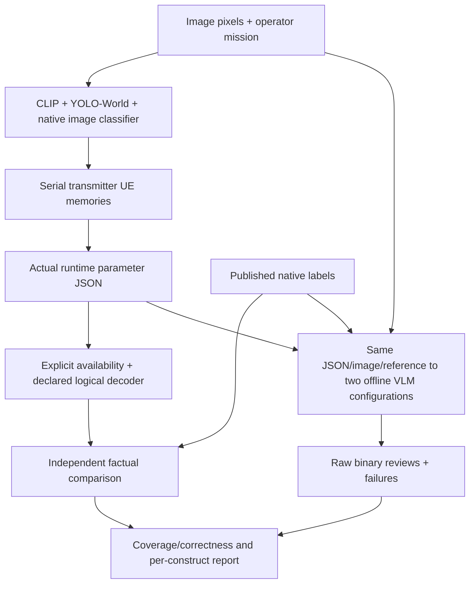

# Balanced validation of the semantic representation

Terminal h3 evidence: [SEMANTIC_VALIDATION_H3_RESULTS.md](SEMANTIC_VALIDATION_H3_RESULTS.md).
Extraction completed; the reviewer comparison remained partial and neither VLM
qualified. The pre-launch and local-only observations below retain their scope.

This increment implements the user's approved next experiment. It evaluates two
native building facts and records what can and cannot be tested for the other
parameter constructs. It does not finalize a universal parameter set or train a
scheduler. Archived f/gstrict-key results retain their original failed scores.

## Three different questions

| Question | Mechanism | Example |
|---|---|---|
| Explicit availability | Deterministic key/value/mask check | A missing/null/masked damage field is not explicit |
| Representational recovery | Versioned decoder rules | Predicted no-building can encode predicted no-affected-building |
| Factual correctness | Compare explicit and derived predictions to supported source labels | A false predicted absence remains wrong even if it decodes completely |

`semantic_contract.py` implements true/false/unknown semantics. Missing and null
are unknown;`claim_availability.available=false` overrides a stale displayed value.
Detector non-detection does not create absence. Rules are limited to native scope:

```text
building.affected_or_greater=true -> building.present=true
building.present=false -> building.affected_or_greater=false
```

Only candidate predictions enter decoding. Derivation does not manufacture source
annotation truth. Every derived claim retains its premise/rule provenance. Explicit
conflicts are retained and invalidate consistency;they are never silently repaired.
Partial references stay partial and ungradable endpoints remain unavailable.



Labels,control arms,expected verdicts and evaluator audits never enter extraction.
Published annotations intentionally enter the offline reviewer,as requested. That
arm is annotation-assisted,not independent visual recognition ground truth.

## Balanced source panel

The12parents are from the official LADI test split at revision
`5f2dbfe8c466d32edafd1bab847ec5252309acdb`,rows20–37after deterministic balancing:
4absent,4present with no annotated affected condition,4affected. “Unaffected” here
means the source's native label,not a universal claim that every surface is intact.
The previous prepared LADI cohort used train-source records;the reference image
classifier was trained official train. The new test-source panel is a more useful
development check. Dataset-version overlap and external pretraining are not certified.

Known7555prepared image hashes,the prior exposure ledger and20exposed test-source
images are excluded. dHash distance<=2with adequate texture screens near-pixel
matches. Selected images are also screened against one another. This does not
establish event/site independence or natural cross-view correspondence.

The metadata audit examined100rows,reporting partial=true and1049viewer rows.
It does not extrapolate that count to the whole published test set. Only12images
were downloaded(5,544,858bytes). Viewer asset URLs require refreshed signatures;
runtime downloads re-fetch metadata,check label/revision agreement,and verify all
pixel hashes. Signed URLs are not persisted. A bounded failed access check on the
unsigned route was diagnosed before packaging;the run does not rely on that route.

## Controls and real extracted representations

Every parent provides4controls:complete,condition unavailable,wrong presence,and
wrong condition. Half of each stratum's unavailable cases omit the field;half
mask a stale opposite value. Availability masks must override visible stale values.
Absence with a recoverable condition and presence with a genuinely unknown
condition receive different semantic targets. Incorrect presence predictions and
explicit contradictory pairs are included. Expected outcomes are generated only
by the separately tested decoder and native labels;they are not sent to the VLM.

The actual extractor runs once per image. Cached evidence then drives15causal
observations:12images assigned acrossUE-A/UE-B,one exact repeat per sender,and
UE-C'sindependent cold start. No real capture times or natural event novelty are
invented. The full output contains12unique real JSONs and48controls. After runtime
preflight exposed an over-tight reviewer budget, the final paired pilot selects
the first2source rows in each state:6parents,24controls and6actual JSONs per
model. Selection is fixed before9Boutcomes and identical for both models;full
extraction/case files remain preserved. Each reviewed state has one omitted and
one masked-condition case. This is a small pilot,not a final model comparison.

| Construct | Evidence this pilot can supply | What remains unsupported |
|---|---|---|
| Context relevance | Actual mission/image cosine;availability and class-proxy separation | General mission relevance or urgency calibration |
| Novelty | Causal KB,exact-repeat zero,independent sender cold start | Real new disaster/asset identity or cross-view complementarity |
| Scarcity | Predicted concept frequency under the declared history | Independent scene importance or global rarity |
| Scene claims | Published building presence/affected labels | Complete scene meaning or every other native concept |
| Spatial/complexity | YOLO output,valid geometry/counts,producer cost | Localized accuracy,physical distance or semantic depth |
| Reliability | Raw claim scores and correctness on supported labels | Calibrated confidence from12images |
| Time/geography | Explicit unavailable state without trusted metadata | Real freshness/location utility |

Runtime JSON byte counts are research representation sizes. They are not a frozen
binary header,payload size,channel-use count or codec compression result.

## Reviewer comparison,thinking disabled

Both reviewers use a fixed semantic_contract_v5 prompt,mission scope,192output
tokens,aspect-preserving512-side inputs,262144effective pixels and greedy decoding.
The4Bbaseline is Qwen3-VL-4B-Instruct FP16 onGPU1,Transformers4.57.6,revision
`ebb281ec70b05090aa6165b016eac8ec08e71b17`. The challenger is Qwen3.5-9BNF4
double quantization/FP16compute,revision`c202236235762e1c871ad0ccb60c8ee5ba337b9a`.

9Buses an isolated venv with Transformers5.3.0,Accelerate1.12.0,bitsandbytes0.49.2
andHub1.5.0,sharing the managed matched Torch/Torchvision pair. It preserves the
baseline runtime. The environment is created with `venv --without-pip`,then the
existing pip manages its interpreter via `pip --python`;this avoids the observed
failing ensurepip subprocess. Runtime import checks precede either VLMweight
download. Optional FLA/causal-conv1d packages are rejected before weights
download if inherited:the inspected source does not verify their T4 compatibility
or expose a supported selective-off switch. Native Torch fallback is used only
when those packages are absent. No global package uninstall or private monkeypatch.

`enable_thinking=False` reaches the actual chat template. Qwen3.5must render a
closed empty think block before generation. Unexpected generated think tags fail
the response and remain preserved. `/nothink` is not substituted for the API flag.
The existing Instruct4B template is also checked for an open thinking block.

The official9Bcard motivates a challenger via visual and instruction-following
benchmarks;it does not certify our NF4,disabled-thinking configuration. The
comparison changes family,precision and runtime,so it tests practical deployed
configurations rather than a causal effect of parameter count.

Before the full loop,each model reviews the same3technical cases. Record placement,
activatedNF4modules,model footprint,pixel/input limits,finite last-token logits,
JSON validity and measured time. Reject OOM,spill outsideGPU1,nonfinite output,
thinking leakage or insufficient time. Technical cases are reused,not duplicated.
The worker can finish partial;missing planned calls remain missing.

## Metrics and limits

Report both endpoint confusion matrices,balanced accuracy,class-specific correct
fractions including invalids,valid count,joint correctness,genuinely missing
condition rejection and declared recoverable-absence acceptance. Controlled
qualification requires95%valid,80%BAperendpoint,75%perclass,and75%for each of the
two availability/recovery checks. It is an engineering gate on a small panel,not
statistical certification. Actual JSONs receive a separate table;unknown truths
are counted as ungradable and never replaced by negative labels.

Compare models on identical completed cases;do not compare a partial9Bprefix to
the full4Bcohort. Report source-parent results before pooled variants. No final
holdout or parameter selection is inferred from this development pilot.

Final corrected budget:twoT4s,server1200s/internal1050s,maximum30reviews per
model. Prior failed-attempt conservative bounds146.484s+258.5splus1200s give
<=1605sacross twoGPUs,or0.892aggregateGPUhours,within the original1hour allowance.
CPU preflight precedes cloud execution. Incremental JSONL,worker logs,
model/source/config hashes,executed notebook and checksums are preserved. Run
identity/status/retrieval remain in KAGGLE_RUNS.md. No automatic retry or training.

## Local results before the cloud comparison

- 80tests passed12.07s,including an independent allowed-worlds enumeration of all
  three-state input combinations. Focused numerical checks found no mismatch.
- Real CPU image extraction:12images,15observations,24/24native building fact
  comparisons correct in16.09s. CLIP/native classifier ran;YOLOwas disabled in
  this CPU preflight,so spatial and complexity were explicitly unavailable.
- Secondary inspection of all12native heads found129/144matching facts. Building-
  minor recall was2/4,tree-damage4/11andwater2/4. Several heads have no positive
  cases,so sensitivity is undefined;no threshold was tuned on these data.
- Exact repeats returned zero appearance novelty;UE-Cwas a cold start.
- Cached replay with swapped reference labels left all15runtime bundles identical.
  The revised masked controls were regenerated without re-running image models.
- Actual4Btokenizer/image processor check verified thinkingOFF and valid pixels.
  9Bprocessor/GPU execution and full detector results are still pending.

These observations do not establish all-parameter sufficiency or universal
classifier accuracy. Cloud results are added only after artifact verification.

## Primary sources

- LADI dataset:https://huggingface.co/datasets/MITLL/LADI-v2-dataset
- Reference classifier:https://huggingface.co/MITLL/LADI-v2-classifier-small-reference
- 9Bmodel/modes:https://huggingface.co/Qwen/Qwen3.5-9B
- Pinned9Btemplate:https://huggingface.co/Qwen/Qwen3.5-9B/blob/c202236235762e1c871ad0ccb60c8ee5ba337b9a/chat_template.jinja
- NativeDeltaNetfallback:https://github.com/huggingface/transformers/blob/v5.3.0/src/transformers/models/qwen3_5/modeling_qwen3_5.py
- NF4requirements:https://huggingface.co/docs/bitsandbytes/v0.49.2/en/installation
- Supported pip targeting:https://pip.pypa.io/en/stable/topics/python-option/
