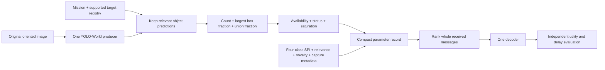

> **Active 300-image contract — 28 October 2026:** use all retained detections
> from the frozen YOLO-World vocabulary. Export instances, distinct detector
> categories, largest-box fraction and exact union coverage. These are global,
> detector-dependent measurements, not mission-relevant counts, physical
> distance, urgency or total semantic complexity. Current header remains35bytes.
> The mission-filtered design discussed below is historical/proposed and is not
> the active extractor definition. No extra scene classifier is introduced.

# Spatial evidence decision and scheduler handoff

Decision date: 27 October 2026. Design is finalized for the next implementation.
It is not an empirical finding of benefit. No extraction, tests, model loading,
training or Kaggle submission was performed for this decision.

This document is the current spatial contract. It supersedes the earlier PPT
definitions and the menu of spatial candidates in the preceding research plan.
`parameters/PLAN.md` remains the canonical project decision record.

## 1. Final decision

The core big three are retained: **SPI, context relevance, and causal UE novelty**.
Capture metadata is retained independently. The two PPT concepts are retained
with narrower operational definitions: **Spatial Prominence = largest relevant
box fraction** and **Scene Complexity (detected entity load) = relevant instance
count**. Collective relevant coverage is the third spatial measurement, not an
invented third user-named conceptual category. No class or urgency is derived
solely from any of these three measurements.

Use **task-relevant detected-object extent and count** as an optional three-value
descriptor accompanying four-class SPI, relevance, novelty and capture metadata:

1. `relevant_instance_count`: how many relevant object instances the configured
   producer retained.
2. `largest_relevant_box_fraction`: the largest relevant detection rectangle as
   a fraction of image area; this is the operational spatial-prominence value.
3. `relevant_box_union_fraction`: the union of relevant detection rectangles as
   a fraction of image area; overlap is counted once.

These are observations about predicted objects. Their causal role in urgency is
not assumed. Four-class SPI addresses intervention need; geometry adds possible
evidence about extent and multiplicity. The learned scheduler may use interactions
among them. It must be allowed to ignore misleading geometry.

The name Scene Complexity is permitted only with its qualifier **detected entity
load**; it is not total semantic complexity. Transmit the raw count, not a graph
score or an arbitrary number normalized by MAX_COMPLEXITY. Keep total detections,
distinct detected categories and raw boxes as audit diagnostics only. Do not
add REBEL, a knowledge graph, GNN, monocular depth, tracking, or crop relevance
grids to the default pipeline. The grid proposal remains deferred; it has no
established added value and would add new extraction and selection work.

## 2. What changes in the PPT claims

| Earlier statement | Current decision and reason |
|---|---|
| Bigger/closer means more important. | Box area measures projected size. It cannot distinguish a large distant object from a smaller nearby object, camera zoom or cropping. No distance estimate is emitted. |
| Spatial prominence is a proxy for urgency. | Reject as a universal assumption. A small exposed person can matter more than a large intact building. Any conditional predictive value must be measured beyond SPI and relevance. |
| More visually dominant entities should be prioritized. | No fixed rule. The policy learns whether relevant object extent adds value under the mission; no positive coefficient is imposed. |
| YOLO identifies scene conditions or urgency. | YOLO-World supplies object labels, scores and boxes. A building box alone does not establish damage, occupancy or current danger. |
| Nodes + edges describe scene complexity. | Use relevant detected entity count as an explicit limited proxy. Graph size also changes with relation-generator verbosity and merging rules, adding uncertainty beyond object detection. |
| YOLO entities -> REBEL -> visual relations. | REBEL extracts relations from text, not visual regions. A caption stage would introduce another unverified inference and error propagation. |
| More scene complexity means a larger payload or slower decoder. | For fixed latent shape/dtype and a fixed decoder path, tensor bytes and nominal operator workload need not increase with object count. Variable-rate codecs require actual bits/service measurements. |
| Temporal tracking estimates approaching/receding objects. | Requires a sequence, identity association and treatment of camera motion/zoom. A single still image cannot support this field. Defer. |

The camera ambiguity follows the perspective projection documented by
[OpenCV](https://docs.opencv.org/4.x/d9/d0c/group__calib3d.html): image coordinates
depend jointly on world position, depth and camera intrinsics. Relative box area
does not remove those ambiguities.

## 3. Exact extraction definition

Let the EXIF-oriented RGB image have original width W and height H. Let D_m be
retained, nonmaximum-suppressed detections whose canonical object labels belong
to the supported target set for mission m. Each detection has a clipped original-
image-coordinate rectangle b_i = (x1,y1,x2,y2).

```text
n = |D_m|
a_i = max(x2-x1, 0) * max(y2-y1, 0)
p = max_i a_i / (W*H)                    when n > 0
u = area(union of all b_i in D_m)/(W*H)
```

Ranges: n is a nonnegative integer; p and u are in [0,1]. For n>0, p<=u.
For n=0, p is unavailable because there is no largest detected box; u=0 is a
valid empty-detection union. Neither zero proves object absence.

Example: a 100x100 image contains two retained relevant boxes of area 400 and
900 pixels, with 100 pixels overlap. Then n=2, p=0.09 and u=0.12. These values
establish no urgency class or physical distance.

Use the original image rectangle as denominator. Undo letterbox/padding and
resizing before measurement. Padding must not dilute object coverage. Clip boxes,
reject nonfinite/reversed/zero-area boxes, preserve saturation/truncation, and
record the detector settings and vocabulary hash. NMS and threshold changes
change the descriptor definition and require a new producer version.

### 3.1 Defining relevant objects without hidden importance weights

Use one YOLO-World producer and a declared mission target registry. For example:

- Road obstruction inspection: supported target objects such as person, vehicle,
  debris; a road-surface task may need a different future producer.
- Building inspection: building instances. Their boxes measure building extent,
  not extent of damage.
- Routine people-counting task: person instances, with no automatic urgency.

The registry specifies measurable entities, not class-to-importance weights.
Aliases such as car/automobile must resolve consistently; categories must not be
inferred from numeric class IDs across model vocabularies. Do not silently add
unsupported condition prompts such as 'critical emergency' and interpret their
boxes as verified conditions.

For the first implementation, select targets from the supported existing producer
registry by explicit mission configuration. Do not add an automatic LLM ontology
builder or a large scene classifier. If a free-text mission has no supported
target mapping, report `unsupported_targets`. No task-specific mapping is
guessed from evaluator labels or annotations. All-image mission relevance still
accepts the full context paragraph independently.

An arbitrary screenshot, document, broad landscape or road/water surface may not
have a supported box interpretation. Mark spatial applicability unavailable for
that case; do not equate it to Low SPI or low relevance. A universal message
schema can carry an optional typed measurement. It cannot make one object
detector universally reliable.

### 3.2 Producer choice and settings

Keep the already-used YOLO-World checkpoint as the first implementation source;
changing the name to closed-vocabulary YOLOv8 does not resolve the observed
coverage problem. The current conf=0.25, IoU=0.5, imgsz=640 output is the historical
baseline, not a validated final operating point. Use a pinned max_det and record
all effective preprocessing/NMS settings. Detector settings remain provisional
until the bounded annotated assessment; do not pretend a threshold was finalized
from counts alone.

Do not rerun an expensive producer search. Reuse the bounded 640/1024 and
confidence 0.10/0.25 diagnostic from the research plan only when execution is
authorized. Compare precision and recall, including small targets and aerial
images; prefer the least costly adequate setting. If no adequate setting exists,
keep this descriptor unavailable for the unsupported domain rather than lowering
the threshold until every image has a box.

The existing geometry helper in `parameters/scene_measurements.py` measures all
retained detections. It is reusable geometry code, **not yet** the task-filtered
contract described here. Do not pass its old all-object values off as these new
fields. Implementation must filter using the declared target registry and emit
the versioned status/provenance.

## 4. Scheduler contract

Contract ID: `task_box_extent_v1`. Units and field names are stable for the next
implementation. The human-facing concepts map to numeric inputs as follows:

| Concept | Exact field | Interpretation |
|---|---|---|
| Scene Complexity (detected entity load) | relevant_instance_count | Predicted instance multiplicity, not unique identities or universal information content. |
| Spatial Prominence | largest_relevant_box_fraction | Projected rectangular extent of the largest relevant instance. |
| Collective extent | relevant_box_union_fraction | Combined rectangular coverage with overlap counted once. |

Logical schema (an audit example, not the currently implemented wire format):

```json
{
  "spatial_version": "task_box_extent_v1",
  "status": "ok",
  "relevant_instance_count": 2,
  "largest_relevant_box_fraction": 0.09,
  "relevant_box_union_fraction": 0.12,
  "available": [true, true, true],
  "saturated": false
}
```

Policy input order is `[count, largest_fraction, union_fraction]` with three
availability flags. Scale count with a declared training-fold transform such as
log1p plus fitted scaling; preserve fractions on [0,1]. Fit all scaling only on
training groups. No arbitrary MAX_COMPLEXITY is introduced. Profiles/producer
registries must be shared. Producer identity is for compatibility, not a learned
shortcut to dataset identity. Routing IDs do not enter semantic features.

| Situation | Output interpretation | Policy handling |
|---|---|---|
| Supported, successful detections | All three values available. | Learn their conditional contribution with core parameters. |
| Supported, successful, no retained detections | count=0, largest=null, union=0; masks [1,0,1]. | A detector observation, not proof of no useful evidence. |
| Unsupported targets or inappropriate source format | Three unavailable fields. | Core-only scoring path with masks. |
| Producer error, invalid input or incompatible profile | Three unavailable fields and an explicit failure status. | Core-only scoring path; log the failure. |
| Detection limit reached | Retained values and saturation flag. | Count/extent are censored; do not treat count as complete. |

All missingness is retained. A model trained only on spatially available natural
photos cannot silently be declared validated for unavailable screenshot cases.
Include those cases in selection/evaluation and report their coverage explicitly.

### 4.1 Compact representation

A proposed spatial extension can use five bytes: one flag byte, uint16 count,
uint8 largest fraction and uint8 union fraction. Flags carry three availability
bits, saturation and a small status code. Fraction encoding is round(255*x);
maximum rounding error is 1/510 before any measurement error. Missing numeric
slots are ignored according to flags, never inferred from their zero bytes.

This is the descriptor size only. It excludes envelope and agreed registry/
version identity. It does not make the full header five bytes. Existing v2 uses
a different seven-byte scene extension; retain it until an explicit versioned
implementation, then report complete old/new header sizes and quantization
effects. Do not silently reinterpret existing saved headers.

### 4.2 Policy mechanism

Use a shared ranker receiving SPI probabilities, relevance, novelty, trusted
timing and the three spatial values/masks. Preserve within-class comparisons;
do not force a hard SPI-only ordering. The policy designer may choose a linear
or neural ranker under matched information and budgets.

No universal score such as `SPI + 0.3*area + 0.2*count` is justified. Compare
core-only, core+count, core+extent, and core+all-three using identical independent
labels/queues, same model family and tuning budget. Geometry can interact with
SPI, but a close-up intact building must not outrank a small visible immediate
threat merely because its extent is larger.

The policy owner can implement a ranker with candidate input
`[SPI scores, relevance, novelty, timing, log1p(count), largest_fraction,
union_fraction, availability flags, saturation]`. SPI scores are included only
when actually provided by the agreed runtime contract; they must not be fabricated
from a transmitted class. Training-fold scaling and optional queue/history
features follow the frozen policy contract. A linear scorer is the simple
baseline; a small neural scorer may learn interactions. Model family, tuning
budget and independent ranking targets must match across spatial ablations.

For example, a small critical target may have low prominence; many routine
people may have high entity load; one intact building may occupy most of a
frame. All three are valid measurement outputs. None licenses a forced increase
in priority. Compare cases with similar SPI/relevance but different count/extent
to determine whether this descriptor supplies additional useful information.

The descriptor cannot distinguish different object categories or relationships
when they produce identical count/extent values. No ranker can recover that
omitted information. Retain category names and raw boxes in local audit outputs
to detect such collisions; any later transmission extension requires evidence
that those collisions materially affect priority.

These three aggregates do not encode positions, object identity, relations or
depth. Describe the method as using **spatial extent**, not comprehensive spatial
reasoning. Two different scenes may have identical aggregates. The scheduler
cannot recover the omitted distinction. Image-plane overlap across messages is
not cross-camera world overlap or a redundancy measure.

## 5. Literature justification and limit of transfer

| Source | Mechanism we use as inspiration | What it does not justify |
|---|---|---|
| [YOLO-World, 2024](https://arxiv.org/abs/2401.17270) | Text-defined object vocabulary and detected boxes. | Universal condition recognition or urgency from area. |
| [Personalized Saliency in Task-Oriented Semantic Communications, 2023 journal / 2022 preprint](https://arxiv.org/html/2209.12274) | Task/user relevance matters when prioritizing localized entities and relations. | Their relation/saliency system is not replicated by our three aggregates; their triplet protection is not whole-latent decoder ordering. |
| [ROI-JSCC, 2025](https://arxiv.org/html/2506.01269v1) | Explicit relevant regions can guide task-specific processing/quality emphasis. | ROI is supplied; it does not validate our detector, urgency classes, or whole-job policy. |
| [REBEL, 2021](https://aclanthology.org/2021.findings-emnlp.204/) | Confirms its actual domain: relations from raw text. | YOLO class names alone are not visual relation evidence and cannot produce a trusted scene graph. |
| [OpenCV camera model](https://docs.opencv.org/4.x/d9/d0c/group__calib3d.html) | Projection explains the dependence of visible size on camera/object geometry. | Normalized box area is not a metric distance estimate. |

No inspected paper establishes these exact three fields as an optimal descriptor
for our receiver scheduling contract. Their selection is a constrained engineering
hypothesis: reuse available detections, avoid extra models, keep units explicit
and let ablation decide their incremental value. Do not claim journal novelty
from the feature names or formula.

## 6. How we will justify retaining the descriptor empirically

There are two claims and therefore two checks:

1. **Measurement validity:** boxes/count/union correspond sufficiently to the
   declared task entities. Assess detection precision/recall by domain and size,
   count error, and extent error against appropriate boxes. Box extent error is
   not mask error; image-level labels cannot validate coordinates. Include
   ordinary photographs, aerial scenes, misleading large irrelevant objects,
   small relevant targets, and unavailable screenshot/document cases.
2. **Scheduling value:** additional fields improve ordering beyond core SPI,
   relevance, novelty and timing on held-out groups. Use independent supported
   utility labels or explicitly policy-derived references; never create the
   evaluator's importance by adding the very count/area fields being tested.

The decisive contrasts are small critical versus large benign content, similar
SPI with different task-relevant extent, irrelevant clutter, same scene under
crop/zoom, and detector misses. Do not assert crop/zoom invariance: these features
are frame-dependent; check that the resulting priority is sensible and bound
the claim to the available evidence.

Report distinct-evidence A10/coverage@10 where correspondence supports them,
class-conditioned waiting/completion delays including unfinished jobs,
redundancy, missingness/saturation, overhead and header bytes. Keep natural
observation, exact-copy and object-correspondence arms separate. Split and
uncertainty units are parent/duplicate/event/site groups, not queue seed repeats.

Use the previously proposed +0.01 A10 practically useful target with paired
grouped uncertainty supporting a positive effect, while reporting Critical
delays/undercalls. Insufficient independent groups yield descriptive results.
If the descriptor fails to help or hurts important cases, remove it from the
default transmitted features. A finalized contract does not predetermine a
positive research result.

## 7. Ownership and current implementation status

- Parameters owner: implement task filtering, values, flags/provenance and the
  new versioned serialization in `parameters` after the design handoff.
- Policy owner: consume the named ordered values/masks without geometry-derived
  gold labels or fixed monotonic urgency assumptions. No pixel image or raw
  ontology class ID is required in the policy observation.
- Evaluation owner: supply independent references and matched ablations in
  `Evaluation`/`experiments`; do not tune on the locked test.
- Codec owner: supply actual payload bytes, tensor/channel-use units and decode
  times independently of object count.

Current source still emits the earlier all-object four-value scene measurements.
Neither this three-value contract, its task filtering nor the proposed five-byte
extension was implemented or tested by this documentation task. SPI still has
an unresolved four-class training requirement. Existing historical test results
do not validate the new design or reorganized codebase.

### Scheduling teammate acceptance checklist

1. Use the exact contract ID, ordered fields, units, availability and censoring.
2. Do not substitute category count for instance count or sum areas for union.
3. Accept core-only cases with unavailable spatial fields, including unsupported
   screenshots. Zero detections describe the model result, not confirmed absence.
4. Do not impose area/count urgency weights, infer distance, or manufacture cost.
5. Use independently defined ranking/utility references, grouped splits and
   core-only/core+count/core+extent/core+all-three comparisons.
6. Record which of class-only SPI or actual class scores the header provides.
7. Do not parse the existing v2 scene bytes as the proposed new three-value
   contract: the old format includes category count and different semantics.

This is a passable design handoff; contact with the teammate or a change to
their implementation was not performed by this documentation step.


