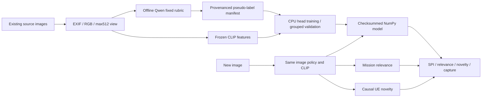

# SPI classifier and the four-output extractor

**27 October status:** this document describes the existing core and its
three-class fallback. Candidate c produced180 valid pseudo-labels
(82Low,0Medium,73High,25Critical), then correctly refused its four-class fit.
The subsequent three-class checkpoint exists. A new four-class rubric-v2 run is
underway. The28-byte core described below does not include the implemented
35-byte v2 scene extension; see PARAMETER_FINAL_REPORT.md for the current path.

The current decision is the first section of [PLAN.md](../PLAN.md). This file describes implementation and execution, not another architecture proposal.

**Follow-up repair:** user authorized dropping the unsupported class. Current
local training explicitly uses `--levels Low High Critical`; it preserves all180
labels unchanged and exports `better_spi_head_v2` with Medium unsupported.
The exported head now exists at `results/spi_three_class_20261027/models/spi.json`:
62.86% development teacher agreement,2/10Critical recall. Treat this as a working
research artifact, not a validated urgency classifier.
See [SPI_MEDIUM_DIAGNOSIS.md](SPI_MEDIUM_DIAGNOSIS.md) for diagnosis, command and
limitations. Four-class defaults/v1 loading remain for historical callers. The
following four-class architecture describes that original path; the current
selected head has three logits. Canonical header values remain Low3/High1/Critical0.

## What is fixed

One shared frozen CLIP ViT-B/32 represents the image. The SPI head is 512→128→4 with tanh-approximate GELU, dropout during training and unweighted cross-entropy. There is no scene-classifier ensemble or detector in this path.

| Output | Extraction | Interpretation |
|---|---|---|
| SPI | Image embedding → learned four-class head | Visible response-attention under the pinned rubric |
| Relevance | Image embedding versus operator-paragraph embedding | Cosine similarity, not probability |
| Novelty | Maximum cosine to comparable prior images in this UE's KB | Appearance change, not verified new real-world facts |
| Capture | Trusted capture timestamp and operator delay | Raw milliseconds, no decay formula |

Long operator paragraphs are tokenized into CLIP-sized chunks. Each chunk is encoded; a token-count-weighted normalized mean produces the paragraph representation. The implementation has an explicit 16-chunk ceiling and does not truncate silently.

The SPI labels come from a dedicated offline Qwen teacher under [the fixed rubric](../config/spi_rubric_v1.json). Mission paragraphs, native source labels, other parameter predictions and KB history are excluded from the teacher. The student sees image embeddings only. This avoids hidden-context contradictions. Scores describe this model's predictions; they are not independently calibrated probabilities of human urgency.

Published image-urgency and VLM-distillation precedents are in [the literature review](phase0/SPI_LABEL_LITERATURE_REVIEW.md). Existing native image categories are not renamed into SPI labels. Independent four-way human urgency accuracy remains unmeasured.



## Source entry points

- [spi_labels.py](../spi_labels.py): fixed-rubric teacher prompt/parser and provenance. Thinking is disabled by the shared Qwen runner.
- [spi.py](../spi.py): data isolation, CE training, per-class/RPS metrics, prior baseline and NumPy export/inference.
- [minimal_vision.py](../minimal_vision.py): shared input policy and full-paragraph representation.
- [minimal_parameters.py](../minimal_parameters.py): four-output extraction, query-before-commit and 28-byte header.
- [spi_campaign.py](../spi_campaign.py): bounded source preparation and offline teacher→student campaign.
- [spi_infer.py](../spi_infer.py): a single-image command after retrieving a trained artifact.
- [build_spi_notebook.py](../build_spi_notebook.py): immutable private Kaggle notebook builder; building does not submit.

## Commands

Use the existing environment:

```powershell
$py = 'D:\Bunker\BaseCamp\WirelessCommunication\SemanticCommunication\SemanticSchedulerEnd2End\.venv\Scripts\python.exe'
Set-Location 'D:\Bunker\BaseCamp\WirelessCommunication\SemanticCommunication\SemanticSchedulerParameterAudit'

# Train from actual labelled/cached inputs, not native damage labels.
& $py -m BetterScheduler.spi train --features FEATURES.npz --labels SPI_LABELS.json --output NEW_RUN

# Classify an image after obtaining a trained model; checkpoint is local-only.
& $py -m BetterScheduler.spi_infer --image IMAGE.png --model RUN/models/spi.json --checkpoint '..\SemanticSchedulerEnd2End\models\priority_classifiers\clip' --mission 'Inspect damage to roads and bridges.' --output RESULT.json
```

The training feature cache contains `image_ids`, `image_sha256`, `embeddings` and `feature_signature`. Every labelled image has an explicit group, split, whole-image label unit, label source and rubric hash. A run accepts one source type and one rubric. Message priority and damage labels are rejected. All four classes need actual train support. No omitted class is fabricated.

The test role is left unopened during fitting; only training and validation labels affect the selected model. The initial available cohort is already development-exposed. Its reported validation is a development teacher-agreement result, not a fresh human-labelled final test.

## Compact header

The additive protocol is 28 bytes (224 bits): version/flags/SPI, source/session/message identity, profile ID, trusted capture time, allowed delay, 8-bit relevance and 8-bit novelty. Missingness has explicit bits; available zero is not missing. Cold start has its own flag. Lower scheduling-class integer means higher priority: Critical=0, High=1, Medium=2, Low=3. The model's ordinal probability order is Low→Critical; conversion is explicit.

Relevance quantization has maximum error 1/255 in cosine units; novelty has maximum error 0.5/255. Payload size is not included and depends on the codec. Model/rubric/profile registration is shared deployment configuration. The audit JSON is not the wire header. Historical headers and callers are unchanged.

No model present, a mismatched encoder signature or invalid image features produces unavailable SPI. `available` establishes computational availability, not a guarantee of scene correctness or arbitrary out-of-domain recognition. Uncertainty is visible in model scores; this build does not pretend to have validated a universal abstention threshold.

## Validation and actual status

Checks cover the ordinal metric with hand references, label-source/group/hash isolation, rejection of missing training classes, held-out-label poisoning, export equivalence, teacher parser integration, failure status preservation, quantization, trusted timestamps and causal KB mutation. Engineering fixtures do not measure real urgency accuracy.

Luna's initial run passed nine tests under the existing CPU environment; three actual source images matched the older CLIP cache numerically. The older signature lacked weight/processor hashes, so the prepared campaign regenerates features with full identity from the exact bounded images. Current tests, package identities and measured outcomes are recorded in JOURNAL.md and KAGGLE_RUNS.md. A successful source build is not a trained model; the campaign's `status.json` and retrieved `student/models/spi.json` establish whether training actually completed.


Response contract v2 asks Qwen for level,evidence,reason. Availability is derived
from a supported non-null level; exact string `"null"` is canonicalized to JSON
null. Contradictions remain errors. All original raw responses are preserved.
This repair was checked against ten actual responses without altering their
priority labels. It does not establish semantic-label accuracy.

SPI represents the UE's estimated response attention. Subsequent scheduler
experiments must use independent task evidence as the evaluator; rewarding a
scheduler merely for selecting its own predicted SPI would be circular.
