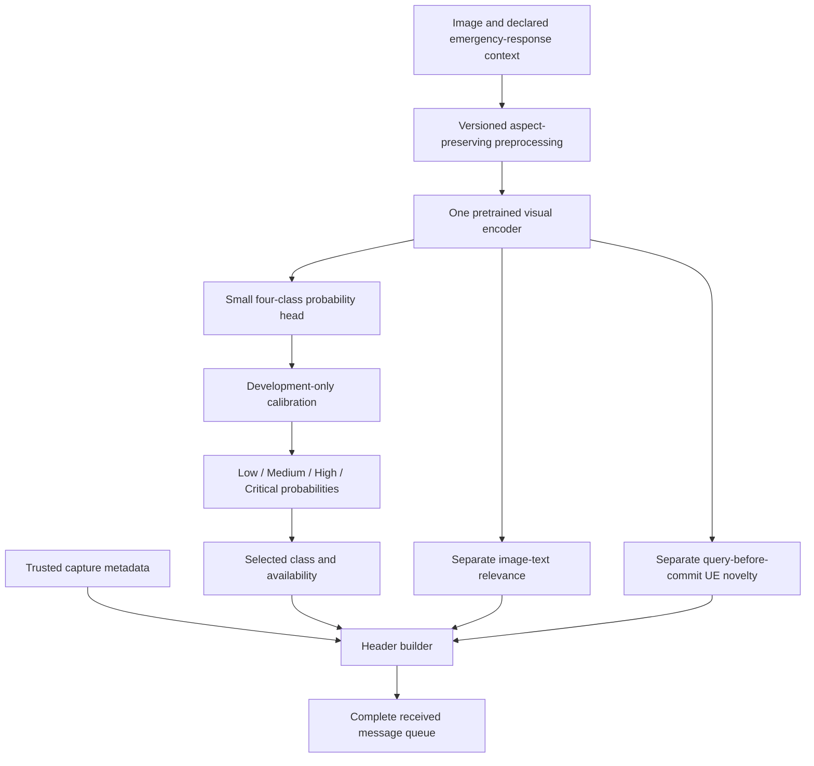

# Phase 0 decision: supervision and the final SPI architecture

Date: 26 October 2026. Status: dataset audit and architecture recommendation; no trained SPI model.


> **Subsequent literature correction (26 October):** The TREC-first data recommendation below is superseded by [SPI_LABEL_LITERATURE_REVIEW.md](SPI_LABEL_LITERATURE_REVIEW.md). Direct human-labelled image urgency and VLM-assisted importance with human verification have published precedents. Retain the simple classifier architecture as a candidate; establish accessible, target-matched visual labels before training. The factual TREC audit and its modality limitations still stand.

## 1. Earlier candidate decision

Use TREC-IS as human supervision for **emergency-response information priority**. It does not supply universal image-only operator-action urgency. An image model trained against tweet priority is weakly supervised. A tweet may contain an urgent written request alongside an uninformative photo, or several photos with different content.

The final implementation route is one pretrained visual encoder, one four-class probability head, validation-only calibration and an explicit availability flag. Keep relevance, causal transmitter novelty and capture metadata separate. These are different questions; no hand-written severity weights or YOLO scene rules will create the SPI target.

This is one architecture to build and evaluate, with scientific comparators. It is not a succession of disposable SPI prototypes. The exact exported backbone and loss are selected on grouped development data before the final test. Calling a backbone the best before that comparison would be unsupported.

**Important boundary:** our previously chosen operator-action urgency objective is stronger than TREC-IS supervision. If that stronger claim is required, independent image-and-mission urgency labels are still necessary. With no new reviewers available, no model or VLM can remove this evidence gap. The implementable TREC result must retain the narrower information-priority interpretation.

## 2. What the full annotation audit establishes

Inputs: both officially linked consolidated compressed annotation files, all 122 topic blocks and the 25-type ontology. See `TRECIS_AUDIT_STATUS.md` and `AUDIT_SUMMARY.json` for measurements and hashes.

The files contain 164,163 top-level rows, 136,263 distinct event/post pairs and 135,052 distinct post IDs. Top-level rows can already combine several judgements. The nested `multipleJudgements` entries preserve individual records; counting a merged parent as another vote is wrong.

Exact leaf-record deduplication gives 163,236 records but only 162,176 `(event, post, annotator)` keys. Of these keys, 969 have multiple record versions and 359 have conflicting priorities. Therefore even the deduplicated leaf count is not a verified number of independent human votes.

The observed priorities are Low, Medium, High, Critical and Unknown. Unknown is unavailable supervision. The newer annotation file adds author/audience/image categories to the original information types. It is not a 45-class urgency dataset.

The paper reports 7,297 tweets with image annotations and an archive of 312,546 images. Our union-of-image-category proxy finds 8,217 post IDs in the consolidated files. This discrepancy is unresolved: edition/pool/cohort rules need reconciliation. Do not describe 8,217 as a verified matched, image-labelled training set. `MultimediaShare` also does not establish a valid downloaded image.

## 3. What classes mean

Use the native four-level order:

| SPI | Intended meaning in this study | What it does not prove |
|---|---|---|
| Critical | Highest response-information priority under the assessed emergency-officer context | A measured seconds-to-harm deadline |
| High | Information that deserves prompt officer attention under that context | Universal high urgency for every operator |
| Medium | Useful information of intermediate response priority | A fixed allowed delay |
| Low | Lower response-information priority under that context | Safe to discard in every mission |

These are interpretations of the native ordered labels, not newly adjudicated classes. Keep the original label in provenance. Do not infer a grade from the number of people, damage area, object count or incident type.

An unassessed ordinary image is **unlabelled**, not automatically Low. A screenshot can carry a critical evacuation instruction or irrelevant content. A damage image can be informational rather than immediately actionable. The original study itself found higher average priority for weather-forecast imagery than damage imagery; its population average is not an individual-image rule.

## 4. Candidate approaches considered

| Approach | Mechanism | Benefit | Material problem | Decision |
|---|---|---|---|---|
| Text/message SPI | Predict priority from message text using supervised labels | Closest to the label modality; useful reference for interpreting visual results | Text is absent from the specified image-only runtime; older rows contain missing text | Diagnostic comparator where text is available |
| Image SPI | Visual encoder plus learned class distribution | Fits image-only UE extraction and shares features with relevance/novelty | Tweet-priority weak labels; multiple images; domain restriction | Main image architecture, Ok lsitenclaims explicitly bounded |
| Image+message SPI | Fuse image and accompanying text, then predict priority | Matches the message-level target more faithfully | Changes runtime inputs if accompanying text is unavailable | Separate comparator, not a silent replacement |
| Information-type-first priority | Predict types, then estimate priority using training-set type/priority relations | Transparent mechanism suggested by TREC-IS guidelines | Gold types leak truth; predicted types add error; original types are often textual | Training-only predicted-type comparator, conditional on usable annotations |
| VLM label generation | Ask a VLM for priority | Flexible descriptions without training a classifier | Generated labels are not independent human urgency truth | Phase 2 diagnostic only |

Do not use continuous severity regression on arbitrary targets 0, 0.33, 0.67, 1 as if these were observed interval-scale urgency measurements. Those spacings are a modelling choice.

## 5. Final architecture contract



The mission paragraph remains the input to relevance. TREC-IS does not label arbitrary paragraph-specific urgency, so do not claim a free-form mission-conditioned SPI model without matching supervision. Start with its declared emergency-officer context. Changing the task paragraph alone cannot make the native SPI label a valid label for a new mission.

### Visual encoder and head

Compare the existing pinned `openai/clip-vit-base-patch32` against `google/siglip2-base-patch16-naflex`. The latter is a justified candidate because the published NaFlex method preserves aspect ratio and supports variable resolution; it is not already a measured SPI winner. No checkpoint downloads or GPU work are part of this audit.

Cache frozen visual features remotely. Use a single hidden layer of 128 units, GELU, dropout 0.1 and four output logits as the common head. These are proposed fixed defaults, not tuned results. A multinomial linear head is the simple comparator. Export only one selected encoder/head; no ensemble and no fleet of scene detectors.

Do not crop away screenshot text or incident evidence without recording the effect. Use the encoder's documented processor; pin its revision, dimensions/token budget and resize policy. For CLIP, retain the project's aspect-preserving-padding comparison rather than assume standard centre crop preserves all evidence.

### Label construction

1. Preserve raw rows and nested provenance; never count a merged parent and its component judgements as separate votes.
2. Normalize post IDs as strings and retain event/assessor identities. Reconcile the 359 within-key priority conflicts; until resolved, exclude those keys from the primary vote target and report them separately. No majority fabrication within a duplicated key.
3. Keep one valid vote per `(event, post, assessor)` where record versions agree on priority. Do not assume assessor independence from the identifier alone.
4. For multiple usable assessors in one event/post, use their empirical four-class distribution as a soft target. Single-assessor records remain one-hot. This describes recorded disagreement; it does not establish true urgency probabilities.
5. Preserve conflicting contexts across events; do not globally combine them into an artificial consensus. Group the post across splits anyway.
6. Ignore Unknown for class loss and count it as unavailable supervision. Do not infer negatives from absent image labels.
7. A multi-image tweet is a bag of images. Never assign its message label independently to each image as though each had been assessed. Single-image records define the primary image cohort after media matching. Multi-image records require an explicitly separate bag-level result.

### Loss and probability output

Let `p=(p0,p1,p2,p3)` be softmax probabilities for Low through Critical, and `q` the recorded target distribution. The proposed ordinal loss is the ranked probability score:

\[
F_p(r)=\sum_{c=0}^{r}p_c,\quad F_q(r)=\sum_{c=0}^{r}q_c,
\qquad L_{RPS}=\frac{1}{3}\sum_{r=0}^{2}(F_p(r)-F_q(r))^2.
\]

It measures probability errors at the three ordered boundaries without requiring independent thresholds that can cross. Compare it against soft-target cross-entropy on the identical architecture and folds:

\[L_{CE}=-\sum_{c=0}^{3}q_c\log p_c.\]

These are candidate objectives, not evidence that ordinal loss wins. CORN is a distinct ordered-probability alternative from the literature, but is unnecessary additional implementation for the first fixed comparison.

Give each event/post training unit equal weight before any explicitly reported event-balancing strategy. Do not let repeated assessments or attached-image counts multiply an observation's weight. Use the ordinary loss as the default; any class balancing changes the target distribution and must be followed by held-out calibration and a separate reported comparison.

Fit one temperature on development calibration groups, never final groups. Report full four-class probabilities, their calibration and errors. An argmax class occupies two bits in principle; availability, confidence, timestamps and framing add bytes. This document does not finalize the wire size.

Example output below is illustrative, not a measured prediction:

```json
{
  "spi": {
    "available": true,
    "level": "High",
    "probabilities": {"Low": 0.08, "Medium": 0.20, "High": 0.60, "Critical": 0.12},
    "definition": "trecis_emergency_response_information_priority",
    "model_version": "selected_artifact_id"
  }
}
```

Unsupported context produces `available: false` with a reason in the extraction record. Low confidence can also produce abstention at a threshold selected on development groups. A confidence threshold is not a guaranteed out-of-domain detector. Availability must not silently map to Low or guarantee a safe fallback order.

## 6. Storage-safe data preparation and splitting

The complete local compressed annotation/access snapshot is 18.45 MiB. Keep image archives remote. Run media inventory/matching on Kaggle with an explicit download ceiling, content-length checks, per-file hashes and incremental manifests. Read one archive at a time within the authorized cap. A Drive HTML response or an event filename is not evidence that all image bytes are accessible and intact.

The local corpus contains 1,149 post IDs in both annotation files, and 1,209 assigned to multiple event IDs. Same-post linkage gives 80 candidate event components after excluding the artificial `2021atraining` panel. These components are conservative anti-leakage constraints, not 80 verified independent disasters. Topic URLs reveal further aliases and occasional incorrect-looking references; do not merge by Wikipedia URL automatically.

The 64 unique calibration-panel posts all occur elsewhere. Do not let the artificial panel join otherwise independent disasters into a single invented event, or add repeated votes automatically. Preserve it for provenance and resolve its assessor records against the original contexts.

Before fitting: match post→media, reconcile event aliases, hash exact images, group near duplicates/derivatives, audit label availability and class support per group, then lock final groups. If structural flooding remains the unseen mission, reserve those groups before encoder adaptation, loss selection and calibration. Disclose generic pretraining exposure separately.

Use grouped development folds only where each training/validation role has usable class support. With sparse matched-image support, report descriptive results rather than claim a reliable four-class comparison. No random-row fallback.

## 7. Evaluation and selection

For SPI itself report event-macro RPS, per-class precision/recall/F1, confusion matrix, high/critical misses, log loss, calibration, ordinal rank error and coverage-versus-error when abstaining. Report the number of groups and labelled images behind each value. Rank error imposes equal step costs and is a secondary diagnostic, not measured human harm.

Primary candidate selection: lowest grouped-development event-macro RPS; use a declared simpler-model tie rule before observing scores. Show CE and ordinal heads against the same labels and feature budget. Do not select by final-test accuracy or Qwen approval.

Also show majority-class and training-prior predictors. The 95,362 unambiguous Low posts out of 134,379 unambiguous known-priority posts imply about 70.96% accuracy for always-Low on that descriptive cohort. This is a corpus arithmetic illustration, not a held-out score. High accuracy alone can conceal complete failure on Critical.

Text-only and image+text references, where matched text exists, measure how much message information the visual model may be missing. Performance differences do not by themselves prove the images lack evidence: encoder quality and optimization are competing explanations.

Phase 1 subsequently tests whether SPI, relevance, novelty and capture metadata contain complementary information. Scheduling A10 belongs there; it cannot replace SPI label validation. Native TREC categories do not create real-world cross-view fact identity.

## 8. Acceptance and outstanding evidence

Completed now: full downloaded annotation traversal; four-class/Unknown audit; nesting and record-grain audit; cross-file/post overlap; category drift; all 122 topic-block parsing; remote first-page archive inventory; four numerical/schema reference tests. See the source-hashed audit output.

Not completed: full media inventory, pixel integrity, matched single-image cohort, independent image-action-urgency annotations, final group assignment, model fitting or held-out performance. These remain open, not passed.

The next implementation is the bounded **remote media-match manifest**, which decides the usable image cohort before allocating training compute. It is part of preparing the final model, not an extra speculative architecture. If image access or target validity fails, do not spend GPU hours fitting an unsupported image-urgency claim.

The user-requested Sol High consultation supplied intermediate findings on modality and priority context, then hit a usage limit. This document is the lead's synthesis, not a completed independent High review.

## 9. Sources and their roles

- [Official TREC-IS guidelines](https://www.dcs.gla.ac.uk/~richardm/TREC_IS/2021/2021A/TREC%202021-A%20Incident%20Streams%20Track.pdf): multi-label information types, message priority, pooling, submissions and baseline methodology. The document lists Irrelevant among possible importance labels, but our actual snapshots use it as a category and contain no Irrelevant priority value. Preserve that distinction.
- [Buntain, McCreadie and Soboroff, 2022 overview](https://www.nist.gov/publications/incident-streams-2021-deep-end-deeper-annotations-and-evaluations-twitter), [full paper](https://www.dcs.gla.ac.uk/~richardm/TREC_IS/2021/TRECIS_ISCRAM_2022.pdf), p8: image labels attach to a tweet, not an individual image. The paper is directly inspected through text extraction; the PDF was processed in memory, not retained as an image dataset.
- [Official image dataset page](https://trecis.github.io/datasets.html): archive scope and event download location; not proof of current per-file accessibility.
- [SigLIP 2, 2025](https://arxiv.org/html/2502.14786v1): encoder and NaFlex mechanism; no reported TREC-IS SPI result inferred from its general benchmarks.
- [CORN, 2021 preprint / 2023 journal paper](https://arxiv.org/abs/2111.08851): ordered categorical probabilities as an architectural alternative, not evidence for a universally superior priority predictor.

The ranked probability score above is defined explicitly here so our evaluation and loss can be independently implemented; no legacy TREC evaluator is silently reused.
